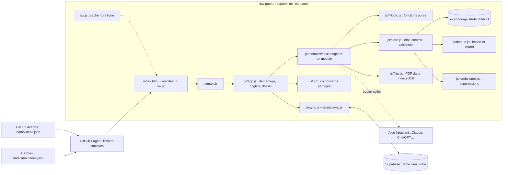
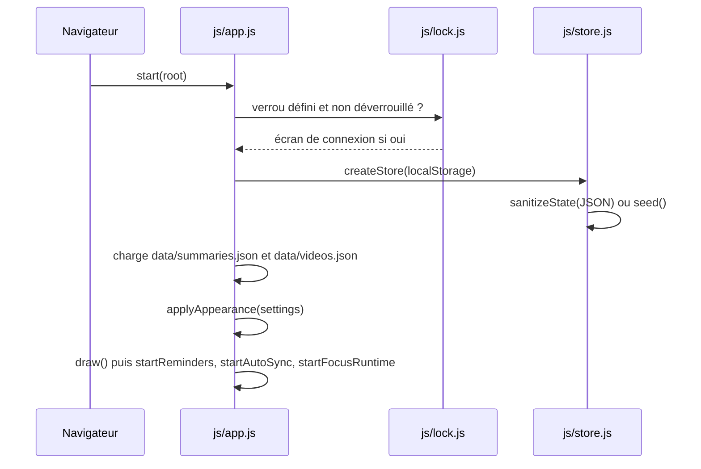
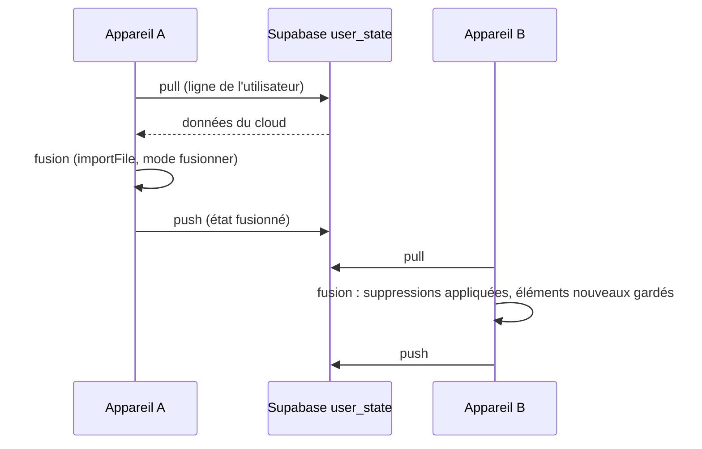

# Architecture de Student Hub

Vue d'ensemble du projet : comment les morceaux s'emboîtent, où vivent les données, et où se trouve chaque fichier. Pour le détail d'une fonctionnalité, voir [les fiches](features/README.md) ; pour le vocabulaire, le [glossaire](GLOSSAIRE.md).

## 1. Vue d'ensemble

Student Hub est une **application web d'une seule page**, écrite en HTML, CSS et JavaScript (modules ES), **sans framework, sans étape de construction et sans dépendance à l'exécution**. Elle tourne dans le navigateur, garde ses données sur l'appareil (`localStorage`, IndexedDB) et peut, en option, les synchroniser avec un compte Supabase. Elle est publiée telle quelle sur GitHub Pages.



Trois idées structurent tout le code :

1. **Un onglet = un module** (`js/modules/<nom>.js`) qui exporte `render(ctx) → Element`. Ajouter un onglet = un module + une ligne dans `TABS` de `js/app.js`.
2. **La logique est séparée de l'interface** : les règles métier sont des fonctions pures dans `js/*-logic.js` (testables sans navigateur) ; l'interface (`modules/`, `ui/`) ne fait que les appeler et dessiner.
3. **Une seule source de vérité** : tout l'état est un objet JSON validé par `sanitizeState` (`js/store.js`) et modifié uniquement par `store.commit(...)`.

## 2. Flux de données principaux

### 2.1 Démarrage



```text
FONCTION start(racine)
  SI un verrou existe ET la session n'est pas déverrouillée
    AFFICHER l'écran de verrou ; ATTENDRE le déverrouillage (ou « mot de passe oublié » : effacer verrou ET données)
  store ← createStore(localStorage)          // état validé ou données de départ
  data  ← { summaries, videos } lus dans data/*.json (valeur par défaut si absent)
  ctx   ← { store, data, storage, rerender, lockControls }
  appliquer thème, taille du texte, premier jour de la semaine
  store.subscribe(draw) ; écouter « hashchange »
  draw() ; démarrer rappels, synchro automatique, minuteur Focus
```

### 2.2 Modifier une donnée

```text
FONCTION store.commit(mutation)
  avant ← identifiants de chaque collection suivie
  mutation(état)                  // modifie l'état en place
  recordDeletions(état, avant)    // ce qui a disparu devient un marqueur de suppression daté
  sauvegarder l'état dans localStorage
  PREVENIR les abonnés → app.draw() redessine l'onglet courant
```

Règle à retenir : **ne jamais modifier l'état hors d'un `commit`**, et **poser l'état de la vue avant le `commit`** (c'est lui qui redessine).

### 2.3 Importer / exporter

```text
EXPORT  : état → { app, kind: 'all' | 'section', version, exportedAt, data } (JSON), par onglet (SECTIONS) ou complet
IMPORT  : fichier → parseImport (refuse un autre onglet) → applyImport
            mode « fusionner » : listes fusionnées par id, XP = maximum, réglages locaux conservés, marqueurs appliqués
            mode « remplacer » : les clés présentes remplacent l'état
          → sanitizeState (tout ce qui entre est revalidé et borné)
```

### 2.4 Synchronisation (facultative)



### 2.5 Hors ligne

Le service worker (`sw.js`, **généré** par `scripts/build-sw.mjs`) met en cache les fichiers de l'app à l'installation. Ensuite : fichiers de l'app **cache d'abord** ; `data/*.json` **réseau d'abord** (cache de secours) ; origines extérieures (vignettes YouTube, Supabase) jamais interceptées.

### 2.6 IA par copier-coller

```text
APP    : construit un prompt (prompts du catalogue, sources de la leçon) → l'étudiant le COPIE
IA     : l'étudiant le colle dans Claude / ChatGPT → l'IA répond (JSON ou texte)
APP    : l'étudiant COLLE la réponse → parse + validation → cartes, couches, fiche, podcast, session_log
```

Aucune clé, aucun appel réseau vers une IA : voir [ADR-007](decisions/007-ia-par-copier-coller.md).

## 3. Stack technique et raisons

| Choix | Raison | Décision |
|---|---|---|
| HTML/CSS/JS, modules ES, aucun framework ni build | lisible, publiable sur GitHub Pages tel quel, aucune chaîne d'outils à maintenir, travail possible depuis un téléphone | [ADR-001](decisions/001-pas-de-framework.md) |
| `localStorage` pour l'état, IndexedDB pour les PDF | pas de serveur ; les PDF (droits d'auteur) ne quittent jamais l'appareil | [ADR-002](decisions/002-aucun-token-github-dans-le-navigateur.md), [ADR-003](decisions/003-pdf-par-appareil.md) |
| CSP stricte, aucun `innerHTML` | une faille d'injection ne peut pas exécuter de code ; la CSP n'autorise que `self` (plus `*.supabase.co` pour la synchro) | [ADR-004](decisions/004-csp-stricte-sans-innerhtml.md) |
| pdf.js copié dans `vendor/` | lecteur PDF sans CDN, utilisable hors ligne | [ADR-005](decisions/005-pdfjs-dans-vendor.md) |
| Verrou PBKDF2 local | simple écran de connexion, sans prétendre chiffrer | [ADR-006](decisions/006-verrou-local-sans-chiffrement.md) |
| IA par copier-coller | aucune clé secrète dans un site statique | [ADR-007](decisions/007-ia-par-copier-coller.md) |
| FSRS-6 | planificateur de répétition espacée de référence (paramètres vérifiés contre py-fsrs) | [ADR-008](decisions/008-fsrs-6.md) |
| Supabase (REST + Auth par `fetch`) | synchronisation sans écrire de serveur ; protégé par une règle RLS | [ADR-009](decisions/009-synchronisation-supabase.md), [ADR-010](decisions/010-fusion-par-identifiant-et-marqueurs.md) |
| Service worker généré + test de péremption | hors ligne fiable : la liste des fichiers ne peut pas dériver du dépôt | [ADR-011](decisions/011-service-worker-genere.md) |
| Tests `node:test` + jsdom, e2e Playwright | logique testée sans navigateur, comportements réels vérifiés dans Chromium | voir [CONTRIBUTING](CONTRIBUTING.md) |

Chaque décision est détaillée dans [`docs/decisions/`](decisions/README.md).

## 4. Modèle de données

L'état complet est un objet unique stocké sous la clé `localStorage` `studenthub:v1`.

| Clé d'état | Contenu | Section d'export (onglet) | Propriétaire |
|---|---|---|---|
| `version` | version du format | (toutes) | `js/store.js` |
| `courses`, `todos`, `projects` | cours, to-dos (avec `slots` : plages de travail ; `parentId`, `blockedBy`, `effort`, `doneAt`, `projectId`), projets | `workspace` | `js/modules/workspace.js`, `js/modules/projects.js` |
| `calendars`, `events`, `calPrefs` | agendas colorés, événements (`endDate`, `exceptions`), préférences d'affichage | `calendar` | `js/modules/calendar.js` |
| `focusTags`, `sessions`, `focusPlans`, `focusRun` | tags, sessions terminées, sessions planifiées, session en cours | `focus` (sauf `focusRun`) | `js/modules/focus.js` |
| `decks`, `cards`, `gaps`, `exams`, `revDays`, `tutorLogs` | leçons, cartes, blocages, examens, jours de révision, bilans du tuteur | `revision` | `js/modules/revision.js` |
| `goals`, `tips`, `tipsSeeded`, `guideVersion` | objectifs (mode `time`, `manual` ou `auto`, avec `links`), conseils (dont le guide), version du guide | `goals` | `js/modules/goals.js` |
| `settings`, `xp`, `tombstones` | réglages, XP, marqueurs de suppression | `settings` | `js/modules/settings.js` |
| `library` | catalogue des livres (sans les fichiers) | `library` | `js/modules/library.js` |
| `localSummaries`, `read` | résumés importés à la main, identifiants lus | `messages` | `js/modules/messages.js` |
| `localVideos` | vidéos importées à la main | `videos` | `js/modules/videos.js` |
| `notes` | morceaux de notes | `notes` | `js/modules/notes.js` |
| `links` | liens utiles | `links` | `js/modules/links.js` |

Autres stockages :

| Clé / base | Où | Contenu |
|---|---|---|
| `studenthub:lock` | `localStorage` | empreinte du verrou (jamais exportée) |
| `studenthub:unlocked` | `sessionStorage` | session déverrouillée |
| `studenthub:sync` | `localStorage` | adresse du projet Supabase, clé anon, session, dernière synchro (jamais exportée) |
| `studenthub-files` | IndexedDB (`pdf`, `cover`) | fichiers PDF et couvertures, **par appareil** |

Données externes lues, jamais écrites par l'app : `data/summaries.json` (Hermes), `data/videos.json` (Action GitHub), `data/channels.json` (liste des chaînes).

## 5. Arborescence commentée

```
index.html                 point d'entrée ; CSP ; liens manifeste et icônes
manifest.webmanifest       application installable
sw.js                      service worker (GÉNÉRÉ : npm run build:sw)
package.json               scripts npm (test, build:tutor, build:sw)
README.md                  présentation et lancement
css/
  base.css                 variables (thème clair/sombre), mise en page, taille du texte
  components.css           styles des composants et des onglets
js/
  main.js                  entrée : start(), enregistrement du service worker
  app.js                   TABS, start(), draw(), navigation par hash
  constants.js             clés de stockage, listes (statuts, répétitions, rappels)
  dom.js                   h() (création de DOM sans innerHTML), field, select, empty, dates
  store.js                 état : seed, validation (sanitize*), commit, import/export
  data-io.js               SECTIONS, export, import, fusion
  tombstones.js            marqueurs de suppression
  sync.js                  client Supabase, scénarios de synchro
  autosync.js              synchronisation automatique
  pwa.js                   service worker, invite d'installation
  appearance.js            thème, taille du texte, premier jour de la semaine
  settings-logic.js        modèle des réglages et des widgets
  lock.js                  verrou PBKDF2 (logique)
  reminders.js             rappels d'événements, toasts
  search.js                recherche globale (barre de Home)
  files.js                 PDF et couvertures dans IndexedDB
  pdfdoc.js                pont vers pdf.js (chargé à la demande)
  library-logic.js         catalogue : tri, regroupement, récents
  kanban.js                regroupement des to-dos par statut (colonnes)
  tasks-logic.js           sous-tâches, progression, règles de statut
  deps-logic.js            dépendances : blocage, boucles, tâches prêtes, ordre conseillé
  reports-logic.js         agrégats des rapports : statuts, retards, charge de travail
  calendar-logic.js        dates, récurrence, occurrences, éléments d'un jour, mise en colonnes
  ics.js                   export et import .ics
  work-logic.js            plages de travail, sessions Focus planifiées
  focus-logic.js           sessions, arbre, statistiques
  focus-runtime.js         chronomètre qui survit au changement d'onglet
  fsrs.js                  algorithme FSRS-6
  revision-logic.js        cartes, leçons, examens, prompts
  planning.js              planning d'examen, éléments d'Agenda
  study-logic.js           fiches, podcast, couches (prompts et lecture des réponses)
  tutor-logic.js           contexte du tuteur, lecture du session_log
  tutor-prompt.js          prompt du tuteur (GÉNÉRÉ depuis docs/fds-tutor.md)
  goals-logic.js           objectifs, guide d'utilisation (conseils)
  xp-logic.js              XP et niveaux
  modules/                 un onglet par fichier
    home.js workspace.js calendar.js focus.js revision.js library.js messages.js
    videos.js notes.js links.js goals.js settings.js
    settings-ui.js         sections de réglages « simples »
    projects.js            vue Projets de Workspace
    learn-ui.js            Apprendre : couches, fiche, podcast
    tutor-ui.js            sous-onglet Tuteur
  ui/                      composants partagés
    dialog.js              feuilles modales (openSheet)
    context-menu.js        menu contextuel
    widgets.js             widgets, barre de bas d'onglet, personnalisation
    data-panel.js          panneaux d'import/export
    todo-dialog.js         fiche d'une tâche
    todo-actions.js        statut, suppression, sous-tâche (partagés par plusieurs onglets)
    report-widgets.js      rapports de Workspace et widgets en retard, charge, prêtes
    slot-planner.js        planifier le travail d'une tâche
    focus-plan.js          planifier une session Focus
    lock-screen.js         écran de verrou
    reader.js              lecteur de PDF
    charts.js              graphiques et arbres SVG (Focus), sans innerHTML
    download.js            téléchargement de fichiers
assets/logo.svg            logo
icons/                     icônes de l'application installable
data/                      données lues par l'app (Hermes, Actions)
scripts/
  build-sw.mjs             génère sw.js
  build-tutor-prompt.mjs   génère js/tutor-prompt.js
  fetch-videos.mjs         lit les flux YouTube (Action GitHub)
  supabase.sql             table de synchronisation
.github/workflows/videos.yml   met à jour data/videos.json chaque jour
vendor/pdfjs/              pdf.js copié (aucun CDN)
tests/                     tests node (*.test.js), e2e Playwright (e2e/*.py), helpers
docs/                      cette documentation
```

## 6. Contraintes transverses

- **CSP stricte** (`index.html`) : `script-src 'self'`, `style-src 'self'` → pas de script ni de style en ligne ; positions dynamiques posées par `element.style.x = …` (autorisé), jamais par attribut `style`.
- **Aucun `innerHTML`** : tout le DOM passe par `h()` (`js/dom.js`). Les textes saisis par l'utilisateur ne sont jamais interprétés comme du HTML.
- **Validation à l'entrée** : tout ce qui vient de `localStorage`, d'un import, du cloud, d'un collage d'IA ou d'un fichier `.ics` passe par un validateur qui borne les longueurs et écarte l'invalide.
- **Mobile d'abord** : interactions tactiles (appui long, boutons ⋯), mise en page pour un écran de téléphone.
- **Réponse honnête sur les limites** : les rappels ne sonnent que si l'app est ouverte ([ADR-017](decisions/017-rappels-application-ouverte.md)) ; la synchronisation n'a jamais d'effet sans compte.
