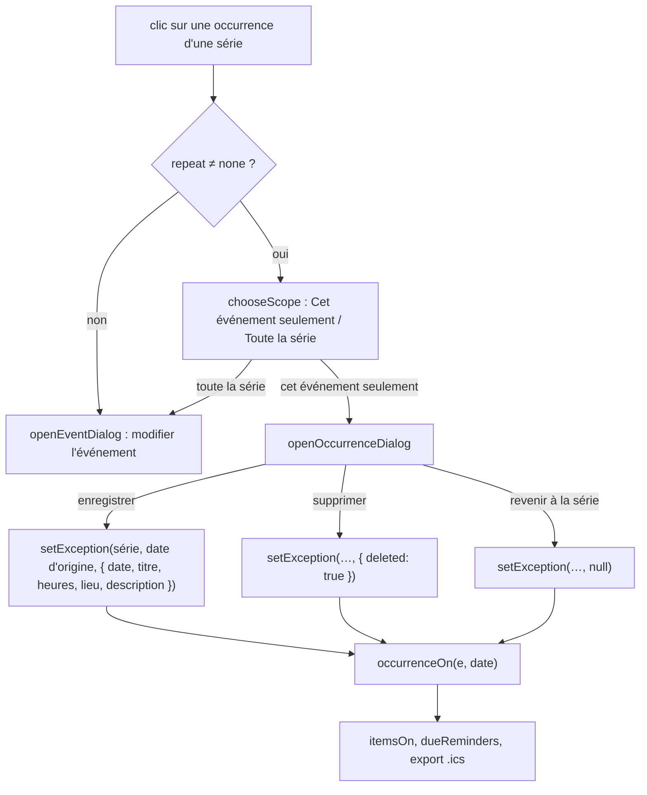

# Agenda : événements sur plusieurs jours et occurrences d'une série

**État :** Implémentée · **Vérifiée contre le code :** 2026-10-26

Retour à l'[index des fiches](README.md) · [ARCHITECTURE](../ARCHITECTURE.md) · [GLOSSAIRE](../GLOSSAIRE.md) · Décisions : [ADR-015](../decisions/015-exceptions-de-serie-par-date-d-origine.md), [ADR-016](../decisions/016-evenements-longs-par-enddate.md)

## 1. Objectif

Deux besoins de l'Agenda : afficher un événement qui **dure plusieurs jours** (un stage, un voyage), et pouvoir **changer ou supprimer une seule occurrence** d'un événement répété (le cours du 2 novembre est annulé, celui du 9 est déplacé) sans toucher au reste de la série.

## 2. Périmètre

**Fait** : date de fin (`endDate`) ; affichage jour par jour ; séries d'événements longs ; exceptions par occurrence (supprimée, déplacée, modifiée) ; choix « Cet événement seulement » ou « Toute la série » ; « Revenir à la série » ; prise en compte par les rappels, l'export et l'import `.ics`.

**Ne fait pas** : changer l'heure, le titre ou le lieu de **tous les événements suivants** (« cette occurrence et les suivantes ») ; changer par exception la journée entière, l'agenda, la répétition ou le rappel d'une occurrence ; gérer les répétitions complexes ([agenda-vues-et-recurrence](agenda-vues-et-recurrence.md)).

## 3. Vue d'ensemble technique



## 4. Composants et fichiers concernés

| Chemin | Rôle |
|---|---|
| `js/calendar-logic.js` | `spanOf`, `occurrenceOn`, `itemsOn` (partie événements) |
| `js/modules/calendar.js` | `chooseScope`, `openOccurrenceDialog`, `setException`, `moveEvent`, champ « Se termine le » de `openEventDialog` |
| `js/store.js` | `sanitizeEnd` (fin valide), `sanitizeExceptions` (exceptions valides) |
| `js/ics.js` | `EXDATE`, `RECURRENCE-ID` ([agenda-ics](agenda-ics.md)) |
| `tests/agenda.test.js` | 8 tests |

## 5. Entrées / sorties

**Événement long** : `endDate` au format `AAAA-MM-JJ`, strictement **après** `date`, au plus 366 jours plus tard ; sinon la fin est vidée à la lecture. `spanOf(e)` donne le nombre de jours après le premier (0 = un seul jour).

**Exceptions** : un objet `exceptions` par événement, **clé = date d'origine** de l'occurrence dans la série.

```json
"exceptions": {
  "2026-11-02": { "deleted": true },
  "2026-11-09": { "date": "2026-11-10", "title": "Déplacé", "start": "14:00", "end": "15:00" },
  "2026-11-16": { "title": "Renommé" }
}
```

| Champ d'une exception | Sens |
|---|---|
| `deleted: true` | cette occurrence n'existe pas |
| `date` | nouveau jour (occurrence déplacée) ; absent = même jour |
| `title`, `location`, `description` | remplacent ceux de la série pour cette occurrence |
| `start`, `end` | nouvelles heures (la fin n'est jamais avant le début) |

Au plus 400 exceptions par événement ; une clé qui n'est pas une date est ignorée.

**Affichage d'un événement long** (test : événement du 26 au 28 octobre 2026, de 09:00 à 10:00) :

| Jour | Affichage |
|---|---|
| 25 octobre | rien |
| 26 octobre (premier) | `09:00` – `23:59` |
| 27 octobre (milieu) | journée entière |
| 28 octobre (dernier) | `00:00` – `10:00` |
| 29 octobre | rien |

Un événement long **en journée entière** s'affiche en journée entière tous les jours.

## 6. Fonctionnement détaillé

```text
FONCTION spanOf(e)  : SI e.endDate > e.date : nombre de jours entre les deux ; SINON 0

FONCTION occurrenceOn(e, d)                  // l'occurrence qui COMMENCE le jour d, ou rien
  POUR CHAQUE exception (origine → ex) de e
    SI ex.date = d ET origine ≠ d ET ex n'est pas « deleted » ET l'événement tombe bien à la date d'origine :
        RETOURNER { eff: e + ex, origin: origine }                              // une occurrence déplacée atterrit ici
  SI l'événement ne tombe pas le jour d : RETOURNER rien
  ex ← e.exceptions[d]
  SI ex.deleted OU (ex.date existe ET ≠ d) : RETOURNER rien                      // supprimée, ou déplacée ailleurs
  RETOURNER { eff: e + ex (ou e), origin: d }

FONCTION itemsOn (partie événements), pour un jour `date`
  L ← spanOf(e)
  POUR k DE 0 À L
    occ ← occurrenceOn(e, date − k jours)                                        // une occurrence commencée k jours avant couvre `date`
    SI occ :
      premier ← (k = 0) ; dernier ← (k = L ET L > 0)
      journéeEntière ← occ.eff.allDay OU (L > 0 ET PAS premier ET PAS dernier)
      début ← journéeEntière ? vide : premier ? occ.eff.start : '00:00'
      fin   ← journéeEntière ? vide : dernier ? occ.eff.end   : (premier ET L > 0) ? '23:59' : occ.eff.end
      ajouter l'élément { …, origin: occ.origin, k, span: L }

FONCTION setException(store, événement, origine, valeur)
  commit : copie de exceptions ; SI valeur : exceptions[origine] ← valeur ; SINON : supprimer exceptions[origine]
```

**Interface** :

```text
Clic sur une occurrence : SI série : feuille « Événement répété » avec deux boutons ; SINON fenêtre normale
« Cet événement seulement » : feuille « Cet événement seulement · <date d'origine> »
    champs : Titre, Date, Début, Fin (sauf journée entière), Lieu, Description
    onSubmit : « Le titre est obligatoire. » | « La date est obligatoire. » | « La fin doit être après le début. »
               sinon setException(origine, { date, titre, lieu, description, début, fin })
    boutons : « Supprimer cet événement seulement » (confirmation) ; « Revenir à la série » (seulement s'il existe déjà une exception)
Menu d'un événement d'une série : « Supprimer cet événement seulement » (confirmation) et « Supprimer la série »
Glisser (vue Semaine) : déplace une seule occurrence (voir agenda-glisser), message « Seul cet événement a été déplacé : la série ne change pas. »
```

## 7. Dépendances

- **Internes** : `js/store.js` (validation), `js/ics.js`, `dueReminders` ([socle-rappels](socle-rappels.md)), `store.commit`, `showToast`.
- **Externe** : aucun. **Variable d'environnement** : aucune.
- **Clés** : `endDate` et `exceptions` font partie de chaque événement de `state.events` (`studenthub:v1`) ; la fusion de synchronisation remplace l'événement entier, exceptions comprises ([socle-synchronisation](socle-synchronisation.md)).

## 8. Cas limites et erreurs

| Situation | Comportement |
|---|---|
| `endDate` avant ou égale à `date` | fin vidée à la lecture (événement d'un jour) |
| événement de plus de 366 jours | fin vidée à la lecture ; refusé dans la fenêtre (« Un événement dure 366 jours au plus. ») |
| série d'événements longs | chaque occurrence couvre ses propres jours |
| occurrence déplacée sur un jour qui a déjà une occurrence | les deux s'affichent |
| occurrence déplacée hors des bornes de la série (après « jusqu'au ») | visible : la règle porte sur la date d'origine |
| exception sur une date où la série ne tombe pas | ignorée à l'affichage |
| occurrence supprimée | pas de rappel ; exportée comme `EXDATE` |
| occurrence déplacée | rappel à sa nouvelle heure ; exportée comme événement à part avec `RECURRENCE-ID` |
| « Revenir à la série » | l'exception est effacée |
| suppression de la série | les exceptions disparaissent avec elle |
| import avec exceptions invalides | écartées (dates absentes ou impossibles) |

## 9. Tests

- Fichier : `tests/agenda.test.js` : événement du 26 au 28 octobre (premier jour jusqu'à minuit, milieu en journée, dernier jour depuis minuit, journée entière) ; série hebdomadaire de deux jours ; exceptions (supprimée le 2 novembre, déplacée du 9 au 10, renommée le 16, reste de la série intact, origine identifiable) ; rappels (supprimée silencieuse, déplacée à sa nouvelle heure) ; import (fin et exceptions invalides écartées) ; choix « cet événement seulement » ou « toute la série » ; menu « supprimer cet événement seulement » ou « la série » ; formulaire avec date de fin refusée avant le début.
- Lancer : `npm test`.
- Ne couvre pas : « Revenir à la série », la fenêtre de l'occurrence (validation, enregistrement), la limite de 400 exceptions, un événement long déplacé par glisser (non proposé), l'effet d'un changement de la date de la série sur ses exceptions.

## 10. Pièges et dette technique

- **Une exception « épingle » les champs** : en enregistrant une occurrence, l'application stocke titre, lieu, description et heures, même inchangés. Un changement ultérieur de la série (nouvelle salle, nouvelle heure) **ne s'applique plus** à cette occurrence (déduit du code, non testé).
- **Exceptions orphelines** : elles sont rangées par date d'origine ; si la série change de date ou de rythme, certaines peuvent ne plus correspondre à rien et rester sans effet (aucun nettoyage).
- **Une occurrence déplacée garde la durée en jours de la série** (`spanOf` se calcule sur l'événement de base).
- **Pas de « cet événement et les suivants »** : changer l'heure à partir d'une date impose de couper la série (via « jusqu'au ») et d'en créer une nouvelle à la main.
- **Coût du calcul** : pour chaque jour affiché, un événement de `L` jours est évalué `L + 1` fois ; un événement de 366 jours alourdit la vue Année (déduit du code, non mesuré).
- **Les exceptions sont remplacées avec l'événement** : à la fusion de synchronisation, la version du cloud d'un événement remplace entièrement la version locale, exceptions comprises.

## 11. Pour modifier ou étendre

1. **Autoriser un champ de plus dans une exception** : l'ajouter à `sanitizeExceptions` (`js/store.js`), à la fenêtre `openOccurrenceDialog`, à `occurrenceOn` (il est déjà fusionné par `{ ...e, ...ex }`), à l'export `.ics`, et ajouter un test.
2. **« Cet événement et les suivants »** : fermer la série actuelle (`until` = veille) et créer un nouvel événement ; nouvelle décision à écrire d'abord.
3. **Nettoyer les exceptions orphelines** : les filtrer dans `sanitizeExceptions` à l'aide de `occursOn`.
4. **Ne pas casser** : la date d'origine comme clé ([ADR-015](../decisions/015-exceptions-de-serie-par-date-d-origine.md)) ; la limite de 366 jours ([ADR-016](../decisions/016-evenements-longs-par-enddate.md)) ; l'ordre des tests de `occurrenceOn` (déplacée d'abord) ; l'identification de l'origine (`origin`) dans les éléments.
5. Relancer `npm run build:sw` puis `npm test`.
