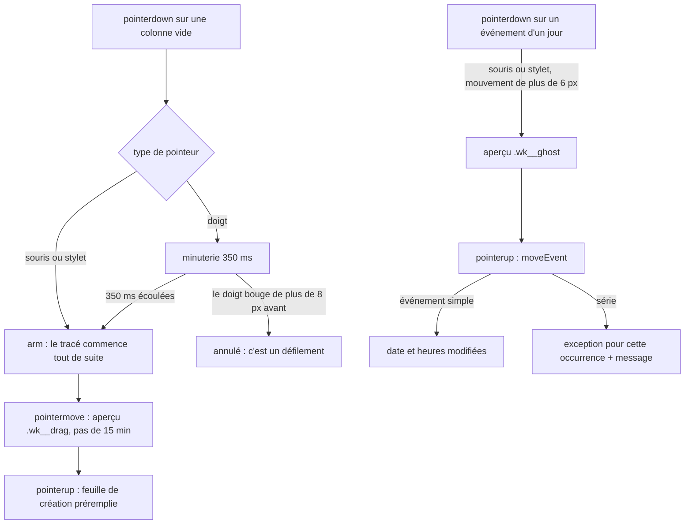

# Agenda : créer et déplacer par glisser (vue Semaine)

**État :** Implémentée · **Vérifiée contre le code :** 2026-10-26

Retour à l'[index des fiches](README.md) · [ARCHITECTURE](../ARCHITECTURE.md) · [GLOSSAIRE](../GLOSSAIRE.md)

## 1. Objectif

Dans la vue **Semaine**, créer un événement en traçant son créneau avec le doigt, la souris ou le stylet (même sur plusieurs jours), et déplacer un événement existant en le faisant glisser, par pas de 15 minutes. Un simple clic dans une colonne crée toujours un événement d'une durée par défaut.

## 2. Périmètre

**Fait** : tracé d'un créneau (souris, stylet, doigt après appui long) ; tracé sur plusieurs colonnes (événement sur plusieurs jours) ; aperçu pendant le geste ; clic simple dans une colonne ; déplacement d'un événement d'un seul jour à la souris ou au stylet ; déplacement d'une seule occurrence pour une série.

**Ne fait pas** : redimensionner un événement ; déplacer au **doigt** (voir section 10, tâche T19) ; déplacer un événement sur plusieurs jours, en journée entière, un to-do, un examen ou une plage de travail ; glisser dans les vues Mois ou Année (la vue Jour n'existe pas) ; annuler un déplacement (hors édition manuelle) ; offrir une alternative au clavier pour le geste lui-même (le bouton « + Ajouter » et la feuille de modification restent disponibles).

## 3. Vue d'ensemble technique



## 4. Composants et fichiers concernés

| Chemin | Rôle |
|---|---|
| module de l'Agenda (fiche [agenda-vues-et-recurrence](agenda-vues-et-recurrence.md)) | `weekView` (gestionnaires `pointerdown`, `pointermove`, `pointerup`, `pointercancel`, `click`), `moveEvent`, `setException`, constantes `HOUR_PX = 48` et `SLOT = 15` |
| `css/components.css` | `.wk__col` (24 h = 1152 px), `.wk__drag` (aperçu de création), `.wk__ghost` (aperçu de déplacement) |
| `tests/agenda.test.js` | test « vue semaine : créer par glisser… » |

Les vues sont décrites dans [agenda-vues-et-recurrence](agenda-vues-et-recurrence.md), les séries et exceptions dans [agenda-evenements-longs-et-occurrences](agenda-evenements-longs-et-occurrences.md).

## 5. Entrées / sorties

**Constantes** : 48 pixels par heure ; pas de 15 minutes ; appui long de 350 ms ; seuils de mouvement de 8 pixels (création, avant armement) et de 6 pixels (déplacement).

| Geste | Résultat |
|---|---|
| clic simple dans une colonne vide | feuille de création : début à l'heure pleine cliquée, fin = début + durée par défaut (réglage `agenda.duration`, 60 minutes par défaut ; 23:59 au plus) |
| tracé sur une colonne | feuille de création : début et fin au quart d'heure ; la fin est le **bas** du dernier quart d'heure touché |
| tracé sur plusieurs colonnes | feuille de création avec **date de début**, **date de fin** (`endDate`) et heures ; événement sur plusieurs jours |
| glisser un événement d'un jour (souris, stylet) | `moveEvent(ctx, item, date, début, fin)` ; la durée est conservée |

Exemple tiré du test (colonne du 10 novembre 2026) : appui à 96 px (2 h), déplacement jusqu'à 200 px (4 h 10, donc le créneau de 4 h), relâchement : la feuille propose `02:00` et `04:15`. Un simple clic à 480 px propose `10:00` et `11:00`.

## 6. Fonctionnement détaillé

```text
FONCTION minuteAtY(y)
  RETOURNER ((y − haut de la première colonne) / 48 px × 60), arrondi par le bas au multiple de 15, borné entre 0 et 24 h − 15 min

COLONNE : pointerdown (sur la colonne elle-même, pas sur un événement ; souris : bouton gauche seulement)
  drag ← { colonne de départ, minute a, colonne d'arrivée, minute b, armé: faux, position }
  SI souris OU stylet : armer tout de suite     SINON : minuterie de 350 ms pour armer
  armer : drag.armé ← vrai ; capturer le pointeur ; afficher l'aperçu

COLONNE : pointermove
  SI pas armé : SI le déplacement dépasse 8 px : annuler la minuterie ; drag ← rien ; RETOURNER     // le doigt défile
  colonne d'arrivée ← colonne sous le doigt ; b ← minuteAtY ; redessiner l'aperçu « .wk__drag » colonne par colonne

COLONNE : pointerup ou pointercancel
  effacer l'aperçu ; SI pas armé OU pointercancel : RETOURNER
  SI souris ET même minute ET même colonne : RETOURNER                  // simple clic : le gestionnaire de clic crée l'événement
  ignorer le prochain clic pendant 60 ms (swallowClick)                 // sinon un second formulaire s'ouvrirait
  [p1, p2] ← les deux points dans l'ordre chronologique                 // on peut tracer vers le haut ou vers la gauche
  fin ← p2.minute + 15 ; SI fin ≥ 24 h : « 23:59 »
  SI même colonne : ouvrir la création { date, début: p1, fin }
  SINON : ouvrir la création { date: jour de p1, début: p1, endDate: jour de p2, fin }

COLONNE : touchmove (non passif)
  SI le tracé est armé : empêcher le défilement de la page

ÉVÉNEMENT D'UN JOUR (kind = 'event', span = 0, pas en journée entière) : pointerdown
  SI doigt OU bouton non gauche : RETOURNER                             // le doigt ne déplace pas (T19)
  moving ← { événement, position, début d'origine } ; capturer le pointeur
ÉVÉNEMENT : pointermove
  SI moins de 6 px de déplacement : RETOURNER
  colonne ← colonne sous le curseur
  minute ← début d'origine + (déplacement vertical converti en minutes, arrondi à 15), bornée entre 0 et 24 h − durée
  afficher l'aperçu « .wk__ghost » avec le titre
ÉVÉNEMENT : pointerup
  SI le mouvement n'a pas démarré OU pointercancel : RETOURNER
  ignorer le clic qui suit ; moveEvent(événement, jour de la colonne, début, début + durée)

FONCTION moveEvent(ctx, item, date, début, fin)
  SI fin ≤ début OU (même date ET même début) : RETOURNER
  SI l'événement ne se répète pas : store.commit : date, début et fin modifiés
  SINON : setException(série, date d'origine de l'occurrence, { ...exception existante, date, début, fin }) ;
          message « Seul cet événement a été déplacé : la série ne change pas. »
```

Dans la vue Semaine, un clic sur un événement l'ouvre (`openItem`) sauf s'il vient de terminer un glisser (le clic est alors ignoré).

## 7. Dépendances

- **Internes** : `openEventDialog` (feuille de création et de modification), `itemsOn`, `layoutDay`, `weekDays`, `minutesOf`, `store.commit`, `showToast` ([socle-rappels](socle-rappels.md)), `attachMenu` ([socle-menu-contextuel](socle-menu-contextuel.md)).
- **Navigateur** : événements pointeur (`pointerdown`, `pointermove`, `pointerup`, `pointercancel`), `setPointerCapture`, `getBoundingClientRect`, événement `touchmove` non passif.
- **Réglage** : `settings.agenda.duration` pour le clic simple ([socle-parametres](socle-parametres.md)).
- **Externe** : aucun. **Variable d'environnement** : aucune. **Clé** : les événements sont dans `state.events` ; les exceptions de série dans `events[].exceptions`.

## 8. Cas limites et erreurs

| Situation | Comportement |
|---|---|
| doigt qui bouge de plus de 8 px avant 350 ms | pas de tracé : la page défile |
| doigt maintenu 350 ms puis glissé | tracé ; la page ne défile plus |
| tracé vers le haut ou vers la gauche | points remis dans l'ordre : début avant fin |
| tracé jusqu'en bas de la colonne | fin à `23:59` |
| clic simple à la souris sans mouvement | feuille d'un événement d'une durée par défaut, une seule fois (le clic suivant n'est pas ignoré) |
| clic sur un événement existant | ouvre l'événement, ne crée rien (le tracé ne démarre que sur la colonne elle-même) |
| déplacement vers la même place | rien ne change |
| déplacer une occurrence d'une série | seule cette occurrence change ([ADR-015](../decisions/015-exceptions-de-serie-par-date-d-origine.md)) ; message d'explication |
| événement sur plusieurs jours, journée entière, to-do, examen, plage de travail | non déplaçable par glisser |
| événement dont l'heure de fin passerait minuit | la position est bornée pour que l'événement finisse à 24 h au plus |
| `pointercancel` (le navigateur reprend le geste) | tout est annulé sans effet |

## 9. Tests

- Fichier : `tests/agenda.test.js`, test « vue semaine : créer par glisser (pas de 15 min), un simple clic crée toujours une heure » : appui à 2 h, aperçu `.wk__drag` visible, relâchement à 4 h 10 donnant `02:00` et `04:15`, aperçu effacé ; simple clic à 10 h donnant `10:00` et `11:00` ; un doigt qui défile avant l'appui long ne trace rien et n'ouvre aucune feuille.
- Lancer : `npm test`.
- Ne couvre pas : **le déplacement d'un événement par glisser** (`moveEvent`, aperçu `.wk__ghost`), le tracé sur plusieurs colonnes, le tracé validé après l'appui long de 350 ms, le tracé jusqu'en bas (23:59), le blocage du défilement, le message de série. Les exceptions de série sont testées séparément (`tests/agenda.test.js`, « une seule occurrence : supprimée, déplacée, modifiée »).

## 10. Pièges et dette technique

- **Pas de déplacement au doigt** : sur téléphone, l'étudiant ne peut pas glisser un événement existant (tâche T19). Il passe par la feuille de modification.
- **Pas de clavier** pour le geste : l'alternative est « + Ajouter » ou « Modifier » ; les colonnes ne sont pas focalisables au clavier.
- **Déplacement non testé** : seule la création par glisser a un test ; le déplacement n'est couvert que par la logique des exceptions.
- **Le clic qui suit un geste est ignoré pendant 60 ms** (`swallowClick`) : si le navigateur n'envoie pas de clic, l'état se libère tout seul, mais un vrai clic très rapide juste après un glisser serait perdu.
- **La position dépend de la première colonne** : `minuteAtY` mesure tout par rapport à la première colonne ; un changement de mise en page (colonnes décalées en hauteur) fausserait les minutes.
- **Hauteur fixe** : 24 heures = 1152 px (48 px par heure) ; changer `HOUR_PX` demande de changer aussi la feuille de style.
- **Aucune annulation** : un glisser de déplacement modifie tout de suite l'événement ; il n'y a pas de « annuler ».

## 11. Pour modifier ou étendre

1. **Déplacer au doigt (T19)** : ajouter un appui long (comme pour la création) avant d'armer le déplacement, bloquer le défilement avec `touchmove` non passif, et tester les trois types de pointeur.
2. **Redimensionner** : ajouter une poignée en bas de l'événement ; réutiliser `minuteAtY` et `moveEvent` avec une fin différente.
3. **Changer le pas** : modifier `SLOT` ; les tests (15 minutes) sont à ajuster.
4. **Ne pas casser** : le tracé qui ne démarre que sur la colonne vide ; l'armement différé pour le doigt (sinon plus de défilement) ; l'exception par occurrence pour les séries ; la tolérance de `pointercancel`.
5. Relancer `npm run build:sw` puis `npm test`.
