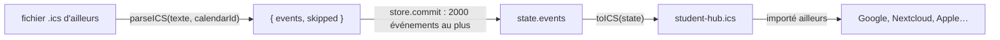

# Agenda : import et export iCalendar (.ics)

**État :** Implémentée · **Vérifiée contre le code :** 2026-10-26

Retour à l'[index des fiches](README.md) · [ARCHITECTURE](../ARCHITECTURE.md) · [GLOSSAIRE](../GLOSSAIRE.md)

## 1. Objectif

Échanger l'agenda avec d'autres outils (Google Agenda, Nextcloud, Exchange, Apple Calendrier) **sans compte ni connexion** : l'étudiant exporte un fichier `.ics` ou en importe un. Il n'existe pas de synchronisation en direct avec ces services.

## 2. Périmètre

**Fait** : export de tous les événements ; import d'un fichier `.ics` ; titre, lieu, description ; heures ou journée entière ; événements sur plusieurs jours ; répétition simple (jour, semaine, mois, année) avec date de fin ; occurrences supprimées ou modifiées ; rappel (alarme) ; lignes repliées ; échappement des caractères spéciaux.

**Ne fait pas** : synchroniser en continu ; lire les fuseaux horaires `TZID` (voir section 10) ; gérer les répétitions complexes (intervalle, jours précis, nombre d'occurrences) ; exporter les to-dos, les examens, les sessions Focus ou le planning de Mémorisation (seuls les événements de l'agenda sont exportés) ; éviter les doublons à l'import.

## 3. Vue d'ensemble technique



## 4. Composants et fichiers concernés

| Chemin | Rôle |
|---|---|
| `js/ics.js` | `toICS(state)`, `parseICS(texte, calendarId)` et leurs aides (`esc`, `unesc`, `fold`, `parseStamp`, `triggerMinutes`) |
| panneau « Agendas et réglages » de l'Agenda | boutons « Importer .ics » et « Exporter .ics », message d'état (`role="status"`) |
| `js/store.js` | `newEvent` (crée l'événement importé) |
| `tests/ics.test.js`, `tests/ics2.test.js` | 8 tests |

## 5. Entrées / sorties

**Export** : le fichier `student-hub.ics` (type `text/calendar`), en fins de ligne `\r\n`, lignes repliées à 74 caractères. Exemple (extrait) pour un cours hebdomadaire :

```text
BEGIN:VCALENDAR
VERSION:2.0
PRODID:-//Student Hub//FR
CALSCALE:GREGORIAN
BEGIN:VEVENT
UID:<identifiant>@studenthub
DTSTAMP:20261026T080000Z
SUMMARY:Cours\; de\, physique
DTSTART:20261019T080000
DTEND:20261019T100000
LOCATION:Amphi A
RRULE:FREQ=WEEKLY;UNTIL=20261218
BEGIN:VALARM
ACTION:DISPLAY
DESCRIPTION:Rappel
TRIGGER:-PT15M
END:VALARM
END:VEVENT
END:VCALENDAR
```

| Donnée de l'événement | Propriété `.ics` |
|---|---|
| `title`, `location`, `description` | `SUMMARY`, `LOCATION`, `DESCRIPTION` (échappés : `\\`, `\;`, `\,`, `\n`) |
| journée entière | `DTSTART;VALUE=DATE:AAAAMMJJ` et `DTEND;VALUE=DATE:` le **lendemain du dernier jour** (fin exclusive) |
| heures | `DTSTART:AAAAMMJJThhmm00` et `DTEND:` (le jour de `endDate` s'il y en a un) |
| `repeat`, `until` | `RRULE:FREQ=DAILY|WEEKLY|MONTHLY|YEARLY` et `;UNTIL=AAAAMMJJ` |
| occurrence supprimée (`exceptions[date].deleted`) | `EXDATE` |
| occurrence modifiée ou déplacée | un `VEVENT` à part avec `RECURRENCE-ID`, même `UID`, sans `RRULE` |
| `reminder` (minutes) | `VALARM` avec `TRIGGER:-PT<minutes>M` |

**Import** : `parseICS(texte, calendarId)` renvoie `{ events, skipped }`. Les événements créés reçoivent un **nouvel identifiant** et l'agenda `calendarId`.

## 6. Fonctionnement détaillé

```text
FONCTION toICS(state)
  lignes ← [BEGIN:VCALENDAR, VERSION:2.0, PRODID, CALSCALE]
  POUR CHAQUE événement e
    vevent(e, e)                                           // l'événement lui-même
    POUR CHAQUE exception de e, ni supprimée, si e se répète
      vevent(e avec les champs de l'exception, RECURRENCE-ID = origine de l'occurrence)
  ajouter END:VCALENDAR ; replier les lignes de plus de 74 caractères ; joindre par \r\n

FONCTION vevent(lignes, e, champs, recurrenceId)
  UID ← e.id + '@studenthub' ; DTSTAMP ← maintenant (UTC)
  durée ← nombre de jours entre e.date et e.endDate (0 si absent ou antérieur)
  SI journée entière : DTSTART et DTEND en dates (fin exclusive = date + durée + 1)
  SINON : DTSTART = date + heure de début ; DTEND = (date + durée) + heure de fin
  SI PAS recurrenceId : RRULE si répétition ; un EXDATE par occurrence supprimée
  SI rappel : VALARM

FONCTION parseICS(texte, calendarId)
  déplier les lignes (une ligne qui commence par espace ou tabulation continue la précédente)
  POUR CHAQUE bloc VEVENT
    SI pas de DTSTART lisible : skipped ← skipped + 1 ; PASSER
    début ← parseStamp(DTSTART) ; fin ← parseStamp(DTEND)
    SI la fin est un autre jour : endDate ← dernier jour (la veille si la fin est à minuit ou en date) ; heure de fin 23:59 si minuit
    SI heure de fin absente : début + 1 heure (23 h au plus)
    freq ← DAILY, WEEKLY, MONTHLY ou YEARLY trouvé dans RRULE, sinon aucune ; until ← UNTIL si présent
    SI INTERVAL ≥ 2 OU règle non reconnue : skipped ← skipped + 1       // l'événement est tout de même importé
    rappel ← TRIGGER négatif converti en minutes, seulement s'il vaut 0, 5, 15, 30, 60 ou 1440
    EXDATE (plusieurs possibles) → exceptions supprimées de la série
    SI RECURRENCE-ID : attendre la fin de la lecture, puis rattacher à la série du même UID (sinon importer tel quel)
  RETOURNER { events, skipped }

FONCTION parseStamp(valeur, paramètres)
  AAAAMMJJ ou AAAAMMJJThhmm[ss][Z]
  « Z » (UTC) : converti en heure locale de l'appareil ; sans « Z » : lu comme heure locale ; date seule : journée entière

Dans l'application : parseICS(texte, premier agenda) → store.commit : ajoute au plus 2000 événements → message
  « N événements importés[, M ignorés (non géré)]. » ; erreur : « Fichier illisible : rien n'a été importé. »
```

## 7. Dépendances

- **Internes** : `js/store.js` (`newEvent`), dates de la logique de l'Agenda (`ymd`, `addDays`, `daysBetween`).
- **Navigateur** : `File.text()`, `Blob`, `URL.createObjectURL`, un lien de téléchargement (`<a download>`).
- **Externe** : aucun. **Variable d'environnement** : aucune. **Clé** : les événements sont dans `state.events` (`studenthub:v1`).

## 8. Cas limites et erreurs

| Situation | Comportement |
|---|---|
| fichier vide, texte quelconque ou `BEGIN:VEVENT` seul | aucune erreur ; zéro événement |
| événement sans `DTSTART` lisible | ignoré (compté dans « ignorés ») |
| date en UTC (`…Z`, fichier Google Agenda) | convertie en heure locale de l'appareil |
| lignes repliées | dépliées avant lecture |
| `RRULE` avec `INTERVAL=2` ou règle inconnue | compté « ignoré (non géré) », **mais l'événement est importé** (série simple si le rythme est connu, sinon événement unique) |
| plusieurs `EXDATE` | tous pris en compte |
| occurrence modifiée sans série correspondante | importée comme un événement à part |
| événement d'un jour en journée entière | reste d'un jour (la fin exclusive est corrigée) |
| rappel hors des valeurs 0, 5, 15, 30, 60, 1440 ou positif | ignoré (pas de rappel) |
| plus de 2000 événements dans le fichier | 2000 sont ajoutés, mais le message en annonce davantage |
| import du même fichier deux fois | **doublons** (nouveaux identifiants) |

## 9. Tests

- Fichiers : `tests/ics.test.js` (aller-retour d'un cours avec `;` et `,` dans le titre, description sur deux lignes, répétition hebdomadaire avec fin, rappel de 15 minutes, journée entière ; fichier de type Google Agenda : heure UTC, ligne repliée, `INTERVAL=2` et événement sans date comptés « ignorés » ; fichiers vides ou invalides sans exception) ; `tests/ics2.test.js` (événement sur plusieurs jours en heures ou en journée entière ; `EXDATE` et `RECURRENCE-ID` à l'export ; aller-retour des événements longs, séries et exceptions ; fichier d'ailleurs avec plusieurs `EXDATE`, fin à minuit et occurrence sans série ; événement d'un jour reste d'un jour).
- Lancer : `npm test`.
- Ne couvre pas : l'interface (boutons, message, limite de 2000), le téléchargement réel, les fuseaux `TZID`, les `BYDAY` et `COUNT`, le pliage des lignes avec des caractères accentués.

## 10. Pièges et dette technique

- **Les fuseaux `TZID` sont ignorés** : une heure `DTSTART;TZID=Europe/Paris:20261019T080000` est lue comme heure locale de l'appareil, sans conversion (déduit du code, non testé). Seul le suffixe `Z` (UTC) est converti.
- **Répétitions simplifiées** : `INTERVAL`, `BYDAY` et `COUNT` sont ignorés. Une série « toutes les 2 semaines » devient « toutes les semaines » ; `COUNT=10` devient une série sans fin (déduit du code).
- **Tout va dans le premier agenda** : l'application importe toujours dans le premier agenda de la liste ; l'export ne distingue pas les agendas (leur nom et leur couleur ne sont pas écrits dans le fichier), donc un aller-retour regroupe tout.
- **Les agendas masqués sont exportés** : `toICS` prend tous les événements, visibles ou non.
- **Doublons à la réimportation** : l'`UID` du fichier n'est pas conservé ; chaque import crée de nouveaux événements.
- **Pliage par caractères** : les lignes sont coupées à 74 caractères, pas à 75 octets ; avec des accents, une ligne peut dépasser la limite de la norme. Les outils usuels l'acceptent.
- **Limite de 2000 non annoncée** : au-delà, le compteur affiché est plus grand que le nombre d'événements ajoutés.
- **Les alarmes** : seules six durées existent ; toute autre est perdue à l'import.

## 11. Pour modifier ou étendre

1. **Gérer `TZID`** : lire le paramètre, convertir avec `Intl.DateTimeFormat` vers l'heure locale, ajouter un test d'aller-retour avec un fuseau différent.
2. **Choisir l'agenda cible** : ajouter une liste déroulante dans le panneau d'import et passer l'identifiant choisi à `parseICS`.
3. **Éviter les doublons** : conserver l'`UID` d'origine dans l'événement et ignorer ceux déjà présents.
4. **Gérer `COUNT`, `INTERVAL`, `BYDAY`** : cela demande de nouveaux champs dans les événements ([agenda-vues-et-recurrence](agenda-vues-et-recurrence.md)) et une nouvelle décision.
5. **Ne pas casser** : l'échappement des caractères spéciaux ; la fin exclusive des journées entières ; le rattachement des `RECURRENCE-ID` à leur série ([ADR-015](../decisions/015-exceptions-de-serie-par-date-d-origine.md)) ; la tolérance aux fichiers invalides (aucune exception).
6. Relancer `npm run build:sw` puis `npm test`.
