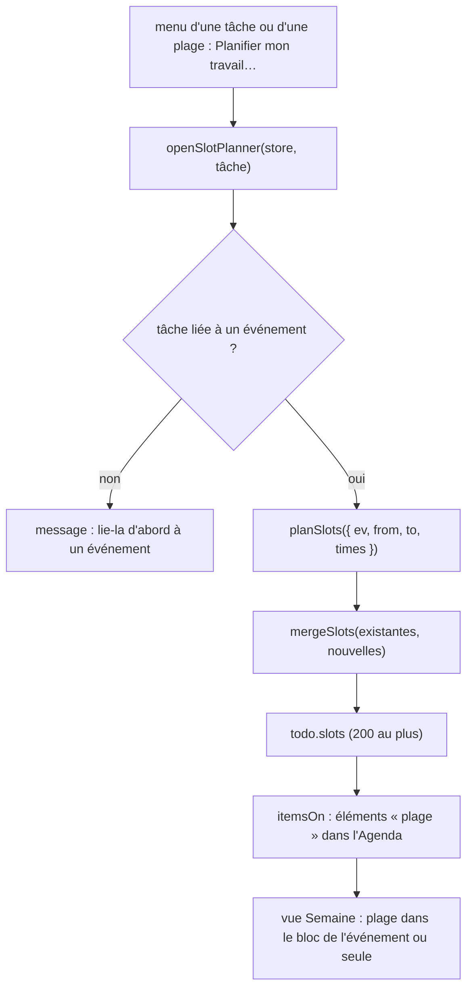

# Agenda : plages de travail d'une tâche

**État :** Implémentée · **Vérifiée contre le code :** 2026-10-26

Retour à l'[index des fiches](README.md) · [ARCHITECTURE](../ARCHITECTURE.md) · [GLOSSAIRE](../GLOSSAIRE.md)

## 1. Objectif

Quand une tâche est liée à un événement (un stage, une série de TP, un examen), réserver **à l'avance des créneaux de travail** dans l'Agenda : « chaque jour du stage, de 9 h à 9 h 30 et de 14 h à 15 h ». L'étudiant voit ces plages dans l'Agenda, les coche quand elles sont faites, et peut lancer un Focus depuis l'une d'elles.

## 2. Périmètre

**Fait** : génération de plages pour tous les jours d'activité de l'événement (événement long, série, occurrence supprimée sautée) ; une à huit plages par jour ; période choisie (un jour précis ou la fin de l'événement) ; aperçu du nombre de plages ; marquer faite ; supprimer ; replanifier en gardant les plages déjà faites ; affichage dans l'Agenda.

**Ne fait pas** : mettre à jour les plages quand l'événement change (ce sont des copies figées) ; créer des plages pour une tâche non liée à un événement ; synchroniser avec un autre agenda que celui de l'application ; planifier automatiquement selon la charge de travail.

## 3. Vue d'ensemble technique



## 4. Composants et fichiers concernés

| Chemin | Rôle |
|---|---|
| `js/work-logic.js` | logique pure : `firstDay`, `lastDay`, `activeDays`, `checkRanges`, `planSlots`, `mergeSlots`, `MAX_SLOTS` (200), `MAX_RANGES` (8) ; contient aussi `exclusiveLink` et `planEnd` des sessions Focus ([focus-sessions-planifiees](focus-sessions-planifiees.md)) |
| `js/ui/slot-planner.js` | `openSlotPlanner(store, tâche)` : la feuille « Planifier mon travail » |
| `js/store.js` | `slots` d'une tâche (`newTodo`) et `sanitizeSlots` à la lecture |
| `js/calendar-logic.js` | `itemsOn` : transforme chaque plage en élément `slot` |
| module de l'Agenda ([agenda-vues-et-recurrence](agenda-vues-et-recurrence.md)) | affichage dans la grille, menu d'une plage |
| `tests/work.test.js` | 10 tests (dont 2 sur les sessions Focus planifiées) |

## 5. Entrées / sorties

**Plage** (dans `todo.slots`) :

```json
{ "id": "s1", "date": "2026-11-09", "start": "09:00", "end": "09:30", "done": false }
```

| Règle à la lecture (`sanitizeSlots`) | |
|---|---|
| au plus 200 plages par tâche | les suivantes sont ignorées |
| `date` valide, `start` et `end` au format `hh:mm`, `end > start` | sinon la plage est écartée |
| `done` | vrai seulement si `true` |

**Feuille « Planifier mon travail · <tâche> »** : l'événement (titre, dates, répétition) ; « Se termine » (**un jour précis de l'événement** ou **la fin de l'événement**) ; « Jour précis » ; « À partir du » (aujourd'hui, ou le début de l'événement s'il est futur) ; une à huit plages horaires ; message d'aperçu (« 6 plages sur 3 jours. ») ; liste des plages déjà planifiées (cases à cocher, suppression ; les 40 premières).

**Affichage dans l'Agenda** : un élément `{ kind: 'slot', title: nom de la tâche, début, fin, couleur de l'agenda de l'événement, done }` ; masqué avec les to-dos si l'option « Afficher les to-dos » est décochée.

## 6. Fonctionnement détaillé

```text
FONCTION lastDay(ev)
  SI pas de répétition : date + durée en jours (événement long)
  SINON SI « jusqu'au » existe : jusqu'au + durée en jours
  SINON : vide                                          // série sans fin

FONCTION activeDays(ev, de, à)                          // jours où l'événement a lieu
  POUR CHAQUE jour d de « de » à « à » (4000 jours au plus)
    SI une occurrence de ev commencée entre d − durée et d existe (exceptions comprises) : ajouter d

FONCTION checkRanges(plages)
  aucune                          : « Ajoute au moins une plage horaire. »
  plus de 8                       : « 8 plages par jour au maximum. »
  fin ≤ début                     : « Chaque plage doit finir après son début. »
  deux plages qui se chevauchent  : « Les plages d'une même journée ne doivent pas se chevaucher. »     // deux plages qui se touchent (10:00 et 10:00) sont permises

FONCTION planSlots({ ev, de, à, plages, newId })
  vérifier les plages
  début ← le plus tardif entre « de » et le premier jour de l'événement
  fin   ← le plus tôt entre « à » et lastDay(ev) (si défini)
  jours ← activeDays(ev, début, fin) ; SI aucun : ERREUR « L'événement n'a aucun jour entre ces dates. »
  plages créées ← pour chaque jour, pour chaque plage horaire : { id, date, start, end, done: faux }
  SI plus de 200 : ERREUR « Ça ferait N plages (maximum 200) : réduis la période ou le nombre de plages. »
  RETOURNER { slots, days }

FONCTION mergeSlots(existantes, nouvelles)
  RETOURNER les plages FAITES existantes + les nouvelles, triées par date puis heure, 200 au plus
  // toutes les plages non faites existantes sont remplacées
```

À l'envoi, la feuille refuse : « Choisis le jour de départ. » ; « Cette série n'a pas de date de fin : choisis un jour précis. » (mode « la fin de l'événement » sur une série sans « jusqu'au ») ; « Le dernier jour doit être après le premier. » ; puis les erreurs de `planSlots`.

**Dans la vue Semaine** : une plage qui est **dans l'horaire** de son événement (même jour, début et fin à l'intérieur) s'affiche à l'intérieur du bloc de l'événement ; sinon elle est un bloc à part. Une plage est un bouton « ☐ nom » / « ☑ nom » ; entrée ou espace l'ouvre.

**Menu d'une plage** : Marquer faite / non faite ; Ouvrir la tâche ; Planifier mon travail… ; Démarrer un Focus (pour la tâche) ; Supprimer cette plage (confirmation).

## 7. Dépendances

- **Internes** : `js/calendar-logic.js` (`addDays`, `spanOf`, `occurrenceOn`, `ymd`), `js/dom.js`, `js/ui/dialog.js`, `js/store.js` (`uid`), la boîte d'une tâche (champ « Événement lié », fiche [workspace-cours-et-todos](workspace-cours-et-todos.md)), `prepareSession` de Focus.
- **Externe** : aucun. **Variable d'environnement** : aucune.
- **Clé** : `slots` fait partie de chaque tâche de `state.todos` (`studenthub:v1`) ; exporté avec les tâches.

## 8. Cas limites et erreurs

| Situation | Comportement |
|---|---|
| tâche non liée à un événement | la feuille explique de la lier d'abord ; rien n'est créé |
| aucun jour d'activité entre les dates | « L'événement n'a aucun jour entre ces dates. » |
| série sans date de fin et mode « fin de l'événement » | « Cette série n'a pas de date de fin : choisis un jour précis. » |
| occurrence supprimée de la série | aucune plage ce jour-là |
| événement long (plusieurs jours) | une plage par plage horaire pour **chacun** de ses jours |
| plus de 200 plages au total | erreur avant tout enregistrement |
| replanification | les plages faites sont gardées ; **toutes** les plages non faites sont remplacées |
| aperçu | affiche le nombre de plages ou le message d'erreur en direct |
| plage supprimée dans la feuille | disparaît immédiatement de la liste et de l'Agenda |
| tâche supprimée | ses plages disparaissent avec elle |

## 9. Tests

- Fichier : `tests/work.test.js` : événement sur plusieurs jours (3 jours, 6 plages, jamais au-delà de la fin) ; série hebdomadaire (9, 23 et 30 novembre, occurrence du 16 supprimée sautée, série sans fin = `lastDay` vide) ; vérification des plages, plafond de 200, « aucun jour », fusion qui garde la plage faite ; données bornées (plages invalides écartées) ; affichage dans l'Agenda et masquage ; planificateur (plages choisies, jusqu'à la fin de l'événement, plages faites conservées) ; vue Semaine (la plage s'affiche dans l'événement, ou dans son propre bloc hors de ses heures) ; menu d'une plage (marquer faite, supprimer).
- Lancer : `npm test`.
- Ne couvre pas : les messages d'erreur de la feuille à l'envoi, l'aperçu en direct, le bouton « Démarrer un Focus » d'une plage, `slotEndsOutside`.

## 10. Pièges et dette technique

- **La replanification remplace toutes les plages non faites**, y compris celles d'autres périodes : planifier la semaine prochaine efface les plages non faites de la semaine en cours (déduit de `mergeSlots` ; le test garde seulement les plages faites).
- **Les plages sont des copies figées** : déplacer l'événement, changer sa série ou supprimer une occurrence après coup **ne les met pas à jour** ; il faut replanifier.
- **Une plage de travail dans le panneau d'un jour du mois s'affiche avec l'étiquette « Examen »** (comme les sessions Focus planifiées et le planning de Mémorisation) : l'étiquette de la ligne ne connaît que les événements, les to-dos et les examens. Vérifié en rendant le panneau du 9 novembre 2026 : lignes « Examen Rapport » et « Examen Focus : Revoir ».
- **Plages liées au bouton « Afficher les to-dos »** : les décocher masque aussi les plages.
- **Tâche sans événement : aucune plage**, même si elle a une deadline.
- **`slotEndsOutside` n'est utilisée nulle part** (fonction exportée sans appelant).
- **Jusqu'à 4000 jours** sont examinés par planification ; une très longue série à plages multiples atteint vite le plafond de 200.

## 11. Pour modifier ou étendre

1. **Replanifier seulement la période choisie** : dans `mergeSlots`, ne retirer que les plages non faites dont la date est entre `de` et `à` (la fonction `slotEndsOutside` y était destinée).
2. **Corriger l'étiquette « Examen »** : donner à `chip` un libellé par type (`slot` : « Travail », `focus` : « Focus », `study` : « Révision »).
3. **Mettre à jour les plages quand l'événement change** : recalculer avec `planSlots` à l'enregistrement de l'événement ; nouvelle décision à écrire d'abord.
4. **Ne pas casser** : les plafonds (`MAX_SLOTS`, `MAX_RANGES`) ; la validation des plages (aucun chevauchement) ; la conservation des plages faites ; l'ignorance des occurrences supprimées.
5. Relancer `npm run build:sw` puis `npm test`.
