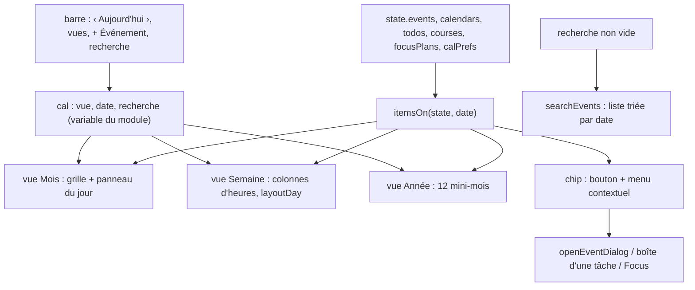

# Agenda : vues, agendas et récurrence

**État :** Implémentée · **Vérifiée contre le code :** 2026-10-26

Retour à l'[index des fiches](README.md) · [ARCHITECTURE](../ARCHITECTURE.md) · [GLOSSAIRE](../GLOSSAIRE.md)

## 1. Objectif

Un calendrier personnel complet : voir ses événements par **semaine**, **mois** ou **année**, y retrouver aussi ses deadlines, examens, sessions Focus et plages de travail, regrouper les événements en **agendas** colorés, les répéter, y lier des tâches et des notes, et les chercher.

## 2. Périmètre

**Fait** : trois vues ; navigation (précédent, aujourd'hui, suivant) ; panneau d'un jour ; création rapide ; fenêtre d'événement (titre, agenda, dates, heures, journée entière, lieu, description, répétition, rappel) ; agendas (créer, renommer, colorer, masquer, supprimer) ; cinq types d'éléments affichés ; répétition simple ; tâches et notes liées à un événement ; recherche ; menu contextuel ; premier jour de la semaine réglable.

**Ne fait pas** : vue « Jour » (il n'y en a pas : le panneau du jour dans la vue Mois en tient lieu) ; répétitions complexes (toutes les 2 semaines, jours choisis, nombre d'occurrences) ; fuseaux horaires ; invités ; synchronisation avec Google ou Exchange (seulement le fichier [.ics](agenda-ics.md)) ; les événements sur plusieurs jours et les exceptions de série (fiche [agenda-evenements-longs-et-occurrences](agenda-evenements-longs-et-occurrences.md)) ; le geste de tracé et de déplacement (fiche [agenda-glisser](agenda-glisser.md)) ; les plages de travail ([agenda-plages-de-travail](agenda-plages-de-travail.md)).

## 3. Vue d'ensemble technique



## 4. Composants et fichiers concernés

| Chemin | Rôle |
|---|---|
| `js/calendar-logic.js` | logique pure : dates (`ymd`, `parseYMD`, `addDays`, `daysBetween`, `mondayOf`, `weekStartOf`, `weekDays`, `monthGrid`, `shiftMonth`, `isoWeek`), `setFirstDay`, `occursOn`, `spanOf`, `occurrenceOn`, `itemsOn`, `layoutDay`, `dueReminders`, `searchEvents` |
| `js/modules/calendar.js` | onglet : barre d'outils, `monthView`, `weekView`, `yearView`, `dayPanel`, `searchResults`, `chip`, `itemMenu`, `panel`, `editCalendar`, `openEventDialog`, `relations`, variable de vue `cal` |
| `js/store.js` | `newEvent`, `newCalendar`, `defaultCalendars`, `removeEvent`, `removeCalendar`, validation à la lecture |
| `js/constants.js` | `REPEATS`, `REMINDERS`, `CAL_COLORS` |
| `js/ui/context-menu.js`, `js/ui/dialog.js` | menus et feuilles |
| `css/components.css` | `.mgrid`, `.mday`, `.wk`, `.wk__col`, `.ev`, `.yr` |
| `tests/calendar-logic.test.js`, `tests/agenda.test.js` | tests |

## 5. Entrées / sorties

**Événement** (`state.events`) :

```json
{ "id": "e1", "calendarId": "cal-cours", "title": "Physique", "location": "Amphi A", "description": "",
  "date": "2026-10-19", "start": "08:00", "end": "10:00", "allDay": false,
  "repeat": "weekly", "until": "2026-12-18", "reminder": 15, "endDate": "", "exceptions": {} }
```

| Champ | Règle à la lecture |
|---|---|
| `date` | obligatoire (`AAAA-MM-JJ`), sinon l'événement est écarté |
| `title` | 300 caractères ; « Sans titre » s'il est vide ; `location` 300 ; `description` 5000 |
| `start`, `end` | `hh:mm` ; défauts 09:00 et 10:00 ; la fin n'est jamais avant le début |
| `repeat` | `none`, `daily`, `weekly`, `monthly` ou `yearly` |
| `until` | dernier jour de la répétition, **inclus** (facultatif) |
| `reminder` | `null` ou 0, 5, 15, 30, 60, 1440 minutes ([socle-rappels](socle-rappels.md)) |
| `calendarId` | agenda existant, sinon le premier agenda |

**Agenda** (`state.calendars`) : `{ id, name (100), color, visible }`. Par défaut : « Personnel » (bleu) et « Cours » (rouge). **Préférences d'affichage** (`state.calPrefs`) : `todos`, `exams`, `focus`, `study`, tous vrais par défaut.

**Élément affiché** (produit par `itemsOn`) : `{ kind, id, date, title, allDay, start, end, color, ref, … }`, avec `kind` = `event`, `todo` (deadline), `exam`, `slot` (plage de travail), `focus` (session planifiée) ou `study` (planning de Mémorisation).

**Réglages utilisés** : premier jour de la semaine (lundi, dimanche ou samedi), durée par défaut d'un événement créé par clic (60 minutes), agenda par défaut ([socle-parametres](socle-parametres.md)).

## 6. Fonctionnement détaillé

```text
FONCTION occursOn(e, date)                         // l'événement tombe-t-il ce jour-là ?
  SI date < e.date OU (e.until ET date > e.until) : faux
  daily   : vrai
  weekly  : (jours entre e.date et date) modulo 7 = 0
  monthly : même numéro de jour du mois que e.date
  yearly  : même mois et même jour que e.date
  sinon   : date = e.date

FONCTION itemsOn(state, date, prefs)
  items ← liste vide
  POUR CHAQUE événement e d'un agenda visible : ajouter ses occurrences qui couvrent `date` (voir agenda-evenements-longs-et-occurrences)
  SI prefs.todos : les to-dos non terminés dont la deadline = date (journée entière) ; les plages de travail du jour
  SI prefs.exams : les cours dont l'examen = date ("Examen · nom")
  SI prefs.focus : les sessions Focus planifiées du jour ("Focus : nom")
  SI prefs.study : les tâches de révision du jour (planning de Mémorisation)
  RETOURNER items triés : journée entière d'abord, puis heure de début, puis titre

FONCTION monthGrid(année, mois)
  6 semaines de 7 jours à partir du premier jour de la semaine contenant le 1er du mois
  retirer la dernière semaine tant qu'elle ne contient aucun jour du mois (4 semaines au minimum)

FONCTION layoutDay(éléments avec heure)                     // vue Semaine
  trier par début puis par fin décroissante ; durée comptée pour au moins 20 minutes
  regrouper les éléments qui se chevauchent en « grappes » ; chacun reçoit la première colonne libre
  RETOURNER { élément, début, fin, colonne, nombre de colonnes de sa grappe }       // largeur = 1 / nombre de colonnes

FONCTION shiftMonth(date, n)  : même numéro de jour, ramené au dernier jour si le mois d'arrivée est plus court
FONCTION isoWeek(date)        : numéro de semaine ISO (le lundi est le début de semaine ISO, même si l'Agenda commence le dimanche)
```

**Vues** :

```text
Mois    : grille de 4 à 6 semaines ; chaque jour = bouton avec le numéro, jusqu'à 4 points de couleur, 2 titres et « +N »
          clic : sélectionne le jour (panneau en dessous : « Rien de prévu. » ou la liste complète avec « + Ajouter ») ; double-clic : nouvel événement ce jour-là
Semaine : sept colonnes de 24 h (48 px par heure) ; ligne « Jour » pour la journée entière ; trait de l'heure actuelle ; défilement initial à 7 h
Année   : douze mini-mois ; un jour avec des éléments est souligné ; clic sur un jour ou un mois : passe en vue Mois
Recherche : champ « Rechercher… » ; résultats triés par date, clic = vue Mois à cette date
Titre   : « octobre 2026 » ; en semaine « octobre 2026 · semaine 43 » ; en année « 2026 »
```

**Fenêtre d'événement** (`openEventDialog(ctx, init)`) : champs Titre, Agenda, Date, « Se termine le » (plusieurs jours), Journée entière (cache les heures), Début, Fin, Lieu, Description, Répétition, « Répéter jusqu'au », Rappel ; pour un événement existant : tâches liées et notes liées (créer, lier, délier) ; boutons « Supprimer » ou « Supprimer la série ».

```text
onSubmit :
  titre vide                                : « Le titre est obligatoire. »
  date vide                                 : « La date est obligatoire. »
  fin avant le début (plusieurs jours)      : « La date de fin ne peut pas précéder le début. »
  plus de 366 jours                         : « Un événement dure 366 jours au plus. »
  heures absentes ou fin ≤ début (un jour)  : « La fin doit être après le début. »
  sinon : enregistrer (ajout ou mise à jour) ; à la fermeture : redessin
```

**Agendas** : panneau repliable « Agendas et réglages » : case de visibilité, « Modifier », « + Nouvel agenda », quatre cases d'affichage (to-dos, examens, sessions Focus, planning de Mémorisation) ; on ne peut pas supprimer le dernier agenda ; supprimer un agenda supprime ses événements (confirmation).

**Menu d'un événement** : Modifier ; Ajouter une tâche ; Démarrer un Focus ; Planifier un Focus… ; Dupliquer (« … (copie) ») ; Copier le texte ; Supprimer (ou « cet événement seulement » / « la série » pour une série).

## 7. Dépendances

- **Internes** : `js/store.js`, `js/dom.js`, `js/ui/context-menu.js`, `js/ui/dialog.js`, `js/ics.js` (import et export, [agenda-ics](agenda-ics.md)), la boîte d'une tâche et le planificateur de plages ([agenda-plages-de-travail](agenda-plages-de-travail.md)), la préparation d'une session Focus ([focus-sessions-planifiees](focus-sessions-planifiees.md)), le planning de Mémorisation, `showCourse` de Workspace, `showToast`.
- **Navigateur** : `Date` en heure locale, `requestAnimationFrame`, `Notification` (bouton d'autorisation).
- **Externe** : aucun. **Variable d'environnement** : aucune.
- **Clés** : `state.events`, `state.calendars`, `state.calPrefs` dans `studenthub:v1`. La vue (`cal`) est en mémoire : elle repart du mois courant au rechargement.

## 8. Cas limites et erreurs

| Situation | Comportement |
|---|---|
| répétition mensuelle le 31 | l'événement n'apparaît que les mois qui ont un 31 |
| répétition annuelle le 29 février | seulement les années bissextiles |
| répétition sans « jusqu'au » | sans fin |
| agenda masqué | ses événements disparaissent (et leurs rappels) |
| dernier agenda | impossible à supprimer |
| agenda supprimé | ses événements aussi |
| événement supprimé | ses tâches, notes, sessions et plans Focus perdent le lien mais restent |
| deux événements au même moment (semaine) | côte à côte, largeur partagée |
| recherche vide de résultat | « Aucun résultat. » |
| jour sans élément | « Rien de prévu. » |
| tâche terminée avec deadline | n'apparaît plus dans l'Agenda |
| fenêtre fermée sans enregistrer | rien ne change |

## 9. Tests

- Fichiers : `tests/calendar-logic.test.js` (dates, lundi et semaine ISO ; récurrence jamais, jour, semaine, mois, an, « jusqu'au » ; `itemsOn` : événements, deadlines, examens, agendas masqués, tri ; `layoutDay` ; `dueReminders` ; recherche ; agendas par défaut, nettoyage, suppression) ; `tests/agenda.test.js` (événements longs, exceptions, planning de Mémorisation dans l'Agenda, choix « cet événement seulement » ou « toute la série », menus de suppression, formulaire avec date de fin, création par glisser) ; `tests/ics.test.js` (import et export).
- Lancer : `npm test`.
- Ne couvre pas : les trois vues à l'écran (mois, année, semaine hors glisser), la navigation précédent et suivant, le titre « semaine N », le panneau « Agendas et réglages », les tâches et notes liées dans la fenêtre d'événement, la duplication, la limite de 366 jours dans la fenêtre.

## 10. Pièges et dette technique

- **Corrigé : l'étiquette « Examen ».** `itemLabel` (`js/calendar-logic.js`) donne l'étiquette d'un élément du jour, partagée par la puce de l'Agenda et le widget : « À rendre » (to-do), « Examen » (examen seulement), « Révision » (plan de révision), l'heure `début–fin` pour un événement horaire, une plage de travail ou une session Focus planifiée, « Journée » sinon.
- **Les mois courts et le 29 février** : une répétition « tous les mois » ne s'adapte pas ; elle saute les mois sans le jour. Une répétition le 31 saute avril, juin, septembre, novembre.
- **La vue Année n'est pas accessible au clavier** : la grille est masquée aux lecteurs d'écran (`aria-hidden`) et les jours ont `tabindex="-1"` ; on y passe par les boutons de mois.
- **La semaine ISO n'est pas la semaine affichée** quand le premier jour est le dimanche : le numéro « semaine N » reste celui de la norme ISO.
- **Changer la date d'une série laisse ses exceptions** : elles sont rangées par date d'origine ; si la nouvelle règle ne tombe plus sur ces dates, les occurrences déplacées ou renommées disparaissent de l'affichage (déduit du code, non testé).
- **Tous les calculs de date en heure locale** : changement d'heure d'été sans problème connu (`daysBetween` arrondit), mais les fuseaux ne sont pas gérés.
- **Pas de vue Jour** : seule la liste du jour sélectionné dans la vue Mois.
- **Les agendas ne se partagent pas** ; ils servent à regrouper et à colorer.
- **Doublon de logique avec la recherche globale** (`searchEvents` et `searchAll`, voir [socle-recherche-globale](socle-recherche-globale.md)).

## 11. Pour modifier ou étendre

1. **Nouvelle fréquence de répétition** : ajouter la valeur à `REPEATS` (`js/constants.js`), à `occursOn`, à la validation de `js/store.js`, à l'export `.ics`, et un test dans `tests/calendar-logic.test.js`.
2. **Nouveau type d'élément dans l'Agenda** : l'ajouter à `itemsOn` avec un nouveau `kind`, une couleur, et gérer `openItem` et `itemMenu`.
3. **Nouvelle vue** : ajouter une fonction de vue, une entrée dans la barre et dans `bodyFor`.
4. **Ne pas casser** : l'ordre de tri (journée entière d'abord) ; le masquage par agenda ; la suppression d'un événement qui délie ses tâches, notes et sessions ; les messages d'erreur de la fenêtre.
5. Relancer `npm run build:sw` puis `npm test`.
