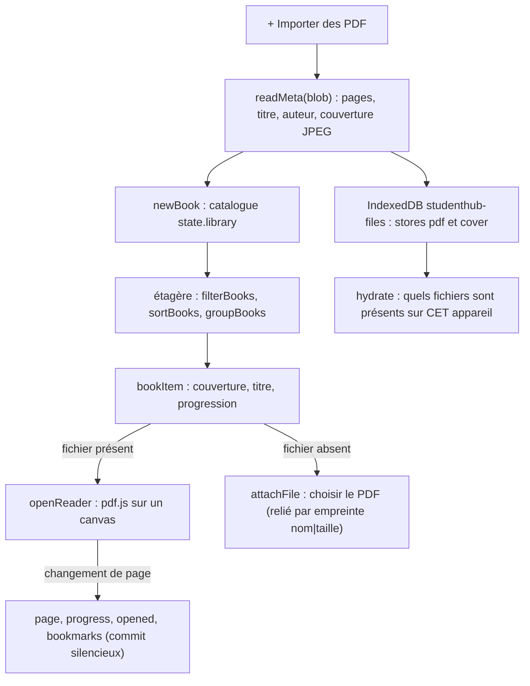

# Onglet Biblio : bibliothèque de PDF et lecteur

**État :** Implémentée · **Vérifiée contre le code :** 2026-10-26

Retour à l'[index des fiches](README.md) · [ARCHITECTURE](../ARCHITECTURE.md) · [GLOSSAIRE](../GLOSSAIRE.md) · Décisions : [ADR-003](../decisions/003-pdf-par-appareil.md), [ADR-005](../decisions/005-pdfjs-dans-vendor.md)

## 1. Objectif

Ranger ses PDF de cours et d'ouvrages, les retrouver (titre, auteur, tags, dossier, favoris), les **lire dans l'application** sans réseau, reprendre à la dernière page et poser des signets. Les fichiers restent sur l'appareil ; seul le **catalogue** voyage entre appareils.

## 2. Périmètre

**Fait** : import de plusieurs PDF ; lecture des métadonnées (titre, auteur, nombre de pages) et d'une couverture ; cinq sections (Bibliothèque, Dossiers, Récents, Favoris, Signets) ; recherche, tri (7 critères), regroupement, quatre affichages ; modification (titre, auteur, dossier, tags) ; favoris ; lecteur plein écran (une page à la fois, zoom, signets, reprise) ; rattachement d'un livre du catalogue à son fichier sur un autre appareil ; export et import du catalogue.

**Ne fait pas** : stocker les PDF ailleurs que dans le navigateur de l'appareil (ni dépôt, ni cloud, ni sauvegarde) ; sélectionner ou chercher du texte **dans** un PDF (pas de couche de texte) ; annoter ; lire un autre format (EPUB…) ; défilement continu d'un document ; limiter la taille des fichiers.

## 3. Vue d'ensemble technique



## 4. Composants et fichiers concernés

| Chemin | Rôle |
|---|---|
| `js/modules/library.js` | onglet : `render`, `hydrate`, `libraryView`, `foldersView`, `bookItem`, `importFiles`, `attachFile`, `bookmarksView`, `editBook` ; état de vue `view` et `device` |
| `js/library-logic.js` | fonctions pures : `filterBooks`, `sortBooks`, `groupBooks`, `recents`, `favorites`, `allBookmarks`, `folderNames`, `parseTags`, `titleFromFilename`, `fingerprint`, `formatSize`, `progressOf` |
| `js/files.js` | IndexedDB : `putFile`, `getFile`, `putCover`, `getCover`, `listFileIds`, `deleteFile`, `keepStorage` |
| `js/pdfdoc.js` | pont vers pdf.js : `openPdf`, `renderPage`, `readMeta` (chargement à la demande) |
| `js/ui/reader.js` | `openReader(ctx, livre, pageDeDépart)` : lecteur plein écran |
| `vendor/pdfjs/` | copie locale de pdf.js (`pdf.min.mjs`, `pdf.worker.min.mjs`, polices standard, `cmaps`), 4,3 Mo ([ADR-005](../decisions/005-pdfjs-dans-vendor.md)) |
| `js/store.js` | `newBook`, `removeBook`, validation de `library` |
| `css/components.css` | `.shelf`, `.book`, `.cover`, `.reader` |
| `tests/library-logic.test.js`, `tests/modules.test.js`, `tests/e2e/library.e2e.py` | tests |

## 5. Entrées / sorties

**Livre du catalogue** (`state.library`, exporté et synchronisé) :

```json
{ "id": "b1", "name": "Algebre2.pdf", "title": "Algèbre 2", "author": "", "size": 183000, "pages": 3,
  "added": "2026-10-26T08:00:00.000Z", "opened": "", "favorite": false, "tags": ["maths"], "folder": "Algèbre",
  "progress": 0, "page": 1, "bookmarks": [ { "id": "m1", "page": 2, "label": "Page 2", "date": "2026-10-26T08:05:00.000Z" } ],
  "fingerprint": "Algebre2.pdf|183000" }
```

| Règle à la lecture | |
|---|---|
| `title` | 300 caractères ; sinon le nom du fichier, sinon « Sans titre » |
| `tags` | 30 au plus, 40 caractères chacun |
| `bookmarks` | 500 au plus ; page entière d'au moins 1 |
| `progress` | 0 à 100 ; `page` : 1 ou plus |

**Fichiers** (jamais dans l'état, jamais exportés) : base IndexedDB `studenthub-files`, deux magasins `pdf` (le fichier) et `cover` (couverture en JPEG, 240 px de large, qualité 0,7, au format « data URL »), indexés par l'identifiant du livre.

**Tris** : date d'ajout (défaut, décroissant), titre, auteur (croissants), taille, pages, dernière lecture, progression (décroissants) ; **affichages** : couvertures, grille, liste, condensée ; **regroupements** : aucun, auteur, tag, dossier.

**Lecteur** : ← → et PageUp / PageDown (au clavier), balayage horizontal de plus de 70 px (au doigt, quand le zoom vaut 100 %), champ « Numéro de page », zoom de 50 % à 400 % par pas de 25 %, bouton « Signet ». **Export** : section « Bibliothèque » (catalogue seul).

## 6. Fonctionnement détaillé

```text
FONCTION importFiles(ctx, fichiers)
  SI aucun fichier PDF (type application/pdf ou nom en .pdf) : « Aucun PDF sélectionné. »
  keepStorage()                                       // demande le stockage persistant
  POUR CHAQUE fichier f
    empreinte ← nom + '|' + taille ; livre ← le livre du catalogue de même empreinte
    SI livre existe ET son fichier est déjà sur cet appareil : « déjà présent » ; PASSER
    meta ← readMeta(f)                                // pages, titre, auteur, couverture
    SI pas de livre : newBook({ nom, titre: meta.titre OU nom sans extension, auteur, taille, pages, empreinte }) ; l'ajouter au catalogue (commit silencieux)
    SINON : « relié au catalogue »
    putFile(livre.id, f) ; putCover(livre.id, meta.cover)
    en cas d'erreur : noter le nom dans « Échec »
  message : « N ajouté(s) · N relié(s) au catalogue · N déjà présent(s) · Échec : … » ; commit

FONCTION readMeta(blob)
  doc ← openPdf(blob) ; pages ← doc.numPages ; titre, auteur ← métadonnées ; cover ← page 1 dessinée sur fond blanc (240 px) en JPEG
  fermer doc (destroy)

FONCTION hydrate(ctx)                                 // à chaque affichage de l'onglet
  ids ← listFileIds() ; pour chaque livre présent sans couverture lue : getCover
  RETOURNER « quelque chose a changé » ; l'onglet se redessine alors

FONCTION bookItem(b)
  présent ← b.id ∈ fichiers de CET appareil
  clic : présent ? openReader : attachFile (sélecteur de fichier)
  pastille « Fichier absent de cet appareil » si absent ; barre de progression si progress > 0
  menu : Ouvrir ou Charger le fichier · favoris · Modifier (titre, tags, dossier) · Copier le titre

FONCTION openReader(ctx, livre, pageDeDépart)
  <dialog> plein écran ; getFile(livre.id) ; doc ← openPdf(blob)
  SI le fichier manque ou est illisible : « Impossible d'ouvrir ce fichier sur cet appareil. »
  go(pageDeDépart OU page enregistrée OU 1)

FONCTION go(n)
  page ← n arrondi, borné entre 1 et le nombre de pages
  commit silencieux : livre.page ← page ; livre.progress ← arrondi(page / pages × 100) ; livre.opened ← maintenant
  dessiner la page sur un canvas (résolution ×2 au plus) ; annuler le dessin précédent s'il est en cours

FONCTION toggleMark()      : SI un signet existe pour cette page : le retirer ; SINON ajouter { page, « Page N », date } (commit silencieux)
À la fermeture du lecteur  : annuler le dessin, détruire le document, retirer le <dialog>, commit vide (rafraîchit progression et « Récents »)
```

**Modification et suppression d'un livre** : feuille « Modifier le livre » (titre obligatoire : « Le titre est obligatoire. » ; auteur ; dossier avec suggestions tirées des noms de cours ; tags séparés par des virgules, des points-virgules ou des retours à la ligne). « Retirer » demande confirmation (« Le fichier sera supprimé de cet appareil. »), supprime le fichier et la couverture d'IndexedDB, puis le livre du catalogue.

## 7. Dépendances

- **Internes** : `js/store.js` (`newBook`, `removeBook`, `uid`), `js/dom.js`, `js/ui/dialog.js`, `js/ui/context-menu.js`.
- **Externe** : **pdf.js**, en copie locale dans `vendor/pdfjs/` (aucun réseau). Chargé seulement à l'ouverture d'un PDF (import dynamique), avec `isEvalSupported: false` pour la CSP stricte ([ADR-004](../decisions/004-csp-stricte-sans-innerhtml.md)) ; polices et `cmaps` lus depuis `vendor/`.
- **Navigateur** : IndexedDB, `File`/`Blob`, `canvas`, `<dialog>`, `navigator.storage.persist()`.
- **Hors ligne** : `pdf.min.mjs` et `pdf.worker.min.mjs` sont mis en cache par le service worker ; le reste de `vendor/` (polices, `cmaps`) l'est au premier usage ([socle-pwa-hors-ligne](socle-pwa-hors-ligne.md)).
- **Variable d'environnement** : aucune. **Clés** : `state.library` dans `studenthub:v1` ; base IndexedDB `studenthub-files`.

## 8. Cas limites et erreurs

| Situation | Comportement |
|---|---|
| bibliothèque vide | « Ta bibliothèque est vide. » avec une explication |
| fichier qui n'est pas un PDF | ignoré ; « Aucun PDF sélectionné. » s'il n'y en a aucun |
| même fichier importé deux fois | « déjà présent », rien n'est dupliqué |
| PDF illisible ou chiffré | « Échec : nom du fichier » ; rien n'est ajouté pour ce fichier |
| catalogue importé ou synchronisé sans les fichiers | chaque livre porte « Fichier absent de cet appareil » ; rouvrir le même PDF le relie |
| PDF sans titre dans ses métadonnées | titre déduit du nom du fichier (sans extension, `_` en espaces) |
| couverture impossible | pastille avec la première lettre du titre |
| page demandée hors du document | ramenée entre 1 et le nombre de pages |
| lecteur sans fichier sur l'appareil | « Impossible d'ouvrir ce fichier sur cet appareil. » |
| stockage plein ou IndexedDB indisponible | l'import échoue pour ce fichier (« Échec ») ; le catalogue reste utilisable |
| titre HTML | affiché comme texte |

## 9. Tests

- Fichiers : `tests/library-logic.test.js` (recherche dans titre, auteur, tags, dossier ; tris avec vides à la fin ; regroupements ; récents, favoris, signets, dossiers ; tags, titres, tailles ; nettoyage d'un catalogue importé) ; `tests/modules.test.js` (bibliothèque vide puis Favoris, Récents, Signets ; recherche et regroupement par auteur ; titre HTML en texte) ; `tests/e2e/library.e2e.py` (**navigateur réel** : import d'un PDF, doublon ignoré, lecteur, progression 2/3 = 67 %, signets, favoris, persistance après rechargement, modes d'affichage, export du catalogue sans le PDF, thème sombre, et rattachement du fichier dans un second contexte).
- Lancer : `npm test` ; navigateur réel : `python3 -m http.server 8765` puis `python3 tests/e2e/library.e2e.py` (Playwright).
- Ne couvre pas en tests rapides : l'import, le lecteur et IndexedDB (seulement en e2e, non lancé par `npm test`) ; la modification et la suppression d'un livre ; le zoom et le balayage ; un PDF volumineux ; les PDF protégés.

## 10. Pièges et dette technique

- **Corrigé : « Charger le fichier » relie le PDF au livre cliqué.** `importFiles(ctx, fichiers, livre)` enregistre le fichier sous l'identifiant du livre choisi, même si son nom ou sa taille diffèrent ; le titre choisi est gardé, l'empreinte, la taille et le nombre de pages sont mis à jour. Sans livre cliqué (import normal), le rattachement reste fait par l'empreinte (nom + taille).
- **L'empreinte `nom|taille` peut confondre deux fichiers différents** de mêmes nom et taille (rare, assumé dans l'ADR-003).
- **Les fichiers d'un livre supprimé ailleurs restent** : si un autre appareil retire un livre du catalogue, la suppression se propage ([socle-synchronisation](socle-synchronisation.md)) mais le fichier de cet appareil reste dans IndexedDB, orphelin et jamais nettoyé (déduit du code).
- **Premier affichage** : la liste des fichiers présents est lue après le premier dessin ; chaque livre peut brièvement porter « Fichier absent de cet appareil » avant le second dessin (déduit du code).
- **Aucune limite de taille** : le fichier entier est lu en mémoire (`arrayBuffer`) à l'import et à la lecture ; un très gros PDF peut échouer sur un téléphone, et le quota d'IndexedDB dépend du navigateur.
- **Pas de recherche dans le texte d'un PDF**, ni de sélection : la page est une image dessinée sur un canvas.
- **Chaque changement de page écrit dans `localStorage`** (commit silencieux) et met à jour la date de dernière lecture ; un livre « parcouru » en tournant les pages remonte donc dans « Récents ».
- **La progression est la position** : arriver à la dernière page donne 100 %, sans lien avec le temps de lecture.
- **Le filtre par dossier et par tag de `filterBooks`** n'est pas exposé dans l'interface de l'onglet (seuls la recherche et la section « Dossiers »).
- **`vendor/pdfjs`** est une copie figée : toute mise à jour est manuelle.

## 11. Pour modifier ou étendre

1. **Relier au livre cliqué** : faire passer `book` à `importFiles` et associer le fichier choisi à ce livre (en vérifiant le nombre de pages) au lieu de se fier à l'empreinte.
2. **Nettoyer les orphelins** : au démarrage de la section, comparer `listFileIds()` au catalogue et proposer de supprimer les fichiers sans livre.
3. **Recherche dans le texte** : utiliser `page.getTextContent()` de pdf.js (au prix d'une couche de texte ou d'un index) ; à décider avant.
4. **Mettre à jour pdf.js** : remplacer le contenu de `vendor/pdfjs/`, relancer `npm run build:sw`, puis le test e2e de la bibliothèque.
5. **Ne pas casser** : les fichiers hors de l'état et hors des exports ([ADR-003](../decisions/003-pdf-par-appareil.md)) ; l'import dynamique de pdf.js (pas de script au démarrage) ; `isEvalSupported: false` ; les commits silencieux du lecteur.
6. Relancer `npm run build:sw` puis `npm test`.
