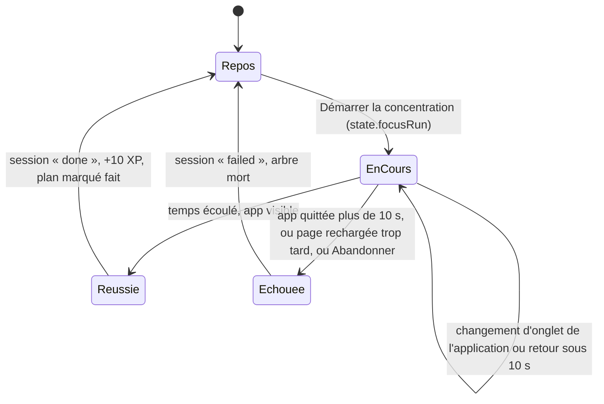

# Focus : minuteur, arbre et règle des 10 secondes

**État :** Implémentée · **Vérifiée contre le code :** 2026-10-26

Retour à l'[index des fiches](README.md) · [ARCHITECTURE](../ARCHITECTURE.md) · [GLOSSAIRE](../GLOSSAIRE.md)

## 1. Objectif

Aider l'étudiant à rester concentré : il lance une session de durée choisie, un **arbre pousse** pendant qu'il reste sur Student Hub, et il **meurt** s'il quitte l'application plus de 10 secondes. Chaque arbre planté rapporte de l'XP et alimente les statistiques.

## 2. Périmètre

**Fait** : choix de la durée, du tag, du titre, d'une tâche **ou** d'un événement ; décompte ; arbre à cinq stades ; règle de l'abandon ; session qui survit à un rechargement ; enregistrement de la session ; XP ; carte de résultat ; gestion des tags ; chronomètre qui continue quand on change d'onglet de l'application.

**Ne fait pas** : les statistiques ([focus-statistiques](focus-statistiques.md)) ; la planification de sessions ([focus-sessions-planifiees](focus-sessions-planifiees.md)) ; bloquer d'autres applications ; sonner à la fin (un message s'affiche dans l'application) ; faire tourner le chronomètre application fermée ; mettre en pause.

## 3. Vue d'ensemble technique



## 4. Composants et fichiers concernés

| Chemin | Rôle |
|---|---|
| `js/modules/focus.js` | onglet : `render`, `idle` (préparation), `running` (décompte), `resultCard`, `manageTags`, `prepareSession`, `showResult` ; état de vue `ui` |
| `js/focus-runtime.js` | `startFocusRuntime(store, { onEnd, isHidden, grace })` et `endRun(store, statut, now)` |
| `js/focus-logic.js` | `stageOf`, `reconcile`, `buildSession`, `formatClock`, `formatMinutes`, `GRACE_MS`, `DURATIONS` |
| `js/ui/charts.js` | `treeSvg(stade, mort)` : dessin de l'arbre |
| `js/xp-logic.js` | `award`, `XP.focus` (10), plafond quotidien de 300 |
| `js/app.js` | lance `startFocusRuntime` au démarrage et affiche le message de fin |
| `tests/focus-logic.test.js`, `tests/focus-runtime.test.js`, `tests/modules.test.js` | tests |

## 5. Entrées / sorties

**Session en cours** (`state.focusRun`, une seule à la fois, conservée au rechargement) :

```json
{ "id": "a1b2c3", "start": 1793000000000, "planned": 25, "tagId": "tag-etude", "title": "Maths", "todoId": "", "eventId": "", "planId": "", "lastSeen": 1793000001000, "hiddenAt": null }
```

**Session terminée** (ajoutée à `state.sessions`) : `{ id, start (ISO), planned, actual, status: "done" | "failed", tagId, title, todoId, eventId, planId }`. Une réussite a `actual = planned` ; un échec a `actual` = minutes écoulées (arrondies au dixième).

| Réglage | Effet |
|---|---|
| `settings.focus.minutes` (25 par défaut, 1 à 180) | durée proposée au lancement |
| `settings.focus.grace` (10 par défaut, 5 à 60 s) | délai de tolérance avant la mort de l'arbre ([socle-parametres](socle-parametres.md)) |

**Durées rapides** : 10, 25, 45, 60 et 90 minutes, ou saisie libre de 1 à 180. **Tags par défaut** : Étude (ambre), Lecture (violet), Travail (turquoise), Sport (vert), Repos (bleu), Autre (rouge).

**Stades de l'arbre** (`stageOf`) : 0 graine (aucun temps écoulé), 1 pousse (moins de 33 %), 2 (33 % et plus), 3 (66 % et plus), 4 arbre complet (100 %).

## 6. Fonctionnement détaillé

```text
FONCTION reconcile(run, maintenant, { hidden, grace })      // que faire de la session ?
  SI pas de session : 'none'
  SI run.hiddenAt existe ET maintenant − hiddenAt > grace : 'fail'            // quitté l'app trop longtemps
  SI app visible ET hiddenAt vide ET maintenant − lastSeen > grace + 2000 : 'fail'   // page rechargée ou figée trop longtemps
  SI maintenant ≥ start + planned × 60 s : 'complete'
  SINON 'none'

FONCTION startFocusRuntime(store, { onEnd, isHidden, grace })
  check() :
    SI pas de session : RETOURNER
    action ← reconcile(session, maintenant, { hidden: isHidden(), grace })
    SI action ≠ 'none' : onEnd( endRun(store, action = 'complete' ? 'done' : 'failed', maintenant) ) ; RETOURNER
    SI app visible : session.lastSeen ← maintenant   (commit silencieux)
  « visibilitychange » :
    SI l'app est masquée : hiddenAt ← maintenant ; lastSeen ← maintenant (commit silencieux)
    SINON : check() ; SI la session continue : hiddenAt ← vide ; lastSeen ← maintenant
  check() tout de suite, puis toutes les secondes

FONCTION endRun(store, statut, maintenant)
  session ← buildSession(run, maintenant, statut)
  store.commit : ajouter session à state.sessions ; focusRun ← vide
      SI statut = 'done' : award(état, 10 XP, jour local) ; SI run.planId : marquer ce plan « fait »
  RETOURNER session

FONCTION buildSession(run, maintenant, statut)
  fin ← le plus petit entre maintenant et (start + planned)
  actual ← (statut = 'done') ? planned : minutes écoulées de start à fin, arrondies au dixième
```

**Écran** :

```text
Repos (idle)     : tag, titre, tâche, événement, durée, « Démarrer la concentration » ; sections « Concentration » / « Statistiques »
                   choisir une tâche vide l'événement (et réciproquement) ; une tâche choisie remplit le titre s'il est vide
                   démarrer : focusRun ← { …, ...exclusiveLink(tâche, événement), planId, lastSeen: maintenant, hiddenAt: vide }
En cours (running) : horloge « mm:ss » et arbre mis à jour toutes les 500 ms ; « Abandonner » avec confirmation
Fin              : carte « Arbre planté » ou « Arbre mort » avec la durée ; bouton « Marquer … comme terminée » pour la tâche liée
Tags             : feuille « Tags de concentration » : renommer (40 caractères), couleur, ajouter, supprimer ; au moins un tag
```

À la fin d'une session (réussie ou non), l'application affiche aussi un message : « Arbre planté : bravo ! » ou « L'arbre est mort : tu as quitté la session. ».

## 7. Dépendances

- **Internes** : `js/store.js` (`commit`, `uid`), `js/xp-logic.js`, `js/dom.js`, `js/ui/dialog.js` (feuille des tags), `js/ui/charts.js`, `showToast` ([socle-rappels](socle-rappels.md)), dates de la logique de l'Agenda, `exclusiveLink` ([ADR-014](../decisions/014-session-focus-une-tache-ou-un-evenement.md)).
- **Navigateur** : `document.hidden` et l'événement `visibilitychange`, `setInterval`, `confirm`.
- **Externe** : aucun. **Variable d'environnement** : aucune.
- **Clés** : `state.focusRun`, `state.sessions`, `state.focusTags`, `state.xp` dans `studenthub:v1`.

## 8. Cas limites et erreurs

| Situation | Comportement |
|---|---|
| retour dans l'application avant la fin du délai | la session continue |
| quitter l'application plus longtemps que le délai | arbre mort, session « failed » |
| page rechargée plus de `grace + 2` secondes après la dernière activité | arbre mort |
| rechargement rapide | la session reprend (elle est enregistrée) |
| temps écoulé alors que l'app est visible | arbre planté, XP, plan marqué fait |
| « Abandonner » | confirmation, puis arbre mort |
| tag supprimé (sessions anciennes) | affiché « Sans tag » |
| tâche liée déjà terminée | pas de bouton « Marquer … comme terminée » |
| plus de 300 XP gagnés le même jour | l'XP est plafonné (la session reste enregistrée) |
| liste de tags vidée | « Garde au moins un tag. » ; les noms vides sont retirés |
| durée saisie hors limites ou illisible | ramenée entre 1 et 180 ; 25 si illisible |

## 9. Tests

- Fichiers : `tests/focus-logic.test.js` (5 stades ; `reconcile` : continue, réussit, échoue après 10 s ; `buildSession` : réussite = durée prévue, échec = temps réel ; formats) ; `tests/focus-runtime.test.js` (session en cours qui continue ; arbre planté à la fin ; app quittée plus de 10 s ; retour dans les 10 s ; page rechargée trop tard et abandon manuel ; persistance au rechargement) ; `tests/modules.test.js` (démarrer, abandonner, résultat et tâche terminée en un clic, gestion des tags).
- Lancer : `npm test`.
- Ne couvre pas : l'horloge et le changement de stade à l'écran, le réglage `grace` personnalisé, l'XP gagnée et son plafond à la fin d'une session, le comportement de l'onglet masqué dans un vrai navigateur (écran verrouillé, application en arrière-plan sur mobile).

## 10. Pièges et dette technique

- **Corrigé : le délai affiché est celui du réglage.** L'écran « en cours » et l'écran de préparation affichent `settings.focus.grace` ; le conseil du guide précise que 10 secondes est la valeur par défaut. (`GRACE_MS` reste la valeur par défaut du moteur.)
- **Écriture chaque seconde** : tant que la session est visible, `lastSeen` est enregistré à chaque seconde (commit silencieux) ; cela écrit dans `localStorage` en continu.
- **Durée d'un échec** : `actual` est calculée jusqu'au moment où l'échec est détecté, qui peut être bien après le départ réel de l'étudiant ; ces minutes ne comptent pas dans les statistiques, mais figurent dans le message « Session interrompue après … » (déduit du code).
- **Sur mobile, le navigateur peut geler l'application** écran verrouillé : la règle des 10 secondes est faite pour cela, mais rien n'est testé sur appareil.
- **Pas de son ni de notification à la fin** si l'application est masquée : mais masquer l'application plus de 10 secondes fait déjà échouer la session.
- **Un seul chronomètre** : impossible de lancer une seconde session pendant la première.
- **Pas de pause** : une session ne peut être ni suspendue ni prolongée ; il faut l'abandonner.

## 11. Pour modifier ou étendre

1. **Changer le délai par défaut** : `GRACE_MS` dans `js/focus-logic.js` (et la valeur par défaut du réglage `focus.grace` dans `js/settings-logic.js`).
2. **Texte du délai** : toujours utiliser `settings.focus.grace`, jamais `GRACE_MS`, dans l'interface.
3. **Nouvelle durée rapide** : `DURATIONS`.
4. **Nouveaux stades** : modifier `stageOf` **et** `treeSvg` (`js/ui/charts.js`) ensemble, avec le test « 5 stades ».
5. **Ne pas casser** : `reconcile` (pure et testée) ; le fait que les échecs ne comptent pas en minutes ; la persistance de `focusRun` ; le lien exclusif tâche ou événement.
6. Relancer `npm run build:sw` puis `npm test`.
