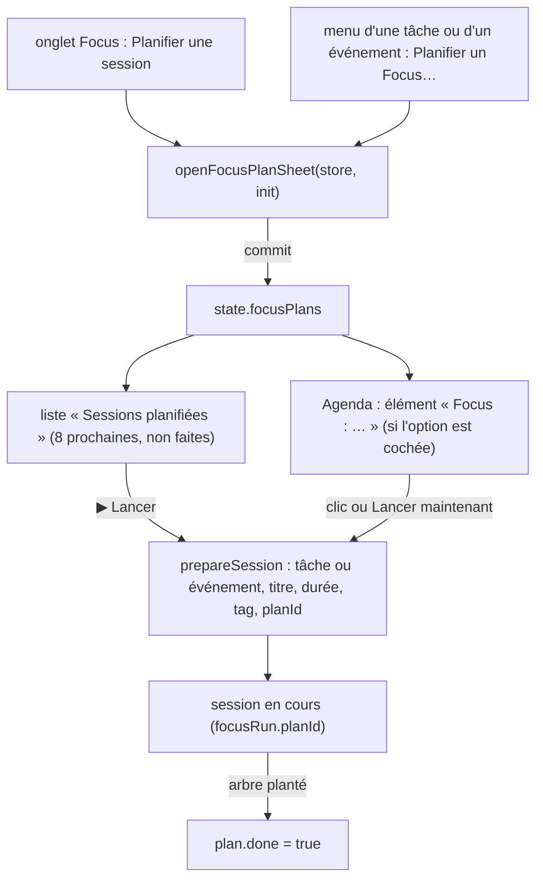

# Focus : sessions planifiées

**État :** Implémentée · **Vérifiée contre le code :** 2026-10-26

Retour à l'[index des fiches](README.md) · [ARCHITECTURE](../ARCHITECTURE.md) · [GLOSSAIRE](../GLOSSAIRE.md) · Décision : [ADR-014](../decisions/014-session-focus-une-tache-ou-un-evenement.md)

## 1. Objectif

Réserver à l'avance un créneau de concentration (jour, heure, durée, tag), éventuellement pour **une tâche** ou **un événement**, le retrouver dans l'Agenda, le lancer d'un clic le moment venu, et le voir se marquer « fait » quand l'arbre est planté.

## 2. Périmètre

**Fait** : feuille « Planifier une session Focus » ; liste « Sessions planifiées » dans l'onglet Focus ; affichage dans l'Agenda (masquable) ; lancement depuis la liste ou depuis l'Agenda ; marquage « fait » à la réussite ; menus « Planifier un Focus… » sur les tâches et les événements.

**Ne fait pas** : sonner ou notifier à l'heure prévue (les rappels ne concernent que les événements, [socle-rappels](socle-rappels.md)) ; répéter une session ; lancer une session automatiquement ; modifier une session planifiée (on la supprime et on la recrée) ; lier à la fois une tâche et un événement.

## 3. Vue d'ensemble technique



## 4. Composants et fichiers concernés

| Chemin | Rôle |
|---|---|
| `js/ui/focus-plan.js` | `openFocusPlanSheet(store, init)` : la feuille de planification |
| onglet Focus (fiche [focus-minuteur-et-arbre](focus-minuteur-et-arbre.md)) | liste « Sessions planifiées », bouton « ▶ Lancer », `prepareSession` |
| module de l'Agenda (fiche [agenda-vues-et-recurrence](agenda-vues-et-recurrence.md)) | éléments `focus` dans la grille, menu, option d'affichage |
| fonctions `exclusiveLink` et `planEnd` (logique des plages de travail) | lien exclusif ; heure de fin d'une session |
| `js/focus-runtime.js` | marque le plan « fait » dans `endRun` |
| `js/store.js` | validation de `focusPlans` à la lecture ; `removeEvent` détache les plans |
| `tests/work.test.js` | 4 tests concernent les sessions planifiées |

## 5. Entrées / sorties

**Session planifiée** (`state.focusPlans`) :

```json
{ "id": "p7x9k2m", "date": "2026-11-09", "start": "09:00", "minutes": 25, "todoId": "", "eventId": "e1", "title": "", "tagId": "tag-etude", "done": false }
```

| Champ | Règle à la lecture |
|---|---|
| `date` | obligatoire (`AAAA-MM-JJ`) ; sinon la session est écartée |
| `start` | `hh:mm` ; `09:00` si illisible |
| `minutes` | entier de 1 à 180 |
| `todoId`, `eventId` | **un seul** des deux : si les deux sont donnés, la tâche l'emporte et `eventId` est vidé |
| `title` | 200 caractères au plus ; `tagId` : 40 |
| `done` | vrai seulement si `true` |

Au plus 2000 sessions sont conservées. **Export** : section « Focus » (`focusTags`, `sessions`, `focusPlans`) ; les suppressions sont suivies pour la synchronisation ([socle-synchronisation](socle-synchronisation.md)).

**Feuille** (`openFocusPlanSheet(store, init)`) : `init` peut préremplir `date`, `start`, `minutes` (25 par défaut), `title`, `todoId`, `eventId`, `tagId`.

## 6. Fonctionnement détaillé

```text
FONCTION openFocusPlanSheet(store, init)
  champs : Jour (aujourd'hui par défaut), Début (09:00), Durée (25), Lier à (Aucun lien | Une tâche | Un événement), Tâche, Événement, Titre, Tag
  « Tâche » : to-dos non terminés ; « Événement » : les 80 derniers par date ; un seul des deux champs est visible selon « Lier à »
  onSubmit :
    SI jour ou heure vide                   : « Choisis le jour et l'heure. »
    SI durée hors de 1 à 180                : « La durée va de 1 à 180 minutes. »
    lien ← exclusiveLink(tâche choisie ou vide, événement choisi ou vide)
    SI « Lier à » ≠ aucun ET aucun lien     : « Choisis l'élément à lier, ou « Aucun lien ». »
    store.commit : ajouter { id, date, start, minutes, ...lien, title, tagId, done: faux }

FONCTION exclusiveLink(todoId, eventId)
  RETOURNER todoId ? { todoId, eventId: '' } : { todoId: '', eventId: eventId OU '' }

FONCTION planEnd(plan)
  RETOURNER heure de début + minutes, au plus 23:59, au format hh:mm

Liste « Sessions planifiées » (onglet Focus)
  plans ← focusPlans NON faits dont date ≥ aujourd'hui ; tri par date puis heure ; les 8 premiers
  nom ← title, sinon nom de la tâche, sinon titre de l'événement, sinon « Session »
  ligne : « date début–fin · nom » + pastille « tâche » ou « événement » ; « ▶ Lancer » ; « ✕ » (supprime sans confirmation)
  « ▶ Lancer » : prepareSession({ todoId, eventId, title: title OU nom, planId, minutes, tagId }) → onglet Focus prêt à démarrer

Dans l'Agenda (si l'option « focus » du calendrier n'est pas décochée)
  chaque plan du jour devient un élément { titre: « Focus : nom », début, fin = planEnd, couleur « focus », fait }
  clic : prepareSession(…)     menu : « Lancer maintenant », « Marquer faite / non faite », « Supprimer la session » (confirmation)

À la réussite d'une session lancée depuis un plan (endRun, statut « done ») : plan.done ← vrai
```

## 7. Dépendances

- **Internes** : `js/dom.js`, `js/ui/dialog.js` (`openSheet`), `js/store.js` (`uid`), `js/focus-runtime.js`, `ymd` de la logique de l'Agenda.
- **Données d'autres onglets** : `state.todos`, `state.events`, `state.focusTags`.
- **Réglages** : option d'affichage `calPrefs.focus` de l'Agenda (vrai par défaut).
- **Externe** : aucun. **Variable d'environnement** : aucune. **Clé** : `state.focusPlans` dans `studenthub:v1`.

## 8. Cas limites et erreurs

| Situation | Comportement |
|---|---|
| plan sans date valide (import) | écarté |
| plan lié à une tâche **et** un événement (import) | seule la tâche est gardée |
| plus de 180 minutes ou 0 | ramené entre 1 et 180 (import) ; refusé dans la feuille |
| « Lier à » une tâche sans en choisir | « Choisis l'élément à lier, ou « Aucun lien ». » |
| événement supprimé | le plan perd son lien (`eventId` vidé) mais reste, sous le nom « Session » ou son titre |
| plan dont la date est passée et non fait | **disparaît de la liste de Focus** ; reste visible dans l'Agenda à sa date |
| plan fait | disparaît de la liste de Focus ; reste dans l'Agenda, marqué fait |
| session échouée ou abandonnée | le plan reste « non fait » |
| plus de 8 plans à venir | la liste n'en montre que 8 |
| option « focus » décochée dans l'Agenda | plans masqués dans la grille (pas supprimés) |

## 9. Tests

- Fichier : `tests/work.test.js` : données bornées (un plan avec 999 minutes devient 180 ; un plan sans date est écarté ; la tâche l'emporte sur l'événement) ; plans visibles dans l'Agenda et masquables ; « Focus planifié : lié à UNE tâche ou UN événement, lancé depuis la liste, marqué fait à la fin » (feuille, remplacement tâche par événement, liste, bouton « Lancer », démarrage, `planId` dans la session et le plan marqué fait) ; menus « Planifier un Focus… » sur une tâche.
- Lancer : `npm test`.
- Ne couvre pas : les messages d'erreur de la feuille, la suppression par « ✕ », le menu de l'Agenda (« Marquer faite »), la limite de 8 plans et de 2000 plans, un plan passé non fait.

## 10. Pièges et dette technique

- **« ✕ » supprime sans confirmation**, alors que le menu de l'Agenda en demande une.
- **Un plan passé et non fait devient invisible dans l'onglet Focus** : il n'apparaît plus que dans l'Agenda ; aucun rappel ne signale qu'il a été manqué.
- **L'identifiant du plan peut rester associé au prochain démarrage** : `ui.planId` est posé par « ▶ Lancer » et remis à zéro seulement au démarrage d'une session. Si l'étudiant prépare un plan puis lance une autre session sans passer par la liste, cette session marquerait le plan « fait » à sa réussite (déduit du code, non testé).
- **Pas de modification** : changer l'heure d'un plan impose de le supprimer et de le recréer.
- **Tâche supprimée** : les plans gardent son identifiant ; le nom retombe sur le titre ou « Session » (déduit du code ; seul le cas de l'événement supprimé est nettoyé).
- **Aucune alerte à l'heure prévue** : l'étudiant doit ouvrir l'application.

## 11. Pour modifier ou étendre

1. **Rappeler une session planifiée** : l'ajouter à `dueReminders` ([socle-rappels](socle-rappels.md)) avec un réglage dédié.
2. **Modifier un plan** : rouvrir `openFocusPlanSheet` avec un plan existant (`init` contient déjà tous les champs) et mettre à jour au lieu d'ajouter.
3. **Corriger le `planId` résiduel** : vider `ui.planId` quand l'étudiant change de tâche ou d'événement dans l'écran de préparation, ou quand il quitte l'onglet.
4. **Ne pas casser** : le lien exclusif tâche ou événement (`exclusiveLink`, [ADR-014](../decisions/014-session-focus-une-tache-ou-un-evenement.md)) ; le marquage « fait » par `endRun` seulement pour une réussite ; la validation des plans importés.
5. Relancer `npm run build:sw` puis `npm test`.
