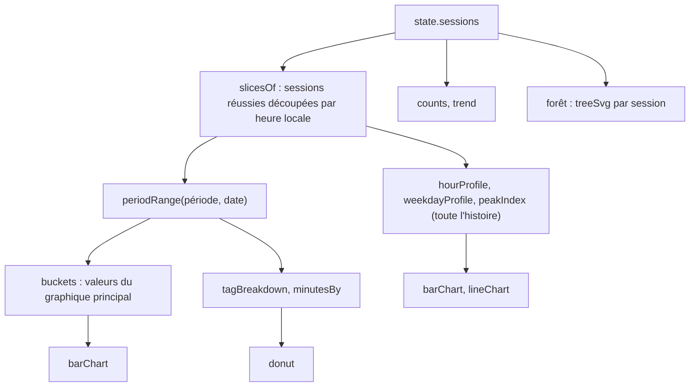

# Focus : statistiques et graphiques

**État :** Implémentée · **Vérifiée contre le code :** 2026-10-26

Retour à l'[index des fiches](README.md) · [ARCHITECTURE](../ARCHITECTURE.md) · [GLOSSAIRE](../GLOSSAIRE.md)

## 1. Objectif

Montrer à l'étudiant combien de temps il a réellement concentré (par jour, semaine, mois ou année), à quels moments il travaille le mieux, sur quelles tâches et quels événements, avec une forêt d'arbres plantés ou morts. Toutes les courbes sont dessinées en SVG par l'application, sans bibliothèque.

## 2. Périmètre

**Fait** : section « Statistiques » de l'onglet Focus ; quatre périodes navigables ; temps total ; graphique principal ; jour et heure les plus concentrés ; tendance par rapport à la période précédente ; répartition par tag ; temps par tâche et par événement ; compte des arbres plantés et morts ; fonctions de dessin `barChart`, `lineChart`, `donut`, `treeSvg`.

**Ne fait pas** : le minuteur et la gestion des sessions (fiche [focus-minuteur-et-arbre](focus-minuteur-et-arbre.md)) ; les sessions planifiées ([focus-sessions-planifiees](focus-sessions-planifiees.md)) ; exporter les statistiques (les sessions sont exportées avec l'onglet, [socle-import-export](socle-import-export.md)) ; comparer avec d'autres personnes.

## 3. Vue d'ensemble technique



## 4. Composants et fichiers concernés

| Chemin | Rôle |
|---|---|
| fichier de logique de Focus | fonctions pures : `hourSlices`, `slicesOf`, `periodRange`, `shiftPeriod`, `periodLabel`, `slicesIn`, `total`, `buckets`, `tagBreakdown`, `hourProfile`, `weekdayProfile`, `peakIndex`, `trend`, `counts`, `minutesBy` |
| onglet Focus (fonction `stats`) | assemble la page ; état de vue `ui.period` et `ui.date` |
| `js/ui/charts.js` | `svgEl`, `barChart`, `lineChart`, `donut`, `treeSvg` |
| `css/components.css` | classes `.chart`, `.donut`, `.tree`, `.forest`, couleurs `.c--<couleur>` |
| `tests/focus-logic.test.js`, `tests/modules.test.js` | tests de la logique et de la page |

## 5. Entrées / sorties

**Session** (dans `state.sessions`) : `{ id, start, planned, actual, status, tagId, title, todoId, eventId, planId }`. `status` vaut `done` (arbre planté) ou `failed` (arbre mort) ; `start` est une date ISO.

**Tranche horaire** (produite par `slicesOf`) : `{ date, hour, minutes, tagId, todoId, eventId }`. Une session réussie de 20 minutes commencée à 8 h 50 donne deux tranches : 10 minutes à 8 h et 10 minutes à 9 h (test).

**Périodes** : `day` (un jour), `week` (du lundi au dimanche), `month` (du 1er au dernier jour), `year` (de janvier à décembre).

| Carte de la page | Source | Remarque |
|---|---|---|
| Arbres plantés / morts | `counts` sur la période | compte par date de **début** de session |
| Forêt | sessions de la période | les 60 dernières ; un arbre par session (grand si réussie, mort si échouée) |
| Répartition du temps | `buckets` | 24 heures, 7 jours, jours du mois, ou 12 mois |
| Jour de concentration maximale | `weekdayProfile` | **toute l'histoire**, pas la période affichée |
| Période maximale de la journée | `hourProfile` | **toute l'histoire** ; point sur le pic |
| Tendance | `trend` | période courante contre la précédente, en minutes de plus ou de moins |
| Distribution des tags | `tagBreakdown` | pourcentage arrondi et temps par tag |
| Temps par tâche / événement | `minutesBy` | 5 premiers ; « Tâche supprimée » ou « Événement supprimé » si l'élément n'existe plus |

## 6. Fonctionnement détaillé

```text
FONCTION hourSlices(débutISO, minutes)
  t ← début ; reste ← minutes
  TANT QUE reste > 0
    prochaineHeure ← début de l'heure locale suivante
    m ← le plus petit entre reste et (prochaineHeure − t) en minutes
    AJOUTER { date: jour local de t, hour: heure locale de t, minutes: m }
    reste ← reste − m ; t ← prochaineHeure

FONCTION slicesOf(sessions)
  POUR CHAQUE session de statut « done » : hourSlices(start, actual), avec tagId, todoId, eventId
  // les sessions « failed » n'ajoutent aucune minute

FONCTION periodRange(vue, date)       // [première date, dernière date]
  week  : du lundi de la date au dimanche ; month : du 1er au dernier jour ; year : 1er janvier au 31 décembre ; day : [date, date]

FONCTION buckets(vue, tranches, date)
  dans ← tranches de la période
  day   : 24 cases (une par heure) ; week : 7 cases (lundi = 0) ; month : une case par jour du mois ; year : 12 cases
  RETOURNER { étiquettes, valeurs en minutes }

FONCTION trend(sessions, vue, date)
  cur ← total de la période ; prev ← total de la période précédente (shiftPeriod −1)
  RETOURNER { cur, prev, delta: cur − prev }

FONCTION tagBreakdown(tranches)
  somme par tagId ; pourcentage = arrondi(minutes / total × 100) ; tri décroissant

FONCTION minutesBy(sessions, clé, période)       // clé = 'todoId' ou 'eventId'
  somme des tranches de la période dont la clé est non vide ; tri décroissant ; RETOURNER [{ id, minutes }]

FONCTION peakIndex(valeurs)  : indice de la première valeur maximale ; −1 si tout est à 0
```

**Dessin** (`js/ui/charts.js`) :

```text
svgEl(balise, attributs, ...enfants)   : élément SVG créé par createElementNS ; texte en nœud texte ; jamais innerHTML
frame(valeurs, étiquettes, fmt, libellé) : cadre de 320 × 150, trois lignes de grille (0, ½, max) avec leurs valeurs ;
                                           aria-label « libellé : étiquette valeur, … » (les valeurs nulles sont omises) ou « aucune donnée »
barChart(valeurs, étiquettes, { label, every, fmt })   : une barre par valeur > 0 ; une étiquette toutes les `every` valeurs
lineChart(valeurs, étiquettes, { label, every, fmt, peak }) : polyligne ; cercle sur l'indice `peak` s'il est ≥ 0
donut(parts, centre)                   : anneau de rayon 40 ; chaque part { value, color, label } = un arc ; texte au centre ; aria-label « Répartition : … % »
treeSvg(stade, mort)                   : arbre dessiné selon le stade 0 (graine), 1 (pousse), 2, 3, 4 (arbre complet), ou arbre mort
```

Le stade d'un arbre pendant une session vient de `stageOf` (fiche [focus-minuteur-et-arbre](focus-minuteur-et-arbre.md)) : à partir de 66 % du temps prévu, l'arbre est au stade 3 ; à 100 %, au stade 4.

## 7. Dépendances

- **Internes** : dates et libellés de la logique de l'Agenda (`ymd`, `parseYMD`, `addDays`, `mondayOf`, `MONTHS`, `DAY_SHORT`) ; `js/dom.js` ; tags (`state.focusTags`), tâches (`state.todos`) et événements (`state.events`) pour les noms.
- **Navigateur** : SVG (`createElementNS`), `Date` en heure locale.
- **Externe** : aucun. **Variable d'environnement** : aucune. **Clé** : `state.sessions` dans `studenthub:v1`.

## 8. Cas limites et erreurs

| Situation | Comportement |
|---|---|
| aucune session | graphiques à zéro, « Pas encore de données. », « Aucun arbre sur cette période. » |
| session échouée | un arbre mort dans la forêt et dans « Arbres morts » ; **aucune minute** comptée |
| session à cheval sur deux heures ou deux jours | découpée par heure locale, chaque tranche va à son jour et à son heure |
| tag supprimé ou vide | « Sans tag » en bleu |
| tâche ou événement supprimé | « Tâche supprimée » ou « Événement supprimé » |
| égalité entre deux jours ou deux heures | le premier (le plus tôt) est retenu comme pic |
| plus de 60 sessions dans la période | la forêt n'en montre que les 60 dernières |
| période précédente sans donnée | tendance « de plus » égale au total courant |

## 9. Tests

- Fichiers : `tests/focus-logic.test.js` (découpe par heure locale ; bornes et décalage des périodes ; « seuls les arbres réussis comptent » : totaux, 24 cases du jour, 7 de la semaine, 31 du mois, 12 de l'année, 50 % et 50 % par tag, pics, `counts` à 1 réussi et 1 échoué ; tendance de 40 contre 35 minutes et temps par tâche) ; `tests/modules.test.js` (onglet Focus : « Arbres plantés : 2 », « Arbres morts : 1 », « 55 min », « Concentration maximale moyenne vers 09:00 », trois arbres dans la forêt, un anneau, au moins trois graphiques après changement de période).
- Lancer : `npm test`.
- Ne couvre pas : les fonctions de dessin une par une (`barChart`, `lineChart`, `donut` n'ont pas de test propre), le texte `aria-label` des graphiques, le passage d'heure d'été, les noms « supprimée ».

## 10. Pièges et dette technique

- **Deux cartes ne suivent pas la période** : « Jour de concentration maximale » et « Période maximale de la journée » additionnent **toute l'histoire** ; le texte « Concentration maximale moyenne vers… » parle d'une moyenne alors que ce sont des sommes.
- **La semaine commence toujours le lundi** dans les statistiques, quel que soit le réglage « Premier jour de la semaine » ([socle-parametres](socle-parametres.md)).
- **Les sessions échouées ne comptent pas en minutes** : elles ne figurent que dans les arbres morts, même si l'étudiant a travaillé avant de quitter l'application.
- **Les arbres de la forêt sont tous au stade 4** : un arbre mort est dessiné mort, pas à son stade d'avancement.
- **Pourcentages arrondis** : leur somme peut ne pas valoir 100.
- **État de vue en mémoire** : `ui.period` et `ui.date` repartent d'aujourd'hui au rechargement de la page.
- **Pas de test de `charts.js`** : une erreur de calcul de position ne serait vue qu'à l'œil.

## 11. Pour modifier ou étendre

1. **Nouvelle statistique** : ajouter une fonction pure dans la logique de Focus (avec un test dans `tests/focus-logic.test.js`), puis une `card(…)` dans `stats()`.
2. **Nouveau type de graphique** : l'ajouter à `js/ui/charts.js`, construit avec `svgEl` (jamais `innerHTML`), avec un `role="img"` et un `aria-label` qui résume les valeurs.
3. **Rendre les pics dépendants de la période** : passer `inRange` au lieu de `all` à `hourProfile` et `weekdayProfile`, et corriger le mot « moyenne ».
4. **Ne pas casser** : l'exclusion des sessions échouées des minutes ; le découpage par heure locale ; les `aria-label` des graphiques.
5. Relancer `npm run build:sw` puis `npm test`.
