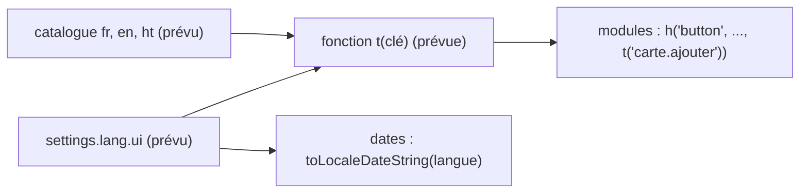

# Interface en plusieurs langues

**État :** Prévue · **Vérifiée contre le code :** 2026-10-29

Retour à l'[index des fiches](README.md) · [ARCHITECTURE](../ARCHITECTURE.md) · [GLOSSAIRE](../GLOSSAIRE.md) · Décision liée : [ADR-001](../decisions/001-pas-de-framework.md)

> Cette fonctionnalité **n'existe pas** (tâche T21 du [plan des tâches](../plans/plan-taches.md)). L'interface est écrite en français dans le code. Cette fiche décrit ce qui est déjà configurable, ce qui est figé en français, et par où commencer. Les noms marqués « prévu » ne sont pas dans le code.

## 1. Objectif

Pouvoir afficher l'interface (boutons, messages, dates) dans une autre langue que le français, par exemple le créole haïtien ou l'anglais, sans dupliquer l'application. Aujourd'hui Paramètres l'annonce : « français (la seule disponible pour l'instant) ».

## 2. Périmètre

Existe déjà, **sans traduire l'interface** :
- `settings.lang.cards` : langue des cartes, fiches, podcasts et prompts générés par l'IA (6 choix) ;
- `settings.lang.voice` : langue de la lecture à voix haute (7 choix) ;
- le tuteur répond « dans la langue du premier message, français ou créole » (règle de `docs/fds-tutor.md`).

Prévu, absent : un catalogue de textes par langue, un choix de langue d'interface, la mise en forme des dates selon la langue, le sens d'écriture de droite à gauche.

## 3. Vue d'ensemble technique

Aujourd'hui, chaque module écrit ses textes en français dans le code. Cible possible (prévue) :



## 4. Composants et fichiers concernés

| Chemin | Rôle aujourd'hui |
|---|---|
| `js/settings-logic.js` | `CARD_LANGS`, `VOICE_LANGS`, valeurs par défaut (`lang: { cards: 'français', voice: 'fr-FR' }`). |
| `js/modules/settings-ui.js` | Section « Langues » et la phrase qui dit que l'interface est en français seulement. |
| `js/constants.js` | Libellés en français **qui sont aussi des valeurs stockées** : `STATUSES`, `TYPES`, `SEMESTERS`. |
| `js/calendar-logic.js` | `MONTHS` et `longDate` (`'fr-FR'`). |
| `js/dom.js` | `formatDate` (`'fr-FR'`). |
| `js/library-logic.js` | Tris avec `localeCompare(…, 'fr')`. |
| `js/modules/home.js`, `js/modules/messages.js`, `js/modules/videos.js`, `js/modules/settings.js`, `js/focus-logic.js` | Dates formatées en `'fr-FR'`. |
| `index.html` | `<html lang="fr">`. |
| `docs/fds-tutor.md` | Prompt du tuteur : français et créole. |

## 5. Entrées / sorties

Aujourd'hui, la seule valeur de langue de l'interface est implicite (français). Prévu : un réglage `settings.lang.ui` (clé non créée), et des catalogues de la forme clé → texte, par exemple `{ "carte.ajouter": "+ Carte" }`. Les sauvegardes et la synchronisation ne contiennent pas de langue d'interface.

## 6. Fonctionnement détaillé

Il n'y a pas d'algorithme existant. Mesure faite pendant cette vérification : environ 660 littéraux de texte accentués dans `js/` (hors prompt du tuteur), surtout dans `js/modules/revision.js`, `js/modules/calendar.js`, `js/goals-logic.js`, `js/modules/focus.js` et `js/revision-logic.js`. Cette mesure est approximative (elle ignore les textes sans accent).

Conception minimale proposée (prévue) :

```text
FONCTION t(clé, variables)
  texte ← catalogue[langue][clé] ?? catalogue["fr"][clé] ?? clé
  RETOURNER texte avec les variables substituées            // pas de innerHTML : le résultat reste du texte

FONCTION formatDate(iso)
  RETOURNER toLocaleDateString(langue de l'interface, { day, month })
```

La construction du DOM par `h()` met déjà tout texte dans des nœuds texte, donc `t()` s'insère sans toucher à la sécurité ([ADR-004](../decisions/004-csp-stricte-sans-innerhtml.md)).

## 7. Dépendances

Prévu : aucune bibliothèque (cohérent avec [ADR-001](../decisions/001-pas-de-framework.md)) ; `Intl` et `toLocaleDateString` du navigateur pour les dates ; `localStorage` pour le réglage (dans `settings`, exporté avec les données mais propre à chaque appareil comme les autres réglages). Aucune variable d'environnement.

## 8. Cas limites et erreurs

À décider avant de coder :
- **Valeurs stockées en français.** Un statut de to-do est enregistré comme `'A faire'`, `'En cours'`, `'Terminés'` ; un type comme `'Examen'` ; un semestre comme `'Semestre 1'`. Le nettoyage (`oneOf` dans `js/store.js`) n'accepte que ces valeurs. Traduire l'affichage exige de séparer clé stockée et libellé, sans quoi les sauvegardes et la synchronisation existantes casseraient.
- **Contenu pré-rempli** : cours de départ (`SEED_COURSES`), guide de 33 conseils, textes des prompts. Les traduire ou les laisser en français ?
- **Arabe** : proposé pour les cartes et la voix ; une interface de droite à gauche demanderait de revoir le CSS (une quarantaine de règles de marge ou de remplissage à examiner).
- **Texte manquant** dans une langue : retomber sur le français plutôt que d'afficher une clé.

## 9. Tests

Aucun test de traduction. Un futur test devrait vérifier que chaque catalogue contient les mêmes clés que le français et que toute variable (`{n}`) y figure.

## 10. Pièges et dette technique

- Les textes sont mêlés à la logique (par exemple des phrases construites avec des pluriels dans `js/modules/revision.js`) : le pluriel et l'ordre des mots varient selon les langues, un simple remplacement de chaînes ne suffit pas.
- `tests/` contient de nombreuses vérifications sur des textes français affichés (`'Révéler'`, `'Session enregistrée'`…) : elles devront utiliser les clés ou rester en français.
- Les prompts générés (`SYS`, `TASKS`, `SHEET`) sont en français et reçoivent seulement une consigne « Rédige en … » : la langue de l'interface et celle des prompts sont deux sujets distincts.
- Dates : sans changement, les mois restent en français quelle que soit la langue choisie.

## 11. Pour modifier ou étendre

Commencer par l'infrastructure, pas par les traductions : créer `t()` et un catalogue français complet, migrer un module à la fois (en gardant `npm test` vert), puis seulement ajouter une langue. Traiter à part les valeurs stockées de `js/constants.js`. Après chaque lot : `npm run build:sw`, puis `npm test`. Passer cette fiche à `Partielle` quand le premier module est migré.
