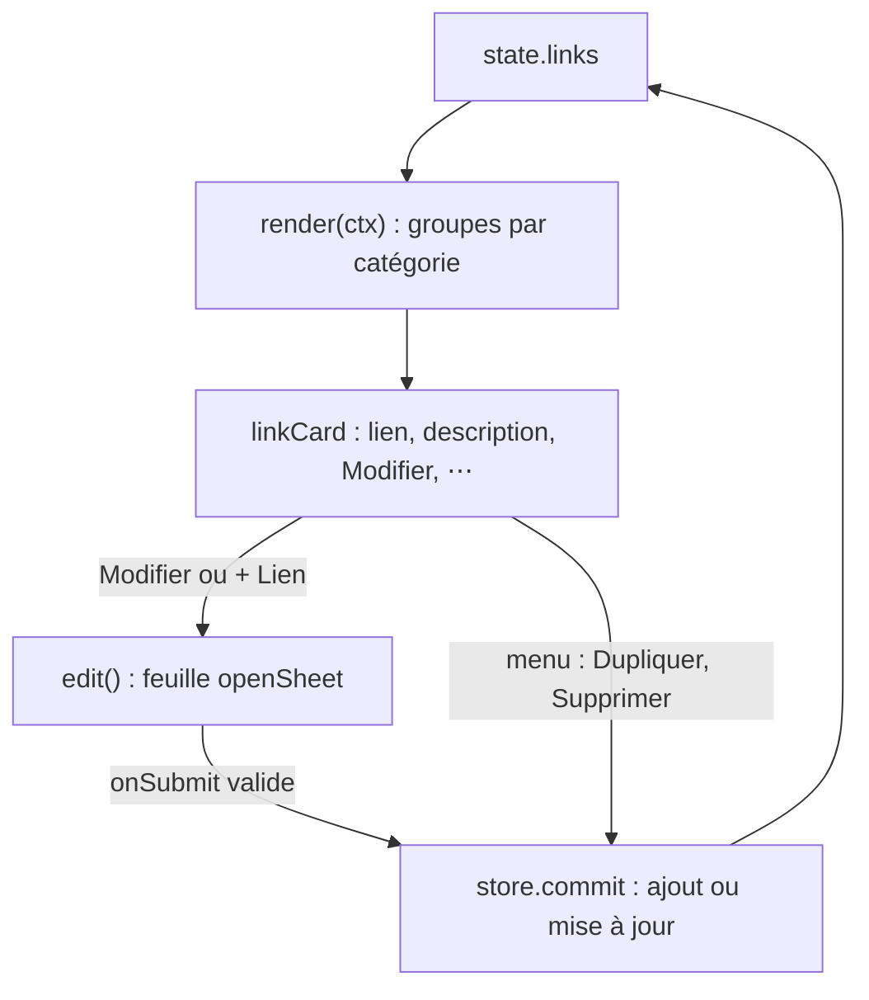

# Onglet Liens

**État :** Implémentée · **Vérifiée contre le code :** 2026-10-26

Retour à l'[index des fiches](README.md) · [ARCHITECTURE](../ARCHITECTURE.md) · [GLOSSAIRE](../GLOSSAIRE.md)

## 1. Objectif

Garder au même endroit les adresses utiles de l'étudiant (portail de l'école, ressources de cours, outils), classées par catégorie, et les ouvrir en un clic dans un nouvel onglet.

## 2. Périmètre

**Fait** : ajouter, modifier, dupliquer, supprimer un lien ; regroupement par catégorie ; ouverture dans un nouvel onglet ; copie de l'adresse ; menu contextuel ; export et import de l'onglet.

**Ne fait pas** : vérifier qu'un lien répond ; récupérer le titre ou l'icône d'un site ; trier ou réordonner les liens ; chercher dans l'onglet (la recherche globale de Home inclut les liens) ; accepter autre chose que `http://` ou `https://`.

## 3. Vue d'ensemble technique



## 4. Composants et fichiers concernés

| Chemin | Rôle |
|---|---|
| `js/modules/links.js` | `render(ctx)`, `linkCard`, `edit` |
| `js/store.js` | `newLink`, `uid`, validation de `links` à la lecture |
| `js/dom.js` | `h`, `field`, `empty`, `safeUrl` |
| `js/ui/context-menu.js` | `attachMenu`, `menuButton`, `copyItem`, `deleteItem` ([socle-menu-contextuel](socle-menu-contextuel.md)) |
| `js/ui/dialog.js` | `openSheet` ([socle-interface](socle-interface.md)) |
| `css/components.css` | `.linkcards`, `.linkcard`, `.linkcard__title` |
| `tests/modules.test.js`, `tests/ux.test.js` | tests de l'onglet et de son menu |

## 5. Entrées / sorties

**Donnée** : `state.links`, une liste d'objets.

```json
{ "id": "k3j9x2a", "title": "Portail", "url": "https://exemple.org/", "description": "Notes et devoirs", "category": "École" }
```

| Champ | Limite à la lecture (`sanitize`) |
|---|---|
| `id` | 40 caractères ; un identifiant est créé s'il manque |
| `title` | 300 |
| `url` | 2000 |
| `description` | 1000 |
| `category` | 100 |

**Export** : section « Liens » (`links`), voir [socle-import-export](socle-import-export.md). Les suppressions sont suivies pour la synchronisation (`links` fait partie de `TRACKED`, [socle-synchronisation](socle-synchronisation.md)).

## 6. Fonctionnement détaillé

```text
FONCTION render(ctx)
  groupes ← table ordonnée vide
  POUR CHAQUE lien DANS state.links
    clé ← lien.category sans espaces de bord, SINON 'Divers'
    ajouter lien au groupe clé                                  // les groupes suivent l'ordre de première apparition
  SI aucun lien : AFFICHER « Aucun lien pour l'instant. »
  SINON POUR CHAQUE groupe : <section> titre de la catégorie + une carte par lien

FONCTION linkCard(store, l)
  href ← safeUrl(l.url)                                          // http(s) seulement, sinon rien
  SI href : <a href=href target="_blank" rel="noopener noreferrer"> titre OU adresse </a>
  SINON : <span> titre OU « (lien invalide) » </span>            // jamais cliquable
  actions du menu : « Ouvrir » et « Copier le lien » (si href), « Modifier », « Dupliquer », « Supprimer » (avec confirmation)

FONCTION edit(store, lien)                                       // feuille « Nouveau lien » ou « Modifier le lien »
  champs : Titre (obligatoire), Adresse (type url, obligatoire), Description, Catégorie
  onSubmit :
    href ← safeUrl(adresse)
    SI titre vide : RETOURNER « Le titre est obligatoire. »
    SI href absent : RETOURNER « L'adresse doit commencer par http:// ou https:// »
    store.commit : SI nouveau, ajouter ; SINON fusionner dans le lien de même id
    // l'adresse enregistrée est href, c'est-à-dire l'adresse normalisée

FONCTION Dupliquer : ajouter newLink({ ...l, id: uid(), title: l.title + ' (copie)' })
```

## 7. Dépendances

- **Internes** : `js/dom.js`, `js/store.js`, `js/ui/context-menu.js`, `js/ui/dialog.js`.
- **Navigateur** : `window.open` (menu « Ouvrir »), `URL`.
- **Externe** : aucun. **Variable d'environnement** : aucune. **Clé de stockage** : `state.links` dans `studenthub:v1`.

## 8. Cas limites et erreurs

| Situation | Comportement |
|---|---|
| aucun lien | message vide avec une suggestion |
| catégorie vide | groupe « Divers » |
| adresse `javascript:…`, `data:…` ou illisible (venue d'un import) | lien affiché **non cliquable** (« (lien invalide) » ou le titre), sans « Ouvrir » ni « Copier le lien » |
| titre vide | « Le titre est obligatoire. » ; la feuille reste ouverte |
| adresse sans `http(s)://` | « L'adresse doit commencer par http:// ou https:// » (le champ `type="url"` du navigateur peut refuser avant) |
| suppression | confirmation « Supprimer ce lien ? » (menu et bouton de la feuille) |
| lien dupliqué | nouvel `id`, titre suivi de « (copie) » |

## 9. Tests

- Fichiers : `tests/modules.test.js` (« liens : groupés par catégorie, URL dangereuse non cliquable » : groupes « École » et « Divers », aucun `a[href^="javascript"]`, un seul lien `target="_blank"` avec `noopener`) ; `tests/ux.test.js` (menu du lien : « Copier le lien », « Ouvrir », « Dupliquer » crée « ENT (copie) » avec un nouvel `id`).
- Lancer : `npm test`.
- Ne couvre pas : la feuille de modification (messages d'erreur, enregistrement), la suppression par la feuille, le bouton « Ouvrir » réel (`window.open`).

## 10. Pièges et dette technique

- **Les catégories sont comparées telles quelles** : « École » et « ecole » forment deux groupes.
- **L'adresse est normalisée à l'enregistrement** : `https://exemple.org` devient `https://exemple.org/` (c'est `URL.href`).
- **Le bouton « Supprimer » de la feuille ferme la première feuille ouverte** (`document.querySelector('dialog.sheet')`) : correct tant qu'une seule feuille est ouverte.
- **Pas de tri** : l'ordre est celui de la liste, les nouveaux liens arrivent à la fin de leur catégorie.
- **Aucun contrôle des doublons** : la même adresse peut être enregistrée plusieurs fois.

## 11. Pour modifier ou étendre

1. **Nouveau champ** (ex. icône, favori) : l'ajouter dans `newLink`, la validation `links` de `js/store.js` (avec une limite), la feuille `edit`, et un test.
2. **Ne pas casser** : l'appel à `safeUrl` avant tout `href` ou `window.open` ([ADR-004](../decisions/004-csp-stricte-sans-innerhtml.md)) ; `rel="noopener noreferrer"` ; le groupe « Divers ».
3. **Chercher dans les liens** : déjà fait par la [recherche globale](socle-recherche-globale.md) (titre, adresse, description).
4. Relancer `npm run build:sw` puis `npm test`.
