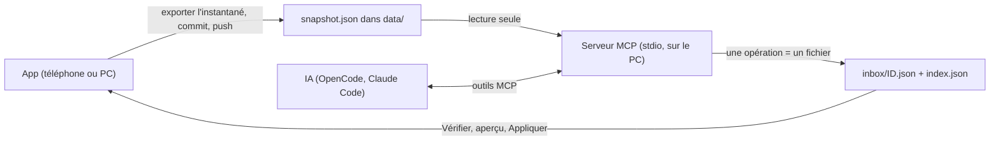

# MCP : lire Student Hub et y déposer du contenu depuis une IA

**État :** Prévue · **Vérifiée contre le code :** 2026-10-29

Retour à l'[index des fiches](README.md) · [ARCHITECTURE](../ARCHITECTURE.md) · [GLOSSAIRE](../GLOSSAIRE.md) · Décisions liées : [ADR-002](../decisions/002-aucun-token-github-dans-le-navigateur.md), [ADR-009](../decisions/009-synchronisation-supabase.md), [ADR-018](../decisions/018-aucune-donnee-privee-dans-le-depot-public.md)

> Rien de cette fiche n'existe dans le code. Elle résume le [plan MCP](../plans/plan-mcp.md) et note ce qui est déjà prêt et ce qui reste à trancher. Les noms d'outils, de fichiers et de clés ci-dessous sont **prévus** : ils ne se trouvent pas encore dans le dépôt.

## 1. Objectif

Permettre à une IA de travail (OpenCode, Claude Code, Hermes) de **lire** l'état de Student Hub et d'**y proposer** des cartes, tâches, événements, notes, objectifs, conseils ou bilans de tuteur, sans jamais placer de jeton GitHub dans le navigateur ([ADR-002](../decisions/002-aucun-token-github-dans-le-navigateur.md)).

## 2. Périmètre

Prévu :
- un instantané de l'état déposé dans le dépôt, lu par le serveur MCP ;
- une boîte de réception d'opérations (un fichier par opération) que l'app lit, montre puis applique sur clic ;
- un serveur MCP local (transport stdio) avec outils de lecture, outils d'écriture, ressources et prompts.

Hors périmètre du plan : synchronisation automatique app → dépôt, MCP distant accessible depuis le téléphone, notifications application fermée ([notifications-application-fermee.md](notifications-application-fermee.md)).

## 3. Vue d'ensemble technique



Le MCP n'écrit jamais dans l'état de l'app : il ne fait que déposer des opérations. Rien ne s'applique sans clic dans l'app.

## 4. Composants et fichiers concernés

Existant, réutilisable tel quel :

| Chemin | Rôle |
|---|---|
| `js/data-io.js` | `exportAll` produit déjà l'enveloppe `{ app, kind, version, exportedAt, data }` qui servira d'instantané ; `applyImport` et `mergeList` fixent les règles de fusion. |
| `js/revision-logic.js`, `js/goals-logic.js`, `js/planning.js`, `js/fsrs.js` | Validation et calculs purs que le MCP doit réutiliser (une seule source de vérité). |
| `js/tutor-logic.js` | `parseSessionLog`, `applySessionLog` : modèle pour l'opération de bilan de session. |
| `docs/fds-tutor.md` | Prompt du tuteur, exposé comme ressource du MCP. |

À créer (prévu) : un dossier `mcp/` avec son propre `package.json` et un point d'entrée `server.mjs` ; côté app, un module `inbox.js` dans `js/` ; dans `data/`, `snapshot.json`, `inbox/index.json` et `inbox/<id>.json`. Aucun de ces éléments n'existe aujourd'hui (vérifié : pas de dossier `mcp/`, pas de clé d'état `appliedOps`, pas de code d'« inbox » ou d'« instantané »).

## 5. Entrées / sorties

Opération prévue (un fichier par opération) :

```json
{ "id": "op-20261022-103000-a1b2", "version": 1, "at": "2026-10-22T10:30:00Z", "source": "opencode",
  "op": "cards.add", "needsConfirm": false,
  "payload": { "deckId": "d1", "cards": [ { "type": "qa", "front": "…", "back": "…", "layer": "core" } ] } }
```

Types d'opérations prévus (v1) : `todo.add`, `todo.update`, `event.add`, `event.link_task`, `note.add`, `link.add`, `deck.add`, `deck.update`, `cards.add`, `gap.add`, `goal.add`, `tip.add`, `session.log`, `delete.request` (toujours avec confirmation). Le site ne pouvant pas lister un dossier, `index.json` donne la liste des fichiers.

## 6. Fonctionnement détaillé

Noms **prévus**, non présents dans le code :

```text
FONCTION verifierBoiteDeReception()                      // côté app, bouton « Vérifier »
  index ← télécharger index.json (même origine, sans cache)
  POUR CHAQUE nom DANS index : lire l'opération
  ignorer celles dont l'id est dans appliedOps
  RETOURNER un aperçu en texte, SANS rien appliquer       // « 15 cartes dans Cinématique »

FONCTION appliquer(operation)                             // bouton « Appliquer »
  SI operation.needsConfirm : demander un clic individuel
  valider avec les MÊMES fonctions que l'import (sanitizeRevision, parseCards…)
  SI invalide OU cible disparue : l'ignorer et la lister, sans bloquer les autres
  SINON appliquer dans un commit ; ajouter operation.id à appliedOps (plafonné)   // idempotence
```

Côté MCP : chaque outil d'écriture valide son entrée avec ces mêmes fonctions, écrit le fichier d'opération de manière atomique (fichier temporaire puis renommage), régénère `index.json` et répond avec l'identifiant et ce qui sera appliqué. Chaque réponse de lecture indique l'âge de l'instantané (avertissement au-delà de 3 jours).

## 7. Dépendances

- Prévu : SDK TypeScript officiel du MCP et `zod` dans `mcp/` seulement (l'app reste sans dépendance d'exécution, [ADR-001](../decisions/001-pas-de-framework.md)), versions épinglées.
- CSP actuelle : `connect-src 'self' https://*.supabase.co` ; la lecture de l'index et des opérations sur la même origine est déjà permise.
- Services : dépôt GitHub (public, voir [ADR-018](../decisions/018-aucune-donnee-privee-dans-le-depot-public.md)), GitHub Pages ; aucune variable d'environnement dans l'app.

## 8. Cas limites et erreurs

Comportements voulus par le plan : opération invalide ou dont la cible n'existe plus → ignorée et listée ; opération rejouée → sans effet ; instantané trop vieux → avertissement ; chemins confinés au dépôt ; 40 cartes par appel au plus. **Contenu non fiable :** notes, résumés d'e-mails (Hermes) et textes de cours peuvent contenir des instructions cachées ; le MCP les présente comme des données et les résumés de messages sont désactivés par défaut.

## 9. Tests

Aucun test aujourd'hui. Le plan prévoit, avant chaque phase : opération → aperçu → application → état correct, rejouer ne change rien, puis un aller-retour complet MCP → app.

## 10. Pièges et dette technique

- **Données privées dans un dépôt public.** Un instantané contient tes données ; tant que le dépôt est public, il ne doit pas y être déposé tel quel ([ADR-018](../decisions/018-aucune-donnee-privee-dans-le-depot-public.md), question toujours ouverte). Sans cela, ce plan est bloqué.
- **Concurrence avec la synchronisation.** [ADR-009](../decisions/009-synchronisation-supabase.md) cite ce plan comme alternative rejetée : si Supabase est utilisé, il faut décider lequel fait foi pour éviter deux sources de vérité.
- Le plan reste manuel : exporter, pousser, vérifier, appliquer.
- Branchement d'OpenCode 2.0 : format de configuration à confirmer dans sa documentation.
- Les cinq décisions de la section 10 du plan sont encore ouvertes (instantané manuel ou rappel, `--autocommit`, lecture des messages Hermes, lieu d'exécution, fichier par opération).

## 11. Pour modifier ou étendre

Commencer par la phase 1 du plan (contrats, `appliedOps`, panneau « Boîte de réception »), en tests d'abord. Garder une seule source de validation (les fonctions de `js/`). Quand une phase est livrée, passer l'état de cette fiche à `Partielle` et remplacer les noms « prévus » par les vrais. Après toute modification de l'app : `npm run build:sw`, puis `npm test`.
