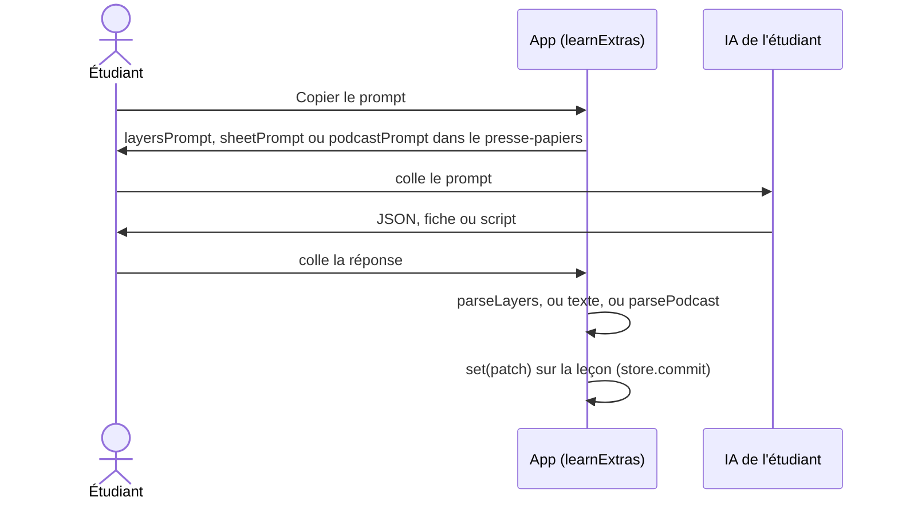

# Mémorisation : Apprendre (couches, fiches, podcast)

**État :** Implémentée · **Vérifiée contre le code :** 2026-10-29

Retour à l'[index des fiches](README.md) · [ARCHITECTURE](../ARCHITECTURE.md) · [GLOSSAIRE](../GLOSSAIRE.md) · Décision : [ADR-007](../decisions/007-ia-par-copier-coller.md)

## 1. Objectif

Transformer le texte d'un cours en trois supports de travail, produits par l'IA de l'étudiant : une **cartographie en couches** (noyaux, piliers, détails), une **fiche** de révision (4 styles × 4 longueurs) et un **podcast** à deux voix lu par le navigateur. L'app fournit les prompts, range les réponses collées et les affiche ; elle n'appelle aucune IA ([ADR 007](../decisions/007-ia-par-copier-coller.md)).

## 2. Périmètre

Fait :
- saisie de la source du cours et des corrigés validés (champs de la leçon) ;
- prompts de cartographie, de fiche et de podcast, copiés dans le presse-papiers ;
- lecture du JSON de cartographie, enregistrement de la fiche et du script ;
- affichage sans `innerHTML` (titres, listes, gras) ; lecture vocale du podcast ;
- conversion des questions de rappel en cartes.

Ne fait pas :
- le planning et les jauges de la partie « Examen et planning » du même sous-onglet → [memo-planning.md](memo-planning.md) ;
- la génération de cartes → [memo-cartes-et-revision.md](memo-cartes-et-revision.md) ;
- aucun export audio du podcast ; aucune vérification que le contenu collé vient bien de la source.

## 3. Vue d'ensemble technique



## 4. Composants et fichiers concernés

| Chemin | Rôle |
|---|---|
| `js/study-logic.js` | `STYLES`, `LENGTHS`, `sheetPrompt`, `podcastPrompt`, `layersPrompt`, `parsePodcast`, `parseLayers`, `sheetBlocks`. |
| `js/modules/learn-ui.js` | `learnExtras` : trois sections (couches, fiche, podcast), `sheetView`, `pickVoices`, `speak`. |
| `js/modules/revision.js` | `learnTab` : source du cours, corrigés, puis `learnExtras`, puis examen et planning. |
| `js/revision-logic.js` | `SYS` (consigne commune), `newDeck`, nettoyage des champs de la leçon. |
| `js/settings-logic.js` | `settings.lang.cards` (langue des textes générés), `settings.lang.voice` (langue de lecture). |
| `tests/tutor.test.js` | Tests de `study-logic.js` et de l'onglet Apprendre. |

## 5. Entrées / sorties

Champs de la leçon alimentés :

```json
{ "layers": { "core": ["Somme des moments nulle"], "pillar": ["Bras de levier"], "detail": [] },
  "summary": "Résumé en deux minutes…", "recall": [{ "q": "Pourquoi A ?", "a": "Parce que" }],
  "sheet": { "style": "exam", "length": "medium", "text": "# Titre\n- point **clé**" },
  "podcast": "HÔTE: Bonjour\nEXPERTE: Voici l'idée.\n[PAUSE 3s]" }
```

JSON attendu pour la cartographie : `{ "cores":[{"id","text"}], "pillars":[{"id","core_id","text"}], "details":[{"id","pillar_id","text"}], "two_minute_summary", "recall_questions":[{"core_id","q","a"}] }` (les éléments peuvent aussi être de simples chaînes).

Longueurs de fiche : `cheat` 250 mots, `short` 500, `medium` 900, `long` 1 600. Styles : `exam`, `memo`, `simple`, `full`.

## 6. Fonctionnement détaillé

Les prompts commencent par `SYS` (« tuteur expert… uniquement à partir du contenu entre `<source>` ») **privé de sa dernière phrase**, celle qui demande un champ `layer` (retirée par une expression régulière, car elle n'a pas de sens hors cartes), puis une tâche, la langue (`settings.lang.cards`) et la source entre `<source>…</source>`. Les boutons « Copier le prompt » sont grisés tant que la source est vide.

```text
FONCTION parsePodcast(text)
  POUR CHAQUE ligne non vide :
    SI la ligne commence par HÔTE|HOTE|EXPERTE|EXPERT suivi de « : » → qui ← host ou expert, reste ← suite
    SINON qui ← celui de la dernière réplique (host au début), reste ← ligne entière
    DÉCOUPER reste autour de [PAUSE n s]
      marqueur → { pause: min(10, n) × 1000 }
      texte non vide → { who: qui, text }
```

Exemple du test : `HÔTE: Bonjour ! [PAUSE 3s]` / `EXPERTE: Voici l'idée.` / `suite de la réplique` / `[PAUSE 30s]` / `Hote: Merci.` donne `host:Bonjour !`, pause 3000, `expert:Voici l'idée.`, `expert:suite de la réplique`, pause 10000 (plafonnée), `host:Merci.`

```text
FONCTION parseLayers(text)
  JSON ← text sans clôtures ```  ; ERREUR « Réponse illisible… » si invalide
  core, pillar, detail ← le texte de chaque élément (chaîne, ou champ text), non vides ; 40, 120, 200 au plus
  SI core est vide : ERREUR « Aucun noyau trouvé : le JSON doit contenir « cores ». »
  recall ← les recall_questions ayant un q non vide (40 au plus)
  RETOURNER { layers, summary: two_minute_summary (5 000 car. au plus), recall }
```

`sheetBlocks` découpe une fiche ligne à ligne : `#` à `####` → titre, `-`, `*`, `•`, `1.` ou `1)` → puce, sinon paragraphe. `sheetView` convertit `**gras**` en élément `strong` par découpage sur `**`, sans `innerHTML` ([ADR 004](../decisions/004-csp-stricte-sans-innerhtml.md)).

Lecture vocale : « ▶ Écouter » incrémente un jeton ; chaque morceau vérifie qu'il appartient au jeton courant, donc « ■ Arrêter » ou une nouvelle lecture invalide l'ancienne. Les pauses utilisent `setTimeout`. Vitesses : 0,8 / 1 / 1,25 / 1,5.

« En faire des cartes » crée une carte `qa` de couche `core` par question de rappel dont l'énoncé n'est pas déjà le `front` d'une carte de la leçon ; une réponse vide devient « (à compléter) ».

## 7. Dépendances

- Internes : `revision-logic.js` (`SYS`, `newCard`), `dom.js`, `store` via `ctx`.
- Navigateur : presse-papiers, `speechSynthesis` et `SpeechSynthesisUtterance` (facultatifs : sans eux le script reste lisible).
- Réglages : `settings.lang.cards`, `settings.lang.voice`.
- Stockage : champs de la leçon dans `studenthub:v1`. Services externes et variables d'environnement : aucun.

## 8. Cas limites et erreurs

- Source vide : boutons de copie grisés.
- Messages : « Colle d'abord la fiche. », « Aucune réplique trouvée (lignes HÔTE: et EXPERTE:). », « Aucun noyau trouvé… », « La lecture à voix haute n'est pas disponible sur ce navigateur : le script reste lisible ci-dessous. », « Copie impossible ici… ».
- Fiche ou script collé : tronqué à 50 000 caractères sans avertissement (le champ de saisie accepte 60 000).
- Supprimer la fiche garde son style et sa longueur ; supprimer le script arrête la lecture.
- Enregistrer une nouvelle cartographie **remplace** l'ancienne sans confirmation.

## 9. Tests

`tests/tutor.test.js` : 16 combinaisons style × longueur (source et consigne présentes, pas de consigne de couche), le style « simple » avec niveau, `sheetBlocks`, `parsePodcast` (voix, pauses, plafond), `parseLayers` (formes mixtes, erreurs), nettoyage des champs à l'import, et l'onglet : cartographie enregistrée, cartes de rappel créées une seule fois, fiche affichée avec titre et gras, script de 2 répliques.

**Couvert par `tests/fixes.test.js`** : niveau transmis au prompt, choix des voix par langue, hiérarchie des couches, « sous : … ». **Non couvert :** la lecture vocale réelle (jsdom n'a pas `speechSynthesis`), les conversions de limites (50 000 caractères).

## 10. Pièges et dette technique

- **Corrigé : la hiérarchie des couches est conservée.** `parseLayers` garde pour chaque pilier l'indice de son noyau (`core_id`) et pour chaque détail l'indice de son pilier (`pillar_id`), dans `deck.layers.parents` (`{ pillar: [...], detail: [...] }`, -1 si inconnu). `sanitizeRevision` les aligne sur les listes et les borne ; l'écran affiche « — sous : … ». Les anciennes leçons n'ont pas de parents (-1). Limite : le `core_id` des questions de rappel n'est toujours pas conservé, et modifier la liste à la main ne met pas les indices à jour.
- **Corrigé : le niveau de la leçon est transmis.** `learnExtras` passe `deck.level` à `sheetPrompt`, qui le traduit (`LEVEL_TEXT` : débutant, intermédiaire, avancé) et ajoute « Adapte le vocabulaire et la profondeur à … » pour les styles autres que « Vulgarisation » ; sans niveau, le prompt est inchangé.
- **Corrigé : la voix suit la langue choisie.** `pickVoices` retient les voix dont la langue commence par celle de `settings.lang.voice` (« fr-FR » → « fr… », « ar-SA » → « ar… ») ; sans voix dans cette langue, le navigateur choisit la sienne. Les voix peuvent encore être vides au premier appel dans certains navigateurs ; non vérifié sur appareil réel.
- Une liste numérotée est affichée comme une liste à puces (les numéros sont perdus).
- Les prompts embarquent toute la source (jusqu'à 50 000 caractères) ; seul le tuteur la coupe ([memo-tuteur.md](memo-tuteur.md)).

## 11. Pour modifier ou étendre

- Nouveau style de fiche : ajouter une entrée à `STYLES`, une fonction dans `SHEET` et au besoin `SHEET_STYLES` dans `revision-logic.js` (sinon le nettoyage le ramène à `full`).
- La hiérarchie des couches est dans `deck.layers.parents` : toute modification de `deck.layers` doit passer par `layersOf` (`sanitizeRevision`) et garder les listes alignées ; `priorities` du tuteur peut s'en servir pour ordonner les piliers sous leurs noyaux.
- Après modification : `npm run build:sw`, puis `npm test`.
