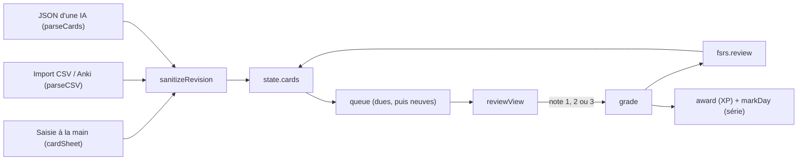

# Mémorisation : cartes et révision

**État :** Implémentée · **Vérifiée contre le code :** 2026-10-29

Retour à l'[index des fiches](README.md) · [ARCHITECTURE](../ARCHITECTURE.md) · [GLOSSAIRE](../GLOSSAIRE.md) · Décision : [ADR-007](../decisions/007-ia-par-copier-coller.md)

## 1. Objectif

Regrouper le cours en **leçons**, y ranger des **cartes** de six types (question/réponse, définition, mot/traduction, QCM, vrai/faux, à trous), puis les réviser en séance courte avec une répétition espacée. Les cartes se créent à la main, par import CSV/TSV/Anki, ou par une IA que l'étudiant utilise lui-même (prompt à copier, JSON à coller : voir [ADR 007](../decisions/007-ia-par-copier-coller.md)).

## 2. Périmètre

Fait :
- liste des leçons, création et suppression d'une leçon, sous-onglets **Apprendre / Retenir / S'exercer / Tuteur** ;
- création, modification, duplication, suppression, changement de couche d'une carte ;
- import de cartes (JSON d'une IA, CSV/TSV/texte Anki) et génération du prompt ;
- séance de révision : file d'attente, notation, correction automatique des QCM, V/F et trous, lecture à voix haute, raccourcis clavier ;
- statistiques (dues, maîtrisées, en cours, à étudier), série de jours, XP par carte.

Ne fait pas :
- le calcul d'intervalle lui-même → [memo-fsrs.md](memo-fsrs.md) ;
- examens et journal des blocages → [memo-examens.md](memo-examens.md) ;
- source du cours, couches, fiches, podcast → [memo-apprendre.md](memo-apprendre.md) ;
- planning avant examen → [memo-planning.md](memo-planning.md) ;
- XP et niveaux → [memo-xp-et-niveaux.md](memo-xp-et-niveaux.md) ;
- session de tuteur → [memo-tuteur.md](memo-tuteur.md) ;
- aucun appel à une IA depuis l'app, aucune clé.

## 3. Vue d'ensemble technique



## 4. Composants et fichiers concernés

| Chemin | Rôle |
|---|---|
| `js/modules/revision.js` | Vue de l'onglet : `listView`, `deckView`, `keepTab`, `cardSheet`, `aiSheet`, `importSheet`, `reviewView`, `grade`, `bindKeys`. Contient aussi les examens ([memo-examens.md](memo-examens.md)). |
| `js/revision-logic.js` | Logique pure : `newDeck`, `newCard`, `sanitizeRevision`, `parseCards`, `parseCSV`, `stats`, `queue`, `streak`, `markDay`, `norm`, `checkCloze`, `buildPrompt`. |
| `js/fsrs.js` | `review`, `label`, `isDue`, `level` (voir [memo-fsrs.md](memo-fsrs.md)). |
| `js/xp-logic.js` | `award`, `XP.card`. |
| `js/store.js` | Clés d'état `decks`, `cards`, `revDays` ; appelle `sanitizeRevision` à chaque chargement. |
| `js/data-io.js` | Section « Mémorisation » des sauvegardes. |
| `js/tombstones.js` | Marqueurs de suppression des leçons et des cartes. |
| `js/ui/context-menu.js` | Menu de la leçon et de la carte (`attachMenu`, `menuButton`). |
| `js/ui/widgets.js` | Widget « Mémorisation » (cartes dues et série). |
| `js/settings-logic.js` | `settings.memo` (`retention`, `newPerDay`) et `settings.lang` (`cards`, `voice`). |
| `tests/revision.test.js` | Tests de la logique et de l'onglet. |
| `tests/e2e/memo.e2e.py` | Test en navigateur réel (CSP, erreurs console). |

## 5. Entrées / sorties

Carte (forme produite par `newCard`) :

```json
{ "id": "k3j9x2a", "deckId": "d1", "type": "qa", "front": "Définition de la vitesse ?", "back": "dx/dt",
  "choices": [], "correct": 0, "accepted": [], "hint": "", "layer": "pillar", "explanation": "",
  "mem": { "state": "new", "s": 0, "d": 0, "due": "", "last": "", "reps": 0, "lapses": 0 } }
```

JSON accepté par `parseCards` (tableau, ou objet `{ "cards": [...] }`, entouré ou non de clôtures ```) :

```json
[{"type":"mcq","front":"QCM ?","choices":["a","b","c","d"],"correct_index":2,"layer":"core"},
 {"type":"tf","front":"Vrai ?","answer":false,"correction":"Non."},
 {"type":"cloze","front":"La ____ est un vecteur","back":"vitesse","accepted":["vitesse instantanée"]}]
```

Texte accepté par `parseCSV` : une carte par ligne, `question ; réponse` (tabulation, point-virgule ou virgule, guillemets doublés `""` gérés).

Sorties : `state.cards` modifié ; `state.revDays` (jours de révision, 400 au plus) ; XP.

## 6. Fonctionnement détaillé

### Nettoyage à chaque chargement et import

`sanitizeRevision` borne tout : `front` et `back` à 2 000 caractères, 6 options de 500 caractères au plus, 10 variantes acceptées, une carte sans `front` est écartée, un QCM de moins de 2 options devient `qa`, un vrai/faux reçoit toujours `["Vrai","Faux"]`. La mémoire `mem` n'est gardée que si l'état est `new`, `learning` ou `review` **et** `s > 0` **et** `due` est une date valide ; sinon la carte repart à `newMemory()`.

### File d'une séance

```text
FONCTION queue(cards, now, maxNew)
  dues   ← cartes dont mem.state ≠ "new" ET isDue(mem, now), triées par mem.due croissant
  neuves ← cartes dont mem.state = "new", triées par rank(layer) : core 0, pillar 1, detail 2
  RETOURNER dues, puis les maxNew premières neuves     // maxNew = settings.memo.newPerDay (20 par défaut)
```

Exemple du test : 25 cartes neuves (une seule « noyau ») et 1 carte due → 21 cartes ; la due est première, la carte noyau seconde.

### Notation

```text
FONCTION grade(ctx, id, g)
  c.mem ← review(c.mem, g, maintenant, settings.memo.retention)
  retirer la carte de tête de session.ids
  SI g = 1 : la réinsérer à la position min(3, longueur)          // « à revoir » revient vite
  SI g = 2 ET c.mem.state = "learning" : la réinsérer à min(6, longueur)
  session.shown ← faux ; session.picked ← rien ; session.done ← done + 1
  markDay(state, aujourd'hui)
  award(state, XP.card[g] ?? 1, aujourd'hui)                      // 1, 2 ou 3 XP
```

Trois boutons seulement : « À revoir » (1), « Moyen » (2), « Bien » (3). La note 4 (« Facile ») existe dans `fsrs.js` mais l'interface ne la propose pas. Pour QCM, vrai/faux et à trous, « Suivant » note **3 si juste, 1 si faux**, jamais 2. Exemple chiffré pour une carte neuve, retention 0,9 : `label` affiche `< 1 min`, `15 min`, `2 j`.

À trous : `checkCloze` compare `norm(réponse)` à `norm(back)` et à chaque variante de `accepted` ; `norm` passe en minuscules, retire les accents, remplace tout caractère hors `a-z0-9` par une espace puis compacte les espaces.

Clavier (cartes à réponse libre seulement, hors champ de saisie et hors fenêtre ouverte) : Espace révèle, 1 / 2 / 3 notent.

### Série et statistiques

```text
FONCTION streak(days, today)
  d ← today ; SI today ∉ days : d ← la veille            // la série n'est pas perdue avant la fin de la journée
  n ← 0 ; TANT QUE d ∈ days : n ← n + 1 ; d ← la veille
  RETOURNER n
```

Tests : `['2026-10-19','2026-10-20']` au 21 → 2 ; `['2026-10-18','2026-10-20']` au 21 → 1.

## 7. Dépendances

- Modules internes : `fsrs.js`, `xp-logic.js`, `planning.js` (onglet Apprendre), `learn-ui.js`, `tutor-ui.js`, `calendar-logic.js` (`ymd`), `dom.js`, `ui/dialog.js`.
- Navigateur : presse-papiers asynchrone (copie du prompt), `speechSynthesis` (facultatif).
- Stockage : état complet dans la clé `localStorage` `studenthub:v1` ; rien dans les sauvegardes hors de la section « Mémorisation ».
- Services externes : aucun. Variables d'environnement : aucune (l'app n'en a pas).

## 8. Cas limites et erreurs

Messages affichés : « Réponse illisible : ce n'est pas du JSON. », « Il faut un tableau JSON de cartes. », « Aucune carte valide trouvée (champ « front » manquant). », « Aucune ligne « question ; réponse » trouvée. », « Écris la question. », « Un QCM a au moins 2 options et un numéro de bonne option valide. », « Une carte à trous contient ____ à l'endroit du mot caché. », « Colle d'abord ton cours. ». Presse-papiers refusé : « Copie impossible ici… ». Session vide : « Tu es à jour, reviens demain. »

Supprimer une leçon supprime ses cartes, blocages et examens ; ses journaux de tuteur restent.

## 9. Tests

`npm test` lance `tests/revision.test.js` : types du catalogue et clôtures ```, séparateurs CSV, file de session et série, à trous (accents, casse, variantes), nettoyage à l'import, parcours complet d'une carte dans l'onglet, correction automatique des QCM, V/F et trous. `tests/e2e/memo.e2e.py` (Playwright, serveur sur le port 8765) vérifie l'absence d'erreur de console.

**Non couvert :** la voix de lecture, et l'effet d'un vrai export Anki. Les défauts corrigés (carte sans `last`, alphabets non latins, signe moins, exposants, décompte « à réviser ») sont couverts par `tests/fixes.test.js`.

## 10. Pièges et dette technique

- **Corrigé : carte importée sans `last`.** `sanitizeRevision` déduit la dernière révision de l'échéance et de la stabilité (échéance − intervalle), et `review` traite une date inconnue comme une révision à l'instant au lieu de calculer `NaN`. « Révéler la réponse » ne lève plus `RangeError`.
- **Corrigé : « à réviser » est la longueur de la séance.** `stats(cards, now, maxNew)` compte les cartes échues plus au plus `maxNew` nouvelles cartes (le réglage « nouvelles par jour », 20 par défaut), comme `queue`. « À étudier » (`fresh`) continue de compter toutes les cartes neuves.
- **Corrigé : trous dans toutes les écritures.** `norm` garde les lettres et chiffres de toute écriture (grec, arabe, cyrillique…), retire les accents latins et les voyelles brèves arabes, conserve les exposants (`x²` ≠ `x`) et un signe moins devant un nombre (`-5` ≠ `5`). Le trait d'union et la ponctuation restent ignorés (« peut-être » = « peut etre »). Limite : `x^2` et `x²` restent deux réponses distinctes : ajouter une variante acceptée.
- `parseCards` : le champ `answer` d'un vrai/faux doit être le booléen `true`. La chaîne `"true"` ou l'absence de champ donnent « Faux » (vérifié).
- `parseCSV` choisit le séparateur sur la **première ligne** seulement ; pas de détection d'en-tête (une ligne « question ; réponse » devient une carte) ; un champ entre guillemets sur plusieurs lignes n'est pas géré. Non testé avec un vrai export Anki.
- Une fusion ou une synchronisation remplace une carte entière par la version entrante (voir [ADR 010](../decisions/010-fusion-par-identifiant-et-marqueurs.md)) : la version la plus récemment révisée ne gagne pas automatiquement.
- Si la carte de tête est supprimée pendant une séance, l'écran affiche « Tu es à jour » même s'il reste des identifiants dans la file.

## 11. Pour modifier ou étendre

- Un nouveau type de carte touche : `CARD_TYPES`, `TYPE_LABELS`, `sanitizeRevision`, `parseCards`, `TASKS` (prompt), `cardSheet`, `reviewView` et `kindOf` pour les examens.
- Pour corriger le défaut de `last`, deux pistes à décider : dans `sanitizeRevision`, exiger aussi un `last` valide pour garder l'état (la carte repart « neuve »), ou dériver `last` de `due` et de `s`. Dans les deux cas, ajouter un test dans `tests/revision.test.js` et protéger `review` contre `NaN`.
- Après toute modification de `js/` : `npm run build:sw` puis `npm test` (le test échoue si `sw.js` est périmé).
- Ne pas casser : `layerRank` (ordre noyau → pilier → détail) est aussi utilisé par le planning ; `sanitizeRevision` est appelé par le chargement, l'import et la synchronisation.
