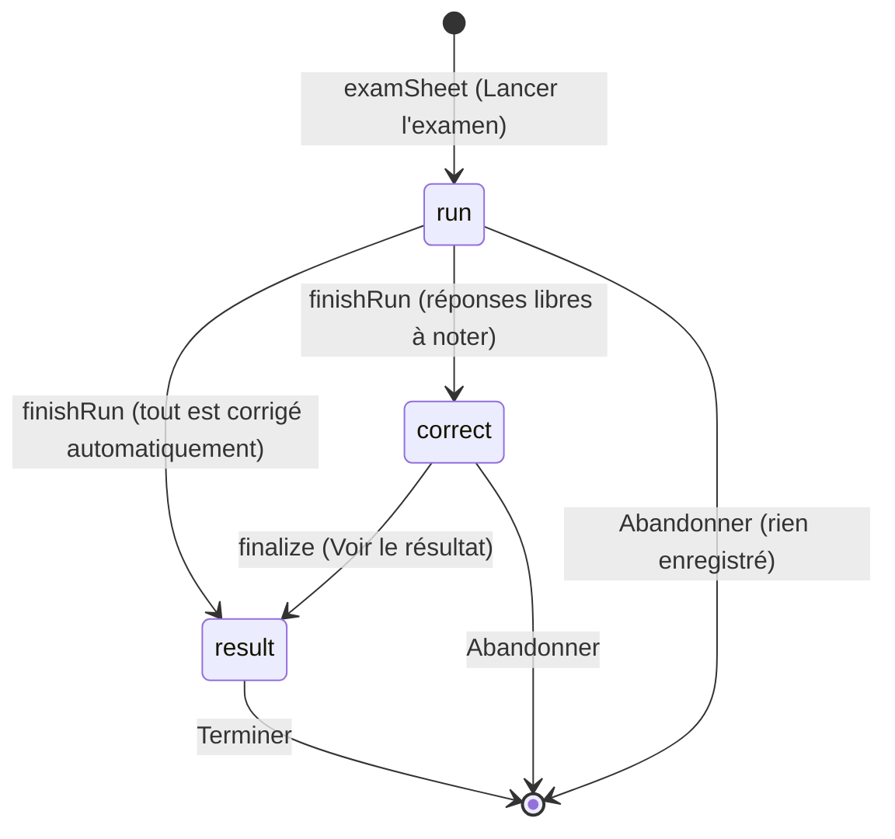

# Mémorisation : examens blancs et journal des blocages

**État :** Implémentée · **Vérifiée contre le code :** 2026-10-29

Retour à l'[index des fiches](README.md) · [ARCHITECTURE](../ARCHITECTURE.md) · [GLOSSAIRE](../GLOSSAIRE.md) · Décision : [ADR-007](../decisions/007-ia-par-copier-coller.md)

## 1. Objectif

Se tester en conditions d'examen : une série chronométrée de cartes, une note sur 20, l'écart avec la note que l'étudiant avait prédite, et la remise « à étudier » des cartes ratées. À côté, un **journal des blocages** où l'étudiant note ce qui l'a arrêté ; il peut en faire des cartes de rattrapage avec son IA.

## 2. Périmètre

Fait :
- configuration (affichage, durée, types de cartes, nombre, note prédite) ;
- chronomètre, correction automatique (QCM, V/F, trous), correction des réponses libres par auto-évaluation ou par scores collés d'une IA ;
- note /20, écart avec la prédiction, historique des 10 derniers examens, XP ;
- journal des blocages et prompt de rattrapage.

Ne fait pas :
- planification des examens blancs (J-7, J-2) → [memo-planning.md](memo-planning.md) ;
- révision quotidienne → [memo-cartes-et-revision.md](memo-cartes-et-revision.md) ;
- reprise d'un examen interrompu : l'examen n'est gardé qu'en mémoire de la page ;
- aucune note officielle : c'est une estimation à partir des cartes de l'étudiant.

## 3. Vue d'ensemble technique



`finalize` est le seul endroit qui écrit dans l'état : il ajoute l'examen, remet les erreurs « à étudier », marque le jour et attribue les XP.

## 4. Composants et fichiers concernés

| Chemin | Rôle |
|---|---|
| `js/modules/revision.js` | `practiceTab`, `examSheet`, `finishRun`, `finalize`, `examView`, `correctView`, `resultView`, journal des blocages. |
| `js/revision-logic.js` | `pickExam`, `kindOf`, `autoScore`, `examNote`, `parseScores`, `correctionPrompt`, `gapPrompt`, `EXAM_KINDS`, nettoyage des `exams` et `gaps`. |
| `js/xp-logic.js` | `XP.exam`, `award`. |
| `js/tutor-logic.js` | Ajoute aussi des blocages (« Signalé par le tuteur », voir [memo-tuteur.md](memo-tuteur.md)). |
| `js/data-io.js`, `js/tombstones.js` | Sauvegarde et suppression des `exams` et `gaps`. |
| `tests/revision.test.js` | Notes automatiques, `parseScores`, parcours complet d'un examen. |

## 5. Entrées / sorties

Examen enregistré dans `state.exams` :

```json
{ "id": "a1b2c3d", "deckId": "d1", "date": "2026-10-29T09:30:00.000Z", "n": 2, "predicted": 10, "score": 10 }
```

Blocage dans `state.gaps` : `{ "id", "deckId", "topic", "note", "created" }`.

Réponse attendue de l'IA pour la correction (collée par l'étudiant) : un tableau de N éléments, dans l'ordre des questions libres.

```json
[{"score": 1, "feedback": "Complet."}, {"score": 0.5, "feedback": "Il manque l'unité."}]
```

Le champ `feedback` est demandé dans le prompt mais **jamais lu** : seuls les scores sont utilisés.

## 6. Fonctionnement détaillé

### Lancement

`examSheet` propose : affichage (« Toutes d'un coup » ou « Une par une »), durée (5, 10, 15, 30 min ou 1 h, 15 par défaut), types de cartes cochables (libres, QCM, V/F, à trous ; un type sans carte est grisé), nombre de questions (vide = maximum) et note prédite facultative (bornée à 0-20).

```text
FONCTION pickExam(cards, { kinds, n }, rng)
  pool ← cartes dont kindOf(c) ∈ kinds        // kindOf : qa, def, word → "free" ; sinon le type
  mélanger pool (Fisher-Yates avec rng)
  RETOURNER les max(1, n) premières
```

L'examen est un objet de la vue (`view.exam`) : `{ deckId, display, end, idx, phase, note, predicted, items:[{ id, answer, picked, score }] }`. `end` est une heure absolue ; un `setInterval` d'une seconde rafraîchit le minuteur et appelle `finishRun` à zéro.

### Correction

```text
FONCTION finishRun(ctx)
  POUR CHAQUE item : item.score ← autoScore(carte, item)     // carte supprimée → 0
  SI un item a score = null (réponse libre) : phase ← "correct"
  SINON : finalize(ctx)

FONCTION autoScore(card, item)
  SI QCM ou V/F : RETOURNER (item.picked = card.correct) ? 1 : 0
  SI à trous : RETOURNER checkCloze(card, item.answer) ? 1 : 0
  RETOURNER null
```

En phase `correct`, chaque réponse libre reçoit « Faux » (0), « Partiel » (0,5) ou « Juste » (1), ou tous les scores arrivent d'un coup via `parseScores` (nombre exact de scores exigé, valeurs rognées entre 0 et 1). « Voir le résultat » reste désactivé tant qu'une réponse n'est pas notée.

### Résultat

```text
FONCTION finalize(ctx)
  scores ← pour chaque item : item.score ?? 0
  note ← examNote(scores)                     // round(moyenne × 200) / 10
  ajouter { id, deckId, date: maintenant, n, predicted, score: note } à state.exams
  POUR CHAQUE item avec score < 0,5 : carte.mem ← newMemory()      // « à étudier »
  markDay(state, aujourd'hui)
  award(state, XP.exam(note), aujourd'hui)   // 10 + round(note / 2)
```

Exemples chiffrés : `examNote([1, 0.5, 0, 1])` = 12,5 ; `examNote([1, 0.5, 0])` = 10 ; liste vide = 0. `XP.exam` : 10/20 → 15 XP, 14/20 → 17, 20/20 → 20 (plafond de 300 XP par jour).

Écart : `diff = note − predicted`. Au-delà de −2, le texte parle de surestimation ; au-delà de +2, de sous-estimation ; sinon « Ton estimation est juste ». La page de résultat liste les 3 premières notions ratées et le détail de toutes les questions.

### Journal des blocages

L'étudiant saisit une notion et une précision facultative ; `gapPrompt(gaps, source)` assemble la liste des blocages et la source de la leçon, et demande à l'IA 2 cartes `qa` par blocage au format JSON de `parseCards`. L'étudiant colle la réponse dans « Retenir → Générer avec une IA ».

## 7. Dépendances

- Internes : `revision-logic.js`, `fsrs.js` (`newMemory`), `xp-logic.js`, `ui/dialog.js` (feuille de configuration).
- Navigateur : `setInterval`, presse-papiers.
- Stockage : clé `studenthub:v1` ; sections `exams` et `gaps` de la sauvegarde « Mémorisation ».
- Services externes et variables d'environnement : aucun.

## 8. Cas limites et erreurs

- Aucun type coché : « Choisis au moins un type de carte. »
- Nombre de questions : `0` ou négatif sont ramenés à 1 ; vide = toutes.
- Scores collés : « Il faut exactement N score(s) entre 0 et 1. » ; JSON invalide : « Réponse illisible : ce n'est pas du JSON. »
- Abandon : confirmation « Abandonner l'examen ? Rien ne sera enregistré. »
- Carte supprimée pendant l'examen : affichée « (carte supprimée) » et notée 0.
- Si l'étudiant quitte l'onglet pendant l'examen, le minuteur ne tourne plus ; au retour, la fin est constatée à la seconde suivante (l'heure de fin est absolue).
- Un rechargement de la page perd l'examen en cours sans rien enregistrer.

## 9. Tests

`npm test` : `tests/revision.test.js` couvre `autoScore`, `examNote` (12,5), `parseScores` (valeurs rognées, nombre exact), `pickExam` avec un générateur fixé, la présence de « (vide) » dans le prompt de correction, et un examen complet dans l'onglet (note 10/20, écart, une carte ratée remise « à étudier », historique).

**Non couvert :** la phase de correction manuelle, la fin par expiration du minuteur, le mode « une par une », le prompt de rattrapage.

## 10. Pièges et dette technique

- Rater un examen **efface tout l'état mémoire** de la carte (`newMemory()`), y compris `reps`, `lapses` et la stabilité : une carte « maîtrisée » repart de zéro. C'est voulu (« erreurs remises à étudier ») mais coûteux.
- `feedback` est demandé à l'IA et ignoré.
- `gapPrompt` demande aussi une « mini-explication orale », mais le format de sortie ne contient que des cartes : cette consigne n'a nulle part où aller. Le bouton n'est pas désactivé quand la source de la leçon est vide (contrairement aux autres prompts).
- Pas de détection de doublons dans le journal des blocages ; pas de modification d'un blocage (suppression seulement).
- `sanitizeRevision` ne limite pas le nombre d'examens ; l'historique n'en affiche que 10.
- Le comparateur de trous a les limites décrites dans [memo-cartes-et-revision.md](memo-cartes-et-revision.md) (caractères non latins, signes, exposants) : elles faussent aussi la note d'un examen.

## 11. Pour modifier ou étendre

- Nouvelle manière de noter : passer par `autoScore` (retour `null` = à corriger à la main) et ne toucher à l'état que dans `finalize`.
- Persister un examen en cours demanderait de sortir `view.exam` du module et de le sérialiser (heure de fin comprise).
- Après modification : `npm run build:sw`, puis `npm test`.
