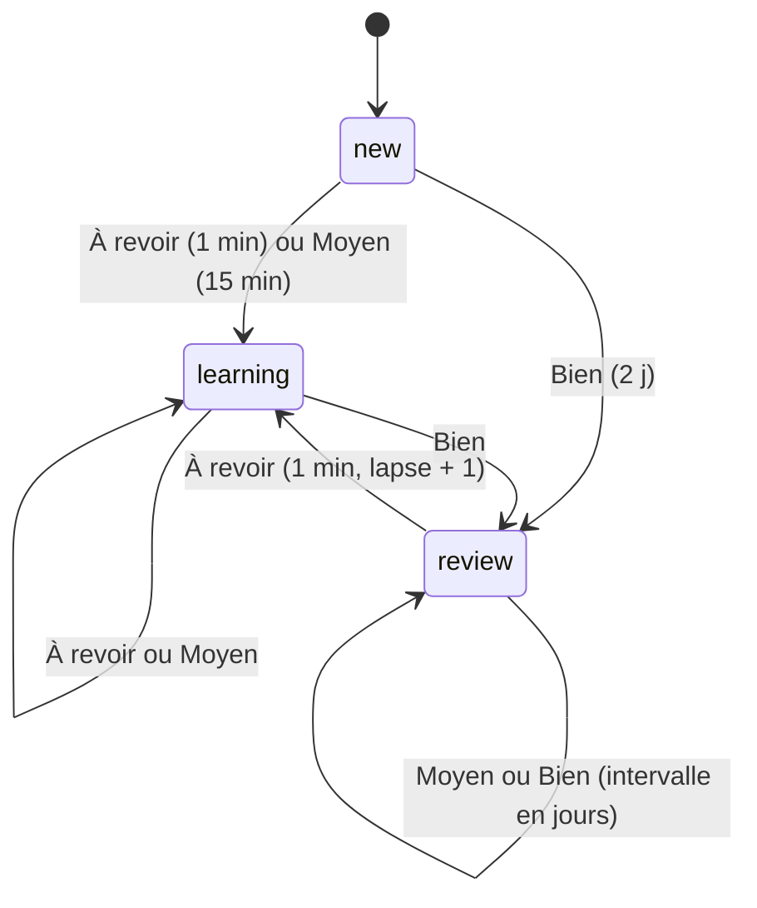

# Mémorisation : planification des révisions (FSRS-6)

**État :** Implémentée · **Vérifiée contre le code :** 2026-10-26

Retour à l'[index des fiches](README.md) · [ARCHITECTURE](../ARCHITECTURE.md) · [GLOSSAIRE](../GLOSSAIRE.md) · Décision : [ADR-008](../decisions/008-fsrs-6.md)

## 1. Objectif

Décider **quand** réviser chaque carte pour qu'elle soit revue juste avant d'être oubliée : à chaque réponse notée (« À revoir », « Moyen », « Bien »), l'algorithme calcule la prochaine date de révision. C'est la répétition espacée, selon l'algorithme **FSRS-6** avec ses paramètres par défaut.

## 2. Périmètre

**Fait** : état mémoire d'une carte (stabilité, difficulté, échéance, compteurs) ; calcul après chaque note ; première étape en minutes (1 minute, 15 minutes) ; intervalles en jours ensuite ; rétention visée réglable ; texte « < 1 min », « 15 min », « 3 j » sous chaque bouton ; niveau « nouvelle », « en apprentissage », « maîtrisée ».

**Ne fait pas** : personnaliser les 21 paramètres à partir des révisions de l'étudiant (pas d'optimiseur) ; proposer la note « Facile » (le code la calcule mais l'interface n'offre que trois notes) ; ajouter un léger hasard aux intervalles (aucun) ; la file de session, les cartes et les paquets (fiche [memo-cartes-et-revision](memo-cartes-et-revision.md)).

## 3. Vue d'ensemble technique



## 4. Composants et fichiers concernés

| Chemin | Rôle |
|---|---|
| `js/fsrs.js` | `W` (21 paramètres), `retrievability`, `interval`, `newMemory`, `review`, `label`, `isDue`, `level` |
| logique des cartes (`sanitizeRevision`, `stats`, `queue`) | valide l'état mémoire à la lecture ; compte les cartes dues et maîtrisées ; ordonne la session |
| onglet Mémorisation (fonction `grade`) | appelle `review` à chaque note et `label` pour les boutons |
| `tests/revision.test.js` | test « FSRS : stabilité initiale, intervalles croissants… » |

## 5. Entrées / sorties

**État mémoire d'une carte** (`carte.mem`) :

```json
{ "state": "review", "s": 2.3065, "d": 2.12, "due": "2026-10-28T08:00:00.000Z", "last": "2026-10-26T08:00:00.000Z", "reps": 1, "lapses": 0 }
```

| Champ | Sens |
|---|---|
| `state` | `new` (jamais révisée), `learning` (à revoir bientôt), `review` (en intervalles de jours) |
| `s` | **stabilité** : nombre de jours au bout desquels la probabilité de se souvenir tombe à 90 % |
| `d` | **difficulté**, de 1 (facile) à 10 (difficile) |
| `due`, `last` | date de prochaine révision et de la dernière (ISO) |
| `reps`, `lapses` | nombre de révisions et d'oublis (« À revoir » sur une carte déjà apprise) |

**Notes** : 1 À revoir, 2 Moyen, 3 Bien (4 Facile existe dans `review`, non proposée).

**Rétention visée** (`settings.memo.retention` : 0,8 ; 0,85 ; 0,9 par défaut ; 0,95) : plus elle est haute, plus les intervalles sont courts ([socle-parametres](socle-parametres.md)).

**Exemples calculés par le code** (révisions faites exactement à l'échéance, toujours « Bien », rétention 90 %) : une nouvelle carte revient dans 2 jours, puis 11, 46, 163, 497, 1346… jours. Avec 95 % : 1, 3, 8, 19, 43, 89… ; avec 80 % : 8, 75, 521… (l'intervalle est plafonné à 36 500 jours, soit 100 ans).

**Boutons d'une nouvelle carte** : « À revoir < 1 min », « Moyen 15 min », « Bien 2 j » (et « Facile 8 j » pour la note 4).

## 6. Fonctionnement détaillé

```text
CONSTANTES : W[0..20] = paramètres par défaut de py-fsrs (FSRS-6) ; DECAY = −W[20] ; FACTOR = 0,9^(1/DECAY) − 1

FONCTION retrievability(jours, s)   : (1 + FACTOR × jours / s) ^ DECAY            // probabilité de se souvenir
FONCTION interval(s, rétention = 0,9) : arrondi( s / FACTOR × (rétention^(1/DECAY) − 1) ), borné entre 1 et 36 500 jours

FONCTION review(mem, note, maintenant, rétention)       // retourne une NOUVELLE mémoire, la carte d'origine n'est pas modifiée
  m ← copie de mem ; m.reps += 1 ; m.last ← maintenant
  SI mem.state = 'new'
    m.s ← max(0,001 ; W[note − 1]) ; m.d ← borné(1 ; 10 ; difficulté initiale de la note)
  SINON
    jours ← (maintenant − mem.last) en jours ; r ← retrievability(jours, mem.s)
    m.d ← difficulté mise à jour (retour vers la moyenne) borné entre 1 et 10
    SI jours < 1 (même jour) : m.s ← mem.s × facteur de court terme (au moins 1 pour Moyen et Bien)
    SINON SI note = 1        : m.s ← le plus petit entre la stabilité « après oubli » et mem.s / facteur
    SINON                    : m.s ← mem.s × (1 + croissance(d, s, r) × malus « Moyen » × bonus « Facile »)
  SI note = 1 ET mem.state ≠ 'new' : m.lapses += 1
  court ← (note = 1) ? 1 minute : (note = 2 ET état ∈ {new, learning}) ? 15 minutes : aucun
  m.state ← (note = 1 OU court) ? 'learning' : 'review'
  m.due ← maintenant + (court OU interval(m.s, rétention) jours)

FONCTION label(mem, note, …) : « < 1 min » (≤ 1 min), « N min » (< 1 h), « N h » (< 2 j), « N j »
FONCTION isDue(mem, maintenant) : état 'new' OU date d'échéance ≤ maintenant
FONCTION level(mem)             : 'new' | 'mastered' (s ≥ 21 jours) | 'learning'
```

**Dans la session** (fiche [memo-cartes-et-revision](memo-cartes-et-revision.md)) : `À revoir` remet la carte dans la file après 3 autres ; `Moyen` d'une carte encore « en apprentissage » après 6 autres. L'état mémoire est enregistré dans un `commit` avec la rétention du moment.

## 7. Dépendances

- **Internes** : aucune dépendance (module pur, sans navigateur) ; utilisé par la logique des cartes et l'onglet Mémorisation ; `settings.memo.retention`.
- **Externe** : paramètres de référence de **py-fsrs** (open-spaced-repetition) ; aucun appel réseau. **Variable d'environnement** : aucune.
- **Clé** : `carte.mem` dans `state.cards` (`studenthub:v1`).

## 8. Cas limites et erreurs

| Situation | Comportement |
|---|---|
| nouvelle carte notée « Bien » | état `review`, intervalle de 2 jours |
| carte apprise notée « À revoir » | état `learning`, retour dans 1 minute, `lapses` augmente |
| carte apprise notée « Moyen » | reste en `review` ; l'intervalle grandit moins qu'avec « Bien » |
| deux révisions le même jour | formule de court terme (la stabilité ne baisse pas pour « Moyen » et « Bien ») |
| intervalle calculé énorme | plafonné à 36 500 jours |
| carte importée avec un état incohérent (`s` négatif, échéance illisible) | remise à l'état `new` à la lecture |
| carte importée avec un état valide mais **sans date de dernière révision** | **voir section 10 : erreur** |
| « Remettre à étudier » | `mem` redevient une mémoire neuve |
| examen : réponses fausses | les cartes concernées repassent « à étudier » ([memo-examens](memo-examens.md)) |

## 9. Tests

- Fichier : `tests/revision.test.js`, test « FSRS : stabilité initiale, intervalles croissants, « à revoir » baisse la stabilité » : la première stabilité de « Bien » vaut `W[2]`, quatre révisions « Bien » à l'échéance donnent des intervalles croissants, « À revoir » diminue la stabilité, passe en `learning` et ajoute un oubli ; les libellés d'une carte neuve sont « < 1 min » et « 15 min ». Un autre test vérifie que l'état mémoire importé est borné.
- Lancer : `npm test`.
- Ne couvre pas : les valeurs numériques exactes de la référence py-fsrs (seule la tendance est testée), la note « Facile », le calcul de court terme (même jour), un changement de rétention, `retrievability`, les cartes importées sans `last`.

## 10. Pièges et dette technique

- **Défaut vérifié : une carte importée sans `last` plante à la notation.** `sanitizeRevision` accepte un état `learning` ou `review` avec `s` et `due` valides même si `last` manque (il devient vide). `review` calcule alors un nombre de jours illisible : « Moyen » et « Bien » lèvent `RangeError: Invalid time value` (la note ne s'enregistre pas et la carte reste en tête de la session), seule « À revoir » passe, avec une stabilité illisible (la carte redevient neuve au rechargement). Cela ne peut pas arriver avec des cartes créées par l'application (elle écrit toujours `last`), mais bien avec un fichier fabriqué à la main ou par un outil. Correction : exiger `last` à la lecture, ou le remplacer par la date de la dernière révision supposée.
- **Pas de personnalisation** : les paramètres sont ceux d'une population moyenne ; les intervalles réels peuvent paraître trop longs ou trop courts pour l'étudiant (voir l'ADR-008).
- **Intervalles très longs si l'étudiant répond toujours « Bien » à l'échéance** (7 398 jours au huitième passage à 90 %) : la rétention visée est le seul levier.
- **« Facile » inexistante dans l'interface** : le code la gère, mais seuls les boutons 1 à 3 existent (et les touches `1`, `2`, `3`).
- **Calculs en temps réel** : le moment de la révision vient de l'horloge de l'appareil ; une horloge déréglée fausse les échéances.
- **Aucun test contre la référence** : si les paramètres de py-fsrs évoluent, `W` est à vérifier à la main.

## 11. Pour modifier ou étendre

1. **Corriger les cartes sans `last`** : dans `sanitizeRevision`, exiger `iso(m.last)` pour garder l'état, ou lui donner une valeur par défaut ; ajouter un test.
2. **Proposer « Facile »** : ajouter un quatrième bouton et la touche `4` dans l'onglet, `XP.card[4]` dans [memo-xp-et-niveaux](memo-xp-et-niveaux.md), et un test.
3. **Mettre à jour les paramètres** : remplacer `W` après vérification contre py-fsrs, ajouter des valeurs de référence dans un test, écrire une note dans l'ADR-008.
4. **Optimiser selon l'étudiant** : demanderait un historique des révisions (non conservé aujourd'hui) ; nouvelle décision à écrire.
5. **Ne pas casser** : la pureté de `review` (elle ne modifie pas la carte d'origine) ; l'ordre `new` → `learning` → `review` ; le plafond de l'intervalle ; les bornes de `s` et `d` à la lecture.
6. Relancer `npm run build:sw` puis `npm test`.
