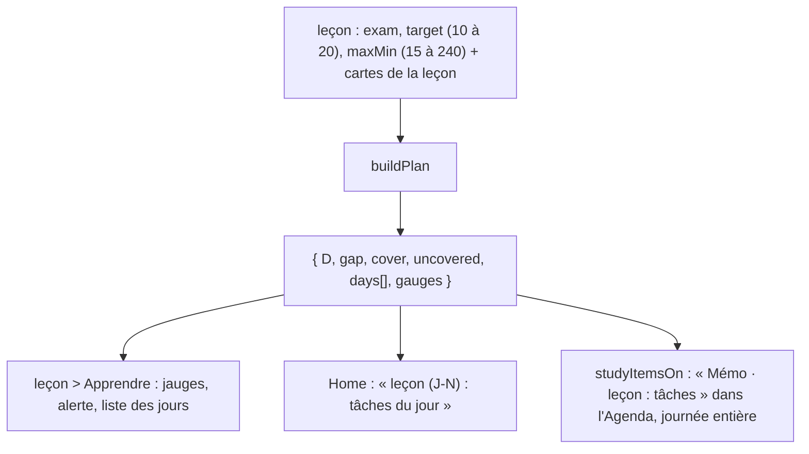

# Mémorisation : planning optimal avant un examen

**État :** Implémentée · **Vérifiée contre le code :** 2026-10-26

Retour à l'[index des fiches](README.md) · [ARCHITECTURE](../ARCHITECTURE.md) · [GLOSSAIRE](../GLOSSAIRE.md)

## 1. Objectif

À partir de la **date d'examen** d'une leçon, de la **note visée** et du **temps disponible par jour**, calculer jour par jour ce qu'il faut faire : cartographier le cours, introduire les nouvelles cartes, réviser, passer des examens blancs. Le calcul est **déterministe** : l'IA n'intervient pas, elle ne fait que l'expliquer si on le lui demande.

## 2. Périmètre

**Fait** : plan quotidien du jour J à l'examen ; couverture selon la note visée ; plafond de minutes par jour ; deux examens blancs ; estimation du temps gagné et de la maîtrise ; alerte quand tout ne tient pas ; affichage dans la leçon (onglet « Apprendre »), dans Home (widget « Mémorisation ») et dans l'Agenda.

**Ne fait pas** : suivre le plan comme une promesse (il est **recalculé chaque jour** à partir de l'état des cartes) ; remplacer FSRS, qui décide seul des échéances réelles ([memo-fsrs](memo-fsrs.md)) ; choisir un moment de la journée ; prendre en compte les autres examens ou charges de l'étudiant ; apprendre des habitudes de l'étudiant.

## 3. Vue d'ensemble technique



## 4. Composants et fichiers concernés

| Chemin | Rôle |
|---|---|
| `js/planning.js` | `gapFraction`, `coverage`, `gauges`, `buildPlan`, `todayTasks`, `describeTask`, `studyItemsOn` ; constantes `MIN_PER_NEW` (1,5 min) et `MIN_PER_REVIEW` (0,5 min) |
| onglet Mémorisation (leçon > Apprendre) | champs « Date d'examen », « Note visée », « Temps par jour » ; affichage du planning |
| `js/ui/widgets.js` | widget « Mémorisation » ([socle-widgets-et-home](socle-widgets-et-home.md)) |
| `js/calendar-logic.js` | appelle `studyItemsOn` ([agenda-vues-et-recurrence](agenda-vues-et-recurrence.md)) |
| `tests/revision.test.js`, `tests/agenda.test.js` | tests |

## 5. Entrées / sorties

**Entrées** (`buildPlan`) :

| Paramètre | Source | Défaut et bornes |
|---|---|---|
| `cards` | cartes de la leçon | ; chaque carte a un état mémoire (`new`, `learning`, `review`) |
| `exam` | `leçon.exam` (date `AAAA-MM-JJ`) | sans date, ou date passée : **pas de plan** (`null`) |
| `target` | note visée sur 20 | 16 ; de 10 à 20 |
| `today` | date du jour | |
| `maxMin` | minutes par jour | 60 ; de 15 à 240 |
| `examMinutes` | durée d'un examen blanc | 30 |

**Sortie** :

```json
{ "D": 37, "gap": 5, "cover": 32, "uncovered": 0,
  "gauges": { "timeSaved": 0.4, "mastery": 0.79 },   // 40 cartes neuves, examen dans 37 jours, note visée 16, 60 min par jour
  "days": [ { "date": "2026-10-21", "tasks": [ { "type": "layer_scan", "n": 0, "minutes": 25 }, { "type": "free_recall", "n": 0, "minutes": 5 }, { "type": "new", "n": 2, "minutes": 3 } ], "minutes": 33 } ] }
```

| Type de tâche | Texte affiché |
|---|---|
| `layer_scan` | « Cartographier le cours en couches (25 min) » (jour J seulement) |
| `free_recall` | « Rappel libre sur page blanche (5 min) » (jour J seulement) |
| `new` | « N nouvelle(s) carte(s) » (1,5 min chacune) |
| `due_review` | « N révision(s) » (0,5 min chacune) |
| `mock_exam` | « Examen blanc (30 min) » |

**Couverture** (part des cartes à introduire avant l'examen) : 50 % pour une note visée de 10, 80 % pour 16, 100 % pour 20. **Jauges** : « Temps gagné » = (1 − couverture) × 2, borné de 0 à 1 ; « Maîtrise à l'examen » = 0,55 + 0,4 × (note visée − 10) ÷ 10, bornée. Ces deux jauges sont des **estimations**.

**Écart conseillé entre deux révisions** d'une même carte : 30 % du délai pour 7 jours, 15 % pour 30 jours, 7,5 % pour un an, interpolé de façon logarithmique entre ces points (le code précise « estimation, pas un résultat de l'article »).

## 6. Fonctionnement détaillé

```text
FONCTION buildPlan({ cards, exam, target = 16, today, maxMin = 60, examMinutes = 30 })
  SI pas de date d'examen : RETOURNER rien
  D ← jours entre today et exam ; SI D < 0 : RETOURNER rien
  nouvelles ← cartes d'état « new », triées par couche (noyaux d'abord, puis piliers, puis détails)
  déjàIntroduites ← nombre de cartes − nombre de nouvelles
  cover ← arrondi supérieur(nombre de cartes × coverage(target))
  reste ← borné entre 0 et nouvelles de (cover − déjàIntroduites)
  joursDIntroduction ← max(1, partie entière(D × 0,6))                   // les 60 % premiers jours
  parJour ← arrondi supérieur(reste / joursDIntroduction)
  blancs ← { D − 7, D − 2 } si D ≥ 7 ; { D − 1 } si 2 ≤ D < 7 ; rien sinon       // jours d'examen blanc
  POUR i DE 0 À D                                                          // le jour d'examen est inclus
    minutes ← 0
    SI i = 0 : tâches « Cartographier » (25 min) et « Rappel libre » (5 min)
    révisions ← (i = 0) ? nombre de cartes non nouvelles dont l'échéance est aujourd'hui ou avant : arrondi(introduites × 0,3)
    SI révisions > 0 : tâche « révisions » (révisions × 0,5 min)
    SI i ∈ blancs : tâche « Examen blanc » (30 min) — pas de nouvelles cartes ce jour-là
    SINON SI i < joursDIntroduction ET reste > 0
      place ← partie entière( (maxMin − minutes) / 1,5 )
      n ← borné entre 0 et reste de min(parJour, reste, place)
      SI n > 0 : tâche « nouvelles cartes » (n × 1,5 min) ; reste ← reste − n ; introduites ← introduites + n
  RETOURNER { D, gap: max(1, arrondi(D × gapFraction(max(D, 1)))), cover, uncovered: reste, days, gauges: gauges(target) }

FONCTION studyItemsOn(état, date, aujourd'hui)
  SI date < aujourd'hui : rien
  POUR CHAQUE leçon avec examen ET date ≤ examen
    jour ← le plan de la leçon pour cette date ; SI aucune tâche : passer
    AJOUTER { kind: 'study', titre: « Mémo · <leçon> : <tâches> », journée entière }
  // les plans sont mis en cache (60 au plus), avec une clé qui contient les dates, la note visée, le temps et le nombre de cartes
```

Dans la leçon, si `uncovered > 0`, un message d'erreur demande : « N cartes ne tiennent pas dans X min par jour : augmente le temps, baisse la note visée ou repousse l'examen. »

## 7. Dépendances

- **Internes** : `layerRank` de la logique des cartes (ordre des couches) ; données `state.decks` (leçons) et `state.cards`.
- **Externe** : aucun. **Variable d'environnement** : aucune.
- **Clés** : `exam`, `target`, `maxMin` font partie de chaque leçon dans `state.decks` (`studenthub:v1`). Le plan lui-même n'est **pas stocké** : il est recalculé à chaque affichage.

## 8. Cas limites et erreurs

| Situation | Comportement |
|---|---|
| aucune date d'examen | « Choisis une date d'examen pour obtenir ton planning optimal. » |
| examen passé | « La date d'examen est passée : choisis-en une nouvelle. » |
| examen aujourd'hui (D = 0) | un seul jour : cartographie (25 min), rappel (5 min) et autant de nouvelles cartes que le temps le permet (20 cartes pour 40 cartes neuves et 60 minutes) ; le reste est « non couvert » |
| moins de 2 jours | aucun examen blanc ; entre 2 et 6 jours : un seul, la veille |
| trop de cartes pour le temps disponible | `uncovered > 0` : alerte rouge, les cartes restantes ne sont pas planifiées |
| aucune carte | un plan existe mais ne contient que cartographie, rappel et examens blancs (examen dans 9 jours : examens blancs à J−7 et J−2) |
| carte déjà introduite | comptée comme « déjà introduite », jamais replanifiée comme nouvelle |
| leçon sans examen | aucun élément dans l'Agenda ni dans Home |
| agenda : date après l'examen ou passée | aucun élément |
| option « Planning de Mémorisation » décochée dans l'Agenda | éléments masqués |

## 9. Tests

- Fichiers : `tests/revision.test.js` (« planning : écart, examens blancs, plafond de charge, jauges monotones » : `gapFraction` aux trois repères et entre eux ; 40 cartes, examen à 37 jours, note 16 → couverture de 32 cartes, rien de non couvert, examens blancs les 20 et 25 novembre, jamais plus de 90 minutes dans une journée, 32 nouvelles cartes au total ; un cas serré qui laisse des cartes non couvertes ; jauges monotones ; absence ou passé de la date = rien ; texte « 1 nouvelle carte ») ; `tests/agenda.test.js` (planning dans l'Agenda : tâches du jour, rien après l'examen ni dans le passé, masquable).
- Lancer : `npm test`.
- Ne couvre pas : les révisions estimées des jours futurs, un `maxMin` très bas, les leçons d'une même journée dans l'Agenda, le cache du planning, le widget de Home, le texte des alertes.

## 10. Pièges et dette technique

- **Le plan n'est pas un calendrier figé** : il est recalculé chaque jour. Si l'étudiant saute des jours, les nouvelles cartes non introduites sont réparties sur les jours restants (jusqu'à ne plus pouvoir : `uncovered`).
- **Les révisions des jours futurs sont une estimation** (30 % des cartes introduites), pas les vraies échéances de FSRS : le plan et le nombre réel de cartes « à réviser » peuvent différer.
- **Jours 1 à D : « 60 % du temps pour introduire »** est une règle fixe du code, sans réglage.
- **Date d'examen par leçon** : chaque leçon a sa propre date, distincte de la date d'examen du cours dans Workspace ([workspace-cours-et-todos](workspace-cours-et-todos.md)) ; l'Agenda peut donc montrer deux « examens » pour la même matière.
- **Comparaison de dates en chaînes** : l'échéance d'une carte (date ISO en UTC) est comparée à `AAAA-MM-JJT23:59:59` (sans fuseau) ; près de minuit, une carte peut compter un jour trop tôt ou trop tard (déduit du code).
- **Jauges d'estimation** : « Temps gagné » et « Maîtrise » ne sont pas mesurées ; ce sont des fonctions simples de la note visée.
- **Les écarts de révision conseillés (`gap`)** sont affichés à titre indicatif ; FSRS ne les utilise pas.
- **Aucune prise en compte de la charge de la journée** : deux leçons le même jour s'additionnent sans limite commune.

## 11. Pour modifier ou étendre

1. **Changer la part de jours d'introduction** (60 %) ou les durées par carte : `buildPlan`, `MIN_PER_NEW`, `MIN_PER_REVIEW` ; ajuster le test des 32 nouvelles cartes.
2. **Utiliser les vraies échéances** pour les jours futurs : projeter les échéances FSRS (`review` simulé en « Bien ») au lieu du facteur 0,3 ; ajouter un test comparatif.
3. **Examens blancs** : changer l'ensemble `blancs` ou `examMinutes`.
4. **Limite commune entre leçons** : calculer un plan global avant d'appeler `buildPlan` ; nouvelle décision à écrire.
5. **Ne pas casser** : le déterminisme (aucun hasard, aucune IA) ; le plafond `maxMin` pour les nouvelles cartes ; la validation des bornes de `target` et `maxMin` ([memo-cartes-et-revision](memo-cartes-et-revision.md)).
6. Relancer `npm run build:sw` puis `npm test`.
