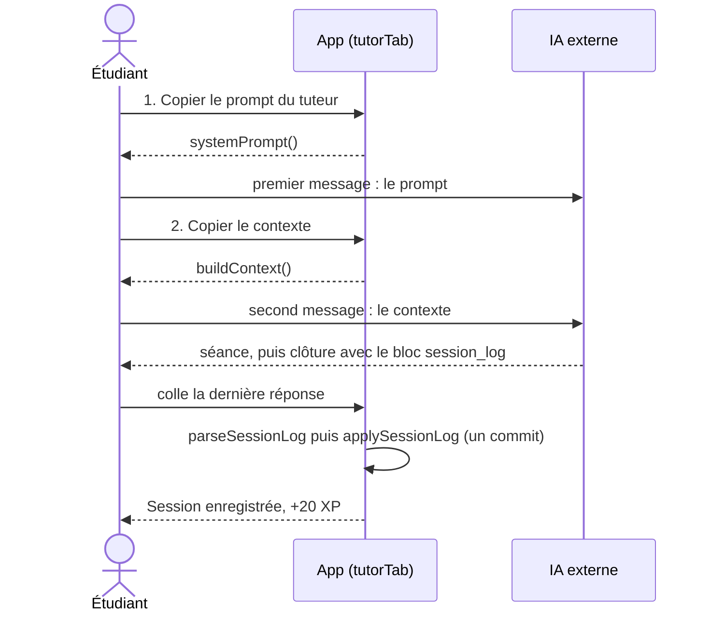

# Mémorisation : tuteur IA

**État :** Implémentée · **Vérifiée contre le code :** 2026-10-29

Retour à l'[index des fiches](README.md) · [ARCHITECTURE](../ARCHITECTURE.md) · [GLOSSAIRE](../GLOSSAIRE.md) · Décision : [ADR-019](../decisions/019-prompt-du-tuteur-genere.md)

## 1. Objectif

Préparer une séance guidée avec l'IA de l'étudiant (Claude, ChatGPT…) : l'app fournit le **prompt système** du tuteur et un **contexte** propre à la leçon (profil, plan, sources, corrigés) ; l'étudiant les colle dans sa conversation, travaille, puis rapporte le **bloc `session_log`** que le tuteur écrit à la clôture. L'app met alors à jour le profil de la leçon. Aucune clé, aucun appel réseau ([ADR 007](../decisions/007-ia-par-copier-coller.md)).

## 2. Périmètre

Fait :
- trois durées : `micro` 15 min, `standard` 30 min, `deep` 60 min ;
- copie du prompt système et du contexte de session ;
- lecture du `session_log` collé, mise à jour de la leçon, du journal des blocages, de l'historique et des XP ;
- profil modifiable à la main (niveau, notions maîtrisées, notions faibles) ; historique des 10 dernières séances de la leçon.

Ne fait pas :
- converser : la conversation se passe hors de l'app ;
- vérifier que la réponse collée vient bien du tuteur ni qu'elle n'a pas déjà été enregistrée ;
- calculer le plan : il vient des couches de la leçon ([memo-apprendre.md](memo-apprendre.md)) ; le planning par jour est ailleurs ([memo-planning.md](memo-planning.md)).

## 3. Vue d'ensemble technique



Le prompt est généré : `docs/fds-tutor.md` → `scripts/build-tutor-prompt.mjs` → `js/tutor-prompt.js` ([ADR 019](../decisions/019-prompt-du-tuteur-genere.md)).

## 4. Composants et fichiers concernés

| Chemin | Rôle |
|---|---|
| `docs/fds-tutor.md` | **Source** du prompt système (version et protocole par matière). À modifier ici seulement. |
| `scripts/build-tutor-prompt.mjs` | Génère `js/tutor-prompt.js` (`npm run build:tutor`). |
| `js/tutor-prompt.js` | Fichier généré (une chaîne exportée par défaut) : ne pas modifier à la main. |
| `js/tutor-logic.js` | `MODES`, `systemPrompt`, `priorities`, `buildContext`, `parseSessionLog`, `applySessionLog`, `MAX_SOURCE`. |
| `js/modules/tutor-ui.js` | `tutorTab` : préparation, collage du bilan, profil, historique. |
| `js/xp-logic.js` | `XP.tutor` (20) et `award`. |
| `js/revision-logic.js` | Nettoyage de `tutorLogs` (200 au plus) et des champs `level`, `mastered`, `weak` de la leçon. |
| `tests/tutor.test.js` | Tests du prompt, du contexte, du `session_log`, de l'enregistrement et de l'onglet. |

## 5. Entrées / sorties

Contexte produit pour la leçon « Physique » (sortie réelle de `buildContext`, mode `standard`) :

```text
<profil_etudiant>
matiere: Physique
niveau: novice
notions_maitrisees: Vecteur
notions_faibles: Signe du moment
blocages: Bras de levier
</profil_etudiant>

<plan_session>
mode: standard
minutes: 30
priorites:
1. [pilier] Signe du moment
2. [noyau] Somme des moments nulle
3. [pilier] Bras de levier
format_examen: essai
rappels:
- Que vaut la somme des moments à l'équilibre ?
</plan_session>

<sources>
Le moment de force vaut r x F.
</sources>

<solution_reference>
Exo 1 : 12 N.m
</solution_reference>

mode_app: true

Premier message de l'étudiant : Je bloque sur les moments de force
```

Bloc de clôture attendu (voir le prompt, section « Clôture de session ») :

```json
{"topic": "Moments de force", "level": "intermediate", "mastered": ["Définition du moment"],
 "weak": ["Signe du moment"], "recall_questions": ["Que vaut la somme des moments ?"],
 "next_step": "Refaire un exercice", "confidence_gap": "sûr 5/5, faux"}
```

Sorties : `deck.level`, `deck.mastered`, `deck.weak` ; nouveaux blocages ; une entrée dans `state.tutorLogs` ; XP.

## 6. Fonctionnement détaillé

### Prompt système

`systemPrompt()` prend le fichier généré et retire l'en-tête YAML, la section « 6. Intégration avec le vault » et la partie « Notes de conception » : 15 954 caractères bruts, 13 830 envoyés à la date de vérification. Le test compare `js/tutor-prompt.js` à `docs/fds-tutor.md` octet pour octet.

### Contexte

```text
FONCTION priorities(deck, cards)
  base ← SI la leçon a des couches : noyaux, puis piliers, puis détails (textes des couches)
         SINON : fronts des cartes, par couche core, pillar, detail
  weak ← deck.weak, chacune avec sa couche (« pilier » si introuvable dans les couches)
  RETOURNER les 12 premières de [weak…, base…], sans doublon (insensible à la casse)

FONCTION buildContext({ deck, cards, gaps, logs, mode, topic })
  last ← journal le plus récent de CETTE leçon
  src ← cut(deck.source, 24000)      // coupe au dernier saut de paragraphe si > 60 % du maximum, sinon net
  assembler <profil_etudiant>, <plan_session> (rappels : 3 premiers de last.recall),
            <sources> si non vide, <solution_reference> si non vide, « mode_app: true », premier message éventuel
  RETOURNER { text, truncated, sourceChars }
```

`mode_app` vaut toujours `true` : c'est lui qui demande au tuteur d'écrire le `session_log`.

### Lecture du bilan

```text
FONCTION parseSessionLog(text)
  raw ← contenu du bloc ```session_log … ```
  SI absent : raw ← du premier « { » après le mot session_log jusqu'au DERNIER « } » du texte
  SI raw absent : ERREUR « Aucun bloc session_log trouvé : colle la toute dernière réponse du tuteur… »
  JSON invalide ou pas un objet : ERREUR « Le bloc session_log est illisible… »
  RETOURNER { topic (300), level ∈ novice|intermediate|advanced sinon "", mastered, weak (20 × 300),
              recall (5 × 500), next (500), gap (500) }
```

Le marqueur `[DARACE]` que le prompt impose en fin de réponse n'est pas lu : il est simplement hors du JSON.

### Enregistrement

```text
FONCTION applySessionLog(state, deckId, log, today)
  SI la leçon n'existe pas : ERREUR « Leçon introuvable. »
  SI log.level : deck.level ← log.level
  deck.weak     ← fusion( deck.weak − log.mastered, log.weak ), 80 au plus      // comparaison insensible à la casse
  deck.mastered ← fusion( deck.mastered − log.weak, log.mastered ), 80 au plus
  POUR CHAQUE notion de log.weak absente du journal des blocages : ajouter un blocage « Signalé par le tuteur »
  ajouter { id, deckId, date, topic, level, mastered, weak, recall, next, gap } à state.tutorLogs
  state.tutorLogs ← les 200 derniers
  award(state, XP.tutor, today)        // 20 XP, dans la limite de 300 par jour
  RETOURNER { added, xp }
```

Le test enregistre le bilan sur une leçon où « Définition du moment » est faible et « Signe du moment » maîtrisé : à la fin les deux listes sont échangées et deux blocages sont créés.

## 7. Dépendances

- Internes : `xp-logic.js`, `calendar-logic.js` (`ymd`), `revision-logic.js` (`LEVELS`), `dom.js`.
- Navigateur : presse-papiers.
- Fichier source du prompt : `docs/fds-tutor.md` (voir [ADR 019](../decisions/019-prompt-du-tuteur-genere.md)) ; commande `npm run build:tutor`.
- Stockage : `studenthub:v1`. Services externes et variables d'environnement : aucun.

## 8. Cas limites et erreurs

- Leçon sans source : « Colle d'abord le texte de ton cours dans l'onglet Apprendre : sans `<sources>`, le tuteur ne peut pas citer ton polycopié. »
- Source de plus de 24 000 caractères : avertissement avec la longueur réelle ; seuls les 24 000 premiers sont envoyés.
- Pas de priorité : « (aucune : demande à l'étudiant ce qui est le plus urgent) ».
- Mauvaise réponse collée : message d'erreur dans la zone d'état, rien n'est enregistré.
- Succès : « Session enregistrée : N maîtrisée(s), M à retravailler, K ajoutée(s) au journal des blocages, +X XP. » (X peut être inférieur à 20 si le plafond du jour est atteint). Le champ de collage est vidé.
- Valeurs hors format (`level: "expert"`, `mastered` qui n'est pas une liste) : ignorées, pas d'erreur.

## 9. Tests

`npm test` : `tests/tutor.test.js` vérifie l'identité du prompt généré avec `docs/fds-tutor.md` et ce que `systemPrompt` retire, le contexte complet (profil, plan, sources, rappels, source trop longue, leçon vide), l'ordre des priorités, les deux formes de `session_log` et ses erreurs, l'enregistrement (échange des listes, blocages sans doublon, XP, leçon introuvable) et le parcours dans l'onglet (message exact, champ vidé, historique).

**Non couvert :** la qualité réelle du tuteur (dépend de l'IA utilisée), la copie dans le presse-papiers, le plafond de 200 journaux.

## 10. Pièges et dette technique

- **Corrigé : un bilan déjà enregistré est reconnu.** `applySessionLog` compare le bilan (leçon, sujet, niveau, notions, questions, étape, écart) aux journaux existants : un doublon ne donne ni journal, ni blocage, ni XP et affiche « Ce bilan est déjà enregistré ». Deux bilans qui diffèrent d'un seul champ sont deux séances.
- Doublons internes : si `weak` contient « Signe du moment » et « signe du moment », deux blocages sont créés (vérifié), car la liste des blocages connus n'est pas mise à jour dans la boucle.
- Le plafond de 200 journaux est global (toutes leçons confondues) ; supprimer une leçon ne supprime pas ses journaux.
- La coupe de la source est silencieuse pour l'IA : elle ne sait pas que le texte est tronqué.
- Le dernier `}` du texte collé est utilisé quand il n'y a pas de clôture ``` : un texte avec des accolades après le JSON le rend illisible.
- Le prompt (`docs/fds-tutor.md`) dit que l'application « masque » le bloc `session_log` à l'étudiant. Ce n'est pas le cas : la conversation est dans une IA externe, l'étudiant voit le bloc. À reformuler dans le prompt si cela gêne.
- Les modifications manuelles des listes de notions dédoublonnent en respectant la casse, alors que `applySessionLog` ignore la casse et les accents (`norm`) : « Dérivée », « dérivée » et « derivee » ne créent qu'un seul blocage.

## 11. Pour modifier ou étendre

- Changer le comportement du tuteur : modifier **`docs/fds-tutor.md`**, puis `npm run build:tutor`. Ne jamais éditer `js/tutor-prompt.js` : le test d'identité échoue.
- Ajouter un champ au `session_log` : le décrire dans le prompt, l'ajouter à `parseSessionLog`, `applySessionLog` et `sanitizeRevision` (champs de `tutorLogs`), puis aux tests.
- Ne pas casser : les noms de blocs `<profil_etudiant>`, `<plan_session>`, `<sources>`, `<solution_reference>` et `mode_app` sont cités dans le prompt.
- Après modification : `npm run build:tutor` si le prompt a changé, `npm run build:sw`, puis `npm test`.
