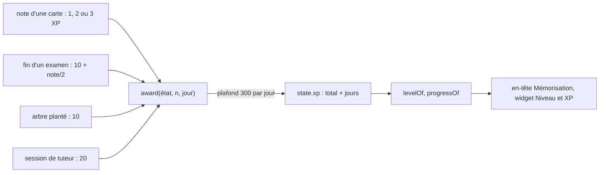

# Mémorisation : XP, niveaux et plafond quotidien

**État :** Implémentée · **Vérifiée contre le code :** 2026-10-26

Retour à l'[index des fiches](README.md) · [ARCHITECTURE](../ARCHITECTURE.md) · [GLOSSAIRE](../GLOSSAIRE.md)

## 1. Objectif

Récompenser la **régularité** de l'étudiant, pas la performance ni la comparaison : chaque effort utile (réviser une carte, passer un examen, planter un arbre Focus, terminer une session de tuteur) rapporte des points d'expérience (XP) qui font monter un niveau. Un **plafond quotidien** empêche de « farmer » des points.

## 2. Périmètre

**Fait** : barème des XP ; plafond de 300 XP par jour ; niveaux ; progression vers le niveau suivant ; affichage dans l'en-tête de Mémorisation et dans le widget « Niveau et XP » de Home ; fusion entre appareils.

**Ne fait pas** : classement ou comparaison avec d'autres personnes ; XP négatifs ou perte de niveau ; badges ou récompenses ; messages quand le plafond est atteint ; XP pour les autres onglets (Notes, Biblio, Agenda…).

## 3. Vue d'ensemble technique



## 4. Composants et fichiers concernés

| Chemin | Rôle |
|---|---|
| `js/xp-logic.js` | `DAILY_CAP`, `XP`, `levelOf`, `xpForLevel`, `progressOf`, `defaultXp`, `sanitizeXp`, `award` |
| onglet Mémorisation | appels à `award` (note d'une carte, fin d'examen) ; ligne « niveau N (X XP) » |
| fichier du minuteur Focus | appel à `award` à la réussite d'une session ([focus-minuteur-et-arbre](focus-minuteur-et-arbre.md)) |
| logique du tuteur | appel à `award` à l'enregistrement d'une session ([memo-tuteur](memo-tuteur.md)) |
| `js/ui/widgets.js` | widget « Niveau et XP » ([socle-widgets-et-home](socle-widgets-et-home.md)) |
| `js/data-io.js` | fusion des XP entre appareils (`MERGERS.xp`) |
| `tests/tutor.test.js`, `tests/sync2.test.js` | tests |

## 5. Entrées / sorties

**Barème** :

| Action | XP |
|---|---|
| carte notée « À revoir » | 1 |
| carte notée « Moyen » | 2 |
| carte notée « Bien » | 3 |
| examen terminé | 10 + arrondi(note sur 20 ÷ 2), soit 10 à 20 |
| arbre planté (Focus) | 10 |
| session de tuteur enregistrée | 20 |

**Plafond** : 300 XP par jour au total, toutes sources confondues ; ce qui dépasse n'est pas gagné.

**Niveaux** : niveau = partie entière de √(XP ÷ 50) + 1. XP nécessaires pour **atteindre** le niveau N : 50 × (N − 1)².

| Niveau | 1 | 2 | 3 | 4 | 5 | 6 | 10 | 20 |
|---|---|---|---|---|---|---|---|---|
| XP | 0 | 50 | 200 | 450 | 800 | 1 250 | 4 050 | 18 050 |

**Donnée** (`state.xp`) :

```json
{ "total": 500, "days": { "2026-10-20": 200, "2026-10-21": 100 } }
```

`progressOf(xp)` renvoie `{ level, into, need, ratio }` : le niveau, les XP gagnés dans ce niveau, les XP du niveau et la part accomplie.

## 6. Fonctionnement détaillé

```text
FONCTION award(état, n, jour)           // à appeler dans un commit ; retourne les XP réellement gagnés
  déjà ← état.xp.days[jour] OU 0
  gain ← borné entre 0 et (300 − déjà) de arrondi(n)
  état.xp.total ← état.xp.total + gain ; état.xp.days[jour] ← déjà + gain
  supprimer les jours les plus anciens au-delà de 400 jours conservés
  RETOURNER gain

FONCTION levelOf(xp)      : partie entière( racine carrée( max(0, xp) / 50 ) ) + 1
FONCTION xpForLevel(l)    : 50 × (l − 1)²
FONCTION progressOf(xp)   : { level, into: xp − seuil du niveau, need: seuil suivant − seuil du niveau, ratio: into / need }

FONCTION sanitizeXp(r)                  // à chaque lecture de l'état
  total ← entier borné entre 0 et 10 000 000 (0 si absent ou illisible)
  days ← les 400 derniers jours dont la clé est AAAA-MM-JJ, chaque valeur entière bornée entre 0 et 300
```

**Dans l'interface** : l'en-tête de Mémorisation affiche « … · série : N jours · niveau N (X XP) » ; le widget de Home affiche le niveau, une barre de progression, « N XP avant le niveau N+1 » et « aujourd'hui X/300 ». Le tuteur annonce « +20 XP » à l'enregistrement d'une session.

**Fusion entre appareils** : le total retenu est le **plus élevé** des deux ; pour chaque jour, la valeur la plus élevée.

## 7. Dépendances

- **Internes** : `js/store.js` (validation à la lecture, `commit`), les trois modules qui appellent `award`.
- **Externe** : aucun. **Variable d'environnement** : aucune.
- **Clé** : `state.xp` dans `studenthub:v1`, exporté avec la section « Paramètres » ([socle-import-export](socle-import-export.md)).

## 8. Cas limites et erreurs

| Situation | Comportement |
|---|---|
| plafond déjà atteint | `award` retourne 0 ; rien n'est ajouté, aucun message |
| plafond presque atteint | seul le reste est gagné (250 puis 100 donnent 250 puis 50) |
| XP négatifs ou illisibles | traités comme 0 |
| total illisible dans une sauvegarde | 0 ; plafonné à 10 000 000 |
| jours plus anciens que 400 | oubliés ; le total reste |
| deux appareils avec des XP différents | le plus élevé est gardé (les XP ne s'additionnent pas) |
| changement de jour à minuit local | le compteur du jour repart de zéro |
| carte notée « Facile » | inexistante dans l'interface ; ferait gagner 1 XP (valeur par défaut) |

## 9. Tests

- Fichiers : `tests/tutor.test.js` (« XP : niveaux croissants, plafond quotidien, données bornées » : niveaux 1 à 3 aux seuils 0, 49, 50, 200 ; 250 XP gagnés puis 50 puis 0 ; données importées bornées ; et la session de tuteur ajoute exactement `XP.tutor`) ; `tests/sync2.test.js` (fusion : le total le plus élevé et les jours conservés, niveau 4 à 500 XP).
- Lancer : `npm test`.
- Ne couvre pas : le gain par carte, par examen et par arbre planté, l'affichage dans l'en-tête et dans le widget, la suppression des jours anciens, le changement de jour.

## 10. Pièges et dette technique

- **Les XP de deux appareils ne s'additionnent pas** : la fusion garde le plus élevé ; des XP gagnés en parallèle sur le second appareil sont perdus pour le total (voir [socle-synchronisation](socle-synchronisation.md)).
- **Aucun retour quand le plafond est atteint** : l'étudiant continue de réviser sans savoir qu'il ne gagne plus rien (le widget affiche « aujourd'hui 300/300 »).
- **« À revoir » rapporte déjà 1 XP** : revoir plusieurs fois la même carte dans une session ajoute des points ; le plafond est le seul frein.
- **Le jour est la date locale de l'appareil** : changer de fuseau ou d'horloge change le compteur du jour.
- **Les niveaux croissent en carré** : le niveau 10 demande 4 050 XP, soit environ deux semaines au plafond complet.
- **Barème écrit en dur** dans `XP` : aucun réglage dans Paramètres.

## 11. Pour modifier ou étendre

1. **Nouvelle source d'XP** : ajouter une entrée à `XP`, appeler `award(état, XP.nouveau, jour)` dans le `commit` de l'action, afficher le gain, et ajouter un test.
2. **Changer le plafond ou la courbe** : `DAILY_CAP` ou `xpForLevel` et `levelOf` ensemble (ils doivent rester inverses), puis ajuster les tests de niveaux.
3. **Additionner les XP à la fusion** : il faudrait conserver un journal des gains par appareil ; nouvelle décision à écrire ([ADR-010](../decisions/010-fusion-par-identifiant-et-marqueurs.md)).
4. **Ne pas casser** : la validation de `sanitizeXp` (jours et total bornés) ; l'appel de `award` dans un `commit` ; la règle « jamais de perte d'XP ».
5. Relancer `npm run build:sw` puis `npm test`.
