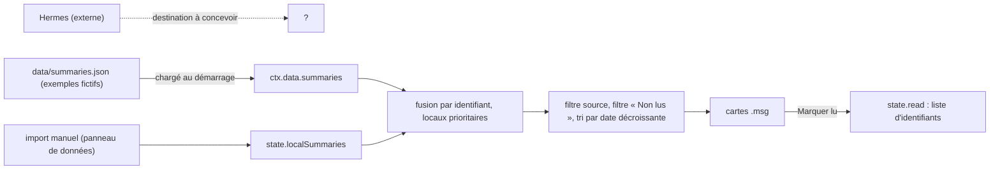

# Onglet Messages (résumés Hermes)

**État :** Partielle · **Vérifiée contre le code :** 2026-10-26

Retour à l'[index des fiches](README.md) · [ARCHITECTURE](../ARCHITECTURE.md) · [GLOSSAIRE](../GLOSSAIRE.md) · Décision : [ADR-018](../decisions/018-aucune-donnee-privee-dans-le-depot-public.md)

> **Pourquoi « Partielle »** : l'onglet fonctionne, mais **rien n'alimente encore l'application avec de vrais résumés**. Depuis la décision 018, Hermes ne peut plus écrire dans `data/summaries.json` (dépôt public) ; sa destination reste à concevoir.

## 1. Objectif

Lire dans l'application les résumés d'e-mails (Gmail) et de messages (WhatsApp) préparés par **Hermes**, un assistant externe : une carte par résumé, filtrable par source, avec un suivi « lu / non lu ».

## 2. Périmètre

**Fait** : lecture de `data/summaries.json` ; ajout de résumés par import manuel ; fusion des deux listes ; tri du plus récent au plus ancien ; filtre par source et « Non lus » ; marquage lu / non lu ; copie d'un résumé ; export et import de l'onglet.

**Ne fait pas** : lire ou envoyer des messages ; se connecter à Gmail ou WhatsApp (c'est le travail d'Hermes, hors de ce dépôt) ; répondre ; chercher dans les résumés (la recherche globale ne les inclut pas) ; supprimer un résumé isolé ; écrire `data/summaries.json`.

## 3. Vue d'ensemble technique



## 4. Composants et fichiers concernés

| Chemin | Rôle |
|---|---|
| `js/modules/messages.js` | `render(ctx)`, variable de vue `view = { source, unreadOnly }` |
| `data/summaries.json` | résumés lus au démarrage : **seulement deux exemples fictifs** (« demo-1 », « demo-2 ») |
| `js/modules/messages.js` | `render`, `allSummaries` (fusion fichier + import manuel, partagée avec le widget) |
| `js/store.js` | `localSummaries` et `read` : validation à la lecture, `importLocal('messages', …)` |
| `js/data-io.js` | `parseSummaries` ; section d'export « Messages » (`localSummaries`, `read`) |
| `js/ui/data-panel.js` | panneau d'import et d'export de l'onglet |
| `js/ui/context-menu.js` | menu d'actions ([socle-menu-contextuel](socle-menu-contextuel.md)) |
| `js/dom.js` | `h`, `empty` |
| `css/components.css` | `.msgs`, `.msg`, `.msg__from`, `.chip`, `.seg` |
| `tests/modules.test.js`, `tests/data-io.test.js` | tests |

## 5. Entrées / sorties

**Un résumé** (fichier ou import) :

```json
{ "id": "demo-1", "source": "gmail", "from": "Exemple (à remplacer)", "subject": "Convocation examen",
  "summary": "Exemple : l'examen de Physique est confirmé pour la semaine prochaine, salle à vérifier.", "date": "2026-10-16T18:30:00Z" }
```

| Champ | Règle |
|---|---|
| `id` | texte unique (clé de fusion et du suivi « lu ») |
| `source` | `gmail` ou `whatsapp` ; pour un import manuel, toute autre valeur devient `gmail` |
| `from`, `subject` | affichés ensemble : « expéditeur — sujet » ; 200 et 300 caractères au plus (local) |
| `summary` | le texte du résumé ; 5000 au plus (local) |
| `date` | date ISO ; sert au tri et à l'affichage (« 16 oct., 18:30 ») |

**Fichier `data/summaries.json`** : une simple liste. **À l'import**, le panneau accepte cette liste, `{ "summaries": [ … ] }` ou une exportation de l'onglet (au plus 5000 résumés locaux).

**Suivi « lu »** : `state.read`, liste d'identifiants (texte), 5000 au plus. **Vues** (`view`) : source (`all`, `gmail`, `whatsapp`) et « Non lus ».

## 6. Fonctionnement détaillé

```text
FONCTION render(ctx)
  venus du fichier ← ctx.data.summaries (si c'est une liste) SINON liste vide
  tous ← table par String(id) remplie dans cet ordre : venus du fichier, PUIS state.localSummaries    // un résumé local remplace celui du fichier de même id
  lus ← ensemble de state.read
  affichés ← tous
      filtrés : view.source = 'all' OU m.source = view.source
      filtrés : PAS view.unreadOnly OU id ∉ lus
      triés par String(date) décroissant
  SI aucun : AFFICHER « Aucun résumé. » + « Importe tes résumés depuis le panneau « Données » en bas de cet onglet : ils restent sur cet appareil, jamais dans le dépôt public. »
  SINON POUR CHAQUE m : carte .msg (classe is-read si lu)
      pastille « Gmail » si m.source = 'gmail', SINON « WhatsApp »
      date formatée ; « expéditeur — sujet » ; texte du résumé (nœud texte)
      boutons : « Marquer lu » ou « Marquer non lu », menu ⋯ (même bascule + « Copier le résumé »)

FONCTION basculer lu(id)
  store.commit : SI lu : retirer id de state.read ; SINON : l'ajouter

FONCTION importLocal('messages', éléments, mode)       // js/store.js
  fusionner par id (ou remplacer) dans state.localSummaries ; valider (source, longueurs) ; RETOURNER le total
```

Changer de source ou cocher « Non lus » ne modifie pas l'état : seule la vue est redessinée.

## 7. Dépendances

- **Internes** : `js/dom.js`, `js/ui/context-menu.js`, `js/store.js` (`commit`, `importLocal`), `ctx.data.summaries` ([socle-interface](socle-interface.md)).
- **Externe** : Hermes, hors de ce dépôt (aucune adresse ni clé dans le code). **Variable d'environnement** : aucune.
- **Clés** : `state.localSummaries` et `state.read` dans `studenthub:v1` ; `data/summaries.json` en lecture seule.
- **Réseau** : le fichier est lu « réseau d'abord » puis depuis la copie hors ligne ([socle-pwa-hors-ligne](socle-pwa-hors-ligne.md)).

## 8. Cas limites et erreurs

| Situation | Comportement |
|---|---|
| aucun résumé | message vide |
| fichier absent ou illisible | l'application démarre avec une liste vide |
| texte avec du HTML (`<b>Msg B</b>`) | affiché comme texte, jamais interprété |
| même `id` dans le fichier et en local | la version locale l'emporte |
| `source` inconnue dans le **fichier** | filtre « Tout » seulement, pastille « WhatsApp » (aucune validation sur le fichier) |
| date absente ou illisible | pas de date affichée ; voir la section 10 pour l'ordre |
| « Non lus » et tout est lu | message vide |
| import d'un fichier qui n'est pas une liste d'objets | refusé par le panneau |

## 9. Tests

- Fichiers : `tests/modules.test.js` (« messages : filtre par source et marque lu » : deux cartes, le HTML de `<b>Msg B</b>` reste du texte, le filtre « Gmail » en laisse une, « Marquer lu » ajoute l'identifiant à `state.read`) ; `tests/data-io.test.js` (formats acceptés par `parseSummaries` ; `importLocal` valide les sources et fusionne par identifiant).
- Lancer : `npm test`.
- Ne couvre pas : le filtre « Non lus », le tri par date, la copie du résumé, la priorité des résumés locaux, la date illisible. `tests/fixes.test.js` couvre le widget « Messages » de Home (résumés du fichier et locaux, sans doublon) et le texte de l'onglet vide.

## 10. Pièges et dette technique

- **Hermes n'a plus de destination** ([ADR-018](../decisions/018-aucune-donnee-privee-dans-le-depot-public.md)) : les résumés de vrais e-mails ne doivent pas être commités dans le dépôt public. Choix possibles notés par la décision : une table Supabase protégée ou un dépôt privé, **à concevoir**. Question ouverte.
- **Le message de l'onglet vide est périmé** : il dit encore « Hermes dépose ses résumés dans data/summaries.json », ce que la décision 018 déconseille. À corriger dans `js/modules/messages.js` quand la destination sera choisie.
- **Corrigé : le widget « Messages » compte aussi les résumés importés à la main.** Il utilise `allSummaries(data, state)` (`js/modules/messages.js`), la même fusion que l'onglet : le nombre de « non lus » est donc le même des deux côtés. Le texte de l'onglet vide ne parle plus de `data/summaries.json` (décision 018) : il renvoie au panneau « Données ».
- **Tri par chaîne de caractères** : une date absente est comparée comme le texte « undefined », qui passe avant les dates ISO ; ces résumés apparaissent en premier (déduit du code, non testé).
- **`read` n'est jamais nettoyé** : les identifiants de résumés disparus restent (5000 au plus ; au-delà, les plus récents sont perdus à la relecture).
- **Aucune validation du fichier du dépôt** : seul l'import manuel valide `source` et les longueurs.
- **Données d'exemple** : `demo-1` et `demo-2` sont fictives ; à supprimer quand de vrais résumés arrivent ([CONTRIBUTING](../CONTRIBUTING.md)).

## 11. Pour modifier ou étendre

1. **Brancher Hermes** : choisir la destination (hors dépôt public), écrire une décision, puis adapter `start()` pour lire cette source et le panneau d'import si besoin. Garder `localSummaries` comme solution de repli manuelle.
2. **Compteur de Home** : toujours passer par `allSummaries`, jamais par `ctx.data.summaries` seul.
3. **Nouvelle source** (Teams, SMS…) : ajouter une entrée à `SOURCES`, une pastille, et l'accepter dans `sanitizeLocal` (`js/store.js`).
4. **Ne pas casser** : l'affichage des résumés en texte (jamais de HTML) ; la fusion par identifiant ; l'absence de donnée privée dans le dépôt.
5. Relancer `npm run build:sw` puis `npm test`.
