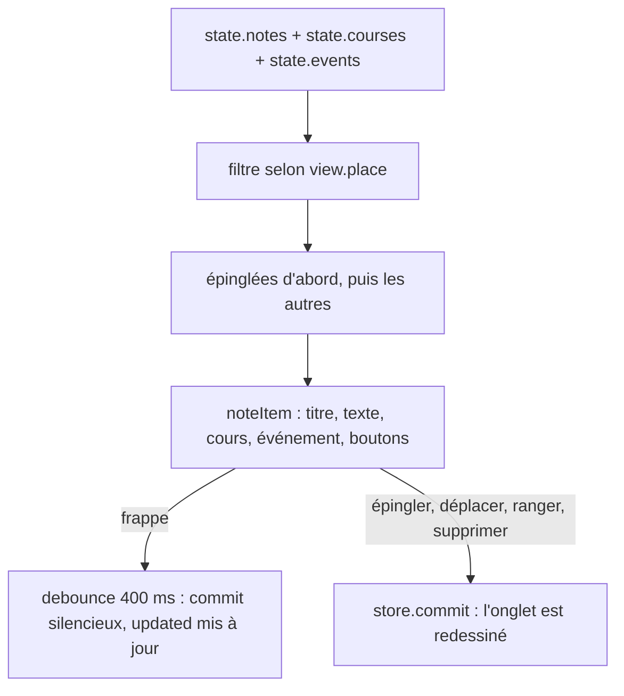

# Onglet Notes

**État :** Implémentée · **Vérifiée contre le code :** 2026-10-26

Retour à l'[index des fiches](README.md) · [ARCHITECTURE](../ARCHITECTURE.md) · [GLOSSAIRE](../GLOSSAIRE.md)

## 1. Objectif

Prendre des notes courtes, les ranger dans un cours (ou dans « Général »), les rattacher à un événement de l'agenda et garder les importantes en haut en les épinglant.

## 2. Périmètre

**Fait** : créer, modifier à même la carte (titre et texte), épingler, réordonner, dupliquer, copier, supprimer ; filtrer par cours ; lier à un cours et à un événement ; enregistrement automatique pendant la frappe ; export et import de l'onglet.

**Ne fait pas** : mise en forme (Markdown, gras, listes) ; pièces jointes ; recherche dans l'onglet (la recherche globale de Home inclut les notes) ; dossiers ; historique des versions.

## 3. Vue d'ensemble technique



## 4. Composants et fichiers concernés

| Chemin | Rôle |
|---|---|
| `js/modules/notes.js` | `render(ctx)`, `noteItem`, variable de vue `view = { place }` |
| `js/store.js` | `newNote`, `moveNote`, `uid`, validation de `notes` à la lecture, `removeCourse` et `removeEvent` (détachent les notes) |
| `js/dom.js` | `h`, `field`, `select`, `empty`, `debounce`, `formatDate` |
| `js/ui/context-menu.js` | menu d'actions ([socle-menu-contextuel](socle-menu-contextuel.md)) |
| `css/components.css` | `.notes`, `.note`, `.note--pinned`, `.note__title`, `.note__body` |
| `tests/modules.test.js`, `tests/store.test.js`, `tests/ux.test.js` | tests |

## 5. Entrées / sorties

**Donnée** : `state.notes`.

```json
{ "id": "m4k1z8q", "title": "Chimie : TD 3", "body": "…", "courseId": "", "eventId": "", "pinned": false, "updated": "2026-10-26T08:00:00.000Z" }
```

| Champ | Sens | Limite à la lecture |
|---|---|---|
| `courseId` | cours où la note est rangée ; vide = « Général » | 40 caractères |
| `eventId` | événement lié ; vide = aucun | 40 |
| `pinned` | épinglée si et seulement si la valeur est `true` | booléen |
| `title`, `body` | texte | 300 et 50 000 |
| `updated` | date ISO, mise à jour **à la frappe** | 40 |

**Sélecteur d'affichage** : « Toutes les notes » (`all`), « Général » (`''`), ou un cours (son `id`).

**Export** : section « Notes » (`notes`) ; suppressions suivies pour la synchronisation.

## 6. Fonctionnement détaillé

```text
FONCTION render(ctx)
  visibles ← notes dont view.place = 'all'  OU  (view.place = '' ET courseId = '')  OU  courseId = view.place
  ordonnées ← les épinglées visibles, PUIS les autres (chacun dans l'ordre de la liste)
  ids ← identifiants de `ordonnées`
  « + Note » : store.commit : AJOUTER EN TÊTE newNote({ courseId: (view.place = 'all' ? '' : view.place) })
  changer le sélecteur : view.place ← choix ; redessiner

FONCTION noteItem(ctx, n, places, ids)
  sauver ← debounce(400 ms) : store.commit(() => { n.updated ← maintenant }, { silent: true })    // pas de redessin
  champ titre / texte : à chaque frappe n.title ← valeur (ou n.body) ; sauver()
  « Placée dans » : n.courseId ← choix                     // commit normal
  « Événement » : liste « — Aucun — » + tous les événements « titre · date » ; n.eventId ← choix
  boutons : Épingler / Désépingler · ↑ · ↓ · Supprimer (confirmation) · ⋯
  menu : Épingler, Monter, Descendre, Dupliquer, Copier (titre + texte), Supprimer

FONCTION moveNote(notes, id, dir, ids)                     // js/store.js
  voisine ← l'identifiant voisin dans `ids` (visibles, ordre affiché)
  SI absent : RETOURNER faux
  échanger, dans la liste complète, les positions de la note et de sa voisine ; RETOURNER vrai
  // exemple : [a, b, c], monter c → [a, c, b] ; monter a → faux

FONCTION Dupliquer : AJOUTER EN TÊTE { ...n, id: uid(), title: n.title + ' (copie)', pinned: faux, updated: maintenant }
```

## 7. Dépendances

- **Internes** : `js/dom.js`, `js/store.js`, `js/ui/context-menu.js`.
- **Données d'autres onglets** : `state.courses` (liste des lieux), `state.events` (liste des événements).
- **Navigateur** : `confirm`, `setTimeout` (via `debounce`).
- **Externe** : aucun. **Variable d'environnement** : aucune. **Clé** : `state.notes` dans `studenthub:v1`.

## 8. Cas limites et erreurs

| Situation | Comportement |
|---|---|
| aucune note dans le filtre | « Aucune note ici. » |
| cours supprimé | la note passe en « Général » (`courseId` vidé par `removeCourse`) |
| événement supprimé | le lien de la note est retiré (`removeEvent`) |
| nouvelle note | créée en tête de liste, déjà rangée dans le cours filtré (vide si « Toutes ») |
| note dupliquée | copie en tête, non épinglée, avec un nouvel `id` |
| « Monter » sur la première note affichée | rien ne se passe |
| titre ou texte trop long (import) | coupé à 300 et 50 000 caractères |
| suppression | confirmation « Supprimer cette note ? » |

## 9. Tests

- Fichiers : `tests/modules.test.js` (« notes : créer, épingler, filtrer par lieu » : le bouton « + Note » ajoute une note et l'onglet en affiche deux avec la note d'un cours ; « une note peut être rattachée à un événement » : la liste propose l'événement et `eventId` est enregistré) ; `tests/store.test.js` (`moveNote` échange avec la voisine visible ; `removeCourse` détache les notes) ; `tests/ux.test.js` (menu : « Épingler ») ; `tests/data-io.test.js` (supprimer un événement délie ses notes).
- Lancer : `npm test`.
- Ne couvre pas : le filtre par cours en lui-même, l'ordre « épinglées d'abord », l'enregistrement différé de 400 ms, la duplication, la copie.

## 10. Pièges et dette technique

- **Frappe sans redessin** : le titre et le texte modifient directement l'objet de l'état ; seul l'enregistrement est différé de 400 ms. Fermer l'onglet du navigateur dans ce délai peut perdre les dernières lettres (déduit du code, non testé).
- **Redessin pendant la frappe** : une synchronisation automatique qui se termine pendant la saisie redessine l'onglet et fait perdre le focus au champ (déduit du code, non testé).
- **`updated` ne change qu'à la frappe** : épingler, déplacer ou ranger une note ne la fait pas remonter dans le widget « Récents » de Home.
- **« Monter » et « Descendre » entre une note épinglée et une autre** : les positions sont échangées dans la liste, mais l'affichage garde les épinglées en tête ; l'action peut ne produire aucun changement visible.
- **Pas de sauvegarde distincte par note** : la limite est celle de tout l'état (`localStorage`).
- **Une seule variable de vue** : `view.place` survit aux changements d'onglet mais pas au rechargement de la page.

## 11. Pour modifier ou étendre

1. **Nouveau champ** : `newNote`, la validation `notes` de `js/store.js` (avec une limite), la carte `noteItem`, et un test.
2. **Ouvrir une note précise depuis la recherche globale** : aujourd'hui elle ouvre seulement l'onglet ([socle-recherche-globale](socle-recherche-globale.md)) ; il faudrait mémoriser l'identifiant à ouvrir, comme pour les cours.
3. **Ne pas casser** : la frappe sans redessin (`silent: true`) ; la remise à zéro de `courseId` et `eventId` à la suppression ; la limite de 50 000 caractères.
4. Relancer `npm run build:sw` puis `npm test`.
