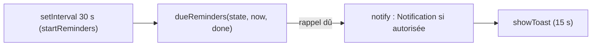
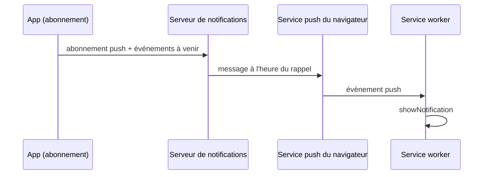

# Notifications application fermée

**État :** Prévue · **Vérifiée contre le code :** 2026-10-29

Retour à l'[index des fiches](README.md) · [ARCHITECTURE](../ARCHITECTURE.md) · [GLOSSAIRE](../GLOSSAIRE.md) · Décision : [ADR-017](../decisions/017-rappels-application-ouverte.md)

> Cette fonctionnalité **n'existe pas** (tâche T20 du [plan des tâches](../plans/plan-taches.md)). La fiche décrit ce qui fonctionne aujourd'hui, pourquoi cela ne suffit pas, et ce qu'il faudrait construire. Les noms marqués « prévu » ne sont pas dans le code.

## 1. Objectif

Qu'un rappel d'événement (et, plus tard, d'une session Focus ou d'une révision) **sonne même si Student Hub est fermé**, par exemple sur le téléphone verrouillé. Aujourd'hui, un rappel n'apparaît que si l'app est ouverte ([ADR-017](../decisions/017-rappels-application-ouverte.md)).

## 2. Périmètre

Existe déjà (mécanisme application ouverte, voir [socle-rappels.md](socle-rappels.md)) :
- une vérification toutes les 30 secondes ; un message à l'écran pendant 15 secondes ; une notification du navigateur si la permission est accordée ;
- un réglage pour tout désactiver (`settings.notify.reminders`) et un bouton « Autoriser les notifications » (Paramètres et Agenda).

Prévu, absent :
- tout envoi hors de l'app : serveur, abonnement push, gestion de la notification par le service worker.

Ne couvre pas : les rappels de to-dos, de plages de travail ou de séances Focus planifiées (`dueReminders` ne lit que les événements).

## 3. Vue d'ensemble technique

Aujourd'hui :



Cible possible (prévue, non retenue) :



## 4. Composants et fichiers concernés

| Chemin | Rôle |
|---|---|
| `js/reminders.js` | `startReminders`, `notify`, `showToast`. |
| `js/calendar-logic.js` | `dueReminders` : calcule les rappels dus. |
| `js/app.js` | Démarre `startReminders(store)` à l'ouverture. |
| `js/modules/settings-ui.js` | Réglage des rappels, état de la permission, bouton d'autorisation, texte d'avertissement. |
| `js/modules/calendar.js` | Même bouton d'autorisation dans les réglages de l'Agenda. |
| `sw.js` | Service worker **généré** ; ne contient aucun code `push` (vérifié). |
| `scripts/build-sw.mjs` | Générateur de `sw.js` : c'est là qu'un futur code push devrait être ajouté. |
| `docs/decisions/017-rappels-application-ouverte.md` | Décision et alternatives rejetées. |

## 5. Entrées / sorties

Entrée actuelle : `state.events[].reminder` (minutes avant, ou `null`), `calendars[].visible`, `settings.notify.reminders`. Sortie : un objet `{ key, title, date, start, minutes }` par rappel dû, puis un texte du type « Cours de physique à 08:00 (dans 15 min) », ou « … aujourd'hui » pour un événement sur la journée.

## 6. Fonctionnement détaillé

```text
FONCTION dueReminders(state, now, done)
  POUR CHAQUE jour DANS [aujourd'hui, demain]
    POUR CHAQUE événement DANS state.events
      ignorer si ev.reminder = null OU agenda masqué
      occ ← occurrenceOn(ev, jour) ; ignorer si rien
      début ← jour + (événement sur la journée ? 08:00 : occ.start)
      déclenchement ← début − occ.reminder minutes
      SI now ≥ déclenchement ET now < début ET clé ∉ done : ajouter le rappel
        // clé = identifiant|jour ; minutes = minutes restantes jusqu'au début
```

`startReminders` appelle cette fonction tout de suite puis toutes les 30 secondes, marque chaque rappel comme fait dans un ensemble en mémoire, et ne fait rien si `settings.notify.reminders === false`.

**Conception prévue pour la fermeture (hypothèse, non codée) :**

```text
FONCTION envoyerRappelsPlanifies()                  // sur un serveur, pas dans l'app
  POUR CHAQUE abonnement ET chaque rappel dont l'heure est arrivée et non envoyé
    envoyer un message push signé (clés VAPID) ; marquer envoyé
// côté service worker : à l'évènement push → showNotification(titre, corps)
```

## 7. Dépendances

- Aujourd'hui : API `Notification` (facultative, permission du navigateur), `setInterval`, `calendar-logic.js`. Aucun service externe, aucune variable d'environnement.
- Pour la cible : Web Push (abonnement, clés VAPID), un serveur ou une fonction planifiée, un code `push` et `notificationclick` dans le service worker (donc dans `scripts/build-sw.mjs`, [ADR-011](../decisions/011-service-worker-genere.md)). Sur iPhone, le push web exige, d'après ce que j'en sais, une app installée sur l'écran d'accueil : à vérifier dans la documentation du navigateur avant de s'engager.

## 8. Cas limites et erreurs

- Permission refusée ou API absente : seul le message à l'écran s'affiche ; l'état est écrit dans Paramètres (« indisponible », « bloquées », « pas encore autorisées »).
- Un mobile qui interdit `new Notification` : l'erreur est avalée, le message à l'écran reste.
- Application fermée, ou onglet gelé par le navigateur : **aucun rappel**. Les rappels manqués ne sont pas rattrapés à la réouverture si l'heure de début est passée (condition `now < début`).
- Les rappels déjà faits sont mémorisés seulement en mémoire : recharger la page dans la fenêtre de rappel peut le refaire sonner.

## 9. Tests

`tests/calendar-logic.test.js` couvre `dueReminders` (fenêtre de rappel, absence de doublon) et `tests/agenda.test.js` le cas d'une occurrence supprimée ou déplacée. Rien ne teste `startReminders`, la permission ni le toast. La partie « application fermée » n'a évidemment aucun test.

## 10. Pièges et dette technique

- Un serveur de notifications connaît les titres et les heures de tes événements : décision de confidentialité à prendre ([ADR-018](../decisions/018-aucune-donnee-privee-dans-le-depot-public.md) pour ce qui touche au dépôt public).
- Il faudrait un serveur à maintenir, ce que le projet évite jusqu'ici ; la synchronisation Supabase ([ADR-009](../decisions/009-synchronisation-supabase.md)) pourrait servir de point de départ, mais cela n'a pas été étudié.
- Le texte « Les rappels ne sonnent que si Student Hub est ouvert » est affiché dans Paramètres : à retirer ou adapter si la fonctionnalité arrive.
- `sw.js` étant généré, un code push ajouté à la main serait effacé par `npm run build:sw`.

## 11. Pour modifier ou étendre

Avant de coder : décider où tourne le serveur et qui détient les clés. Ensuite : ajouter l'abonnement côté app, les évènements `push` et `notificationclick` dans `scripts/build-sw.mjs`, un test de logique pure pour la planification, puis `npm run build:sw` et `npm test`. Passer cette fiche à `Partielle` dès la première étape livrée, et mettre à jour l'[ADR-017](../decisions/017-rappels-application-ouverte.md).
