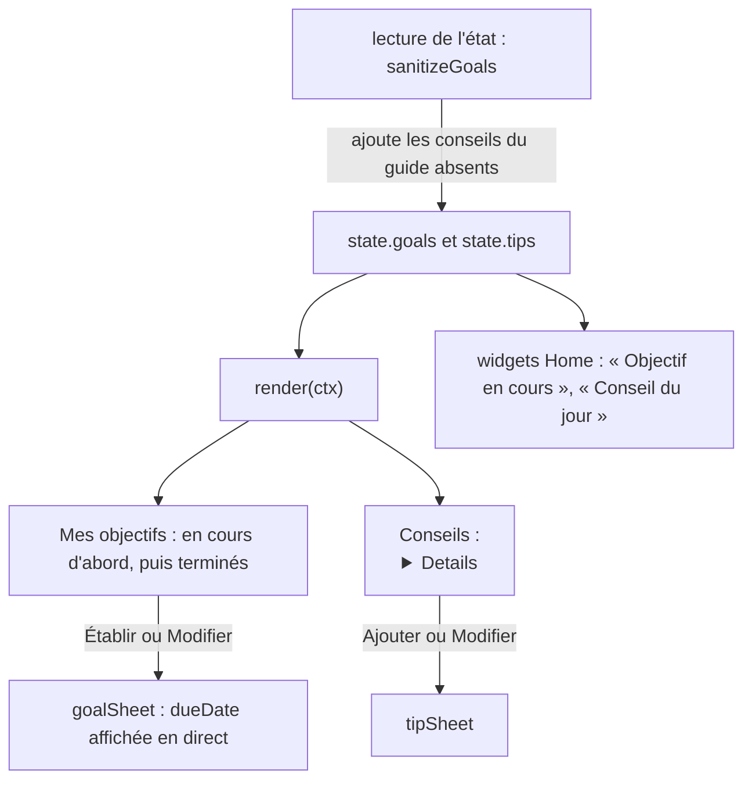

# Onglet Objectifs et conseils

**État :** Implémentée · **Vérifiée contre le code :** 2026-10-26

Retour à l'[index des fiches](README.md) · [ARCHITECTURE](../ARCHITECTURE.md) · [GLOSSAIRE](../GLOSSAIRE.md)

## 1. Objectif

Deux choses dans un même onglet : fixer des **objectifs** à quelques mois ou quelques années et voir le temps qui passe, et garder une bibliothèque de **conseils** (règles de travail, méthodes) qui contient d'abord le **guide d'utilisation** de Student Hub, 33 conseils pré-remplis.

## 2. Périmètre

**Fait** : créer, modifier, dupliquer, terminer, rouvrir, supprimer un objectif ; échéance calculée (mois ou années) ; barre de temps écoulé ; créer, modifier, dupliquer, copier, supprimer un conseil ; guide pré-rempli, mis à jour sans écraser les conseils de l'étudiant ; « Conseil du jour » et « Objectif en cours » dans Home ; export et import de l'onglet.

**Ajouté avec le suivi de projets** : trois modes de progression (`time` temps écoulé, `manual` curseur, `auto` moyenne du travail relié à des projets, cours ou to-dos), statut « Dans les temps / À risque / En retard / Atteint », liens cassés signalés, objectifs liés visibles sur la page d'un projet (voir [ADR-022](../decisions/022-progression-par-moyenne.md) et [workspace-projets](workspace-projets.md)). Le mode `time` reste le défaut : les anciens objectifs ne changent pas.

**Ne fait pas** : mesurer l'avancement réel en mode `time` (la barre montre alors **le temps écoulé**) ; rappeler une échéance (aucune notification) ; découper un objectif en étapes ; trier les objectifs (voir section 10) ; mettre à jour le texte d'un conseil du guide que l'étudiant possède déjà.

## 3. Vue d'ensemble technique



## 4. Composants et fichiers concernés

| Chemin | Rôle |
|---|---|
| `js/modules/goals.js` | `render(ctx)`, `goalItem`, `tipItem`, `goalSheet`, `tipSheet` |
| `js/goals-logic.js` | `UNITS`, `MODES`, `dueDate`, `newGoal`, `progress`, `linkRatio`, `goalProgress`, `goalsLinkedTo`, `sanitizeGoals`, `GUIDE_VERSION`, `guideTips`, le texte du guide |
| `js/store.js` | appelle `sanitizeGoals` à chaque lecture de l'état |
| `js/ui/context-menu.js` | menus d'actions ([socle-menu-contextuel](socle-menu-contextuel.md)) |
| `js/ui/dialog.js`, `js/dom.js` | feuilles et construction du DOM ([socle-interface](socle-interface.md)) |
| `js/ui/widgets.js` | widgets « Objectif en cours » et « Conseil du jour » ([socle-widgets-et-home](socle-widgets-et-home.md)) |
| `tests/revision.test.js` | 2 tests : la logique et l'onglet |

## 5. Entrées / sorties

**Objectif** :

```json
{ "id": "q8w2e1r", "title": "Valider le S1", "detail": "…", "start": "2026-10-26", "amount": 4, "unit": "months", "due": "2027-02-26", "done": false,
  "mode": "auto", "manual": 0, "links": [ { "kind": "project", "id": "p1" } ] }
```

| Champ | Règle à la lecture (`sanitizeGoals`) |
|---|---|
| `start` | **obligatoire**, `AAAA-MM-JJ` ; sans cela, **l'objectif est écarté** |
| `amount` | entier de 1 à 120 (arrondi, borné) |
| `unit` | `months` (mois) ou `years` (ans) ; toute autre valeur devient `months` |
| `due` | **toujours recalculée** à partir de `start`, `amount`, `unit` ; la valeur reçue est ignorée |
| `title` | 300 caractères, « Objectif » s'il est vide ; `detail` : 5000 ; `done` : vrai seulement si `true` |

**Conseil** : `{ "id": "guide-1", "title": "…", "body": "…" }` ; titre 300 (« Conseil » si vide), texte 20 000. Les conseils du guide ont pour identifiant `guide-1` à `guide-33`.

**Export** : section « Objectifs et conseils » : `goals`, `tips`, `tipsSeeded`, `guideVersion`. Les suppressions sont suivies pour la synchronisation ([socle-synchronisation](socle-synchronisation.md)).

## 6. Fonctionnement détaillé

```text
FONCTION dueDate(début, quantité, unité)
  d ← début ; jour ← jour du mois de d
  ajouter `quantité` mois (ou quantité × 12 pour des années) en partant du 1er du mois
  jour ← le plus petit entre `jour` et le nombre de jours du mois d'arrivée        // 31 janvier + 1 mois = 28 février
  RETOURNER d au format AAAA-MM-JJ

FONCTION goalProgress(objectif, état, aujourd'hui)           ← suivi de projets
  temps ← progress(objectif, aujourd'hui).ratio
  mode manual : travail ← manual / 100
  mode auto   : travail ← moyenne de linkRatio sur les liens valides (aucun lien valide → 0) ; liens cassés comptés à part
  mode time   : travail ← temps ; aucun statut
  statut ← « Atteint » si terminé ou travail ≥ 1 (hors mode time) ;
           sinon écart ← travail − temps : ≥ −0,10 « Dans les temps » ; ≥ −0,25 « À risque » ; sinon « En retard »
FONCTION linkRatio(lien, état) : project/course → moyenne des tâches de niveau 1 ; todo → avancement de la tâche ; élément absent → rien (lien cassé)

FONCTION progress(objectif, aujourd'hui)
  ratio    ← (aujourd'hui − début) / (échéance − début), borné entre 0 et 1
  joursRestants ← (échéance − aujourd'hui) en jours, arrondi
  RETOURNER { ratio, daysLeft }

FONCTION sanitizeGoals(r)                                // à chaque lecture de l'état
  objectifs ← ceux dont start est une date valide, avec les bornes du tableau ci-dessus
  conseils ← ceux de r.tips, validés
  stocké ← r.guideVersion, SINON 1 si r.tipsSeeded = vrai, SINON 0
  SI stocké < GUIDE_VERSION (5)
    ajouter EN TÊTE les conseils du guide dont `since` > stocké ET dont l'id n'est pas déjà présent
  RETOURNER { goals, tips, tipsSeeded: vrai, guideVersion: 5 }

FONCTION render(ctx)
  « Mes objectifs » : [en cours…, puis terminés…] dans l'ordre de la liste ; bouton « Établir un objectif »
  « Conseils (N) » : une ligne <details> par conseil ; bouton « Ajouter un conseil »

FONCTION goalItem(g)
  statut ← « Atteint » (terminé) | « Échéance dépassée de N j » | « Échéance aujourd'hui » | « N j restants »
  <progress value = (terminé ? 1 : ratio)> ; ligne « quantité unité · du début au échéance · statut »
  boutons : Terminé / Rouvrir, Modifier, Supprimer (confirmation), ⋯ (+ Dupliquer, Copier)

FONCTION goalSheet(ctx, objectif)
  champs : Objectif (obligatoire), Détail, Début (date), Durée (1 à 120) + Unité ; ligne « Échéance : <date> » mise à jour en direct
  onSubmit : « Écris ton objectif. » | « Choisis une date de début. » | « La durée doit être entre 1 et 120. » ; sinon enregistrer avec due = dueDate(…)
```

**Widgets de Home** :

```text
Objectif en cours : parmi les objectifs non terminés, celui dont l'échéance est la plus proche ; titre, barre, « N j restants · échéance … »
Conseil du jour   : tips[ jour courant (nombre de jours depuis 1970) modulo nombre de conseils ] ; titre + première ligne du texte (160 caractères)
```

## 7. Dépendances

- **Internes** : `js/dom.js`, `js/ui/dialog.js`, `js/ui/context-menu.js`, `js/store.js` (`uid`), `ymd` de la logique de l'Agenda.
- **Navigateur** : `confirm`.
- **Externe** : aucun. **Variable d'environnement** : aucune.
- **Clés** : `state.goals`, `state.tips`, `state.tipsSeeded`, `state.guideVersion` dans `studenthub:v1`.

## 8. Cas limites et erreurs

| Situation | Comportement |
|---|---|
| aucun objectif | message vide avec une suggestion |
| objectif sans date de début valide (import) | **écarté en silence** à la lecture |
| durée de 999 ou « abc » | ramenée à 120 ou à 1 |
| début le 31 janvier, +1 mois | échéance le 28 février (ou 29) |
| échéance dépassée | « Échéance dépassée de N j » ; la barre reste pleine |
| objectif terminé | barre pleine, statut « Atteint », placé après les objectifs en cours |
| première ouverture, ancienne sauvegarde sans guide | les 33 conseils sont ajoutés en tête, sans toucher aux conseils de l'étudiant |
| conseil du guide supprimé | **ne revient pas** (le marqueur de version l'enregistre) |
| nouvelle version du guide (`GUIDE_VERSION` plus grand) | seuls les nouveaux conseils sont ajoutés |
| aucun conseil | « Aucun conseil. » dans l'onglet et dans Home |

## 9. Tests

- Fichier : `tests/revision.test.js`. **Logique** : `dueDate('2026-01-31', 1, 'months')` donne `2026-02-28`, deux ans après le 21 octobre 2026 donne le 21 octobre 2028 ; un objectif de 6 mois commencé le 1er janvier est à mi-parcours le 2 avril (ratio proche de 0,5 et 90 jours restants) ; le guide pré-rempli compte au moins 33 conseils et évoque chaque onglet ; une ancienne sauvegarde reçoit tout le guide en plus de ses conseils ; une sauvegarde à jour avec zéro conseil n'en reçoit pas ; une ancienne version du guide ne reçoit que **14** nouveaux conseils ; un objectif sans date valide est écarté et une durée de 999 devient 120. **Onglet** : au moins 33 conseils affichés ; « Établir un objectif » enregistre un objectif de 4 mois ; ajout et suppression d'un conseil.
- Lancer : `npm test`.
- Ne couvre pas : « Terminé » / « Rouvrir », la duplication, les statuts d'échéance, les messages d'erreur de la feuille, les widgets de Home en détail, la copie d'un conseil.

## 10. Pièges et dette technique

- **La barre n'est pas un avancement** : elle mesure le temps écoulé entre début et échéance. Un objectif non touché atteint 100 % à l'échéance. Le widget de Home le dit par « Temps écoulé » (libellé accessible) mais pas à l'écran.
- **Les conseils du guide déjà possédés ne sont jamais mis à jour** : seuls les conseils dont l'identifiant est absent sont ajoutés. Corriger une faute dans `guide-6` n'atteint pas les appareils qui l'ont déjà ; il faudrait un nouvel identifiant et un `since` plus grand.
- **Un objectif sans date de début valide disparaît** à la lecture, sans message (import ou sauvegarde abîmée).
- **Ordre des objectifs** : celui de la liste (les plus récents en dernier) ; seul le widget de Home trie par échéance.
- **« Conseil du jour » change à minuit UTC**, pas à minuit local (calcul sur `Date.now()`).
- **Aucun rappel d'échéance** : l'objectif n'apparaît pas dans l'Agenda et ne déclenche pas de notification.
- **Pas de limite du nombre de conseils** ni d'objectifs, hors la taille de l'état.

## 11. Pour modifier ou étendre

1. **Ajouter un conseil au guide** : l'ajouter dans `allGuide()` de `js/goals-logic.js` avec un nouveau numéro, un `since` égal à la nouvelle version, et augmenter `GUIDE_VERSION`. Le test du nombre de conseils (« ancienne version : 14 ») est à ajuster.
2. **Modifier un conseil existant du guide pour tout le monde** : lui donner un nouvel identifiant (et retirer l'ancien du guide), puis augmenter `GUIDE_VERSION` ; sinon seules les nouvelles installations voient le nouveau texte.
3. **Montrer un vrai avancement** : ajouter un champ (pourcentage ou étapes) dans `newGoal`, `sanitizeGoals`, la feuille et la barre ; ajouter un test.
4. **Ne pas casser** : la recalculation de `due` à la lecture ; le marqueur `guideVersion` (un conseil supprimé ne doit pas revenir) ; les conseils de l'étudiant jamais écrasés.
5. Relancer `npm run build:sw` puis `npm test`.
