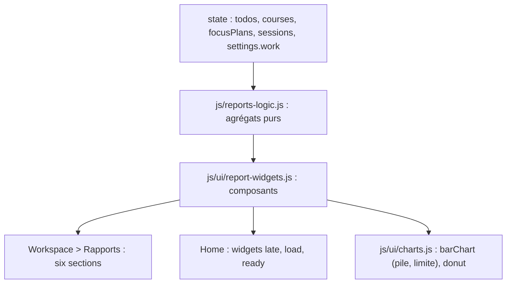

# Rapports et tableaux de bord

**État :** Implémentée · **Vérifiée contre le code :** 2026-10-30

Retour à l'[index des fiches](README.md) · [ARCHITECTURE](../ARCHITECTURE.md) · [GLOSSAIRE](../GLOSSAIRE.md)

## 1. Objectif

Voir d'un coup d'œil où en est le travail : répartition des tâches, retards, charge des prochains jours, avancement par cours, rythme hebdomadaire.

## 2. Périmètre

**Fait** : vue « Rapports » de Workspace (six sections) ; trois widgets de Home (« En retard », « Charge de la semaine », « Prêtes à démarrer ») ; capacité de travail par jour réglable ; graphique de charge avec ligne de capacité et barres empilées.

**Ne fait pas** : rapports exportables ; périodes au choix ; comparaison entre semestres ; temps réellement passé par tâche (voir [focus-statistiques](focus-statistiques.md) pour le Focus).

## 3. Vue d'ensemble technique



## 4. Composants et fichiers concernés

| Chemin | Rôle |
|---|---|
| `js/reports-logic.js` | `statusCounts`, `byCourse`, `doneByWeek`, `overdue`, `load`, `isLate` |
| `js/ui/report-widgets.js` | `statusReport`, `courseReport`, `weeklyReport`, `lateList`, `loadReport`, `readyList`, `reportsView` |
| `js/ui/charts.js` | `barChart` avec options `stack`, `limit`, `limitLabel` ; `donut` |
| `js/ui/widgets.js` | widgets `ready`, `late`, `load` |
| `js/settings-logic.js`, `js/modules/settings-ui.js` | `work.capacityMin` (défaut 240 min, 30 à 960) ; liste des widgets |
| `js/modules/workspace.js` | entrée « Rapports » du sélecteur |
| `tests/reports.test.js`, `tests/e2e/projects.e2e.py` | tests |

## 5. Entrées / sorties

Entrées : `todos` (`status`, `deadline`, `doneAt`, `effort`, `slots`, `parentId`, `courseId`), `courses`, `focusPlans`, `sessions`, `settings.work.capacityMin`. Sorties : éléments DOM (SVG sans `innerHTML`).

| Rapport | Contenu |
|---|---|
| Statut des tâches | donut : faites, en cours, à faire, **en retard** (compté à part) ; tâches de niveau 1 |
| En retard | tâches non terminées dont la deadline est passée, sous-tâches comprises, les plus anciennes d'abord ; clic : ouvre la tâche |
| Charge des 14 prochains jours | heures par jour, **planifié** (vert) + **non planifié** (orange) ; trait de capacité ; jours de surcharge nommés |
| Avancement par cours | une barre par cours qui a des tâches ; « Sans cours » regroupe le reste |
| Terminées par semaine | 8 semaines (lundi à dimanche), d'après `doneAt` |
| Prêtes à démarrer | voir [workspace-sous-taches-et-dependances](workspace-sous-taches-et-dependances.md) |

## 6. Fonctionnement détaillé

```text
FONCTION statusCounts(tâches, aujourd'hui)       ← niveau 1 seulement
  terminée → fait ; sinon deadline passée → enRetard ; sinon « En cours » → enCours ; sinon aFaire

FONCTION doneByWeek(tâches, aujourd'hui, semaines = 8)
  début ← lundi de la semaine courante − 7 × (semaines − 1)
  pour chaque tâche de niveau 1 terminée :
      SI pas de doneAt : inconnues + 1 (jamais comptée dans une semaine)
      SINON index ← semaines entre début et le lundi de doneAt ; SI dans la fenêtre : valeurs[index] + 1

FONCTION load(état, depuis, jours = 14, capacité = 240)
  pour chaque tâche NON terminée :
      planifié(jour) += minutes des plages non faites de ce jour
      SI aucune plage ET aucune sous-tâche ouverte ET effort > 0 ET deadline ≤ dernier jour :
          non planifié(max(deadline, depuis)) += effort        ← une deadline dépassée tombe sur le premier jour
  pour chaque session Focus planifiée dans la période, sans session terminée portant son planId :
      planifié(jour) += minutes
  surcharge(jour) = planifié + non planifié > capacité
```

## 7. Dépendances

- **Internes** : `js/tasks-logic.js` (`isDone`, `children`), `js/deps-logic.js` (`ready`), `js/calendar-logic.js` (`addDays`, `parseYMD`, `ymd`), `js/ui/todo-dialog.js` (ouvrir une tâche), `js/dom.js`.
- **Liens** : [workspace-sous-taches-et-dependances](workspace-sous-taches-et-dependances.md), [agenda-plages-de-travail](agenda-plages-de-travail.md) (plages), [focus-sessions-planifiees](focus-sessions-planifiees.md) (sessions planifiées), [socle-widgets-et-home](socle-widgets-et-home.md).
- **Externe** : aucun.

## 8. Cas limites et erreurs

| Situation | Comportement |
|---|---|
| aucune tâche | messages « Aucune tâche pour l'instant. », « Aucune tâche en retard. », « Aucun travail planifié ni estimé sur la période. » |
| tâche terminée avant le suivi (sans `doneAt`) | comptée dans le donut et les barres par cours, **pas** dans la courbe hebdomadaire (message sous le graphique) |
| parent qui a des sous-tâches ouvertes | son propre `effort` n'est pas compté (ses sous-tâches le portent) |
| tâche qui a des plages | son `effort` n'est pas ajouté en plus des plages |
| session Focus déjà réalisée | ignorée (une session `done` porte son `planId`) |
| `effort` à 0 | tâche absente du non planifié |
| capacité modifiée dans Paramètres | le seuil de surcharge change à l'affichage suivant |

## 9. Tests

`tests/reports.test.js` : comptes par statut (retard à part, sous-tâches ignorées), `byCourse`, semaines (lundi/dimanche, hors fenêtre, sans date), `overdue`, `load` (plages faites, Focus réalisé, deadline dépassée, parent, hors période), `barChart` (pile, limite, dépassement), vue à vide, donut, retard cliquable, surcharge, capacité des réglages, widgets Home. Navigateur réel : `tests/e2e/projects.e2e.py` (six sections, SVG, aucun débordement horizontal à 390 px).

## 10. Pièges et dette technique

- La courbe hebdomadaire ne remonte pas avant l'installation de cette version : l'historique ne peut pas être reconstruit.
- La charge ne tient pas compte des événements de l'agenda, seulement des plages de travail, des sessions Focus planifiées et de l'effort estimé.
- Les semaines commencent le lundi, indépendamment du réglage « premier jour de la semaine » de l'Agenda.
- Les widgets sont des composants partagés : une modification de `report-widgets.js` change Home et Workspace en même temps.

## 11. Pour modifier ou étendre

- Un nouvel agrégat : une fonction pure dans `js/reports-logic.js` avec son test, puis un composant dans `js/ui/report-widgets.js`.
- Un nouveau widget : l'ajouter à `WIDGETS` et `HIDE_ON` (`js/settings-logic.js`) et à `RENDER` (`js/ui/widgets.js`) ; les utilisateurs existants le reçoivent une seule fois.
- Pour pondérer par l'effort, partir de `rollup` ([ADR-022](../decisions/022-progression-par-moyenne.md)).
