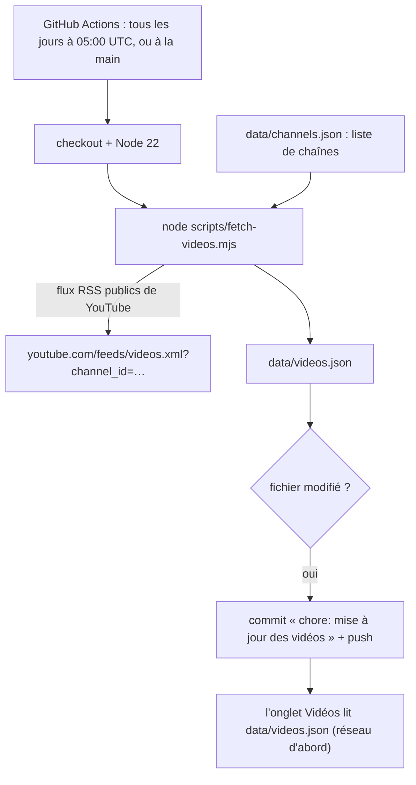

# Socle — Automatisations : Action GitHub des vidéos et scripts

**État :** Implémentée · **Vérifiée contre le code :** 2026-10-26

Retour à l'[index des fiches](README.md) · [ARCHITECTURE](../ARCHITECTURE.md) · [GLOSSAIRE](../GLOSSAIRE.md) · Décisions : [ADR-011](../decisions/011-service-worker-genere.md), [ADR-019](../decisions/019-prompt-du-tuteur-genere.md)

## 1. Objectif

Faire à la place de l'étudiant les tâches répétitives qui ne peuvent pas se faire dans le navigateur : récupérer chaque jour les dernières vidéos des chaînes choisies, et **générer** les deux fichiers qui dérivent d'une source (`sw.js` et `js/tutor-prompt.js`). Tout se fait avec Node, sans dépendance d'exécution, et sans secret.

## 2. Périmètre

**Fait** : une Action GitHub quotidienne qui écrit `data/videos.json` ; les scripts `fetch-videos`, `build-sw`, `build-tutor-prompt` ; leurs tests.

**Ne fait pas** : lancer les tests ni déployer (aucun workflow ne le fait : `npm test` se lance en local, et la publication sur GitHub Pages est un réglage du dépôt) ; écrire `data/summaries.json` (les résumés Hermes n'ont pas de script dans le dépôt, voir la fiche Messages) ; utiliser une clé d'API ou un jeton (les flux RSS de YouTube sont publics).

## 3. Vue d'ensemble technique



## 4. Composants et fichiers concernés

| Chemin | Rôle |
|---|---|
| `.github/workflows/videos.yml` | l'Action « Mise à jour des vidéos » |
| `scripts/fetch-videos.mjs` | `parseFeed(xml, nomChaîne, limite = 12)` et le programme principal |
| `data/channels.json` | liste des chaînes suivies : `[{ "name": "…", "channelId": "UC…" }]` (actuellement vide) |
| `data/videos.json` | résultat : `{ "updated": "<date>", "videos": [ … ] }` (actuellement vide, `updated` à `null`) |
| `scripts/build-sw.mjs` | génère `sw.js` ([socle-pwa-hors-ligne](socle-pwa-hors-ligne.md)) |
| `scripts/build-tutor-prompt.mjs` | génère `js/tutor-prompt.js` à partir de `docs/fds-tutor.md` |
| `scripts/supabase.sql` | script SQL à lancer une fois dans Supabase ([socle-synchronisation](socle-synchronisation.md)) |
| `package.json` | commandes `npm test`, `npm run build:sw`, `npm run build:tutor` |
| `tests/feed.test.js` | 2 tests de `parseFeed` |
| `tests/tutor.test.js` | vérifie que `js/tutor-prompt.js` correspond à `docs/fds-tutor.md` |

## 5. Entrées / sorties

**`data/channels.json`** (entrée) : une liste ; chaque chaîne a un nom et un identifiant de chaîne YouTube de la forme `UC` suivi de 22 caractères.

```json
[ { "name": "Nom de la chaîne", "channelId": "UCxxxxxxxxxxxxxxxxxxxxxx" } ]
```

**`data/videos.json`** (sortie) :

```json
{ "updated": "2026-10-26T05:00:12.345Z",
  "videos": [ { "id": "ZZZZZZZZZZZ", "title": "Plus récente", "channel": "Chaîne", "published": "2026-10-12T10:00:00+00:00" } ] }
```

**Exemple de flux lu** (tiré des tests) : deux `<entry>` valides et une avec un identifiant trop court ; `parseFeed` renvoie 2 vidéos, la plus récente d'abord, et décode « Maths &amp; Physique » en « Maths & Physique ».

**Action GitHub** : `schedule: cron '0 5 * * *'` (05:00 UTC) et `workflow_dispatch` (lancement manuel) ; permission `contents: write`.

## 6. Fonctionnement détaillé

```text
FONCTION parseFeed(xml, nomChaîne, limite = 12)
  résultat ← liste vide
  POUR CHAQUE bloc <entry> DANS xml
    id ← contenu de <yt:videoId> (exactement 11 caractères : lettres, chiffres, _ ou -)
    titre ← contenu de <title> ; publié ← contenu de <published>
    SI id ET titre : AJOUTER { id, title: titre décodé (&lt; &gt; &quot; &#39; &amp;), channel: nomChaîne, published: publié OU '' }
  RETOURNER résultat trié par date décroissante, limité à `limite` éléments

PROGRAMME fetch-videos
  chaînes ← lire data/channels.json
  vidéos ← liste vide
  POUR CHAQUE chaîne
    SI channelId ne correspond pas à /^UC[\w-]{22}$/ : avertir « Ignoré (channelId invalide) » ; PASSER
    essayer : réponse ← GET https://www.youtube.com/feeds/videos.xml?channel_id=<channelId>
              SI réponse non « ok » : ERREUR « HTTP <code> »
              AJOUTER parseFeed(texte, chaîne.name) à vidéos
    en cas d'erreur : avertir « Échec pour <nom> : … » ; continuer
  écrire data/videos.json = { updated: maintenant, videos: vidéos }
```

```text
ACTION « Mise à jour des vidéos » (.github/workflows/videos.yml)
  récupérer le dépôt ; installer Node 22
  exécuter node scripts/fetch-videos.mjs
  configurer l'auteur « student-hub-bot »
  git add data/videos.json
  SI quelque chose a changé : commit « chore: mise à jour des vidéos » ET push
```

**Générateurs** (une source, un fichier généré, un test) :

```text
FONCTION build-sw        : empreinte de chaque fichier de l'app → sw.js                 (npm run build:sw)
FONCTION build-tutor     : lire docs/fds-tutor.md → écrire js/tutor-prompt.js (« export default » de son texte)   (npm run build:tutor)
```

## 7. Dépendances

- **Internes** : `data/channels.json` en entrée ; l'application lit `data/videos.json` (réseau d'abord dans le service worker, copie hors ligne) ; `js/tutor-prompt.js` est importé par la logique du tuteur.
- **Externes** : flux RSS publics de YouTube ; GitHub Actions (`actions/checkout@v4`, `actions/setup-node@v4`, Node 22).
- **Secrets, jetons, variables d'environnement** : aucun. L'Action utilise le jeton fourni automatiquement par GitHub (permission `contents: write`).
- **Aucune dépendance npm** pour ces scripts (le `fetch` de Node suffit).

## 8. Cas limites et erreurs

| Situation | Comportement |
|---|---|
| `data/channels.json` vide (cas actuel) | `data/videos.json` est écrit avec une liste vide ; l'onglet Vidéos n'affiche rien |
| `channelId` invalide | la chaîne est ignorée avec un avertissement dans le journal de l'Action |
| un flux répond une erreur ou le réseau échoue | avertissement ; les autres chaînes sont traitées normalement |
| entrée sans identifiant de 11 caractères ou sans titre | ignorée |
| titre contenant des entités HTML | décodé en texte ; l'application l'affiche sans l'interpréter |
| flux vide | aucune vidéo pour cette chaîne |
| `data/channels.json` illisible | le script s'arrête avec une erreur (l'Action échoue) |
| aucune nouvelle vidéo | `data/videos.json` est tout de même réécrit (voir section 10) |

## 9. Tests

- Fichiers : `tests/feed.test.js` (lit, décode, trie, ignore les identifiants invalides ; respecte la limite et un flux vide), `tests/tutor.test.js` (fichier généré = `docs/fds-tutor.md`), `tests/pwa.test.js` (`sw.js` à jour).
- Lancer : `npm test`.
- Ne couvre pas : le programme principal de `fetch-videos` (appel réseau), le fichier du workflow, l'écriture de `data/videos.json`, le comportement de l'Action sur GitHub.

## 10. Pièges et dette technique

- **Un commit par jour, même sans nouveauté** : `updated` porte la date du jour, donc `data/videos.json` change à chaque exécution et l'Action le commite chaque jour (déduit du code).
- **Une chaîne en échec efface ses vidéos du jour** : le fichier est réécrit entièrement avec les seules chaînes réussies ; une panne ponctuelle d'un flux retire ses vidéos jusqu'à la prochaine exécution.
- **Conflits Git** : l'Action pousse sur la branche principale ; avant de pousser en local, il faut tirer (`git pull`) et ne jamais modifier `data/videos.json` à la main ([CONTRIBUTING](../CONTRIBUTING.md)).
- **Aucune intégration continue** : rien ne lance `npm test` sur GitHub ; un oubli de `npm run build:sw` n'est vu qu'en local.
- **Question ouverte** : quelles chaînes YouTube suivre ? `data/channels.json` est vide.
- **Fichiers générés** : `sw.js` et `js/tutor-prompt.js` ne se modifient jamais à la main ; leurs tests le garantissent.

## 11. Pour modifier ou étendre

1. **Ajouter une chaîne** : l'ajouter à `data/channels.json` (nom + identifiant `UC…` de 24 caractères), puis lancer l'Action à la main (onglet Actions de GitHub, « Run workflow ») ou `node scripts/fetch-videos.mjs` en local.
2. **Changer l'heure** : modifier l'expression `cron` de `.github/workflows/videos.yml` (heure UTC).
3. **Éviter les commits inutiles** : ne réécrire `data/videos.json` que si la liste change, ou ne pas toucher à `updated` dans ce cas.
4. **Modifier le prompt du tuteur** : éditer `docs/fds-tutor.md`, lancer `npm run build:tutor`, **puis** `npm run build:sw` (car `js/tutor-prompt.js` fait partie des fichiers mis en cache), puis `npm test`.
5. **Ne pas casser** : l'absence de secret dans le dépôt public ([ADR-018](../decisions/018-aucune-donnee-privee-dans-le-depot-public.md)) ; la validation du `channelId` ; les fichiers générés non modifiés à la main.
