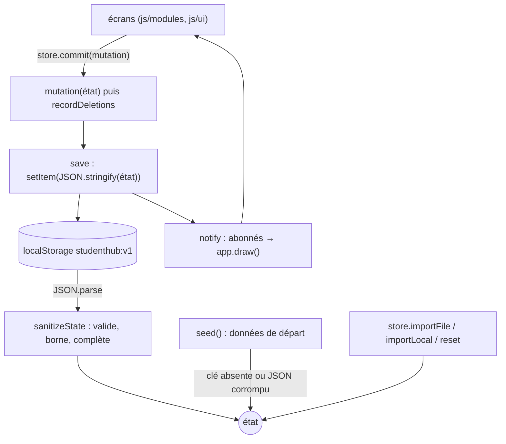

# Socle — État et stockage

**État :** Implémentée · **Vérifiée contre le code :** 2026-10-25

Retour à l'[index des fiches](README.md) · [ARCHITECTURE](../ARCHITECTURE.md) · [GLOSSAIRE](../GLOSSAIRE.md)

## 1. Objectif

Toutes les données de l'étudiant (cours, tâches, agenda, cartes, réglages…) forment **un seul objet JSON, l'état**. Cette fiche décrit comment il est créé, validé, modifié, sauvegardé sur l'appareil et diffusé aux écrans. Elle garantit qu'une donnée corrompue ou mal formée ne peut pas faire planter l'application.

## 2. Périmètre

**Fait** : charger l'état depuis `localStorage` (ou créer les données de départ), valider et borner tout ce qui entre, modifier l'état par `commit`, sauvegarder, prévenir les écrans, suivre les suppressions, fournir les fabriques d'objets (`newTodo`, `newEvent`…).

**Ne fait pas** : l'import/export de fichiers (voir [import-export](socle-import-export.md)), la synchronisation avec le cloud (voir [synchronisation](socle-synchronisation.md)), le stockage des PDF (voir [Biblio](biblio-pdf.md)), le verrou (voir [verrou](socle-verrou.md)).

## 3. Vue d'ensemble technique



## 4. Composants et fichiers concernés

| Chemin | Rôle |
|---|---|
| `js/store.js` | `createStore`, `seed`, tous les `sanitize*`, fabriques `new*`, `removeCourse`, `removeCalendar`, `removeEvent`, `removeBook`, `moveNote`, `uid` |
| `js/constants.js` | clé `STORAGE_KEY` (`studenthub:v1`), listes fermées (statuts, types, répétitions, rappels, couleurs, cours de départ) |
| `js/tombstones.js` | suivi des identifiants disparus à chaque `commit` (voir [synchronisation](socle-synchronisation.md)) |
| `js/data-io.js` | `exportAll`, `applyImport` appelés par `store.exportJSON` et `store.importFile` |
| `js/revision-logic.js`, `js/goals-logic.js`, `js/settings-logic.js`, `js/xp-logic.js` | `sanitizeRevision`, `sanitizeGoals`, `sanitizeSettings`, `sanitizeXp` : validation des clés de ces domaines |

## 5. Entrées / sorties

**Entrée** : un objet `storage` qui a `getItem(clé)` et `setItem(clé, texte)` (le vrai `localStorage`, ou `memory()` dans les tests).

**Sorties** (objet retourné par `createStore`) :

| Membre | Rôle |
|---|---|
| `state` (lecture) | l'état courant ; **le même objet** jusqu'à un import, `reset` ou `importLocal` (qui le remplacent) |
| `commit(mutation, { silent })` | exécute `mutation(état)`, suit les suppressions, sauvegarde ; notifie sauf `silent: true` ; retourne `false` si la sauvegarde a échoué |
| `subscribe(f)` | `f(état)` appelée après chaque notification ; retourne la fonction de désabonnement |
| `exportJSON()`, `exportSection(id)` | texte JSON (voir [import-export](socle-import-export.md)) |
| `importFile(texte, { mode, only })`, `importJSON(texte)` | import (`importJSON` = remplacer) |
| `importLocal('messages' \| 'videos', éléments, mode)` | résumés ou vidéos importés à la main |
| `reset()` | revient aux données de départ |

Exemple d'extrait d'état (réel, après création d'un to-do) :

```json
{
  "version": 1,
  "courses": [{ "id": "k3j9x2a1b", "name": "Physique", "semester": "Semestre 1", "exam": "", "syllabus": [] }],
  "todos": [{ "id": "p0q8w7e6r", "name": "Rendre le TP", "courseId": "k3j9x2a1b", "deadline": "2026-11-12", "status": "A faire", "type": "Devoir", "eventId": "", "slots": [] }],
  "settings": { "appearance": { "theme": "auto", "size": "normal" } },
  "tombstones": {}
}
```

## 6. Fonctionnement détaillé

```text
FONCTION createStore(storage)
  TENTER
    brut ← storage.getItem('studenthub:v1')
    état ← SI brut existe ALORS sanitizeState(JSON.parse(brut)) SINON seed()
  SI ÉCHEC : état ← seed()                    // JSON corrompu : on repart des données de départ

  FONCTION commit(mutation, silent)
    avant ← idSets(état)                      // identifiants de chaque collection suivie
    mutation(état)                            // modification EN PLACE
    recordDeletions(état, avant)              // ce qui a disparu devient un marqueur daté
    ok ← save()                               // setItem ; retourne faux si le stockage est plein
    SI PAS silent : prévenir chaque abonné
    RETOURNER ok

FONCTION sanitizeState(brut)                  // pure, idempotente, tolère n'importe quelle entrée
  r ← brut SI c'est un objet SINON {}
  POUR CHAQUE collection (courses, todos, projects, notes, links, library) :
    éléments ← les objets de r.collection       // un élément qui n'est pas un objet est écarté
    POUR CHAQUE élément :
      id      ← texte(≤ 40) OU uid()            // un id manquant est recréé
      texte   ← tronqué à sa longueur maximale  // 200, 300, 2000, 5000 ou 50000 selon le champ
      énumération (statut, type, semestre) ← valeur SI dans la liste SINON valeur par défaut
      date    ← valeur SI AAAA-MM-JJ SINON ''
      nombre  ← borné entre min et max
  AJOUTER les clés des autres domaines : sanitizeCalendar, sanitizeFocus, sanitizeLocal,
          sanitizeRevision, sanitizeGoals, sanitizeSettings, sanitizeXp, sanitizeTombstones
  RETOURNER { version: 1, … }                   // les clés inconnues sont perdues

FONCTION removeCourse(état, id)
  retirer le cours ; POUR CHAQUE to-do et note qui le référence : courseId ← ''

FONCTION moveNote(notes, id, dir, idsVisibles)  // échange avec la voisine VISIBLE
  SI pas de voisine : RETOURNER faux
  échanger les deux notes dans le tableau ; RETOURNER vrai
```

Règle d'or : **l'état ne se modifie que dans `commit`** ; si l'écran dépend d'un état local (onglet choisi, message), le poser **avant** le `commit`, car c'est lui qui redessine.

## 7. Dépendances

- **Modules de données** : `js/tombstones.js` (suivi des suppressions), `js/data-io.js` (import/export), les `sanitize*` des domaines (cartes, objectifs, réglages, XP).
- **Stockage** : `localStorage` clé `studenthub:v1` ; aucune variable d'environnement ni service externe.
- **Constantes** : `js/constants.js` ; ajouter une valeur à une liste fermée suffit à l'autoriser (par exemple un type de to-do).

## 8. Cas limites et erreurs

| Situation | Comportement |
|---|---|
| clé absente | `seed()` : 8 cours de MPC1, agendas, tags Focus, guide d'utilisation |
| JSON illisible ou invalide | `seed()` sans erreur (l'ancien texte est écrasé à la prochaine sauvegarde) |
| champ inconnu ou mal typé | écarté ou remplacé par sa valeur par défaut ; texte trop long : tronqué |
| statut, type ou semestre hors liste | `Sans statut`, `Devoir`, `Semestre 1` |
| date mal formée | chaîne vide |
| stockage plein (`setItem` lève) | `commit` retourne `false` ; l'état reste en mémoire mais n'est plus sauvegardé |
| `commit` avec une mutation qui lève | l'exception remonte ; l'état peut être partiellement modifié et n'est ni sauvegardé ni notifié |
| entrée qui n'est pas un objet | traitée comme `{}` |

## 9. Tests

- Fichier : `tests/store.test.js`. Lancer : `npm test` (ou `node --test tests/store.test.js`).
- Couvre : les 8 cours de départ, la correction des valeurs invalides, la tolérance à n'importe quelle entrée, la persistance après rechargement, le JSON corrompu, `commit` silencieux, l'aller-retour export/import, l'import invalide qui garde l'état, `removeCourse`, `moveNote`, la structure d'un cours.
- Ne couvre pas : le dépassement du quota de stockage (`save` qui échoue) ni une mutation qui lève.

## 10. Pièges et dette technique

- **Données perdues en silence** : un JSON corrompu ou une clé inconnue disparaît sans avertissement (`sanitizeState` ne conserve que ce qu'il connaît). Une version plus récente de l'app qui ajoute un champ le verrait supprimé par une version plus ancienne.
- **Pas d'alerte de stockage plein** : `commit` retourne `false`, mais aucun écran ne l'affiche aujourd'hui (dette).
- **Références périmées** : `importFile`, `importLocal` et `reset` **remplacent** l'objet `store.state`. Un écran qui a gardé une référence (par exemple une feuille de saisie ouverte) modifierait un objet qui n'est plus dans l'état : c'est pour cela que la synchronisation automatique attend qu'aucune feuille ne soit ouverte ([autosync](socle-synchronisation.md)).
- **Mutation hors `commit`** : non sauvegardée, non notifiée.
- **Suivi des suppressions** : fait par comparaison avant/après dans `commit` ; coût proportionnel au nombre d'éléments suivis (négligeable à cette échelle).

## 11. Pour modifier ou étendre

1. Nouvelle clé d'état : `seed()`, `sanitizeState` (ou une fonction `sanitizeXxx` dédiée si elle est longue), `SECTIONS` dans `js/data-io.js`, libellé dans `js/ui/data-panel.js`, et `TRACKED` dans `js/tombstones.js` si ses éléments ont un `id` et peuvent être supprimés.
2. Nouvelle valeur d'une liste fermée : l'ajouter dans `js/constants.js`.
3. Ne pas casser : la **fonction pure et idempotente** de `sanitizeState` (la rejouer sur sa sortie ne doit rien changer) ; la tolérance à `undefined` et aux types inattendus ; `version: 1`.
4. Relancer `npm test`, puis `npm run build:sw` (le service worker liste les fichiers de l'app).
