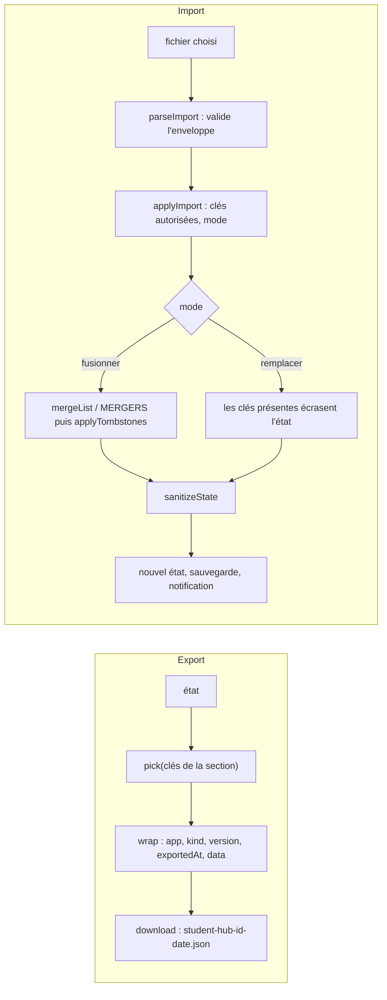

# Socle — Import et export des données

**État :** Implémentée · **Vérifiée contre le code :** 2026-10-25

Retour à l'[index des fiches](README.md) · [ARCHITECTURE](../ARCHITECTURE.md) · [GLOSSAIRE](../GLOSSAIRE.md)

## 1. Objectif

Permettre à l'étudiant de **sauvegarder** ses données, de les **transférer** d'un appareil à un autre, d'en **restaurer** une ancienne version et d'**importer** les fichiers produits par des outils externes (résumés d'Hermes, vidéos). Sans serveur, c'est la seule sauvegarde disponible.

## 2. Périmètre

**Fait** : exporter toutes les données ou celles d'un seul onglet en JSON ; importer en **fusionnant** ou en **remplaçant** ; refuser un fichier d'un autre onglet ; accepter l'ancien format sans enveloppe ; importer `summaries.json` et `videos.json`.

**Ne fait pas** : sauvegarder les PDF (ils restent sur l'appareil, [Biblio](biblio-pdf.md)), ni le verrou ni la configuration de synchronisation (`studenthub:lock`, `studenthub:sync`) ; ne chiffre rien ; n'envoie rien en ligne.

## 3. Vue d'ensemble technique



## 4. Composants et fichiers concernés

| Chemin | Rôle |
|---|---|
| `js/data-io.js` | `SECTIONS` (une par onglet), `ALL_KEYS`, `exportSection`, `exportAll`, `parseImport`, `applyImport`, `mergeList`, `MERGERS`, `parseSummaries`, `parseVideos` |
| `js/ui/data-panel.js` | `dataPanel` (bas de chaque onglet), `backupPanel` (Home), `runImport`, choix du fichier et du mode |
| `js/ui/download.js` | `download(nom, texte)` : crée un lien temporaire et le clique |
| `js/store.js` | `exportJSON`, `exportSection`, `importFile`, `importJSON`, `importLocal` |

## 5. Entrées / sorties

**Fichier exporté** (enveloppe) :

```json
{
  "app": "student-hub",
  "kind": "section",
  "section": "workspace",
  "version": 1,
  "exportedAt": "2026-10-25T09:30:00.000Z",
  "data": { "courses": [ … ], "todos": [ … ] }
}
```

`kind` vaut `all` (toutes les clés, sans `section`) ou `section`. Noms de fichiers : `student-hub-<section>-AAAA-MM-JJ.json` et `student-hub-complet-AAAA-MM-JJ.json`.

**Sections** (clés d'état) : `workspace` (`courses`, `todos`, `projects`) · `calendar` (`calendars`, `events`, `calPrefs`) · `focus` (`focusTags`, `sessions`, `focusPlans`) · `revision` (`decks`, `cards`, `gaps`, `exams`, `revDays`, `tutorLogs`) · `goals` (`goals`, `tips`, `tipsSeeded`, `guideVersion`) · `settings` (`settings`, `xp`, `tombstones`) · `library` (`library`) · `messages` (`localSummaries`, `read`) · `videos` (`localVideos`) · `notes` (`notes`) · `links` (`links`).

**Import** : texte JSON + mode (`merge` ou `replace`) + onglet (`only`, ou tous). Résultat : `{ state, counts }` ; le panneau affiche « Import réussi : 12 cours, 3 to-dos… ».

## 6. Fonctionnement détaillé

```text
FONCTION exportSection(état, id)  = wrap('section', {section: id}, pick(état, SECTIONS[id].keys))
FONCTION exportAll(état)          = wrap('all', {}, pick(état, ALL_KEYS))

FONCTION parseImport(texte)
  obj ← JSON.parse(texte) OU ERREUR « Fichier illisible : ce n'est pas du JSON. »
  SI obj n'est pas un objet : ERREUR « Fichier non reconnu. »
  SI obj.app = 'student-hub' ET obj.data est un objet
    SI obj.kind = 'section' ET la section existe : RETOURNER { kind: 'section', section, data }
    SI obj.kind = 'all'                          : RETOURNER { kind: 'all', data }
    ERREUR « Fichier Student Hub non reconnu. »
  SI une clé de ALL_KEYS est présente à la racine : RETOURNER { kind: 'all', data: obj }   // ancien format
  ERREUR « … ce n'est pas une sauvegarde Student Hub. »

FONCTION applyImport(état, parsed, { mode, only, sanitize })
  autorisées ← SI only : SECTIONS[only].keys SINON ALL_KEYS
  base       ← SI parsed.kind = 'section' : clés de CETTE section SINON ALL_KEYS
  clés       ← les clés de base qui sont autorisées ET présentes dans parsed.data
  SI clés est vide : ERREUR « Ce fichier contient les données « X », pas celles de cet onglet. »
  suivant ← copie superficielle de l'état
  POUR CHAQUE clé k DANS clés
    entrant ← parsed.data[k]
    SI mode = fusionner ET entrant et état[k] sont des listes : suivant[k] ← mergeList(état[k], entrant)
    SINON SI mode = fusionner ET MERGERS[k] existe          : suivant[k] ← MERGERS[k](état[k], entrant)
    SINON                                                   : suivant[k] ← entrant
    compte[k] ← nombre d'éléments (ou 1)
  SI mode = fusionner : applyTombstones(suivant)            // ce qui a été supprimé ailleurs ne revient pas
  RETOURNER { état: sanitize(suivant), compte }

FONCTION mergeList(a, b)
  SI ce sont des listes de textes : RETOURNER l'union sans doublon
  index ← a indexée par id ; POUR CHAQUE x DANS b : index[x.id] ← x   // le fichier ÉCRASE le local pour un même id
  RETOURNER les valeurs de l'index

MERGERS (clés qui ne sont pas des listes, mode fusionner)
  xp         : total = maximum des deux ; jours = maximum jour par jour
  tombstones : union (le marqueur le plus récent pour un même id)
  settings   : on garde ceux de l'appareil
  calPrefs   : on garde ceux de l'appareil

FONCTION runImport(store, onglet, texte, mode)       // js/ui/data-panel.js
  SI onglet = messages OU videos ET le texte est une liste d'objets (ou {summaries|videos: [...]})
    store.importLocal(onglet, éléments, mode)        // fichiers d'Hermes et de l'Action GitHub
  SINON store.importFile(texte, { mode, only: onglet })
```

## 7. Dépendances

- **Internes** : `js/store.js` (`sanitizeState`, `importFile`), `js/tombstones.js` (`applyTombstones`, `mergeTombstones`), `js/xp-logic.js` (forme de `xp`), `js/ui/dialog.js` (feuille de choix du mode).
- **Navigateur** : `Blob`, `URL.createObjectURL`, `<input type="file">`, `File.text()`.
- **Aucun** service externe ni variable d'environnement.

## 8. Cas limites et erreurs

| Situation | Comportement |
|---|---|
| fichier qui n'est pas du JSON | « Fichier illisible : ce n'est pas du JSON. » ; état inchangé |
| JSON d'un autre outil | « Fichier non reconnu : ce n'est pas une sauvegarde Student Hub. » |
| sauvegarde d'un autre onglet importée dans celui-ci | « Ce fichier contient les données « Agenda », pas celles de cet onglet. » |
| sauvegarde complète importée dans un onglet | seules les clés de cet onglet sont lues |
| ancien format (clés à la racine, sans enveloppe) | accepté comme sauvegarde complète |
| élément invalide dans le fichier | corrigé ou écarté par `sanitizeState` |
| mode « remplacer » avec un fichier incomplet | seules les clés **présentes** dans le fichier sont remplacées ; les autres gardent leur valeur |
| import d'une très vieille sauvegarde en « fusionner » | les éléments supprimés depuis ne reviennent pas (marqueurs) ; pour restaurer, utiliser « remplacer » |

## 9. Tests

- Fichiers : `tests/data-io.test.js` (logique pure), `tests/store.test.js` (aller-retour), `tests/sync2.test.js` (fusion de l'XP, réglages, marqueurs), `tests/revision.test.js` et `tests/tutor.test.js` (import avec valeurs hors bornes).
- Lancer : `npm test`.
- Ne couvre pas : le sélecteur de fichier réel (`<input type="file">`) ni le téléchargement dans un vrai navigateur.

## 10. Pièges et dette technique

- **Pour un même `id`, le fichier importé écrase le local** en mode « fusionner » : c'est la règle qui fait que le cloud l'emporte à la synchronisation ([ADR-010](../decisions/010-fusion-par-identifiant-et-marqueurs.md)).
- **Exports et dépôt public** : ne jamais commiter `student-hub-*.json` ([ADR-018](../decisions/018-aucune-donnee-privee-dans-le-depot-public.md)) ; le motif est dans `.gitignore`, mais seulement utile depuis Git sur ordinateur.
- **`messages` et `videos`** ont un chemin d'import à part (`importLocal`) car les fichiers d'Hermes et de l'Action GitHub n'ont pas d'enveloppe `student-hub`.
- **Pas de numéro de version géré** : `version: 1` partout ; un futur changement de format devra le faire évoluer et écrire une migration.
- Les listes de chaînes (`read`) fusionnent par union : on ne peut pas « marquer non lu » par import.

## 11. Pour modifier ou étendre

1. Nouvelle clé exportable : l'ajouter à une section de `SECTIONS` (ou créer une section, avec son libellé dans `js/ui/data-panel.js`) ; si ce n'est pas une liste d'objets avec `id`, écrire sa règle dans `MERGERS`.
2. Nouvel onglet : sa section doit porter le **même identifiant** que l'onglet (`dataPanel(ctx, id)` s'en sert).
3. Ne pas casser : le refus d'un fichier d'un autre onglet, le mode « remplacer » qui ne touche que les clés présentes, l'ordre `applyImport` → `applyTombstones` → `sanitize`.
4. Relancer `npm test`.
