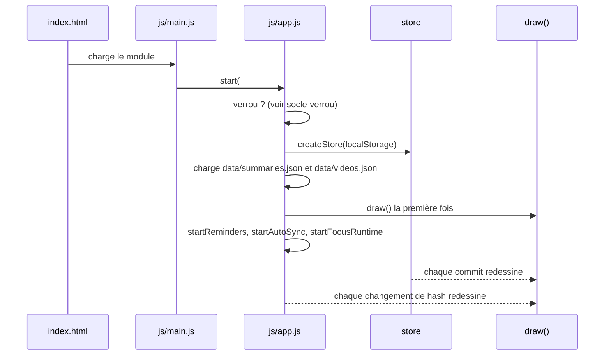

# Socle — Interface : DOM, feuilles, navigation et démarrage

**État :** Implémentée · **Vérifiée contre le code :** 2026-10-26

Retour à l'[index des fiches](README.md) · [ARCHITECTURE](../ARCHITECTURE.md) · [GLOSSAIRE](../GLOSSAIRE.md)

## 1. Objectif

Fournir la **base commune de toute l'interface** : construire du DOM sans jamais interpréter du HTML, afficher des feuilles modales, naviguer entre les 12 onglets par l'adresse (`#calendar`), et démarrer l'application dans le bon ordre. Tous les onglets et composants s'appuient sur ces quelques fonctions.

## 2. Périmètre

**Fait** : `h()` et ses aides (`field`, `select`, `empty`, `safeUrl`, `formatDate`, `debounce`) ; la feuille modale `openSheet` ; la liste des onglets `TABS` ; le démarrage `start()` ; le redessin `draw()` protégé contre les appels imbriqués ; la navigation par `location.hash` ; le point d'entrée `js/main.js`.

**Ne fait pas** : le contenu d'un onglet (chaque module) ; l'état et les sauvegardes ([socle-etat-et-stockage](socle-etat-et-stockage.md)) ; l'écran de verrou ([socle-verrou](socle-verrou.md)) ; les messages éphémères (`showToast`, voir [socle-rappels](socle-rappels.md)) ; le service worker ([socle-pwa-hors-ligne](socle-pwa-hors-ligne.md)) ; le thème et la taille du texte (`applyAppearance`, voir [socle-parametres](socle-parametres.md)).

## 3. Vue d'ensemble technique



## 4. Composants et fichiers concernés

| Chemin | Rôle |
|---|---|
| `index.html` | page unique : CSP, lien d'évitement « Aller au contenu » (`href="#main"`), `<div id="app">`, chargement de `js/main.js` |
| `js/main.js` | point d'entrée : `initInstall()`, `start(#app)`, `registerSW()` |
| `js/app.js` | `TABS`, `start(root, storage, session)`, `draw()`, `render()`, `lockControls`, lecture des fichiers `data/*.json` |
| `js/dom.js` | `h`, `select`, `field`, `safeUrl`, `formatDate`, `empty`, `debounce` |
| `js/ui/dialog.js` | `openSheet(titre, corps, options)` : feuille modale `<dialog class="sheet">` |
| `css/base.css` | barre de navigation (en bas sur téléphone, en haut à partir de 48 rem), `main`, lien d'évitement |
| `css/components.css` | styles `dialog.sheet`, `.sheet__form`, `.sheet__title` |

## 5. Entrées / sorties

**`h(tag, props, ...enfants) → Element`**

```js
h('button', { class: 'btn', onclick: () => ouvrir(), disabled: true }, 'Ouvrir', null, ['a', 'b'])
// <button class="btn" disabled="">Ouvrirab</button> : null ignoré, les listes sont aplaties
```

| Propriété | Effet |
|---|---|
| `class` | `className` |
| `onXxx` (fonction) | `addEventListener('xxx', fn)` : `onclick`, `onsubmit`, `onchange`… |
| `value` | propriété `.value` (pas un attribut) |
| `null`, `undefined`, `false` | propriété ignorée |
| `true` | attribut vide (`disabled`, `required`) |
| autre | `setAttribute(clé, String(valeur))` |

Les enfants `null`/`false` sont ignorés ; un `Node` est ajouté tel quel ; tout le reste devient un **nœud texte**.

**Autres aides**

| Fonction | Entrée → sortie |
|---|---|
| `select(options, valeur, props)` | options `['a','b']` ou `[['a','Libellé A']]` → `<select>` avec `selected` posé sur l'option égale à `valeur` |
| `field(libellé, contrôle, extra)` | `<label class="field …">` avec un `<span class="field__label">` |
| `safeUrl(u)` | `'https://exemple.org/a'` → l'URL ; `'javascript:alert(1)'`, `'data:…'`, `'pas une url'` → `null` |
| `formatDate('2026-10-17')` | texte français court (« 17 oct. ») ; `''` si vide ou invalide |
| `empty(texte, indice)` | bloc « rien à afficher » |
| `debounce(fn, ms = 400)` | fonction qui n'appelle `fn` qu'après `ms` sans nouvel appel |

**`openSheet(titre, corps, { onSubmit, submitLabel = 'Enregistrer', extra })`** → l'élément `<dialog>` (déjà ouvert). `onSubmit` peut être asynchrone et **retourne un message d'erreur** (texte) ou rien.

**`TABS`** : liste de `[clé, libellé, module]`, dans l'ordre de la barre : `home`, `workspace`, `calendar`, `focus`, `revision`, `library`, `messages`, `videos`, `notes`, `links`, `goals`, `settings`.

**`ctx`** (passé à chaque `render(ctx)`) : `{ store, data: { summaries, videos }, storage, rerender, lockControls }`.

## 6. Fonctionnement détaillé

### 6.1 Démarrage

```text
FONCTION start(racine, storage = localStorage, session = sessionStorage)
  verrou ← loadLock(storage)
  SI verrou ET PAS isUnlocked(session) : AFFICHER l'écran de verrou ET ATTENDRE   // voir socle-verrou
  store  ← createStore(storage)
  data   ← { summaries : loadJSON('data/summaries.json', []), videos : loadJSON('data/videos.json', { videos: [] }) }
  ctx    ← { store, data, storage, rerender: draw }
  applyAppearance(store.state.settings)
  main ← <main id="main" tabindex="-1"> ; nav ← <nav class="nav" aria-label="Sections">
  store.subscribe(draw)
  ÉCOUTER « hashchange » : draw() PUIS main.focus()
  racine ← en-tête (logo + nom + nav) + main
  draw()
  startReminders(store) ; startAutoSync(ctx) ; startFocusRuntime(store, …)
  RETOURNER { store, ctx }

FONCTION loadJSON(chemin, valeurParDéfaut)
  SI fetch(chemin, { cache: 'no-cache' }) répond « ok » : RETOURNER le JSON
  SINON (ou si le réseau échoue) : RETOURNER valeurParDéfaut
```

### 6.2 Dessin

```text
FONCTION draw()
  SI un dessin est en cours : again ← vrai ; RETOURNER              // un champ retiré du DOM peut déclencher « change »
  dessin en cours ← vrai
  render()                                                           // même en cas d'erreur, le drapeau est relâché
  dessin en cours ← faux
  SI again : again ← faux ; draw()                                   // un seul redessin supplémentaire, quel que soit le nombre de demandes

FONCTION render()
  applyAppearance(store.state.settings)
  [clé, , module] ← l'onglet dont la clé = location.hash sans « # », SINON le premier (Home)
  nav ← un lien « #clé » par onglet ; aria-current='page' sur l'onglet courant
  outils ← SI clé = 'home' : backupPanel(ctx, lockControls())          // toutes les données
           SINON SI SECTIONS[clé] : dataPanel(ctx, clé)                // les données de l'onglet seulement
           SINON rien
  main ← [ module.render(ctx), (clé ≠ 'home' ? widgetBar(ctx, clé) : rien), outils ]
```

Le redessin est **total** : `main.replaceChildren(...)` reconstruit l'onglet entier à chaque `commit` et à chaque changement d'adresse. C'est pourquoi l'état de la vue (sous-onglet, date affichée…) vit dans des variables du module, posées **avant** le `commit` ([CONTRIBUTING](../CONTRIBUTING.md)).

### 6.3 Feuille modale

```text
FONCTION openSheet(titre, corps, { onSubmit, submitLabel, extra })
  dlg ← <dialog class="sheet" aria-label=titre> contenant un <form> : titre, corps, zone d'erreur (role="alert"), boutons
  À l'envoi du formulaire :
    effacer l'erreur
    msg ← ATTENDRE onSubmit()
    SI msg est un texte non vide : l'AFFICHER dans la zone d'erreur ET rester ouverte
    SINON dlg.close()
  À la fermeture (« close ») : retirer dlg du document
  ajouter dlg à <body> ; dlg.showModal() ; RETOURNER dlg
```

Le navigateur fournit le piège du focus et la touche Échap (balise `<dialog>` native) ; « Annuler » ferme sans appeler `onSubmit`.

## 7. Dépendances

- **Internes** : `js/store.js` (`createStore`), `js/constants.js` (`STORAGE_KEY`), `js/data-io.js` (`SECTIONS`), `js/lock.js` et `js/ui/lock-screen.js` ; les rappels, la synchronisation automatique, le minuteur Focus, la barre de widgets et le panneau de données (documentés dans leurs propres fiches) ; les 12 modules d'onglet.
- **Navigateur** : `<dialog>` (`showModal`), `fetch`, `location.hash` et l'événement `hashchange`, `sessionStorage`.
- **Externe** : aucun. **Variable d'environnement** : aucune.
- **Clés de stockage** : `studenthub:v1` (état, via le store), `studenthub:lock` et `studenthub:unlocked` (verrou).

## 8. Cas limites et erreurs

| Situation | Comportement |
|---|---|
| adresse inconnue (`#nimporte`) | le premier onglet (Home) est dessiné |
| aucune adresse | Home |
| `data/summaries.json` ou `data/videos.json` absent, illisible ou hors ligne sans cache | valeurs par défaut (`[]`, `{ videos: [] }`) : l'app démarre quand même |
| texte contenant du HTML (``) | affiché tel quel, jamais interprété |
| `safeUrl` sur une URL non `http(s)` | `null` : l'appelant n'affiche pas de lien |
| `onSubmit` d'une feuille retourne un message | affiché sous le formulaire ; la feuille reste ouverte |
| plusieurs demandes de redessin pendant un dessin | un seul redessin supplémentaire, ensuite |
| changement d'onglet | `main` reçoit le focus (lecteurs d'écran, clavier) |

## 9. Tests

- Fichiers : `tests/dom.test.js` (`h` n'interprète jamais le HTML, `safeUrl`, `formatDate`), `tests/modules.test.js` (feuilles `dialog.sheet` ouvertes et fermées par plusieurs onglets), `tests/e2e/app.e2e.py` (démarrage réel, navigation par `#…`, verrou).
- Lancer : `npm test` ; navigateur réel : `python3 tests/e2e/app.e2e.py` (serveur lancé).
- Ne couvre pas directement : `start()` et `draw()` ne sont testés qu'en navigateur réel (e2e) ; la protection contre les dessins imbriqués n'a pas de test dédié ; `select`, `field`, `empty` et `debounce` n'ont pas de test propre ; les messages d'erreur de `openSheet` sont couverts seulement à travers les onglets qui l'utilisent.

## 10. Pièges et dette technique

- **`value` se pose avant les enfants** dans `h()` : sur un `<select>`, la valeur serait perdue parce que les `<option>` n'existent pas encore. Utiliser `select(options, valeur)`, qui marque l'option choisie avec `selected`.
- **Lien d'évitement** : `href="#main"` change l'adresse en `#main`, qui n'est pas un onglet ; d'après la lecture de `current()`, l'app retombe alors sur Home. À vérifier dans un navigateur ; si confirmé, le lien devrait seulement donner le focus à `main` sans toucher à l'adresse.
- **`openSheet` n'attrape pas les erreurs** : si `onSubmit` lève une exception (au lieu de retourner un message), la feuille reste ouverte sans message.
- **Confirmations par `confirm()` natif** : les suppressions utilisent `confirm(...)` (boîte du navigateur) et non une feuille ; simple, mais non stylable et bloquant.
- **Redessin total** : `main` est reconstruit en entier à chaque `commit` ; un champ en cours de saisie directement dans un onglet serait perdu si un `commit` survenait entre-temps (synchronisation automatique, par exemple). Les feuilles `openSheet` ne sont pas concernées : elles sont ajoutées à `<body>`, hors de `main`.
- **`TABS` est la seule liste des onglets** pour la navigation, mais les cibles de widgets ont leur propre liste (`TARGETS`, [socle-widgets-et-home](socle-widgets-et-home.md)) : un nouvel onglet doit être ajouté aux deux.

## 11. Pour modifier ou étendre

1. **Nouvel onglet** : suivre la procédure de [CONTRIBUTING](../CONTRIBUTING.md) (module `render(ctx)`, ligne dans `TABS`, `TARGETS`, section d'export).
2. **Nouvel élément d'interface** : le construire avec `h()` ; ne jamais utiliser `innerHTML` ni un attribut `style` ([ADR-004](../decisions/004-csp-stricte-sans-innerhtml.md)).
3. **Nouvelle feuille** : appeler `openSheet`, valider dans `onSubmit` et **retourner le message d'erreur** plutôt que de lever une exception.
4. **Ne pas casser** : l'ordre de démarrage (verrou → état → données → dessin → rappels, synchro, Focus) ; la protection `drawing` / `again` de `draw()` ; le fait que `h()` n'interprète jamais le HTML.
5. Toute modification d'un fichier de l'app : `npm run build:sw`, puis `npm test`.
