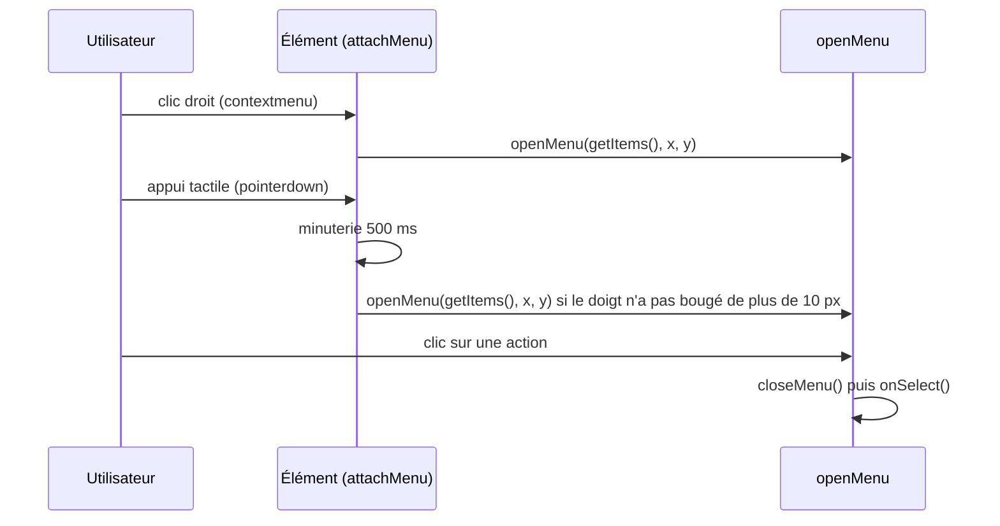

# Socle — Menu contextuel

**État :** Implémentée · **Vérifiée contre le code :** 2026-10-26

Retour à l'[index des fiches](README.md) · [ARCHITECTURE](../ARCHITECTURE.md) · [GLOSSAIRE](../GLOSSAIRE.md) · Décision : [ADR-012](../decisions/012-menu-contextuel-unique.md)

## 1. Objectif

Donner accès aux actions d'un élément (modifier, dupliquer, copier, supprimer, planifier…) de la même façon sur ordinateur et sur téléphone : **clic droit**, **appui long de 500 ms**, ou bouton **⋯**. Un seul composant sert tous les onglets ; chaque onglet fournit seulement sa liste d'actions.

## 2. Périmètre

**Fait** : ouverture du menu aux trois gestes ; un seul menu à la fois ; fermeture par Échap, clic ailleurs, défilement, redimensionnement ; navigation aux flèches ; positionnement dans l'écran ; éléments imbriqués (seul le plus profond ouvre son menu) ; actions toutes prêtes « Copier » et « Supprimer ».

**Ne fait pas** : sous-menus ; cases à cocher ; restitution du focus à l'élément après fermeture ; raccourcis clavier propres à chaque action.

## 3. Vue d'ensemble technique



## 4. Composants et fichiers concernés

| Chemin | Rôle |
|---|---|
| `js/ui/context-menu.js` | `openMenu`, `closeMenu`, `attachMenu`, `menuButton`, `copyText`, `copyItem`, `deleteItem` |
| `css/components.css` | `.ctx`, `.ctx__item`, `.is-danger`, `.menu-btn`, `.has-menu` |
| `tests/ux.test.js` | 4 tests : clic droit, appui long, menus de to-do, note et lien, menu « Démarrer un Focus » |

Utilisé par les onglets Workspace, Agenda, Mémorisation, Biblio, Messages, Notes, Liens et Objectifs (leurs listes d'actions sont décrites dans leurs fiches).

## 5. Entrées / sorties

**Un élément de menu** : `{ label, onSelect, danger? }`. Une entrée fausse (`null`, `false`, `undefined`) est ignorée, ce qui permet `condition && { … }`.

```js
attachMenu(li, () => [
  { label: 'Modifier', onSelect: () => ouvrir(t) },
  copyItem(t.name),                                         // « Copier le texte »
  deleteItem(`le to-do « ${t.name} »`, () => retirer(t.id)) // « Supprimer », rouge, avec confirmation
]);
```

| Fonction | Rôle |
|---|---|
| `attachMenu(el, getItems)` → `el` | ajoute clic droit et appui long ; `getItems()` est appelée **à l'ouverture** (les actions suivent l'état du moment) |
| `menuButton(getItems, label = 'Actions')` → bouton | bouton `⋯` (`aria-haspopup="menu"`) qui ouvre le menu sous lui |
| `openMenu(items, x, y)` / `closeMenu()` | ouverture directe / fermeture |
| `copyItem(texte, label = 'Copier le texte')` | élément qui copie dans le presse-papiers |
| `deleteItem(quoi, action)` | élément « Supprimer » : `confirm('Supprimer ' + quoi + ' ?')` puis `action()` |
| `copyText(texte)` | copie, puis toast « Copié. » ou « Copie impossible sur ce navigateur. » |

Le menu produit : `<div class="ctx" role="menu" aria-label="Actions">` contenant des `<button role="menuitem" class="ctx__item">`.

## 6. Fonctionnement détaillé

```text
FONCTION openMenu(items, x, y)
  closeMenu()                                    // un seul menu à la fois
  liste ← items sans les entrées fausses ; SI liste vide : RETOURNER
  menu ← <div class="ctx" role="menu"> avec un bouton par élément (clic : closeMenu() PUIS onSelect())
  ajouter menu à <body>
  gauche ← borné entre 4 px et (largeur de la fenêtre − largeur du menu − 4) ; haut ← idem avec la hauteur
  ÉCOUTER : pointerdown hors du menu → closeMenu ; Échap → closeMenu ; ↑ ↓ → focus circulaire sur les éléments ; défilement, redimensionnement → closeMenu
  donner le focus au premier élément
  current ← fonction qui retire les écouteurs et le menu

FONCTION attachMenu(el, getItems)
  clic droit :
    SI l'événement porte déjà la marque __menu : RETOURNER            // un descendant l'a déjà traité
    marquer l'événement ; empêcher le menu du navigateur ; openMenu(getItems(), x, y)
  appui (pointerdown) :
    fired ← faux
    SI l'événement porte la marque __menu : RETOURNER ; sinon la poser
    SI pointerType = 'mouse' : RETOURNER                              // la souris utilise le clic droit
    mémoriser (x, y) ; minuterie 500 ms : fired ← vrai ; openMenu(getItems(), x, y)
  pointermove : SI déplacement > 10 px depuis le début : annuler la minuterie
  pointerup, pointercancel, pointerleave : annuler la minuterie
  click (phase de capture) : SI fired : empêcher et arrêter l'événement ; fired ← faux   // le clic qui suit un appui long n'ouvre rien
```

Les emplacements du menu sont posés par propriété JavaScript (`style.left`, `style.top`) et non par attribut HTML, ce qui reste compatible avec la CSP stricte ([ADR-004](../decisions/004-csp-stricte-sans-innerhtml.md)).

## 7. Dépendances

- **Internes** : `js/dom.js` (`h`) ; `showToast` de `js/reminders.js` (pour « Copié. »).
- **Navigateur** : événements `contextmenu`, `pointer*`, `navigator.clipboard.writeText`, `confirm`.
- **Externe** : aucun. **Variable d'environnement** : aucune. **Clé de stockage** : aucune.

## 8. Cas limites et erreurs

| Situation | Comportement |
|---|---|
| liste d'actions vide | aucun menu |
| menu déjà ouvert | fermé et remplacé par le nouveau |
| doigt qui bouge de plus de 10 px ou relevé avant 500 ms | pas de menu (c'est un défilement ou un appui court) |
| clic qui suit un appui long | ignoré |
| menu proche d'un bord de l'écran | décalé pour rester entièrement visible (4 px de marge) |
| souris | pas d'appui long, seulement le clic droit |
| presse-papiers refusé | toast « Copie impossible sur ce navigateur. » |
| plage de travail dans un événement | seul le menu de la plage s'ouvre (marque `__menu`) |

## 9. Tests

- Fichier : `tests/ux.test.js`. Couvert : clic droit, Échap, clic ailleurs, un seul menu à la fois ; appui long de 500 ms avec appui court et déplacement ignorés, clic suivant ignoré ; actions du to-do (« Statut : En cours », « Dupliquer », « Supprimer »…), de la note (« Épingler ») et du lien (« Copier le lien », « Ouvrir »), via le bouton ⋯ ; menu « Démarrer un Focus ».
- Lancer : `npm test`.
- Ne couvre pas : navigation aux flèches, positionnement près des bords, fermeture par défilement ou redimensionnement, `copyText` (presse-papiers), l'écran tactile réel.

## 10. Pièges et dette technique

- **`getItems` est appelée à l'ouverture** : ne pas calculer la liste une fois pour toutes si les actions dépendent de l'état.
- **Un redessin ne ferme pas le menu** : il est ajouté à `<body>`, hors de `main`. L'action choisie s'applique à l'état du moment : `onSelect` doit relire l'état (`store.state`) et non une copie périmée de l'élément.
- **Pas de restitution du focus** après la fermeture : un utilisateur au clavier repart du début de la page.
- **Confirmations par `confirm()` natif** pour les suppressions (`deleteItem`).
- **Appui long sur certains navigateurs mobiles** : le navigateur peut aussi proposer sa propre sélection de texte ; `.has-menu` désactive seulement l'aperçu tactile d'iOS (`-webkit-touch-callout`). À vérifier sur appareil.

## 11. Pour modifier ou étendre

1. **Ajouter des actions à un élément** : compléter la liste passée à `attachMenu` et à `menuButton` (la même fonction pour les deux).
2. **Nouvel élément de liste** : `attachMenu(h('li', …), items)` et un `menuButton(items, 'Actions de …')` à l'intérieur, avec une étiquette `aria-label` explicite.
3. **Ne pas casser** : un seul menu à la fois ; la marque `__menu` pour les éléments imbriqués ; l'ignorance du clic qui suit l'appui long ; le seuil de 500 ms et de 10 px (testés).
4. Relancer `npm run build:sw` puis `npm test`.
