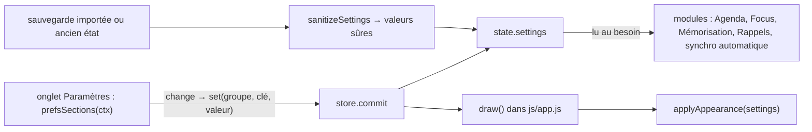

# Socle — Paramètres et réglages

**État :** Implémentée · **Vérifiée contre le code :** 2026-10-26

Retour à l'[index des fiches](README.md) · [ARCHITECTURE](../ARCHITECTURE.md) · [GLOSSAIRE](../GLOSSAIRE.md) · Décision : [ADR-013](../decisions/013-widgets-et-reglages.md)

## 1. Objectif

Regrouper dans un onglet unique tous les réglages de l'application (apparence, langues, notifications, agenda, Focus, mémorisation, synchronisation, widgets), les enregistrer dans l'état, et garantir qu'une valeur inconnue ou hors bornes, venue d'une sauvegarde ou d'un ancien format, est ramenée à une valeur sûre.

## 2. Périmètre

**Fait** : 11 sections dans l'onglet ; une valeur par contrôle, enregistrée dès le changement ; validation et bornes (`sanitizeSettings`) ; application immédiate du thème, de la taille du texte et du premier jour de la semaine (`applyAppearance`).

**Section « Travail »** (suivi de projets) : terminer le parent quand sa dernière sous-tâche est terminée (`work.autoCloseParent`, défaut oui) ; dépendances strictes (`work.strictDeps`, défaut non) ; capacité de travail par jour en minutes (`work.capacityMin`, défaut 240, de 30 à 960). Voir [workspace-sous-taches-et-dependances](workspace-sous-taches-et-dependances.md) et [rapports-et-tableaux-de-bord](rapports-et-tableaux-de-bord.md).

**Ne fait pas** : changer la langue de l'interface (le français est la seule disponible, voir la tâche T21) ; synchroniser les réglages entre appareils (ils restent locaux, [ADR-010](../decisions/010-fusion-par-identifiant-et-marqueurs.md)) ; enregistrer les identifiants de synchronisation (ils vivent hors de l'état, sous `studenthub:sync`, et hors des sauvegardes).

## 3. Vue d'ensemble technique



## 4. Composants et fichiers concernés

| Chemin | Rôle |
|---|---|
| `js/settings-logic.js` | listes de choix (`THEMES`, `SIZES`, `CARD_LANGS`, `VOICE_LANGS`, `FIRST_DAYS`, `RETENTIONS`), `defaultSettings()`, `sanitizeSettings(r)`, widgets (voir [socle-widgets-et-home](socle-widgets-et-home.md)) |
| `js/modules/settings-ui.js` | `prefsSections(ctx)` : 8 sections « simples » (Apparence, Langues, Compte et sécurité, Notifications, Application, Agenda, Focus, Mémorisation) |
| `js/modules/settings.js` | page `render(ctx)` : titre, sections simples, section Synchronisation (interface), section Widgets, section « À propos » |
| `js/appearance.js` | `applyAppearance(settings, racine)` : thème, taille, premier jour de la semaine |
| `css/base.css` | variables de couleurs clair/sombre, `html[data-size]` |
| `tests/prefs.test.js` | 8 tests des réglages |

## 5. Entrées / sorties

`state.settings` (valeurs par défaut réelles, hors `widgets`) :

```json
{
  "appearance": { "theme": "auto", "size": "normal" },
  "lang":       { "cards": "français", "voice": "fr-FR" },
  "agenda":     { "firstDay": 1, "duration": 60, "calendarId": "" },
  "focus":      { "minutes": 25, "grace": 10 },
  "memo":       { "retention": 0.9, "newPerDay": 20 },
  "notify":     { "reminders": true },
  "sync":       { "auto": false }
}
```

| Réglage | Valeurs permises | Effet et lieu |
|---|---|---|
| `appearance.theme` | `auto`, `light`, `dark` | `data-theme` sur `<html>` ; `auto` le retire et laisse la préférence de l'appareil |
| `appearance.size` | `normal`, `large`, `xlarge` | `data-size` : texte à 112,5 % ou 125 % |
| `lang.cards` | français, English, español, Deutsch, italiano, العربية | langue demandée dans les prompts de cartes, fiches et podcasts |
| `lang.voice` | `fr-FR`, `en-US`, `en-GB`, `es-ES`, `de-DE`, `it-IT`, `ar-SA` | voix de lecture à voix haute |
| `agenda.firstDay` | 1 (lundi), 0 (dimanche), 6 (samedi) | premier jour des grilles (`setFirstDay`) |
| `agenda.duration` | 15 à 480 minutes | durée d'un événement créé en cliquant un créneau de la semaine |
| `agenda.calendarId` | texte de 40 caractères au plus | agenda proposé pour un nouvel événement ; vide ou introuvable : le premier agenda |
| `focus.minutes` | 1 à 180 | durée proposée au lancement d'une session |
| `focus.grace` | 5 à 60 secondes | délai avant que l'arbre meure quand on quitte l'app (converti en millisecondes dans `js/app.js`) |
| `memo.retention` | 0,8 ; 0,85 ; 0,9 ; 0,95 | rétention visée des révisions (FSRS) |
| `memo.newPerDay` | 1 à 100 | nouvelles cartes par session |
| `notify.reminders` | vrai / faux | active les rappels ([socle-rappels](socle-rappels.md)) |
| `sync.auto` | vrai / faux | synchronisation automatique ([socle-synchronisation](socle-synchronisation.md)) |
| `widgets` | listes d'identifiants par onglet | voir [socle-widgets-et-home](socle-widgets-et-home.md) |

## 6. Fonctionnement détaillé

```text
FONCTION sanitizeSettings(r)                          // appelée à chaque lecture de l'état (js/store.js)
  base ← defaultSettings()
  POUR CHAQUE onglet DANS TARGETS
    widgets[onglet] ← SI r.settings.widgets[onglet] est une liste : ses identifiants connus, sans doublon, sans ceux masqués dans cet onglet
                      SINON base.widgets[onglet]
  num(v, a, b, défaut)  ← SI v est un nombre fini : v arrondi puis borné entre a et b ; SINON défaut
  pick(v, liste, défaut) ← SI v figure parmi les clés de la liste : v ; SINON défaut
  appearance, lang, agenda, focus, memo ← pick / num sur chaque champ (calendarId : texte coupé à 40 caractères)
  notify.reminders ← (valeur ≠ faux)                  // vrai sauf mention contraire
  sync.auto        ← (valeur = vrai)                  // faux sauf mention contraire
  RETOURNER { settings: { widgets, appearance, lang, agenda, focus, memo, notify, sync } }

FONCTION set(groupe, clé, valeur)                     // dans prefsSections
  store.commit(() => { settings[groupe][clé] ← valeur })        // redessin de toute l'application

FONCTION clamp(v, a, b, ancienne)                     // champs numériques
  SI v est vide ou illisible : RETOURNER ancienne     // on garde l'ancienne valeur
  RETOURNER v arrondi, borné entre a et b

FONCTION applyAppearance(settings, racine)            // appelée au démarrage et à chaque dessin
  SI theme = 'auto' : retirer data-theme ; SINON data-theme ← theme
  SI size = 'normal' : retirer data-size ; SINON data-size ← size
  setFirstDay(settings.agenda.firstDay)
```

Exemple tiré des tests : `sanitizeSettings` avec `theme: 'neon'`, `firstDay: 3`, `duration: 5`, `focus.minutes: 999`, `memo.retention: 0.5` donne `auto`, 1, 15, 180 et 0,9 ; seule une valeur permise est conservée.

**Section Synchronisation** (dans `js/modules/settings.js`) : adresse du projet et clé « anon public » enregistrées à chaque changement sous `studenthub:sync` ; e-mail et mot de passe lus seulement au moment de l'action ; boutons « Se connecter », « Créer un compte », « Synchroniser », « Remplacer le cloud », « Remplacer cet appareil », « Se déconnecter ». Une seule opération à la fois (`ui.busy`) ; le résultat s'affiche en français dans une zone `role="status"`. La case « Synchroniser automatiquement » écrit `settings.sync.auto`. Le détail (client, fusion, erreurs) est dans [socle-synchronisation](socle-synchronisation.md).

**Section Application** : indique si l'app est installée, si le mode hors ligne est prêt, et propose l'installation ([socle-pwa-hors-ligne](socle-pwa-hors-ligne.md)).

**Sections Widgets et À propos** : bouton « Personnaliser les widgets » (feuille de l'onglet Home) ; bouton « Ouvrir le guide » (`#goals`).

## 7. Dépendances

- **Internes** : `js/dom.js` (`h`, `field`, `select`), `js/store.js` (`commit`, `sanitizeSettings` à la lecture), `setFirstDay` (logique de l'Agenda), `js/app.js` (`ctx.lockControls`), `js/ui/widgets.js` (feuille de personnalisation), les fonctions d'installation et de synchronisation (sections Application et Synchronisation).
- **Navigateur** : `Notification` (état et demande d'autorisation), `localStorage`.
- **Externe** : Supabase, seulement si la synchronisation est utilisée. **Variable d'environnement** : aucune.
- **Clés** : `studenthub:v1` (champ `settings`), `studenthub:sync` (adresse, clé, session, date : jamais exportée).

## 8. Cas limites et erreurs

| Situation | Comportement |
|---|---|
| champ numérique vidé ou « abc » | ancienne valeur conservée |
| nombre hors bornes (`5000` minutes) | ramené à la borne (480) |
| valeur de liste inconnue (`neon`) | valeur par défaut |
| sauvegarde sans réglages | défauts ; une sauvegarde contenant seulement des widgets reste valable |
| notifications bloquées par le navigateur | la section l'indique ; le bouton d'autorisation n'apparaît que si la permission est « par défaut » |
| `ctx.lockControls` absent (tests) | message « Le verrou se règle depuis Home. » |
| synchronisation : mot de passe de moins de 6 caractères ou e-mail vide | « Saisis ton e-mail et un mot de passe (6 caractères au minimum). » |
| fusion de deux appareils | les réglages de l'appareil local sont conservés |

## 9. Tests

- Fichier : `tests/prefs.test.js` : valeurs par défaut, bornes et choix inconnus ; thème et taille posés sur la page, `auto` les retire ; premier jour de la semaine ; rétention visée et plafond de nouvelles cartes ; langue des cartes dans les prompts ; rappels désactivables ; durée et agenda par défaut d'un nouvel événement ; onglet Paramètres : chaque réglage s'enregistre. `tests/ux.test.js` couvre aussi la synchronisation depuis l'onglet.
- Lancer : `npm test`.
- Ne couvre pas : la voix de lecture réelle, `Notification.requestPermission`, la section « À propos », l'affichage de l'état d'installation.

## 10. Pièges et dette technique

- **Redessin à chaque changement** : le thème et la taille s'appliquent tout de suite ; un champ numérique se valide à `change` (au départ du champ), pas à chaque frappe.
- **Les réglages ne voyagent pas** : une synchronisation ou un import en fusion garde les réglages de l'appareil ; seul « Remplacer » les remplace.
- **Deux sources de configuration** : `studenthub:sync` (hors état, hors sauvegardes) et `state.settings.sync.auto` (dans l'état) sont séparées exprès.
- **`firstDay` est un état global** du module de l'Agenda : `applyAppearance` le pose à chaque dessin ; un test doit le remettre à 1 (`setFirstDay(1)`).
- **Langue de l'interface** : une seule ; le choix « Langue des cartes » n'agit que sur les prompts générés.

## 11. Pour modifier ou étendre

1. **Nouveau réglage** : l'ajouter à `defaultSettings()` **et** à `sanitizeSettings()` (borne ou liste), puis un contrôle dans `prefsSections` (`sel` ou `num`) et un test dans `tests/prefs.test.js`. Sans validation, une sauvegarde étrangère pourrait injecter n'importe quelle valeur.
2. **Utiliser le réglage** : le lire dans le module concerné (`store.state.settings.<groupe>.<clé>`), jamais de copie.
3. **Ne pas casser** : les bornes (testées) ; la conservation de l'ancienne valeur pour un champ illisible ; le fait que les identifiants de synchronisation restent hors de l'état.
4. Relancer `npm run build:sw` puis `npm test`.
