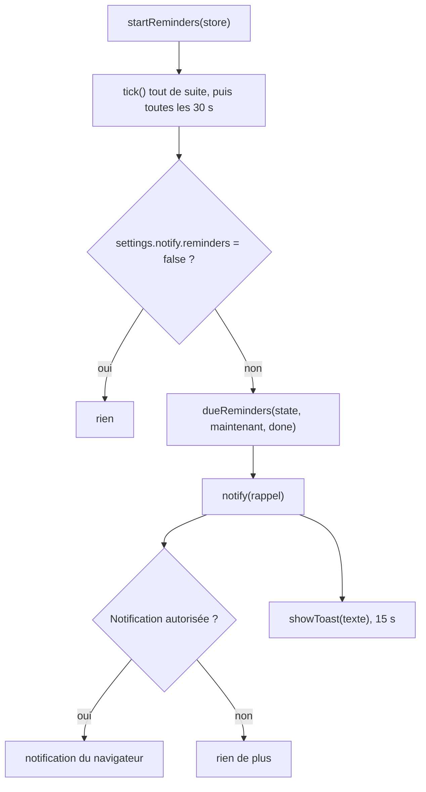

# Socle — Rappels et messages éphémères

**État :** Implémentée · **Vérifiée contre le code :** 2026-10-26

Retour à l'[index des fiches](README.md) · [ARCHITECTURE](../ARCHITECTURE.md) · [GLOSSAIRE](../GLOSSAIRE.md) · Décision : [ADR-017](../decisions/017-rappels-application-ouverte.md)

## 1. Objectif

Prévenir l'étudiant qu'un événement de l'agenda approche, et fournir à toute l'application un petit message temporaire (« toast ») pour confirmer une action ou signaler un problème. Les rappels ne fonctionnent que **lorsque Student Hub est ouvert** : il n'y a pas de serveur de notifications.

## 2. Périmètre

**Fait** : vérification toutes les 30 secondes ; toast + notification du navigateur si elle est autorisée ; un rappel par événement et par jour ; désactivation dans les réglages ; `showToast` utilisé partout.

**Ne fait pas** : prévenir quand l'application est fermée (piste T20, [ADR-017](../decisions/017-rappels-application-ouverte.md)) ; rappeler les to-dos ou les sessions de Focus ; mémoriser les rappels déjà affichés après un rechargement.

## 3. Vue d'ensemble technique



## 4. Composants et fichiers concernés

| Chemin | Rôle |
|---|---|
| `js/reminders.js` | `startReminders(store)`, `notify`, `showToast(texte)` |
| `dueReminders` (fichier de logique de l'Agenda) | fonction pure : quels rappels sont à afficher maintenant |
| `css/components.css` | styles `.toast` et `.toast .btn` |
| `tests/calendar-logic.test.js`, `tests/agenda.test.js`, `tests/prefs.test.js` | tests de `dueReminders` et de `startReminders` |

Appelants de `showToast` : fin de session Focus (`js/app.js`), déplacement d'une occurrence, ajout d'une deadline, copie dans le presse-papiers, mise à jour disponible de l'application, synchronisation automatique.

## 5. Entrées / sorties

**Donnée d'un événement** : `reminder` vaut `null` (aucun) ou l'un des nombres `0, 5, 15, 30, 60, 1440` (minutes avant le début ; 1440 = un jour). L'export ICS le traduit en alarme `TRIGGER:-PT<n>M`.

**Réglage** : `settings.notify.reminders` (booléen, vrai par défaut).

**Sortie de `dueReminders`** : une liste de `{ key, title, date, start, minutes }`.

```js
// événement 'Cours' le 2026-10-19 à 08:00, reminder: 15
dueReminders(state, new Date('2026-10-19T07:50:00'), done)
// [ { key: 'x1|2026-10-19', title: 'Cours', date: '2026-10-19', start: '08:00', minutes: 10 } ]
```

Texte affiché : `Cours à 08:00 (dans 10 min)` ; pour un événement « journée entière » : `Titre aujourd'hui`.

## 6. Fonctionnement détaillé

```text
FONCTION dueReminders(state, maintenant, done)
  visibles ← identifiants des agendas visibles
  POUR CHAQUE date DANS [aujourd'hui, demain]
    POUR CHAQUE événement DANS state.events
      SI ev.reminder = null OU agenda non visible : PASSER
      occ ← occurrenceOn(ev, date)                        // gère séries et exceptions ; rien si l'événement ne tombe pas ce jour
      SI occ absente : PASSER
      début   ← date + (allDay ? '08:00' : start de l'occurrence)
      seuil   ← début − reminder minutes
      clé     ← id + '|' + date
      SI maintenant ≥ seuil ET maintenant < début ET clé ∉ done
        AJOUTER { key: clé, title, date, start (vide si allDay), minutes: max(0, arrondi((début − maintenant) / 1 min)) }

FONCTION startReminders(store)
  done ← ensemble vide (en mémoire)
  FONCTION tick()
    SI store.state.settings.notify.reminders = false : RETOURNER
    POUR CHAQUE r DANS dueReminders(store.state, maintenant, done) : done.ajouter(r.key) ; notify(r)
  tick() ; RETOURNER setInterval(tick, 30000)

FONCTION notify(r)
  texte ← (r.start ? titre + ' à ' + start + ' (dans ' + minutes + ' min)' : titre + " aujourd'hui")
  SI Notification existe ET Notification.permission = 'granted' : essayer new Notification('Student Hub', { body: texte }) ; ignorer une erreur
  showToast(texte)

FONCTION showToast(texte)
  ajouter à <body> un <div class="toast" role="status"> avec le texte et un bouton « × » (aria-label « Fermer le message »)
  retirer le toast au clic sur « × » ou après 15 s
```

Le réglage est relu à **chaque** passage : l'activer ou le désactiver agit sans redémarrage. Les rappels visibles sont ceux des agendas dont `visible` est vrai.

## 7. Dépendances

- **Internes** : `js/dom.js` (`h`), `dueReminders` et `occurrenceOn` (logique de l'Agenda), `store.state`.
- **Navigateur** : `setInterval`, `Notification` (facultative, `try/catch`), `setTimeout`.
- **Autorisation** : demandée par un bouton « Activer les notifications » (onglet Agenda et section Notifications de Paramètres) ; jamais automatiquement.
- **Externe** : aucun. **Variable d'environnement** : aucune. **Clé de stockage** : aucune propre ; le réglage vit dans l'état (`studenthub:v1`).

## 8. Cas limites et erreurs

| Situation | Comportement |
|---|---|
| application fermée | aucun rappel ; au prochain lancement, seuls ceux dont la fenêtre est encore ouverte s'affichent |
| événement déjà commencé | pas de rappel (`maintenant < début` obligatoire) |
| événement répété ou déplacé | pris en compte par `occurrenceOn` (exceptions de série) |
| agenda masqué | pas de rappel |
| notification refusée ou interdite par le mobile | seul le toast s'affiche ; l'erreur est ignorée |
| rechargement de la page | `done` est vidé : un rappel encore dans sa fenêtre peut s'afficher une seconde fois |
| réglage désactivé | aucun toast ; les rappels non affichés ne sont pas rattrapés à la réactivation, sauf s'ils sont encore dans leur fenêtre |

## 9. Tests

- Fichiers : `tests/calendar-logic.test.js` (fenêtre de rappel et absence de doublon : 7:30 rien, 7:50 un rappel « dans 10 min », 7:55 plus rien, 8:05 rien), `tests/agenda.test.js` (rappels d'une série et de ses exceptions), `tests/prefs.test.js` (réglage désactivable : 0 toast puis 1 toast une fois réactivé).
- Lancer : `npm test`.
- Ne couvre pas : `notify` avec une vraie notification, la fermeture manuelle ou automatique d'un toast, l'empilement de plusieurs toasts, les événements « journée entière ».

## 10. Pièges et dette technique

- **Rappels seulement application ouverte** : l'interface et le guide le disent ; la solution (serveur de notifications) est hors périmètre (T20).
- **« Journée entière » affiche « aujourd'hui »** : le texte n'utilise pas `r.date`. Un événement de demain en journée entière, rappelé la veille (08:00), s'afficherait donc « aujourd'hui » (déduit de la lecture du code, non testé).
- **Rappel « 1 jour avant » le jour même** : pour un événement d'aujourd'hui, le seuil est déjà passé ; il s'affiche dès l'ouverture de l'application si l'événement n'a pas commencé (déduit du code, non testé).
- **Les toasts se superposent** : tous sont en position fixe au même endroit (`.toast`) ; deux messages simultanés se recouvrent.
- **`done` n'est pas persisté** : voir cas limites.
- **Aucun rappel pour les to-dos ni le Focus.**

## 11. Pour modifier ou étendre

1. **Nouvelle durée de rappel** : ajouter la valeur à `REMINDERS` (`js/constants.js`) **et** à la liste de validation de `js/store.js`, sinon elle est remise à `null` à la lecture.
2. **Corriger le texte « journée entière »** : utiliser `r.date` dans `notify` pour dire « demain » quand la date n'est pas celle d'aujourd'hui.
3. **Persister `done`** : stocker les clés dans `sessionStorage` pour éviter les doublons après un rechargement.
4. **Ne pas casser** : l'appel à `showToast` par d'autres modules (signature `showToast(texte)`) ; le test de fenêtre ; la relecture du réglage à chaque passage.
5. Relancer `npm run build:sw` puis `npm test`.
