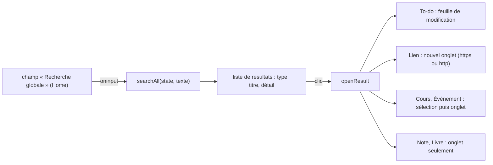

# Socle — Recherche globale

**État :** Implémentée · **Vérifiée contre le code :** 2026-10-26

Retour à l'[index des fiches](README.md) · [ARCHITECTURE](../ARCHITECTURE.md) · [GLOSSAIRE](../GLOSSAIRE.md)

## 1. Objectif

Retrouver en quelques lettres un cours, un to-do, un événement, une note, un livre ou un lien, depuis la barre de recherche de Home, sans savoir dans quel onglet la chose se trouve.

## 2. Périmètre

**Fait** : recherche par sous-chaîne, sans casse, dans six types de données ; au plus 20 résultats ; ouverture du résultat dans le bon onglet.

**Ne fait pas** : chercher dans les cartes de mémorisation, les objectifs, les conseils, les résumés Hermes, les vidéos ni le texte des PDF ; ignorer les accents (« chimie » ne trouve pas « chimié ») ; classer par pertinence ; mémoriser les recherches.

## 3. Vue d'ensemble technique



## 4. Composants et fichiers concernés

| Chemin | Rôle |
|---|---|
| `js/search.js` | fonction pure `searchAll(state, query, limit = 20)` |
| module Home (fiche [socle-widgets-et-home](socle-widgets-et-home.md)) | champ de recherche, liste des résultats, `openResult` |
| `tests/calendar-logic.test.js` | test « recherche d'événements et recherche globale » |

La recherche propre à l'Agenda (`searchEvents`, événements et to-dos datés, triés par date) est une autre fonction, décrite dans la fiche de l'Agenda.

## 5. Entrées / sorties

**Entrée** : l'état (`state.courses`, `todos`, `events`, `notes`, `library`, `links`) et le texte saisi.

**Sortie** : une liste d'objets `{ kind, title, sub, ref, tab, date? }`.

```js
searchAll(state, 'chimie')
// (forme du résultat ; les valeurs dépendent des données)
// [ { kind: 'Cours',     title: 'Chimie',         sub: 'Semestre 1',  ref: {…}, tab: 'workspace' },
//   { kind: 'Événement', title: 'Examen de chimie', sub: '2026-10-25', ref: {…}, date: '2026-10-25', tab: 'calendar' }, … ]
```

| `kind` | Champs comparés | `sub` | `tab` |
|---|---|---|---|
| Cours | `name`, `code`, `prof` | semestre · professeur | `workspace` |
| To-do | `name` | `deadline` | `workspace` |
| Événement | `title`, `location`, `description` | `date` | `calendar` |
| Note | `title`, `body` | vide | `notes` |
| Livre | `title`, `author`, `name`, `tags` | auteur | `library` |
| Lien | `title`, `url`, `description` | description | `links` |

## 6. Fonctionnement détaillé

```text
FONCTION searchAll(state, query, limit = 20)
  q ← query sans espaces de bord, en minuscules
  SI longueur de q < 2 : RETOURNER liste vide
  hit(x1, x2, …) ← vrai si l'un des champs (texte, vide si absent), en minuscules, CONTIENT q
  out ← liste vide
  POUR CHAQUE cours DANS state.courses     : SI hit(name, code, prof)                  AJOUTER { kind:'Cours', … }
  POUR CHAQUE to-do DANS state.todos       : SI hit(name)                              AJOUTER { kind:'To-do', title: name OU 'Sans titre', … }
  POUR CHAQUE événement DANS state.events  : SI hit(title, location, description)      AJOUTER { kind:'Événement', date, … }
  POUR CHAQUE note DANS state.notes        : SI hit(title, body)                       AJOUTER { kind:'Note', title: title OU 'Sans titre', … }
  POUR CHAQUE livre DANS state.library     : SI hit(title, author, name, …tags)       AJOUTER { kind:'Livre', … }
  POUR CHAQUE lien DANS state.links        : SI hit(title, url, description)           AJOUTER { kind:'Lien', title: title OU url, … }
  RETOURNER les `limit` premiers éléments de out        // l'ordre est celui des types ci-dessus
```

**Ouverture d'un résultat** (`openResult`, dans Home) :

```text
FONCTION openResult(ctx, r)
  SI r.kind = 'To-do'  : ouvrir la feuille de modification du to-do ; RETOURNER      // pas de changement d'onglet
  SI r.kind = 'Lien'   : u ← safeUrl(r.ref.url) ; SI u : ouvrir u dans un nouvel onglet (noopener) ; RETOURNER
  SI r.kind = 'Cours'  : sélectionner ce cours dans Workspace
  SI r.kind = 'Événement' : placer l'Agenda sur la date de l'événement
  location.hash ← '#' + r.tab
```

Si rien ne correspond et que la saisie fait au moins 2 caractères, la liste affiche « Aucun résultat. ».

## 7. Dépendances

- **Internes** : `safeUrl` (`js/dom.js`) pour les liens ; aucune autre.
- **Externe** : aucun. **Variable d'environnement** : aucune. **Clé de stockage** : aucune (la recherche lit l'état en mémoire).

## 8. Cas limites et erreurs

| Situation | Comportement |
|---|---|
| moins de 2 caractères | aucun résultat, aucun message |
| plus de 20 correspondances | les 20 premières, dans l'ordre Cours, To-do, Événement, Note, Livre, Lien |
| champ absent ou `null` | traité comme du texte vide |
| lien dont l'adresse n'est ni `http` ni `https` | le clic ne fait rien |
| texte avec du HTML | affiché tel quel (construction par `h()`) |

## 9. Tests

- Fichier : `tests/calendar-logic.test.js`. Le test remplit un cours, un to-do, un événement, une note, un livre et un lien contenant « chimie », vérifie que `searchAll(s, 'chimie')` renvoie les six types, et que `searchAll(s, 'c')` renvoie 0 résultat.
- Lancer : `npm test`.
- Ne couvre pas : la limite de 20, l'insensibilité à la casse seule, `openResult`, l'affichage dans Home, l'absence de champs.

## 10. Pièges et dette technique

- **Les résultats ne sont recalculés qu'à la frappe** (`oninput`) : ils ne suivent pas un changement de données fait ailleurs, mais Home est redessiné à chaque modification de l'état, ce qui vide le champ.
- **Un résultat de type Note ou Livre ouvre seulement l'onglet**, pas la note ou le livre précis.
- **Les premiers types masquent les derniers** : avec beaucoup de cours ou de to-dos correspondants, les liens peuvent ne jamais apparaître dans les 20 résultats.
- **Accents** : la comparaison est faite avec `toLowerCase()` seulement.
- **Doublon de logique** : `searchEvents` (Agenda) et `searchAll` répètent la même fonction `hit`.

## 11. Pour modifier ou étendre

1. **Chercher dans un nouveau type** (cartes, objectifs…) : ajouter une ligne `POUR CHAQUE` dans `searchAll`, un `kind`, un `tab`, puis le cas correspondant dans `openResult`.
2. **Ignorer les accents** : normaliser `q` et chaque champ avec `normalize('NFD')` et retirer les marques, dans `hit`.
3. **Ne pas casser** : le seuil de 2 caractères, la limite de résultats, et le fait que le texte n'est jamais interprété comme du HTML.
4. Relancer `npm run build:sw` puis `npm test`.
