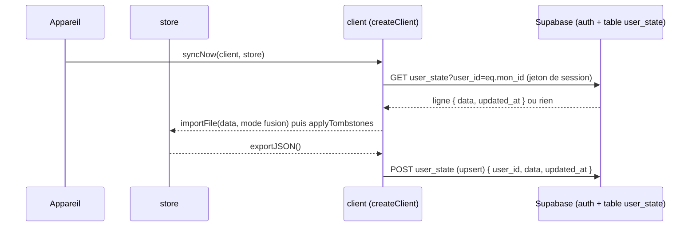

# Socle — Synchronisation entre appareils (Supabase)

**État :** Partielle · **Vérifiée contre le code :** 2026-10-26

Retour à l'[index des fiches](README.md) · [ARCHITECTURE](../ARCHITECTURE.md) · [GLOSSAIRE](../GLOSSAIRE.md) · Décisions : [ADR-009](../decisions/009-synchronisation-supabase.md), [ADR-010](../decisions/010-fusion-par-identifiant-et-marqueurs.md)

> **Pourquoi « Partielle »** : le code est complet et testé contre un **faux serveur** en mémoire, mais il n'a pas encore été essayé contre un vrai projet Supabase (l'adresse et la clé ne sont pas encore saisies dans Paramètres).

## 1. Objectif

Retrouver ses données sur tous ses appareils (téléphone, ordinateur) sans serveur à maintenir : l'étudiant crée lui-même un projet Supabase gratuit ; l'application y dépose une copie de son état et la fusionne avec celle des autres appareils. Les suppressions voyagent aussi, pour que ce qui a été effacé ne revienne pas.

## 2. Périmètre

**Fait** : création de compte, connexion, déconnexion (e-mail et mot de passe) ; envoi et récupération d'une ligne JSON par utilisateur ; fusion par identifiant ; marqueurs de suppression ; « Remplacer le cloud » et « Remplacer cet appareil » ; synchronisation automatique facultative ; messages d'erreur en français.

**Ne fait pas** : synchroniser les PDF (jamais envoyés, [ADR-003](../decisions/003-pdf-par-appareil.md)) ; synchroniser le verrou ni les réglages de l'appareil en fusion ; résoudre finement un conflit sur un même élément (voir section 10) ; synchroniser en arrière-plan application fermée ; fonctionner avec une adresse autre que `https://…supabase.co` (CSP).

## 3. Vue d'ensemble technique



## 4. Composants et fichiers concernés

| Chemin | Rôle |
|---|---|
| `js/sync.js` | `loadSync`, `saveSync`, `cleanUrl`, `createClient` (`signUp`, `signIn`, `pull`, `push`, `signOut`), `syncNow`, `replaceCloud`, `replaceDevice` |
| `js/autosync.js` | `autoSyncOnce`, `startAutoSync`, `MIN_GAP` (5 min), `resetAutoSync` |
| `js/tombstones.js` | `TRACKED`, `recordDeletions`, `applyTombstones`, `mergeTombstones`, `sanitizeTombstones` |
| `scripts/supabase.sql` | table `user_state` et règle de sécurité « ma ligne » (à lancer une fois dans Supabase) |
| `js/store.js` | `commit` (enregistre les suppressions), `importFile` (fusion ou remplacement), `exportJSON` |
| `js/data-io.js` | `mergeList`, `MERGERS`, `applyImport` ([socle-import-export](socle-import-export.md)) |
| `js/modules/settings.js` | interface : adresse, clé, e-mail, mot de passe, boutons, case « Synchroniser automatiquement » ([socle-parametres](socle-parametres.md)) |
| `tests/ux.test.js`, `tests/sync2.test.js` | tests avec faux serveur |

## 5. Entrées / sorties

**Configuration locale** (`studenthub:sync`, jamais exportée, jamais envoyée) :

```json
{ "url": "https://abcd.supabase.co", "anonKey": "<clé anon public>", "session": { "access_token": "…", "refresh_token": "…", "expires_at": 1767000000000, "user": { "id": "…", "email": "…" } }, "last": "2026-10-26T08:00:00.000Z" }
```

**Table** (`scripts/supabase.sql`) :

```sql
create table if not exists public.user_state (
  user_id uuid primary key references auth.users(id) on delete cascade,
  data jsonb not null default '{}'::jsonb,
  updated_at timestamptz not null default now()
);
-- sécurité par ligne : chacun ne voit et n'écrit que sa ligne
create policy "ma ligne" on public.user_state for all to authenticated
  using (auth.uid() = user_id) with check (auth.uid() = user_id);
```

**Requêtes** (par `fetch`, en-têtes `apikey` et `Authorization: Bearer …`) :

| Action | Requête |
|---|---|
| créer un compte | `POST /auth/v1/signup` `{ email, password }` |
| se connecter | `POST /auth/v1/token?grant_type=password` |
| renouveler la session | `POST /auth/v1/token?grant_type=refresh_token` (si elle expire dans moins d'une minute) |
| récupérer | `GET /rest/v1/user_state?select=data,updated_at&user_id=eq.<id>` |
| envoyer | `POST /rest/v1/user_state` avec `Prefer: resolution=merge-duplicates,return=minimal` (insertion ou mise à jour) |
| se déconnecter | `POST /auth/v1/logout` (la déconnexion locale suffit si cet appel échoue) |

`data` est le même JSON que la sauvegarde complète (`exportJSON()`), sans PDF.

**Marqueurs de suppression** dans l'état : `tombstones: { todos: { "<id>": "2026-10-26T09:12:00.000Z" }, notes: {…}, … }`.

## 6. Fonctionnement détaillé

```text
FONCTION syncNow(client, store)
  ligne ← client.pull()
  SI ligne.data existe : store.importFile(ligne.data, { mode: 'merge' })      // fusion par identifiant, puis applyTombstones
  client.push(store.exportJSON())                                              // l'état fusionné devient la copie du cloud
  RETOURNER { merged: nombre d'éléments traités, hadCloud: ligne existe }

FONCTION replaceCloud(client, store)  : client.push(store.exportJSON())                       // le cloud = cet appareil
FONCTION replaceDevice(client, store)
  ligne ← client.pull()
  SI aucune donnée : ERREUR « Le cloud est vide : rien à récupérer. »
  store.importFile(ligne.data, { mode: 'replace' })                            // cet appareil = le cloud, y compris les réglages

FONCTION mergeList(local, entrant)                    // js/data-io.js
  même identifiant : l'élément ENTRANT (le cloud) remplace le local ; identifiants nouveaux : ajoutés
  listes de textes : union

FONCTION commit(mutate)                               // js/store.js, à chaque modification
  avant ← idSets(state)
  mutate(state)
  recordDeletions(state, avant)                       // tout identifiant disparu devient un marqueur daté
  save()

FONCTION recordDeletions(state, avant, maintenant)
  POUR CHAQUE collection DANS TRACKED
    POUR CHAQUE id DANS avant[collection] ABSENT de l'état : tombstones[collection][id] ← maintenant
    SI plus de 2000 marqueurs : garder les 2000 plus récents

FONCTION applyTombstones(state)                       // appelée après une fusion
  POUR CHAQUE collection DANS TRACKED : retirer les éléments dont l'id figure dans tombstones[collection]

FONCTION mergeTombstones(a, b) : union ; pour un même id, la date la plus récente
FONCTION sanitizeTombstones(r)  : à la lecture, garder les marqueurs de moins de 400 jours, id de 1 à 40 caractères, au plus 2000 par collection
```

**Collections suivies** (`TRACKED`) : `todos`, `projects`, `events`, `notes`, `links`, `courses`, `library`, `decks`, `cards`, `gaps`, `goals`, `tips`, `sessions`, `calendars`, `focusTags`, `focusPlans`, `exams`, `tutorLogs`.

**Fusion des clés qui ne sont pas des listes** (`MERGERS`) : `xp` = le total le plus élevé et union des jours ; `tombstones` = `mergeTombstones` ; `settings` et `calPrefs` = ceux de l'appareil local.

**Synchronisation automatique** :

```text
FONCTION autoSyncOnce(ctx, { force })
  SI PAS force ET settings.sync.auto = faux      : RETOURNER 'off'
  SI session, adresse ou clé manquante           : RETOURNER 'no-account'
  SI navigator.onLine = faux                     : RETOURNER 'offline'
  SI PAS force ET dernière synchro < 5 min       : RETOURNER 'recent'
  SI une feuille <dialog> est ouverte            : RETOURNER 'busy-ui'      // ne pas remplacer des données sous les doigts de l'utilisateur
  SI une synchro est déjà en cours               : RETOURNER 'busy'
  syncNow(client, store) ; enregistrer « last » ; RETOURNER 'ok'
  EN CAS D'ERREUR : au plus UN message toutes les 10 minutes (« Synchronisation impossible : … ») ; RETOURNER 'error'

FONCTION startAutoSync(ctx)   : une tentative tout de suite, une à chaque retour sur l'application (visibilitychange), une toutes les 5 minutes
```

**Erreurs expliquées en français** (`explain`) : identifiants incorrects, e-mail à confirmer, compte déjà existant, mot de passe trop faible, trop de tentatives, accès refusé (401/403, règle de sécurité), table introuvable (404, script SQL non lancé), réseau coupé (« Connexion impossible : vérifie le réseau et l'adresse du projet. »).

## 7. Dépendances

- **Internes** : `js/store.js`, `js/data-io.js`, `js/tombstones.js`, `showToast` ([socle-rappels](socle-rappels.md)), l'onglet Paramètres.
- **Externe** : un projet **Supabase** créé par l'étudiant (Auth par e-mail + table `user_state`). Aucune bibliothèque : de simples `fetch`.
- **Configuration** : adresse (`https://….supabase.co`) et clé « anon public », saisies dans Paramètres. La clé « anon » est publique par conception ; c'est la règle de sécurité par ligne (RLS) qui protège les données. **Ne jamais utiliser la clé « service_role »**.
- **CSP** : `connect-src 'self' https://*.supabase.co` dans `index.html` ; un domaine personnalisé serait bloqué.
- **Variable d'environnement** : aucune. **Clés de stockage** : `studenthub:sync`, `studenthub:v1` (champs `tombstones` et `settings.sync.auto`).

## 8. Cas limites et erreurs

| Situation | Comportement |
|---|---|
| adresse en `http://`, avec chemin ou identifiants | refusée : seule l'origine `https://` est gardée (`cleanUrl`) |
| clé « anon » vide | « Renseigne la clé « anon public » du projet. » |
| e-mail vide ou mot de passe de moins de 6 caractères | « Saisis ton e-mail et un mot de passe (6 caractères au minimum). » |
| compte créé mais e-mail à confirmer | « Compte créé : confirme ton e-mail (lien reçu), puis connecte-toi. » |
| pas de session | « Connecte-toi d'abord. » |
| session proche de l'expiration | renouvelée automatiquement (marge d'une minute) |
| table absente | « Table user_state introuvable : vérifie que tu as lancé le script SQL. » |
| cloud vide + « Remplacer cet appareil » | « Le cloud est vide : rien à récupérer. » ; rien n'est écrasé |
| premier envoi | « Synchronisé : premier envoi vers le cloud. » |
| réseau coupé | message « Connexion impossible… » ; en automatique, un seul message par 10 minutes |
| feuille d'édition ouverte | la synchronisation automatique attend |
| suppression faite sur A, synchronisée sur B | l'élément disparaît de B et ne revient pas |
| marqueur de plus de 400 jours | oublié : un élément très ancien réimporté pourrait réapparaître |

## 9. Tests

- Fichiers : `tests/ux.test.js` (adresse `https` seule, identifiants hors sauvegarde ; compte, connexion, erreurs en français, envoi puis fusion entre deux appareils ; remplacer le cloud, remplacer l'appareil (propage une suppression), session renouvelée ; e-mail à confirmer, accès refusé expliqué, réseau coupé ; connexion et synchronisation depuis l'onglet Paramètres), `tests/sync2.test.js` (marqueurs datés, appliqués, fusionnés, nettoyés ; une seule suppression crée un marqueur ; suppression propagée sans résurrection ; XP au maximum et réglages de l'appareil conservés ; synchronisation automatique désactivée, sans compte, trop récente, fenêtre ouverte, puis réussie ; erreur réseau signalée une fois par 10 minutes).
- Lancer : `npm test`.
- Ne couvre pas : **un vrai serveur Supabase** (faux serveur en mémoire seulement), la politique de sécurité SQL réelle, la confirmation d'e-mail réelle, la taille maximale d'une ligne, deux appareils qui modifient le même élément en même temps.

## 10. Pièges et dette technique

- **Jamais essayée en vrai** : adresse et clé restent à saisir ; à la première utilisation, vérifier d'abord avec des données jetables.
- **Le cloud gagne pour un même identifiant** : `mergeList` remplace l'élément local par l'élément entrant. Si deux appareils modifient le même to-do avant de se synchroniser, la version déjà envoyée écrase l'autre à la fusion (déduit du code, non testé). Pas de comparaison de dates par élément.
- **Les jetons sont dans `localStorage`** (`studenthub:sync`) : lisibles par quiconque ouvre les outils du navigateur ; ils ne sont ni exportés ni verrouillés (le [verrou](socle-verrou.md) ne chiffre rien).
- **Tout l'état dans une seule ligne** : plus l'état grossit, plus chaque envoi est lourd ; pas de limite vérifiée.
- **Mot de passe oublié** ([socle-verrou](socle-verrou.md)) : l'état est effacé mais la connexion Supabase reste ; `settings.sync.auto` repasse à faux avec l'état : une synchronisation manuelle ramène alors les données du cloud (déduit du code).
- **Marqueurs bornés** : 2000 par collection et 400 jours (`MAX_PER_COLLECTION`, `KEEP_DAYS`).
- **Domaine Supabase personnalisé** : bloqué par la CSP tant qu'elle reste `https://*.supabase.co`.

## 11. Pour modifier ou étendre

1. **Suivre une nouvelle collection** (et propager ses suppressions) : l'ajouter à `TRACKED` dans `js/tombstones.js` **et** vérifier qu'elle est exportée (`js/data-io.js`).
2. **Changer l'intervalle** : `MIN_GAP` dans `js/autosync.js` (le test l'utilise).
3. **Meilleure résolution des conflits** : comparer une date de modification par élément dans `mergeList`, après avoir écrit une nouvelle décision ([ADR-010](../decisions/010-fusion-par-identifiant-et-marqueurs.md)).
4. **Changer de service** : seul `createClient` parle à Supabase ; `syncNow` ne connaît que `pull` et `push`.
5. **Ne pas casser** : les identifiants de connexion hors de l'état et des sauvegardes ; la règle de sécurité par ligne ; l'attente quand une feuille est ouverte ; le message d'erreur unique par 10 minutes.
6. Relancer `npm run build:sw` puis `npm test`.
