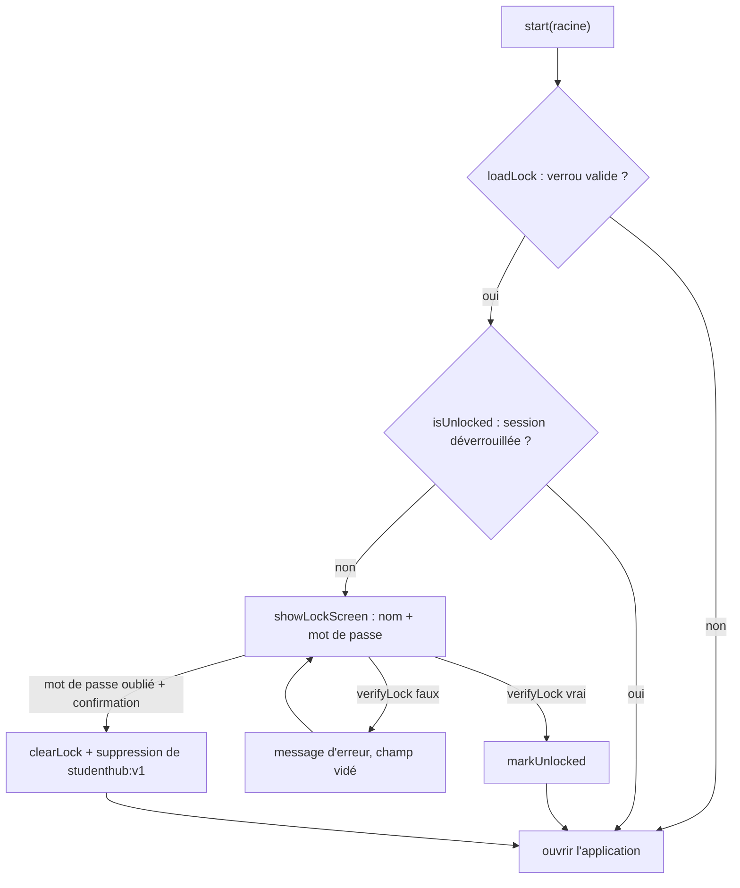

# Socle — Verrou d'accès

**État :** Implémentée · **Vérifiée contre le code :** 2026-10-26

Retour à l'[index des fiches](README.md) · [ARCHITECTURE](../ARCHITECTURE.md) · [GLOSSAIRE](../GLOSSAIRE.md) · Décision : [ADR-006](../decisions/006-verrou-local-sans-chiffrement.md)

## 1. Objectif

Cacher l'application derrière un **écran de connexion** (nom + mot de passe) sur un appareil partagé ou laissé ouvert. C'est un écran de connexion local : il protège d'un regard curieux, **pas** d'une personne qui sait ouvrir les outils du navigateur, car il ne chiffre rien.

## 2. Périmètre

**Fait** : définir, changer ou retirer le verrou ; demander nom et mot de passe à chaque nouvelle session ; verrouiller tout de suite ; « mot de passe oublié » (efface le verrou et l'état) ; ne jamais stocker le mot de passe, seulement une empreinte salée.

**Ne fait pas** : chiffrer les données (`studenthub:v1` reste lisible en clair dans `localStorage`) ; protéger contre quelqu'un qui ouvre les outils de développement ; limiter vraiment les essais (voir section 10) ; synchroniser ou exporter le verrou ; effacer les données du cloud ni les PDF.

## 3. Vue d'ensemble technique



## 4. Composants et fichiers concernés

| Chemin | Rôle |
|---|---|
| `js/lock.js` | logique pure : `makeLock`, `verifyLock`, `loadLock`, `saveLock`, `clearLock`, `isUnlocked`, `markUnlocked`, `markLocked` |
| `js/ui/lock-screen.js` | `showLockScreen` (écran de connexion) et `manageLock` (feuille pour définir, changer ou retirer) |
| `js/app.js` | décide au démarrage d'afficher l'écran ; `lockControls` (boutons « Définir un verrou » / « Verrou… », « Verrouiller maintenant », « Réinitialiser ») |
| onglet Paramètres | affiche `ctx.lockControls()` dans la section Compte et sécurité (fiche [socle-parametres](socle-parametres.md)) |
| `js/constants.js` | `LOCK_KEY` (`studenthub:lock`) et `SESSION_KEY` (`studenthub:unlocked`) |

## 5. Entrées / sorties

**Verrou stocké** dans `localStorage`, clé `studenthub:lock` (jamais exporté, jamais synchronisé) :

```json
{
  "v": 1,
  "name": "Emmanuel",
  "salt": "<16 octets aléatoires en base64>",
  "iterations": 210000,
  "hash": "<32 octets en base64>"
}
```

**Session** : `sessionStorage`, clé `studenthub:unlocked` = `'1'` tant que l'onglet reste ouvert.

| Fonction | Entrée → sortie |
|---|---|
| `makeLock(nom, motDePasse)` | → objet verrou ci-dessus (nom sans espaces de bord, sel neuf à chaque appel) |
| `verifyLock(verrou, nom, motDePasse)` | → `true` seulement si l'empreinte ET le nom correspondent (nom comparé sans casse ni espaces de bord) |
| `loadLock(storage)` | → le verrou, ou `null` s'il manque, est illisible ou incomplet |
| `saveLock`, `clearLock` | écrit ou supprime la clé `studenthub:lock` |
| `isUnlocked`, `markUnlocked`, `markLocked` | lit, pose ou retire la marque de session |

Exemple tiré des tests : un verrou créé avec `('Emmanuel', 'mot-de-passe-1')` accepte `('emmanuel ', 'mot-de-passe-1')`, refuse un autre mot de passe et refuse un autre nom.

## 6. Fonctionnement détaillé

```text
FONCTION derive(motDePasse, sel, itérations)
  RETOURNER PBKDF2(motDePasse normalisé NFKC, sel, SHA-256, itérations) sur 256 bits

FONCTION makeLock(nom, motDePasse)
  sel ← 16 octets aléatoires
  RETOURNER { v: 1, name: nom sans espaces de bord, salt: base64(sel), iterations: 210000, hash: base64(derive(motDePasse, sel, 210000)) }

FONCTION verifyLock(verrou, nom, motDePasse)
  obtenu  ← derive(motDePasse, verrou.salt, verrou.iterations)   // les itérations du verrou stocké, pas la constante
  attendu ← base64 décodé de verrou.hash
  diff ← longueurs différentes ? non nul : 0 ; POUR CHAQUE octet : diff ← diff OU (obtenu XOR attendu)   // comparaison sans sortie anticipée
  mêmeNom ← nom sans espaces de bord, en minuscules = verrou.name en minuscules
  RETOURNER diff = 0 ET mêmeNom

FONCTION loadLock(storage)
  l ← JSON de storage[LOCK_KEY]   // une erreur de lecture donne rien
  SI l.name, l.salt, l.hash sont des textes ET l.iterations est un entier : RETOURNER l
  RETOURNER rien
```

### 6.1 Au démarrage (`start`, `js/app.js`)

```text
verrou ← loadLock(storage)
SI verrou ET PAS isUnlocked(session)
  showLockScreen(racine, verrou, {
    onUnlock : markUnlocked(session) ; continuer
    onForgot : clearLock(storage) ; storage.removeItem(STORAGE_KEY) ; markLocked(session) ; verrou ← rien ; continuer
  })
// ensuite seulement : createStore, chargement de data/*.json, premier dessin
```

Rien de l'état n'est lu ni dessiné tant que l'écran n'a pas répondu.

### 6.2 Écran de connexion (`showLockScreen`)

```text
À l'envoi du formulaire
  SI verifyLock(verrou, champNom, champMotDePasse) : onUnlock() ; FIN
  essais ← essais + 1
  AFFICHER « Nom ou mot de passe incorrect. » ; vider le champ mot de passe
  ATTENDRE min(5000, essais × 700) ms                         // voir section 10 : n'empêche pas un nouvel envoi
Lien « Mot de passe oublié ? »
  SI confirm('Effacer le verrou ET toutes les données de cet appareil ?') : onForgot()
```

### 6.3 Définir, changer, retirer (`manageLock`)

```text
FONCTION onSubmit()                 // dans une feuille openSheet ; retourner un texte = erreur affichée
  SI un verrou existe ET PAS verifyLock(verrou, verrou.name, ancienMotDePasse) : RETOURNER « Mot de passe actuel incorrect. »
  SI un verrou existe ET nouveauMotDePasse est vide : clearLock ; onDone(rien) ; RETOURNER   // retirer le verrou
  SI nom vide                          : RETOURNER « Le nom est obligatoire. »
  SI nouveauMotDePasse < 6 caractères  : RETOURNER « Le mot de passe doit faire au moins 6 caractères. »
  SI confirmation ≠ nouveauMotDePasse  : RETOURNER « Les deux mots de passe sont différents. »
  verrou ← makeLock(nom, nouveauMotDePasse) ; saveLock ; onDone(verrou)
```

Après `onDone` (dans `app.js`) : le verrou courant est remplacé, la session est marquée déverrouillée (pour ne pas se verrouiller soi-même) et l'écran est redessiné. « Verrouiller maintenant » retire la marque de session puis recharge la page, ce qui ramène à l'écran de connexion.

## 7. Dépendances

- **Internes** : `js/constants.js` (clés), `js/dom.js` (`h`, `field`), `js/ui/dialog.js` (`openSheet`), `js/app.js` (appel au démarrage).
- **Navigateur** : `crypto.subtle` (PBKDF2, SHA-256), `crypto.getRandomValues`, `TextEncoder`, `btoa`/`atob`, `localStorage`, `sessionStorage`. **`crypto.subtle` n'existe que sur une page sécurisée** (HTTPS ou `localhost`) : sur GitHub Pages c'est le cas.
- **Externe** : aucun. **Variable d'environnement** : aucune.
- **Clés** : `studenthub:lock` (`localStorage`), `studenthub:unlocked` (`sessionStorage`).

## 8. Cas limites et erreurs

| Situation | Comportement |
|---|---|
| aucun verrou | l'application s'ouvre directement ; bouton « Définir un verrou » |
| verrou stocké corrompu ou incomplet | `loadLock` retourne `null` : **l'application s'ouvre sans verrou** |
| mauvais nom ou mauvais mot de passe | « Nom ou mot de passe incorrect. », mot de passe vidé |
| nom saisi avec des majuscules ou des espaces autour | accepté (comparaison sans casse) |
| mot de passe de moins de 6 caractères à la création | « Le mot de passe doit faire au moins 6 caractères. » (non vérifié à la connexion) |
| changement avec un mauvais « mot de passe actuel » | « Mot de passe actuel incorrect. » ; rien n'est modifié |
| nouveau mot de passe laissé vide alors qu'un verrou existe | le verrou est **retiré** |
| « Mot de passe oublié ? » confirmé | verrou et état (`studenthub:v1`) supprimés ; l'app repart des données de départ |
| onglet fermé puis rouvert | nouvelle session : l'écran de connexion revient |
| ancien verrou créé avec un autre nombre d'itérations | reste valable : la vérification lit `iterations` dans le verrou |

## 9. Tests

- Fichiers : `tests/lock.test.js` (3 tests : bon couple accepté et mauvais refusé avec nom insensible à la casse ; deux verrous du même mot de passe ont des empreintes différentes grâce au sel ; stockage, données corrompues et session), `tests/e2e/app.e2e.py` (définir un verrou, verrouiller, mauvais mot de passe, bon mot de passe, mot de passe oublié efface verrou et données).
- Lancer : `npm test` ; navigateur réel : `python3 tests/e2e/app.e2e.py` (serveur lancé).
- Ne couvre pas : la feuille `manageLock` en tests node (changement et retrait du verrou testés seulement à travers le parcours e2e « définir ») ; les messages d'erreur de `manageLock` un par un ; le comportement du délai après un échec.

## 10. Pièges et dette technique

- **Pas de chiffrement** ([ADR-006](../decisions/006-verrou-local-sans-chiffrement.md)) : les données sont lisibles dans `localStorage` par quiconque ouvre les outils de développement, et il suffit d'y supprimer `studenthub:lock` pour retirer le verrou. L'interface le dit (« Il ne chiffre pas tes données »).
- **Le délai après un échec ne bloque rien** : `showLockScreen` attend `min(5000, essais × 700)` ms à la fin du gestionnaire, mais le formulaire n'est pas désactivé : un nouvel envoi reste possible tout de suite. Seul le coût de PBKDF2 (210 000 itérations) ralentit un peu les essais, et un attaquant peut de toute façon contourner l'écran.
- **« Mot de passe oublié » efface moins que le message ne l'annonce** : la confirmation parle de « toutes les données de cet appareil », mais le code supprime seulement le verrou et `studenthub:v1`. La configuration de synchronisation (`studenthub:sync`), les PDF et couvertures (IndexedDB) restent, et le cloud n'est pas touché (ADR-006).
- **Verrou illisible = pas de verrou** : un verrou corrompu rouvre l'application sans demander de mot de passe (`loadLock` retourne `null`).
- **Session par onglet** : `sessionStorage` est propre à l'onglet ; fermer l'onglet reverrouille, un second onglet demande une nouvelle connexion.
- **Question ouverte** : l'étudiant avait noté « authentification » ; le verrou local répond-il à ce besoin, ou faut-il une vraie authentification (hors périmètre sans serveur) ? Voir l'ADR-006.

## 11. Pour modifier ou étendre

1. **Changer la force de la dérivation** : modifier `ITERATIONS` dans `js/lock.js`. Les anciens verrous restent valables (leurs itérations sont stockées). Pour migrer, reproposer à l'étudiant de redéfinir son verrou.
2. **Vraiment limiter les essais** : désactiver le bouton pendant l'attente dans `showLockScreen`, ou compter les échecs dans `sessionStorage`.
3. **Chiffrer les données** : changement d'architecture (clé dérivée du mot de passe, état chiffré, impact sur l'import, la synchronisation et le mot de passe oublié) : écrire d'abord une nouvelle décision.
4. **Ne pas casser** : le verrou n'est jamais exporté ni synchronisé ; l'écran s'affiche **avant** toute lecture de l'état ; la comparaison de l'empreinte se fait sans sortie anticipée.
5. Relancer `npm run build:sw` puis `npm test`.
