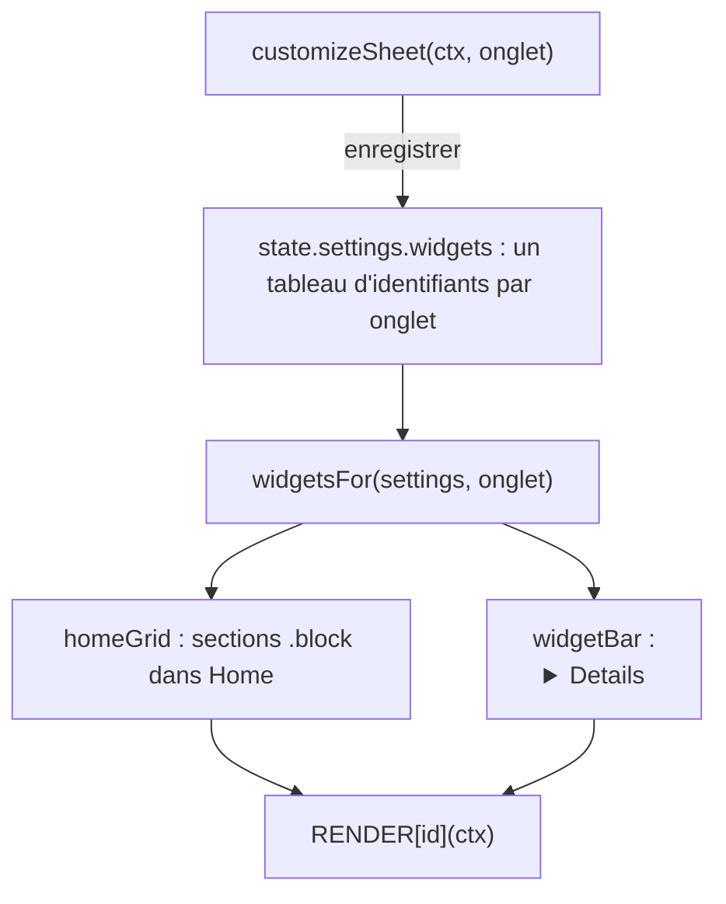

# Socle — Widgets et page Home

**État :** Implémentée · **Vérifiée contre le code :** 2026-10-26

Retour à l'[index des fiches](README.md) · [ARCHITECTURE](../ARCHITECTURE.md) · [GLOSSAIRE](../GLOSSAIRE.md) · Décision : [ADR-013](../decisions/013-widgets-et-reglages.md)

## 1. Objectif

Montrer d'un coup d'œil l'essentiel (agenda du jour, tâches, révisions, objectif…) sur la page **Home**, et réutiliser les mêmes blocs, les **widgets**, en bas de chaque autre onglet. L'étudiant choisit quels widgets s'affichent et dans quel ordre, onglet par onglet.

## 2. Périmètre

**Fait** : 14 widgets (dont « Prêtes à démarrer », « En retard » et « Charge de la semaine », voir [rapports-et-tableaux-de-bord](rapports-et-tableaux-de-bord.md)) ; grille de Home ; barre repliable en bas des autres onglets ; feuille de personnalisation (cases à cocher et flèches) ; en-tête de Home (salutation, date, horloge) ; boutons d'ajout rapide ; recherche globale (voir [socle-recherche-globale](socle-recherche-globale.md)).

**Ne fait pas** : glisser-déposer (jugé trop fragile au doigt) ; widgets créés par l'utilisateur ; mémoriser les widgets repliés ; afficher un widget dans l'onglet dont il est déjà le contenu.

## 3. Vue d'ensemble technique



## 4. Composants et fichiers concernés

| Chemin | Rôle |
|---|---|
| `js/ui/widgets.js` | `RENDER` (un rendu par widget), `widgetBody`, `homeGrid`, `widgetBar`, `customizeSheet` |
| `js/modules/home.js` | page Home : en-tête, recherche, boutons rapides, `homeGrid` |
| `js/settings-logic.js` | `WIDGETS`, `WIDGET_BY_ID`, `TARGETS`, `HIDE_ON`, `widgetsFor`, valeurs par défaut et validation des listes de widgets |
| `js/app.js` | ajoute `widgetBar` sous chaque onglet sauf Home (voir [socle-interface](socle-interface.md)) |
| `tests/ux.test.js` | 3 tests : réglages de widgets, barre et feuille, Home qui suit les réglages |

## 5. Entrées / sorties

**Donnée** : `state.settings.widgets` associe chaque onglet à la liste ordonnée des identifiants affichés. Valeurs par défaut réelles :

```json
{
  "home": ["today","soon","minical","tasks","recent","focus","memory","messages","goal","tip","xp"],
  "workspace": ["today"],
  "calendar": ["tasks"],
  "focus": ["today","tasks"],
  "revision": ["today","tasks"],
  "notes": ["today","tasks"]
}
```

Les autres onglets (`library`, `messages`, `videos`, `links`, `goals`, `settings`) reçoivent `["today","tasks"]`.

| Identifiant | Titre | Contenu | Masqué dans |
|---|---|---|---|
| `today` | Aujourd'hui | éléments du jour (`itemsOn`) avec leur horaire | `calendar` |
| `soon` | À venir (7 jours) | les 6 premiers éléments des 7 jours suivants | `calendar` |
| `minical` | Mini-calendrier | mois navigable ; un clic sur un jour ouvre l'Agenda à cette date | `calendar` |
| `tasks` | Tâches | 6 to-dos non terminés les plus proches ; bouton ✓ pour terminer | `workspace` |
| `recent` | Récents | 4 derniers livres ouverts et 4 dernières notes modifiées, 6 au total | (aucun) |
| `focus` | Focus | minutes et arbres du jour ; bouton de lancement | `focus` |
| `memory` | Mémorisation | cartes à réviser, série de jours, plan du jour des leçons avec examen | `revision` |
| `messages` | Messages | nombre de résumés non lus | `messages` |
| `goal` | Objectif en cours | l'objectif non terminé à l'échéance la plus proche, avec progression | `goals` |
| `tip` | Conseil du jour | un conseil choisi d'après le jour | `goals` |
| `xp` | Niveau et XP | niveau, XP total, XP restant, plafond quotidien | (aucun) |

## 6. Fonctionnement détaillé

```text
FONCTION widgetsFor(settings, cible)
  RETOURNER settings.widgets[cible] (ou liste vide) SANS les identifiants dont HIDE_ON[id] = cible

FONCTION homeGrid(ctx)
  POUR CHAQUE id DANS widgetsFor(settings, 'home') : <section class="block stack" data-widget=id> <h2>titre</h2> RENDER[id](ctx) </section>

FONCTION widgetBar(ctx, onglet)
  <section class="widgets"> titre « Widgets » + bouton « Personnaliser »
  POUR CHAQUE id DANS widgetsFor(settings, onglet) : <details open data-widget=id> <summary>titre</summary> RENDER[id](ctx) </details>

FONCTION customizeSheet(ctx, cible)
  charger() :  actifs ← ensemble des identifiants de settings.widgets[cible] ; ordre ← actifs dans leur ordre, PUIS tous les autres widgets
  afficher chaque widget : case (cochée si actif ; grisée et marquée « déjà dans cet onglet » si HIDE_ON[id] = cible), flèches ↑ ↓
  changer la liste déroulante « Afficher en bas de » : cible ← choix ; charger()        // les changements non enregistrés sont perdus
  enregistrer : settings.widgets[cible] ← ordre filtré sur (actif ET HIDE_ON[id] ≠ cible)   // via store.commit
```

**Page Home** (`render(ctx)`) :

```text
horloge ← <time> mise à jour chaque seconde ; la minuterie s'arrête dès que l'élément n'est plus dans la page
salutation ← « Bonjour » de 5 h à 12 h, « Bon après-midi » de 12 h à 18 h, sinon « Bonsoir »
champ de recherche + liste de résultats                         // fiche socle-recherche-globale
boutons : « + To-do » (feuille vide) · « + Événement » (à la date du jour)
          « + Note » (note vide en tête de liste, commit silencieux, puis #notes)
          « Note du jour » (crée « Note du <date> » si elle n'existe pas, puis #notes)
bouton « Personnaliser les widgets » ; puis homeGrid(ctx)
```

Un `commit` silencieux (`{ silent: true }`) enregistre sans redessiner : la page change d'onglet juste après.

## 7. Dépendances

- **Internes** : `js/dom.js`, `js/ui/dialog.js` (`openSheet`), la feuille de to-do, `js/search.js`, `js/store.js` (`newNote`), `js/settings-logic.js`. Les données des widgets viennent des fonctions de logique des autres onglets : `itemsOn`, `monthGrid`, `shiftMonth` (Agenda) ; `recents` (Biblio) ; `slicesOf`, `slicesIn`, `total` (Focus) ; `stats`, `streak`, `buildPlan`, `todayTasks` (Mémorisation) ; `progress` (Objectifs) ; `progressOf` (XP).
- **Contexte** : `ctx.data.summaries` pour le widget Messages (liste vide si le fichier est absent).
- **Externe** : aucun. **Variable d'environnement** : aucune. **Clé** : `state.settings.widgets` dans `studenthub:v1`.

## 8. Cas limites et erreurs

| Situation | Comportement |
|---|---|
| liste de widgets absente ou illisible dans une sauvegarde | valeurs par défaut de l'onglet |
| identifiant inconnu, doublon, ou widget masqué dans son onglet | retirés à la lecture |
| aucun widget choisi | Home affiche une grille vide ; les autres onglets, la barre sans bloc |
| aucun conseil | widget « Aucun conseil. » |
| aucun objectif | « Aucun objectif en cours. » et bouton « Établir un objectif » |
| aucun résumé chargé | « Aucun message non lu » |
| aucune donnée récente | message « Rien de récent » |

## 9. Tests

- Fichier : `tests/ux.test.js`. Couvert : défauts (14 widgets sur Home, `today` seul sur Workspace, `tasks` seul sur Agenda), nettoyage des listes importées (`['tip','nimporte','tip','today']` devient `['tip','today']`), `widgetsFor`, présence de la barre et de ses `<details>`, 11 blocs sur Home, flèche « Descendre » et case Focus puis enregistrement (`['tasks','today','focus']`), Home qui suit les réglages (deux widgets choisis donnent deux blocs).
- Lancer : `npm test`.
- Ne couvre pas : le contenu de chaque widget en détail, le mini-calendrier, le bouton ✓, la salutation et l'horloge, « Note du jour ».

## 10. Pièges et dette technique

- **Nouveaux widgets et Home déjà personnalisé** : `settings.widgetsSeen` mémorise les widgets connus ; à la lecture, ceux qui n'y figurent pas sont ajoutés **une seule fois** à la fin de Home (un widget retiré ensuite ne revient pas). Sans `widgetsSeen`, la liste `LEGACY_WIDGETS` de `js/settings-logic.js` sert de base.
- **Changer d'onglet dans la feuille de personnalisation efface les modifications non enregistrées** de l'onglet précédent (`charger()` repart des réglages enregistrés).
- **Les widgets repliés ne sont pas mémorisés** : chaque `<details>` est recréé avec `open: true` à chaque redessin de la page (le dessin est total).
- **`mini.date`** (mois du mini-calendrier) est une variable du module, jamais réinitialisée : après une longue ouverture, elle peut rester sur l'ancien mois.
- **Une seule liste de widgets** : un nouvel onglet doit être ajouté à `TARGETS` (voir [socle-interface](socle-interface.md)).
- **Texte des widgets en français uniquement.**

## 11. Pour modifier ou étendre

1. **Nouveau widget** : ajouter `{ id, title }` à `WIDGETS` (`js/settings-logic.js`), un rendu dans `RENDER` (`js/ui/widgets.js`), et, si besoin, une entrée dans `HIDE_ON`. Il apparaît dans Home pour les nouveaux comptes ; les anciens le trouvent dans la feuille de personnalisation (la liste enregistrée ne le contient pas encore).
2. **Nouvelle cible** : ajouter `[clé, libellé]` à `TARGETS` ; la validation et les défauts s'adaptent.
3. **Ne pas casser** : l'absence d'un widget dans son propre onglet (`HIDE_ON`) ; le nettoyage à la lecture ; `data-widget` (utilisé par les tests).
4. Relancer `npm run build:sw` puis `npm test`.
