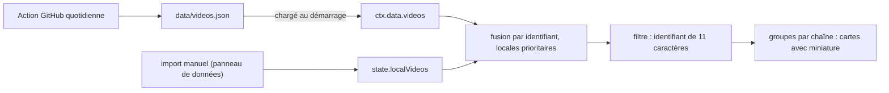

# Onglet Vidéos

**État :** Implémentée · **Vérifiée contre le code :** 2026-10-26

Retour à l'[index des fiches](README.md) · [ARCHITECTURE](../ARCHITECTURE.md) · [GLOSSAIRE](../GLOSSAIRE.md)

## 1. Objectif

Afficher les dernières vidéos des chaînes YouTube choisies par l'étudiant, groupées par chaîne, avec leur miniature, et les ouvrir sur YouTube. La liste est alimentée chaque jour par une Action GitHub, ou à la main par un import.

## 2. Périmètre

**Fait** : lecture de `data/videos.json` ; ajout de vidéos importées à la main ; fusion des deux listes ; regroupement par chaîne ; miniatures ; ouverture sur YouTube ; export et import de l'onglet.

**Ne fait pas** : lire la vidéo dans l'application (aucun lecteur intégré) ; suivre les vidéos vues ; filtrer ou chercher ; supprimer une vidéo isolée ; récupérer les vidéos elle-même (c'est le travail de [socle-automatisations](socle-automatisations.md)).

## 3. Vue d'ensemble technique



## 4. Composants et fichiers concernés

| Chemin | Rôle |
|---|---|
| `js/modules/videos.js` | `render(ctx)` : fusion, filtre, groupes, cartes |
| `data/videos.json` | liste générée par l'Action (fiche [socle-automatisations](socle-automatisations.md)) |
| `js/store.js` | `localVideos` : validation à la lecture (`sanitizeLocal`) et `importLocal` |
| `js/data-io.js` | `parseVideos` (lecture d'un fichier à importer) ; section d'export « Vidéos » |
| `js/ui/data-panel.js` | panneau d'import et d'export de l'onglet |
| `js/dom.js` | `h`, `empty` |
| `css/components.css` | `.vgrid`, `.vcard`, `.vcard__title` |
| `tests/modules.test.js`, `tests/data-io.test.js` | tests |

## 5. Entrées / sorties

**Vidéo** (fichier du dépôt ou liste locale) :

```json
{ "id": "abcdefghijk", "title": "Cours 1", "channel": "Ma chaîne", "published": "2026-10-10T00:00:00Z" }
```

| Champ | Règle |
|---|---|
| `id` | **11 caractères** : lettres, chiffres, `_` ou `-` ; sinon la vidéo est ignorée |
| `title` | texte (« Sans titre » s'il manque) ; 300 caractères au plus pour les vidéos locales |
| `channel` | nom de la chaîne ; « Autres » s'il manque ; 100 au plus (local) |
| `published` | date ISO ; vide ou illisible : aucune date affichée |

**Fichier `data/videos.json`** : `{ "updated": "<date>", "videos": [ … ] }`. **À l'import**, le panneau accepte ce fichier, une simple liste, ou une exportation de l'onglet.

**Liens produits** : page `https://www.youtube.com/watch?v=<id>` (nouvel onglet, `noopener`) ; miniature `https://i.ytimg.com/vi/<id>/mqdefault.jpg`.

**Export** : section « Vidéos » (`localVideos`) : **seulement les vidéos importées à la main**, pas celles de `data/videos.json`.

## 6. Fonctionnement détaillé

```text
FONCTION render(ctx)
  venues du fichier ← ctx.data.videos.videos (ou liste vide)
  toutes ← table par String(id) remplie dans cet ordre : venues du fichier, PUIS state.localVideos      // une vidéo locale remplace celle du fichier de même id
  vidéos ← toutes dont l'id correspond à /^[\w-]{11}$/
  groupes ← par chaîne (String(v.channel) OU 'Autres'), dans l'ordre de première apparition
  SI aucune vidéo : AFFICHER « Aucune vidéo pour l'instant. » + indication « Ajoute tes chaînes dans data/channels.json… »
  SINON POUR CHAQUE groupe : <section> titre = chaîne ; <ul class="vgrid"> une carte par vidéo :
      <a href=page target="_blank" rel="noopener noreferrer">  titre </a>
      date au format « 10 oct. 2026 » (fr-FR), ou rien si la date est illisible

FONCTION importLocal('videos', éléments, mode)                  // js/store.js, appelée par le panneau de données
  garder les éléments à identifiant valide ; fusionner par id (ou remplacer) ; RETOURNER le total
```

L'onglet ne modifie jamais l'état : il n'appelle pas `commit`.

## 7. Dépendances

- **Internes** : `js/dom.js` ; `ctx.data.videos` (chargé par `start()`, voir [socle-interface](socle-interface.md)) ; `state.localVideos`.
- **Externes** : YouTube, uniquement pour ouvrir la vidéo et charger la miniature (`img-src https://i.ytimg.com` dans la CSP).
- **Réseau** : `data/videos.json` est lu « réseau d'abord » par le service worker ([socle-pwa-hors-ligne](socle-pwa-hors-ligne.md)) ; les miniatures, d'un autre site, ne sont **pas** mises en cache.
- **Variable d'environnement** : aucune. **Clé** : `state.localVideos` dans `studenthub:v1`.

## 8. Cas limites et erreurs

| Situation | Comportement |
|---|---|
| aucune vidéo (cas actuel : `data/channels.json` est vide) | message vide avec l'indication de configuration |
| identifiant invalide ou piégé (`"><script>`) | vidéo ignorée, jamais affichée |
| même vidéo dans le fichier et dans l'import | la version locale l'emporte |
| titre contenant du HTML | affiché comme texte |
| date absente ou illisible | pas de date |
| hors ligne | liste du dernier chargement ; **miniatures absentes** (fond gris) ; l'ouverture sur YouTube échoue |
| `data/videos.json` absent ou illisible | l'application démarre avec une liste vide |
| import d'un fichier qui n'est pas une liste d'objets | refusé (le panneau affiche l'erreur) |

## 9. Tests

- Fichiers : `tests/modules.test.js` (« vidéos : groupées par chaîne, ids invalides ignorés » : une seule carte `.vcard`, titre de groupe « Ma chaîne », miniature `https://i.ytimg.com/vi/abcdefghijk/mqdefault.jpg`) ; `tests/data-io.test.js` (formats acceptés par `parseVideos` ; `importLocal('videos', …)` ne garde que les identifiants valides).
- Lancer : `npm test`.
- Ne couvre pas : la priorité des vidéos locales sur celles du fichier, le format de la date, le lien `watch?v=`, l'état vide, le comportement hors ligne.

## 10. Pièges et dette technique

- **La liste est lue une seule fois, au démarrage** : une nouvelle version de `data/videos.json` n'apparaît qu'au prochain chargement de la page.
- **Pas de lecteur intégré** : la CSP n'autorise aucun cadre externe ; chaque vidéo s'ouvre sur YouTube.
- **L'export ne contient pas les vidéos du dépôt** : seules les vidéos importées à la main sont exportées.
- **Pas de suppression individuelle** des vidéos importées : seul un import en mode « Remplacer » vide la liste locale.
- **Deux copies de la règle d'identifiant** : `/^[\w-]{11}$/` est écrite dans `js/modules/videos.js`, `js/store.js` et le script de récupération ; elles doivent rester identiques.
- **Question ouverte** : quelles chaînes suivre ? Tant que `data/channels.json` est vide, l'onglet reste vide.

## 11. Pour modifier ou étendre

1. **Suivre une chaîne** : l'ajouter à `data/channels.json` (voir [socle-automatisations](socle-automatisations.md)).
2. **Ajouter un lecteur intégré** : changer la CSP (cadre YouTube) et écrire une décision d'abord ; aujourd'hui rien ne le permet.
3. **Marquer les vidéos vues** : un tableau d'identifiants dans l'état, comme `read` pour les messages ([messages-hermes](messages-hermes.md)).
4. **Ne pas casser** : le filtre d'identifiant à 11 caractères (il protège l'adresse et l'attribut `src`) ; `rel="noopener noreferrer"` ; les titres rendus en texte.
5. Relancer `npm run build:sw` puis `npm test`.
