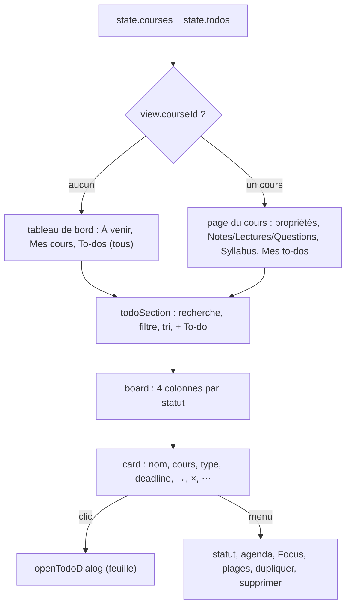

# Onglet Workspace : cours et to-dos (Kanban)

**État :** Implémentée · **Vérifiée contre le code :** 2026-10-26

Retour à l'[index des fiches](README.md) · [ARCHITECTURE](../ARCHITECTURE.md) · [GLOSSAIRE](../GLOSSAIRE.md)

## 1. Objectif

Le centre de la vie d'étudiant : une **page par cours** (professeur, horaires, examen, notes, lectures, questions, syllabus) et un **tableau Kanban** des to-dos (devoirs, lectures, révisions…) avec leurs deadlines. C'est inspiré d'un modèle Notion de gestion des cours.

## 2. Périmètre

**Fait** : tableau de bord (à venir, cours, to-dos) ; page d'un cours ; création, modification, duplication, suppression de cours et de to-dos ; Kanban en quatre colonnes ; recherche, filtre par type, tri ; passage d'un statut à l'autre ; lien d'un to-do avec un cours et avec un événement ; création d'un événement depuis une deadline ; menu contextuel ; export et import de l'onglet.

**Ne fait pas** : glisser-déposer entre colonnes (le bouton « → » et le menu le remplacent) ; sous-tâches de sous-tâches (voir [workspace-sous-taches-et-dependances](workspace-sous-taches-et-dependances.md)) ; rappels propres aux to-dos ; pièces jointes (un simple lien http(s) est possible dans la fiche, voir section 10) ; partage ; historique.

**Depuis le suivi de projets** : la page d'accueil de Workspace a un sélecteur **Tableau · Projets · Rapports** (`modeTabs`, état `view.mode`) ; la carte affiche le compteur de sous-tâches, la pastille « Bloquée » et le projet ; les changements de statut et les suppressions passent par `js/ui/todo-actions.js`. Voir [workspace-projets](workspace-projets.md) et [rapports-et-tableaux-de-bord](rapports-et-tableaux-de-bord.md).

## 3. Vue d'ensemble technique



## 4. Composants et fichiers concernés

| Chemin | Rôle |
|---|---|
| `js/modules/workspace.js` | `render`, `dashboard`, `coursePage`, `syllabus`, `todoSection`, `board`, `card`, `addCourse`, `deadlineBadge`, `showCourse` ; variable de vue `view = { courseId, query, type, sort }` |
| `js/kanban.js` | fonctions pures : `groupByStatus`, `filterTodos`, `sortTodos`, `upcoming`, `todayISO`, `daysUntil` |
| `js/ui/todo-dialog.js` | `openTodoDialog(store, todo, defaults)` : feuille de création et de modification d'un to-do |
| `js/store.js` | `newCourse`, `newTodo`, `eventFromTodo`, `removeCourse`, `seed`, validation à la lecture |
| `js/constants.js` | `STATUSES`, `STATUS_KEY`, `NEXT_STATUS`, `TYPES`, `SEMESTERS`, `SORTS`, `SEED_COURSES` |
| `js/ui/context-menu.js` | menus ([socle-menu-contextuel](socle-menu-contextuel.md)) |
| `css/components.css` | `.course`, `.board`, `.col`, `.card`, `.props`, `.chip--late` |
| `tests/kanban.test.js`, `tests/modules.test.js`, `tests/store.test.js` | tests |

## 5. Entrées / sorties

**Cours** (`state.courses`) :

```json
{ "id": "c1", "name": "Physique", "code": "PHY101", "semester": "Semestre 1", "prof": "…", "exam": "2026-12-15",
  "office": "", "schedule": "", "email": "", "room": "", "notes": "", "readings": "", "questions": "",
  "syllabus": [ { "name": "Plan du cours", "url": "https://exemple.org/plan.pdf" } ] }
```

Au premier lancement, le seed crée les **8 cours de MPC1** : Français, Géométrie, Chimie, Analyse, Physique, Informatique, Dessin technique, Algèbre. Limites à la lecture : nom 200 (« Cours » s'il est vide), code 60, horaire 500, textes `notes`, `readings`, `questions` 50 000, adresses de fichiers 2000.

**To-do** (`state.todos`) :

```json
{ "id": "t1", "name": "Rendre le TP 3", "courseId": "c1", "deadline": "2026-11-05", "file": "", "status": "A faire", "type": "Devoir", "eventId": "", "slots": [],
  "parentId": "", "blockedBy": [], "projectId": "", "effort": 0, "doneAt": "" }
```

| Champ | Valeurs permises |
|---|---|
| `status` | `A faire`, `En cours`, `Terminés`, `Sans statut` (toute autre valeur devient `Sans statut`) |
| `type` | `Devoir`, `Travail de groupe`, `Examen`, `Lecture`, `Révision` (sinon `Devoir`) |
| `name` | 300 caractères ; `deadline` : date `AAAA-MM-JJ` ou vide ; `file` : 2000 |
| `courseId`, `eventId` | identifiants (vides si aucun lien) |
| `slots` | plages de travail ([agenda-plages-de-travail](agenda-plages-de-travail.md)) |
| `parentId`, `blockedBy`, `effort`, `doneAt` | sous-tâche, dépendances, effort estimé, date de fin : [workspace-sous-taches-et-dependances](workspace-sous-taches-et-dependances.md) |
| `projectId` | projet : [workspace-projets](workspace-projets.md) |

**Tris** : Deadline (défaut), Nom, Cours, Statut, Type ; les valeurs vides vont en dernier. **Export** : section « Workspace » (cours et to-dos) ; suppressions suivies pour la synchronisation.

## 6. Fonctionnement détaillé

```text
FONCTION render(ctx)
  cours ← le cours dont l'id = view.courseId ; SI introuvable : view.courseId ← vide
  RETOURNER cours ? coursePage(ctx, cours) : dashboard(ctx)

FONCTION dashboard(ctx)
  « À venir » : upcoming(todos) = les 5 to-dos non terminés avec deadline, les plus proches ; sinon « Rien d'urgent. »
  « Mes cours » : un bouton par cours (nom, semestre · professeur, pastille « Examen <date> ») ; « + Nouveau cours » ; menu : Ouvrir, Ajouter un to-do à ce cours, Dupliquer (« … (copie) »), Copier, Supprimer
  « To-dos » : todoSection pour TOUS les cours

FONCTION coursePage(ctx, c)
  champs texte liés à c (code, professeur, bureau, horaire, e-mail, salle, nom du cours, Notes, Lectures, Questions) : à chaque frappe c.champ ← valeur, puis enregistrement différé de 400 ms (commit silencieux)
  « Année » (semestre) et « Examen » : enregistrés au changement (redessin)
  « Travaux » : les noms des to-dos du cours (informatif) ; « Syllabus » : liste de fichiers { nom, adresse http(s) } ; ajout refusé sans nom ou sans adresse valide : « Nom et lien http(s) requis. »
  « Supprimer le cours » : confirmation « Ses to-dos et notes seront conservés sans cours. » ; removeCourse

FONCTION todoSection(ctx, { courseId })
  barre : recherche (nom), filtre par type, tri, « + To-do »
  board : filtrer (cours, type, recherche) PUIS trier PUIS ranger par statut

FONCTION groupByStatus(todos)  : un tableau par statut ; un statut inconnu va dans « Sans statut »
FONCTION filterTodos(todos, { courseId, type, query }) : cours égal (si donné), type égal (si donné), nom contenant la recherche (sans casse)
FONCTION sortTodos(todos, clé, cours) : tri croissant ; les valeurs vides en dernier
FONCTION upcoming(todos, 5)   : non terminés avec deadline, par date, 5 au plus
FONCTION daysUntil(date)      : jours entre aujourd'hui et la date ; négatif = en retard

FONCTION card(t)
  clic : openTodoDialog ; « → » : statut suivant (A faire → En cours → Terminés ; Sans statut → A faire ; pas de flèche sur Terminés)
  « × » : confirmation puis suppression ; « ⋯ » et clic droit : menu
  menu : Modifier ; Statut : <chaque autre statut> ; Lier à un cours… ; Planifier dans l'agenda ; Démarrer un Focus ;
         Planifier un Focus… ; Planifier mon travail… ; Dupliquer ; Copier ; Supprimer
  « Planifier dans l'agenda » : SI pas de deadline : message « Ajoute d'abord une deadline à ce to-do. » ;
         SINON créer un événement « journée entière » à la deadline dans le premier agenda et le lier

FONCTION openTodoDialog(store, todo, defaults)
  champs : Nom, Cours, Deadline, Fichier (lien), Statut, Type, Événement lié ; boutons « Planifier dans l'agenda » et « Planifier mon travail… »
  « Planifier dans l'agenda » : exige une deadline ; prépare un événement qui ne sera créé qu'à l'enregistrement
  « Planifier mon travail… » : actif seulement si la tâche est déjà enregistrée ET liée à un événement
  onSubmit : « Le nom est obligatoire. » | « Le lien doit commencer par http:// ou https:// » | enregistrer (et créer l'événement préparé) ; « Supprimer » (confirmation) pour un to-do existant
```

**Badge de deadline** : « En retard (<date>) » (rouge), « Aujourd'hui », « Demain », sinon la date ; orangé si l'échéance est dans 2 jours ou moins.

## 7. Dépendances

- **Internes** : `js/dom.js` (`h`, `field`, `select`, `debounce`…), `js/store.js`, `js/kanban.js`, `js/ui/todo-dialog.js`, `js/ui/dialog.js`, `js/ui/context-menu.js`, `showToast`.
- **Liens avec d'autres onglets** : Focus (`prepareSession`, planification de sessions), planificateur de plages, Agenda (événement lié), recherche globale (`showCourse` ouvre un cours), Mémorisation (une leçon peut être rattachée à un cours ; la date d'examen d'une leçon est distincte de celle du cours), Notes (rangées dans un cours).
- **Externe** : aucun. **Variable d'environnement** : aucune.
- **Clés** : `state.courses`, `state.todos` dans `studenthub:v1` ; l'état de vue `view` est en mémoire.

## 8. Cas limites et erreurs

| Situation | Comportement |
|---|---|
| to-do sans nom | refusé : « Le nom est obligatoire. » ; une carte sans nom s'affiche « Sans titre » (import) |
| lien du fichier qui n'est pas `http(s)` | refusé dans la feuille |
| statut ou type inconnu (import) | `Sans statut` / `Devoir` |
| cours supprimé | ses to-dos et ses notes sont **conservés** et passent « sans cours » |
| to-do supprimé | ses plages disparaissent avec lui ; les sessions Focus déjà enregistrées gardent son identifiant |
| deadline passée | pastille « En retard » ; le to-do reste dans sa colonne |
| nom de cours vidé | devient « Cours » |
| cours dupliqué | copie complète du cours (même examen, mêmes textes et syllabus), **sans** ses to-dos |
| plus de 5 to-dos avec deadline | « À venir » n'en montre que 5 |
| recherche | filtre sur le **nom** du to-do uniquement |
| « Planifier dans l'agenda » sans deadline | message, rien n'est créé |

## 9. Tests

- Fichiers : `tests/kanban.test.js` (rangement par statut, statut inconnu, filtres, tris avec valeurs vides en dernier, tri par nom de cours, `upcoming`, `daysUntil`) ; `tests/modules.test.js` (liste des cours et propriétés d'une page, kanban à quatre colonnes, bouton « → », recherche, création par la feuille, nom vide refusé, suppression d'un cours et d'un to-do, to-dos et examens dans l'Agenda) ; `tests/store.test.js` (8 cours MPC1 au départ, `removeCourse` détache to-dos et notes, `newCourse`, nettoyage des valeurs) ; `tests/work.test.js` (menus « Planifier un Focus… » et « Planifier mon travail… »).
- Lancer : `npm test`.
- Ne couvre pas : l'enregistrement différé des champs d'un cours, le syllabus (ajout, refus, retrait), la duplication d'un cours ou d'un to-do, « Planifier dans l'agenda » (carte et feuille), le badge de deadline, le tri dans l'interface, le menu « Statut : … ».

## 10. Pièges et dette technique

- **Corrigé : le lien « Fichier » d'un to-do est affiché.** La carte du kanban montre un bouton « ↗ » (lien `<a>` avec `rel="noopener noreferrer"`, ouvert dans un nouvel onglet) et le menu propose « Ouvrir le fichier ». Seuls les liens `http://` et `https://` sont rendus (un `javascript:` importé est ignoré). Le lien n'apparaît pas sur la page du cours ni dans l'Agenda.
- **« Planifier dans l'agenda » utilise toujours le premier agenda de la liste**, pas l'agenda par défaut choisi dans Paramètres ([socle-parametres](socle-parametres.md)).
- **La recherche ne porte que sur le nom** des to-dos (pas le cours, ni l'événement).
- **Pas de retour arrière par « → »** : pour remettre un to-do « A faire », il faut le menu « Statut : … » ou la feuille.
- **Les champs d'un cours sont enregistrés 400 ms après la dernière frappe** : fermer l'onglet du navigateur dans ce délai peut perdre les dernières lettres (même mécanisme que les notes, [notes](notes.md)).
- **Le nom du cours est modifié à chaque frappe** : le vider fait passer le nom à « Cours » dans l'état.
- **Dupliquer un cours duplique aussi son examen** : l'Agenda affiche alors deux examens le même jour.
- **« Travaux » (page du cours) est une liste de pastilles non cliquables**.
- **Le tableau de bord montre tous les to-dos**, y compris ceux d'un cours ; la page d'un cours ne montre que les siens.
- **Les statuts sont figés** : quatre statuts, non modifiables par l'étudiant.

## 11. Pour modifier ou étendre

1. **Nouveau statut ou type** : ajouter la valeur à `STATUSES` (et `STATUS_KEY`, `NEXT_STATUS`) ou `TYPES` dans `js/constants.js` ; la validation de `js/store.js` et le tableau s'adaptent ; ajouter une classe `col--…` / `tag--…` dans le CSS.
2. **Afficher le lien du fichier** : l'ajouter à la carte avec `safeUrl` et `rel="noopener noreferrer"`.
3. **Glisser-déposer** : ajouter des gestionnaires de pointeur sur `.card` et les colonnes (voir [agenda-glisser](agenda-glisser.md) pour le principe du geste) ; garder « → » et le menu comme alternatives.
4. **Nouvel élément lié à un cours** : ajouter `courseId` à sa validation et le détacher dans `removeCourse` (`js/store.js`).
5. **Ne pas casser** : le détachement (et non la suppression) des to-dos et notes d'un cours supprimé ; la validation du lien http(s) ; la limite de 4 statuts connus ; l'enregistrement différé silencieux.
6. Relancer `npm run build:sw` puis `npm test`.
