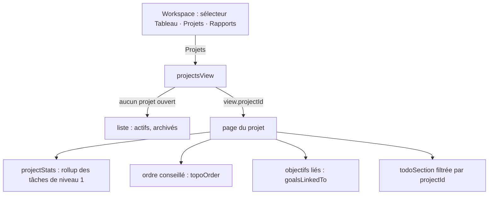

# Workspace : projets

**État :** Implémentée · **Vérifiée contre le code :** 2026-10-30

Retour à l'[index des fiches](README.md) · [ARCHITECTURE](../ARCHITECTURE.md) · [GLOSSAIRE](../GLOSSAIRE.md)

## 1. Objectif

Regrouper des to-dos pour un **travail borné** (un dossier, la révision d'un partiel), suivre son avancement, voir l'ordre conseillé quand des tâches dépendent les unes des autres, et le relier à un objectif.

## 2. Périmètre

**Fait** : liste des projets (actifs, archivés repliés), création, page d'un projet (nom, cours, échéance, couleur, archivage), avancement, ordre conseillé, objectifs liés, kanban filtré par projet, champ « Projet » dans la fenêtre du to-do, pastille de projet sur les cartes, suppression qui conserve les tâches.

**Ne fait pas** : sous-projets ; partage ; modèles de projet ; budget ; chronologie.

## 3. Vue d'ensemble technique



## 4. Composants et fichiers concernés

| Chemin | Rôle |
|---|---|
| `js/modules/projects.js` | `projectsView`, `projectStats`, liste, ligne de projet, feuille de création, page du projet |
| `js/modules/workspace.js` | sélecteur de vue (`modeTabs`), `showProject`, `todoSection` et `board` qui acceptent un `projectId` |
| `js/store.js` | `newProject`, `sanitizeProjects`, `removeProject`, `removeCourse` (vide `courseId` des projets) |
| `js/tombstones.js`, `js/data-io.js` | `projects` suivi pour les suppressions ; inclus dans la section d'export `workspace` |
| `js/kanban.js` | `filterTodos` accepte `projectId` |
| `js/tasks-logic.js` | `projectTodos`, `rollup` |
| `tests/projects.test.js`, `tests/e2e/projects.e2e.py` | tests |

## 5. Entrées / sorties

```json
{ "id": "p1", "name": "Dossier d'informatique", "courseId": "c6", "deadline": "2026-12-01", "color": "teal", "archived": false }
```

`name` : 300 caractères (« Projet » si vide) ; `color` : une des couleurs d'agenda (sinon `blue`) ; `deadline` : date ou vide ; `courseId` : identifiant ou vide. Une tâche porte `projectId` ; un `projectId` inconnu est vidé à la lecture. **Export** : section « Workspace » (cours, to-dos, projets).

## 6. Fonctionnement détaillé

```text
FONCTION projectStats(projet, tâches)
  mine ← tâches du projet ; niveau1 ← celles sans parent
  RETOURNER { ratio : rollup(mine), done : niveau1 terminées, total : niveau1 }

FONCTION projectsView(ctx, view, helpers)
  SI view.projectId ne désigne aucun projet : view.projectId ← vide
  RETOURNER page du projet SI ouvert, sinon liste

FONCTION page du projet
  en-tête : « ← Projets », « Supprimer le projet » (confirmation : les to-dos sont conservés)
  propriétés : cours, échéance (+ pastille), couleur, archivé ; modifications enregistrées au changement
  « Avancement » : barre + « N tâches terminées sur M · P % »
  « Objectifs liés » : objectifs automatiques dont les liens contiennent ce projet
  « Ordre conseillé » : seulement si ≥ 2 tâches ouvertes et au moins une dépendance ; topoOrder des tâches ouvertes
  « Mes to-dos » : kanban filtré ; « + To-do » préremplit le projet et le cours du projet
```

## 7. Dépendances

- **Internes** : `js/tasks-logic.js`, `js/deps-logic.js`, `js/goals-logic.js`, `js/ui/context-menu.js`, `js/ui/dialog.js`.
- **Liens** : [workspace-cours-et-todos](workspace-cours-et-todos.md), [workspace-sous-taches-et-dependances](workspace-sous-taches-et-dependances.md), [objectifs-et-conseils](objectifs-et-conseils.md), [socle-import-export](socle-import-export.md), [socle-synchronisation](socle-synchronisation.md).
- **Clés** : `state.projects` dans `studenthub:v1` ; l'état de vue (mode, projet ouvert) est en mémoire.

## 8. Cas limites et erreurs

| Situation | Comportement |
|---|---|
| projet sans tâche | avancement 0 %, message « Ajoute des to-dos… » |
| projet supprimé | ses tâches sont conservées, sans projet ; un marqueur évite sa résurrection à la fusion |
| cours supprimé | `courseId` des projets vidé |
| import d'un ancien fichier Workspace sans `projects` | les projets existants sont conservés |
| projet supprimé sur un autre appareil | `projectId` des tâches vidé à la lecture |
| nom vidé | « Projet » |
| projet archivé | replié dans la liste ; absent de la liste de choix des nouvelles tâches |
| objectif relié à un projet supprimé | « Lien cassé » ([objectifs-et-conseils](objectifs-et-conseils.md)) |

## 9. Tests

`tests/projects.test.js` : validation à la lecture, `removeProject` et `removeCourse`, `projectStats`, filtre, marqueur de suppression et fusion, export et import, sélecteur sans 13e onglet, création et page d'un projet, archivés. Navigateur réel : `tests/e2e/projects.e2e.py`.

## 10. Pièges et dette technique

- La vue de Workspace (`view`) est un objet de module : elle garde son état d'un test à l'autre (voir `showProject(null)` dans les tests).
- `projects.js` reçoit `todoSection` et `deadlineBadge` en paramètre pour éviter un import circulaire avec `workspace.js`.
- Un projet n'a pas de suivi de ses propres objectifs : le lien va de l'objectif vers le projet, dans un seul sens ([ADR-023](../decisions/023-projets-collection-legere.md)).

## 11. Pour modifier ou étendre

- Un nouveau champ de projet : `newProject`, `sanitizeProjects`, la page du projet, un test de lecture.
- Un nouveau type d'élément relié à un objectif : `linkRatio` dans `js/goals-logic.js` et le sélecteur de la fenêtre d'objectif.
