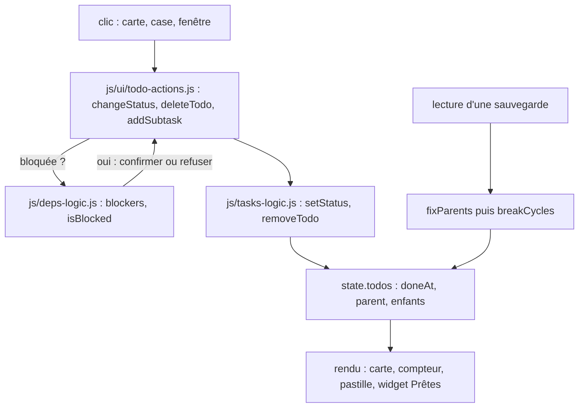

# Workspace : sous-tâches et dépendances

**État :** Implémentée · **Vérifiée contre le code :** 2026-10-30

Retour à l'[index des fiches](README.md) · [ARCHITECTURE](../ARCHITECTURE.md) · [GLOSSAIRE](../GLOSSAIRE.md)

## 1. Objectif

Découper un travail en **sous-tâches** (un seul niveau), dire qu'une tâche doit **attendre** une autre (dépendance), et connaître ce qu'on peut faire **maintenant**. La progression d'un parent se calcule seule ; terminer une tâche dit ce qu'elle débloque.

## 2. Périmètre

**Fait** : sous-tâches (création depuis le menu de la carte, champ rapide sous la carte, fenêtre du to-do) ; compteur « 3/5 » et barre d'avancement ; fermeture automatique du parent ; dépendances « bloquée par » avec refus des boucles ; pastille « Bloquée » ; confirmation avant de démarrer ou terminer une tâche bloquée (ou refus en mode strict) ; message « Débloque : … » ; widget « Prêtes à démarrer » ; `effort` estimé et date de fin `doneAt` ; ordre conseillé (tri topologique) dans la page d'un projet.

**Ne fait pas** : sous-tâches de sous-tâches ([ADR-020](../decisions/020-un-seul-niveau-de-sous-taches.md)) ; calcul de la date d'un parent à partir de ses sous-tâches ; chemin critique, chronologie (Gantt) ; règles d'automatisation ; dépendances vers un autre utilisateur.

## 3. Vue d'ensemble technique



## 4. Composants et fichiers concernés

| Chemin | Rôle |
|---|---|
| `js/tasks-logic.js` | logique pure : `children`, `canNest`, `parentChoices`, `subCounts`, `itemProgress`, `rollup`, `setStatus`, `openChildren`, `inheritFromParent`, `removeTodo`, `fixParents` |
| `js/deps-logic.js` | logique pure : `blockers`, `isBlocked`, `dependents`, `wouldCycle`, `checkBlock`, `breakCycles`, `ready`, `earliestStart`, `conflicts`, `topoOrder` |
| `js/ui/todo-actions.js` | actions partagées par Workspace, Home, Agenda et Focus : `changeStatus`, `deleteTodo`, `addSubtask` |
| `js/ui/todo-dialog.js` | champs « Sous-tâche de », « Effort estimé », « Bloquée par » (cases grisées si une boucle se formerait) |
| `js/modules/workspace.js` | carte (compteur, barre, pastille, liste repliable `subPanel`), regroupement sous le parent |
| `js/store.js` | champs `parentId`, `blockedBy`, `effort`, `doneAt` dans `newTodo` et la validation à la lecture |
| `js/settings-logic.js`, `js/modules/settings-ui.js` | réglages `work.autoCloseParent` et `work.strictDeps` |
| `css/components.css` | `.card--stack`, `.card__subs`, `.chip--blocked`, `.card--blocked`, `.deps` |
| `tests/tasks.test.js`, `tests/deps.test.js`, `tests/e2e/projects.e2e.py` | tests |

## 5. Entrées / sorties

```json
{ "id": "t1", "name": "Dossier", "status": "En cours", "parentId": "", "blockedBy": ["t0"], "effort": 120, "doneAt": "" }
```

| Champ | Règle à la lecture |
|---|---|
| `parentId` | identifiant d'une tâche **de niveau 1** existante, différente de la tâche ; sinon `''` |
| `blockedBy` | 20 identifiants au plus, existants, sans doublon, sans soi-même, sans parent ni enfant ; les liens qui ferment une boucle sont abandonnés |
| `effort` | minutes entières, 0 à 6000 (0 = non estimé) |
| `doneAt` | date `AAAA-MM-JJ`, conservée seulement si le statut est « Terminés » |

Réglages : `settings.work.autoCloseParent` (défaut `true`), `settings.work.strictDeps` (défaut `false`).

## 6. Fonctionnement détaillé

```text
FONCTION setStatus(état, id, statut, { today, cascade })
  tâche ← celle d'identifiant id ; SI introuvable ou statut inconnu : RETOURNER rien
  appliquer(tâche, statut) : si le statut change → statut ← nouveau ; doneAt ← (statut = Terminés ? today : '')
  SI cascade ET statut = Terminés : appliquer(Terminés) à chaque sous-tâche
  SI la tâche a un parent avec des sous-tâches :
      SI toutes les sous-tâches sont terminées ET parent pas terminé ET autoCloseParent : parent → Terminés
      SINON SI une sous-tâche ne l'est pas ET parent terminé : parent → En cours

FONCTION changeStatus(store, tâche, statut)
  SI statut ∈ {En cours, Terminés} ET statut change ET blockers(tâche) non vide :
      SI strictDeps : message « Bloquée par … », RETOURNER faux
      SINON confirmer « Cette tâche attend … » ; Annuler → RETOURNER faux
  SI statut = Terminés ET sous-tâches ouvertes : confirmer « Terminer aussi N sous-tâches ? » ; Annuler → RETOURNER faux
  setStatus ; SI des tâches en attente ne sont plus bloquées : message « Débloque : … »

FONCTION isBlocked(t) = un de ses blocages existe et n'est pas terminé
                       OU (parent non terminé ET parent bloqué)
FONCTION wouldCycle(x, y)  ← ajouter « x bloquée par y » ?
  parcours en profondeur depuis y en suivant « bloquée par » ; si on atteint x → boucle
FONCTION breakCycles(tâches)  ← à la lecture ; ordre du tableau
  pour chaque tâche, pour chaque blocage : l'abandonner s'il est inconnu, doublon, soi-même, parent↔enfant,
  ou si le blocage dépend déjà (même indirectement) de la tâche ; sinon le garder
FONCTION ready(tâches) = non terminées, pas « Sans statut », sans sous-tâche ouverte, non bloquées ;
                         tri : deadline croissante (vide en dernier), puis nombre de tâches débloquées décroissant, puis nom
FONCTION topoOrder(liste) = algorithme de Kahn ; départage par deadline ; une boucle résiduelle ajoute les tâches restantes à la fin
FONCTION deleteTodo(store, tâche)
  confirmer ; SI sous-tâches : confirmer « Supprimer aussi N sous-tâches ? » (Annuler : elles deviennent des tâches de niveau 1)
  removeTodo retire aussi l'identifiant de tous les blockedBy
```

## 7. Dépendances

- **Internes** : `js/store.js`, `js/constants.js` (`STATUSES`), `js/kanban.js` (`todayISO`), `js/reminders.js` (`showToast`), `js/ui/dialog.js`.
- **Liens** : [workspace-cours-et-todos](workspace-cours-et-todos.md) (carte, fenêtre), [workspace-projets](workspace-projets.md) (progression et ordre conseillé), [rapports-et-tableaux-de-bord](rapports-et-tableaux-de-bord.md) (effort, `doneAt`), [socle-widgets-et-home](socle-widgets-et-home.md) (widget « Prêtes à démarrer »).
- **Externe** : aucun. **Clés** : `state.todos` dans `studenthub:v1`.

## 8. Cas limites et erreurs

| Situation | Comportement |
|---|---|
| sous-tâche dont le parent est masqué par un filtre | garde sa propre carte avec la pastille « ↳ parent » |
| parent supprimé | « Supprimer aussi N sous-tâches ? » : Annuler les garde comme tâches de niveau 1 |
| `parentId` orphelin, à deux niveaux ou en boucle (import) | ramené à `''` |
| lien qui créerait une boucle | case grisée avec la raison ; refus à l'enregistrement ; coupé à la lecture |
| deux appareils créent chacun un lien qui forme une boucle une fois réunis | un seul des deux liens survit (ordre du tableau) |
| bloqueur supprimé | son identifiant est retiré de tous les `blockedBy` |
| tâche terminée avant cette version | `doneAt` vide : pas de date de fin |
| parent terminé à la main avec sous-tâches ouvertes | demande de terminer aussi ; Annuler ne change rien |
| sous-tâche rouverte alors que le parent est terminé | le parent repasse « En cours » |
| `Dupliquer` un parent | copie la tâche seule, pas ses sous-tâches |

## 9. Tests

`tests/tasks.test.js` : un seul niveau, progression, `rollup` sans double compte, `doneAt`, fermeture et réouverture du parent, cascade, suppression, `fixParents`, validation à la lecture, actions de l'interface, carte repliable. `tests/deps.test.js` : blocage et héritage, boucles directes et indirectes, limite de 20, fusion de deux appareils, `ready`, `earliestStart`, `conflicts`, `topoOrder`, confirmation, mode strict, message « Débloque », fenêtre. Navigateur réel : `tests/e2e/projects.e2e.py`.

## 10. Pièges et dette technique

- Le lien abandonné par `breakCycles` n'est pas signalé à l'utilisateur.
- La date d'un parent ne suit pas celle de ses sous-tâches (voulu).
- La liste « Bloquée par » peut être longue : elle défile dans la fenêtre (12 rem).
- `Dupliquer` copie `blockedBy` et `parentId` : la copie est bloquée par les mêmes tâches.
- Les widgets d'un utilisateur qui a personnalisé Home sont complétés une seule fois (voir [socle-widgets-et-home](socle-widgets-et-home.md)).

## 11. Pour modifier ou étendre

- Une nouvelle règle de statut va dans `setStatus` (logique pure, testée), jamais dans un `onclick`.
- Tout endroit de l'interface qui change un statut passe par `changeStatus`.
- Pour un second niveau de sous-tâches, il faut une nouvelle décision qui remplace [ADR-020](../decisions/020-un-seul-niveau-de-sous-taches.md).
- Pour des règles d'automatisation, partir de `dependents` et du message « Débloque ».
